# Allumi

Logiciel de comptabilité **open source** et **auto-hébergeable** pour les PME et les travailleurs autonomes du Québec et du Canada. Une alternative libre aux logiciels de comptabilité infonuagiques propriétaires.

> **État : pré-alpha.** Le squelette (premier démarrage, connexion, vérification en deux étapes, interface FR/EN, Docker), le moteur comptable (plan comptable, journal, périodes, audit) et la base des affaires (contacts, produits et services, TPS/TVQ, réglages de l'entreprise) sont en place. Les factures, les paiements, les achats et les rapports arrivent ensuite ([feuille de route](docs/Feuille-de-route.md)). N'utilise pas Allumi pour de la comptabilité réelle avant une version stable.

*English summary: Allumi is an open-source, self-hostable accounting app for Canadian small businesses (QST/GST aware, French-first, bilingual). The repo ships a Docker Compose stack, an Ubuntu install script, encrypted backups and a full wiki in `docs/`. Application code is in pre-alpha.*

## Aperçu

<p align="center">
  <picture>
    <source media="(prefers-color-scheme: dark)" srcset="docs/images/tableau-de-bord-sombre.png">
    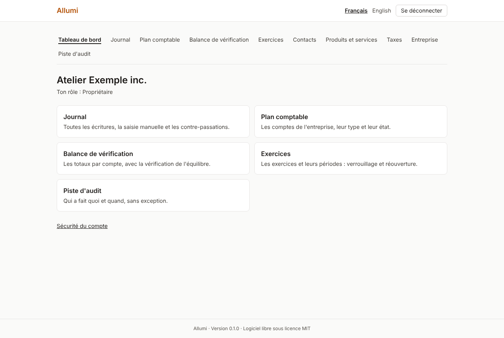
  </picture>
</p>

Captures de l'entreprise de démonstration « Atelier Exemple inc. » (données fictives), produites par `npm run screenshots`. L'interface suit le thème clair ou sombre du système et existe en français et en anglais.

| | |
|---|---|
| 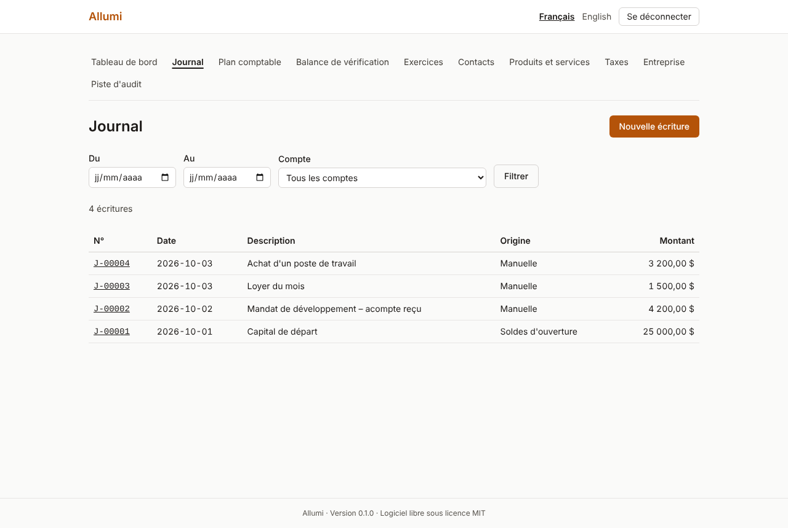<br>**Journal** : écritures à partie double, numérotées sans trou, jamais modifiées (contre-passation). | 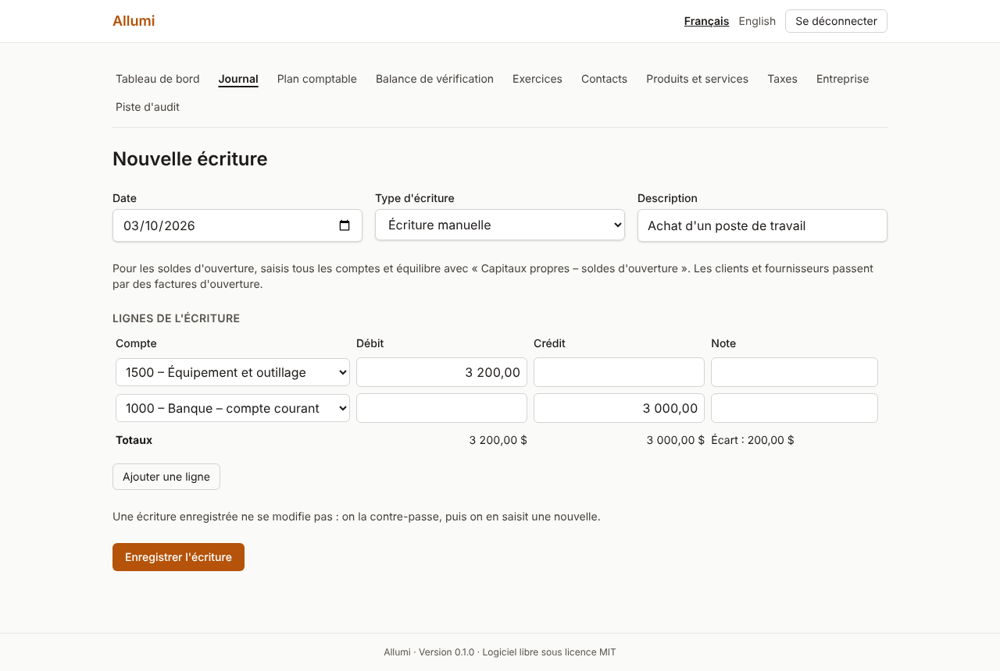<br>**Saisie d'une écriture** : l'écart s'affiche en direct, une écriture déséquilibrée est refusée. |
| 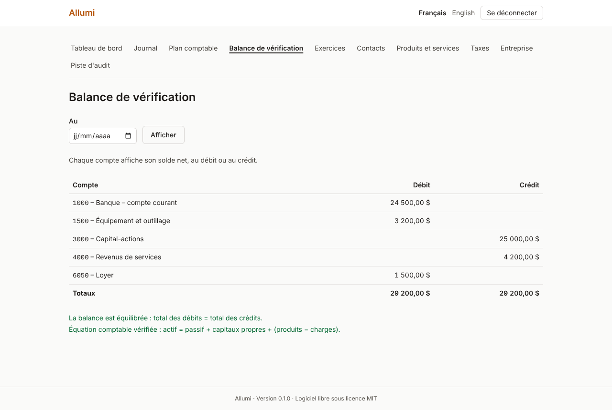<br>**Balance de vérification** : soldes nets par compte, équilibre et équation comptable vérifiés. | 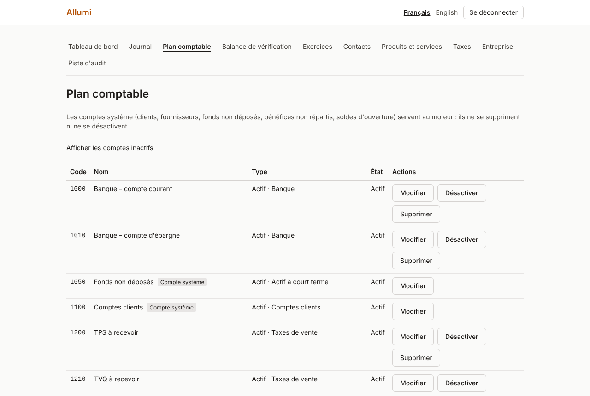<br>**Plan comptable** : 47 comptes bilingues de départ, comptes système protégés. |
| 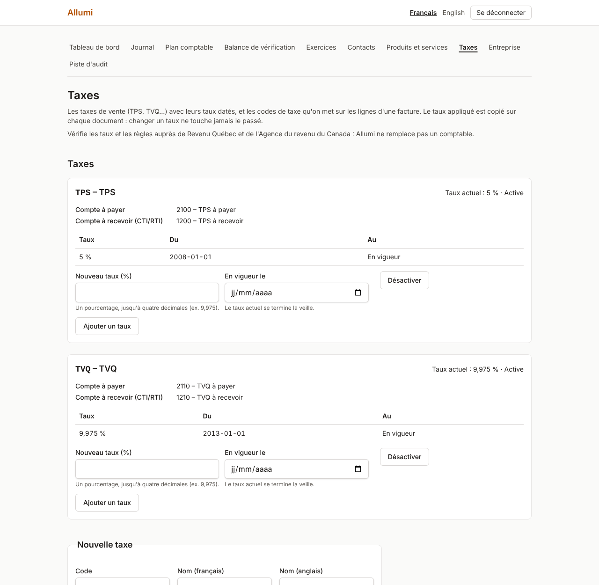<br>**Taxes** : TPS et TVQ du Québec en un clic, taux datés, codes de taxe. | 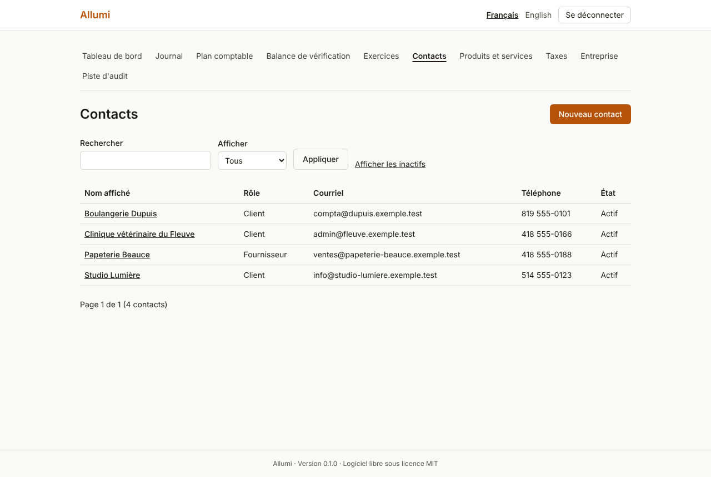<br>**Contacts** : clients et fournisseurs, effacement des renseignements personnels (Loi 25). |
| 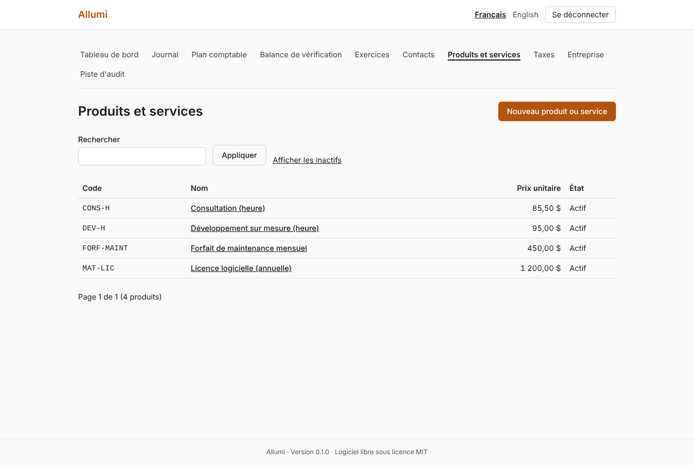<br>**Produits et services** : prix à six décimales, compte de revenus et taxe par défaut. | 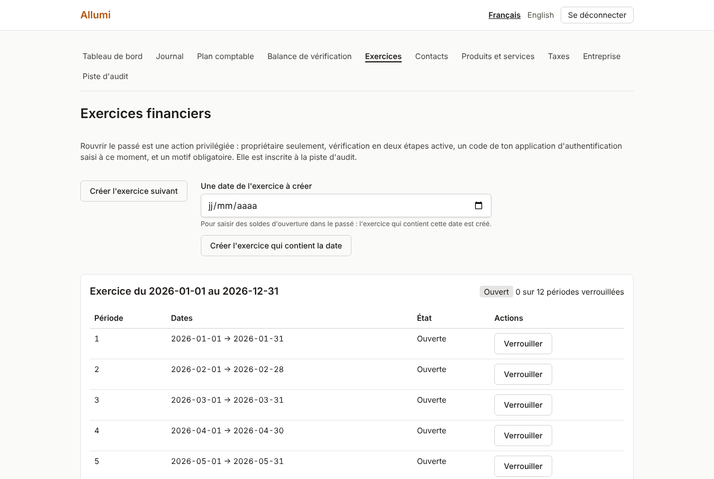<br>**Exercices et périodes** : verrouillage, fermeture, réouverture protégée (2FA, code, motif). |
| 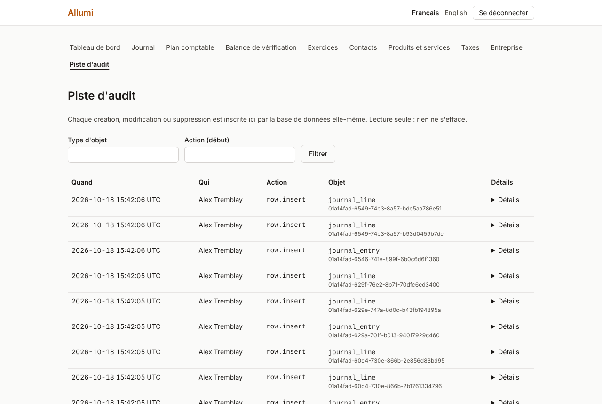<br>**Piste d'audit** : qui a fait quoi et quand, écrite par la base de données. | 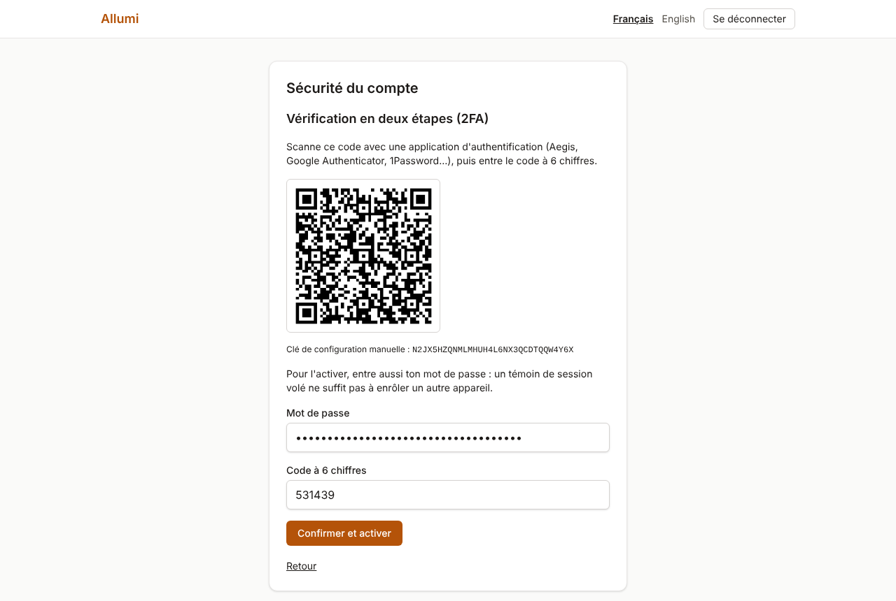<br>**Sécurité du compte** : vérification en deux étapes (TOTP) et codes de récupération. |

Une visite guidée complète : [`docs/Visite-guidee.md`](docs/Visite-guidee.md).

## Fonctions visées (MVP)
- Plan comptable et journal à partie double
- Clients, fournisseurs, factures, paiements, dépenses
- Rapprochement bancaire (CSV/OFX)
- TPS/TVQ avec taux configurables
- Rapports : balance de vérification, bilan, état des résultats, âge des comptes
- Multi-entreprise, rôles, piste d'audit
- Interface en français (par défaut) et en anglais

## Installation rapide (Ubuntu 22.04/24.04)

Prérequis : un serveur Ubuntu avec accès root, un nom de domaine dont l'enregistrement DNS pointe vers le serveur.

```bash
# Remplace OWNER par ton compte ou ton organisation GitHub
git clone https://github.com/OWNER/allumi.git /opt/allumi
cd /opt/allumi
sudo ./scripts/install.sh --domain compta.exemple.ca --email admin@exemple.ca
```

Le script installe Docker, configure le pare-feu, génère les secrets, démarre la pile (PostgreSQL, application, Caddy avec HTTPS automatique) et planifie des sauvegardes chiffrées quotidiennes. Détails : [`docs/Installation.md`](docs/Installation.md).

## Développement local

```bash
cp .env.example .env                              # puis adapte-le (voir la page ci-dessous)
docker compose -f docker-compose.dev.yml up -d   # PostgreSQL + Mailpit
npm install && npm run db:migrate && npm run dev
```

Voir [`docs/Developpement-local.md`](docs/Developpement-local.md). Pour développer dans le cloud (Claude Code sur le web, sans Docker) : [`docs/Developpement-cloud.md`](docs/Developpement-cloud.md).

## Documentation
Le dossier [`docs/`](docs/) est le wiki du projet : installation, exploitation, guide d'utilisation, règles comptables, architecture, conventions. Point de départ : [`docs/Home.md`](docs/Home.md); pour découvrir l'application : [`docs/Visite-guidee.md`](docs/Visite-guidee.md). La commande `scripts/sync-wiki.sh` le publie sur le wiki GitHub (images comprises).

## Contribuer
Lis [`CONTRIBUTING.md`](CONTRIBUTING.md). Pour signaler une faille de sécurité : [`SECURITY.md`](SECURITY.md).

## Avertissement
Allumi est un outil. Il ne remplace ni un comptable professionnel ni un avis juridique ou fiscal. Les taux et règles de taxes doivent être vérifiés auprès de Revenu Québec et de l'Agence du revenu du Canada. Chaque exploitant d'une instance est responsable de la conformité de son usage (dont la Loi 25 sur la protection des renseignements personnels).

## Licence
[MIT](LICENSE)
