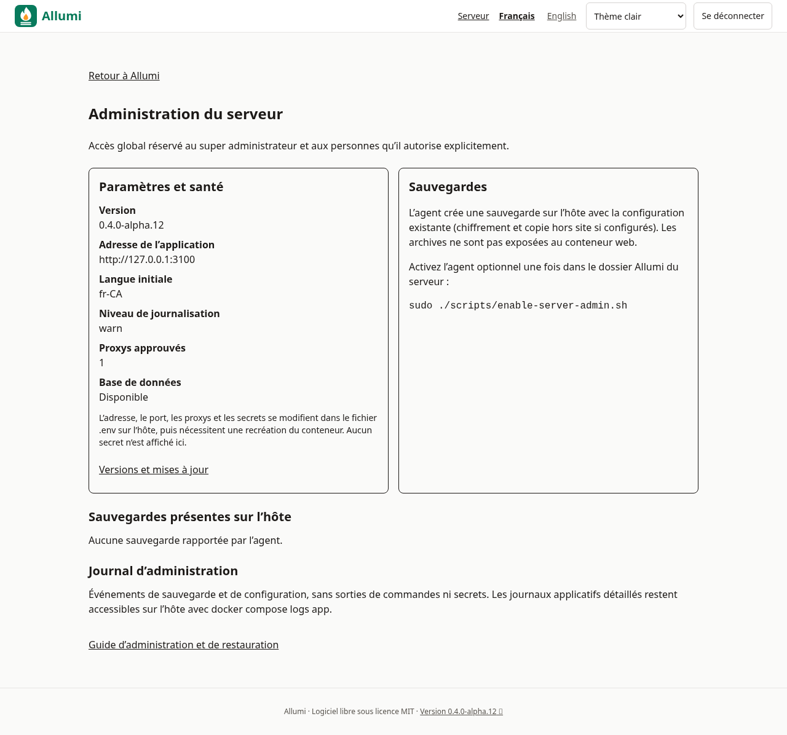
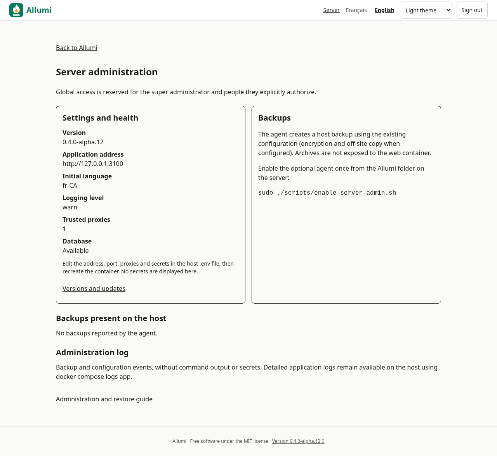

# Administration du serveur

L’entrée **Serveur** de l’en-tête ouvre `/administration/serveur`. Elle est réservée au super admin et aux personnes auxquelles il a explicitement accordé ce droit global dans [[Utilisateurs-et-permissions]]. Un admin d’entreprise seul n’y a pas accès.

## Paramètres et santé

L’écran montre la version, l’adresse de l’application, la langue initiale, le niveau de journalisation, le nombre de proxys approuvés et la disponibilité de PostgreSQL. Aucun mot de passe, jeton d’installation, clé de chiffrement ou identifiant SQL n’est envoyé au navigateur.

La rétention des sauvegardes se règle dans l’interface après activation de l’agent (1 à 3650 jours). Le nettoyage prend effet à la prochaine sauvegarde réussie. Les paramètres réseau, ports, langues de démarrage et secrets restent configurés dans `.env` sur l’hôte, puis appliqués avec `docker compose up -d app`. Ne pas modifier les secrets d’une instance existante sans suivre [[Configuration]] et [[Sauvegardes]].

Les mises à jour se trouvent dans [[Mise-a-jour]] et la page **Version**; l’agent de mise à jour doit être activé séparément. Les opérateurs serveur délégués peuvent aussi demander une mise à jour.

## Activer les sauvegardes depuis le web

Sur un hôte Linux avec Docker et systemd, depuis le clone installé et avec l’application démarrée :

```bash
cd /opt/allumi
sudo ./scripts/enable-server-admin.sh
```

L’agent est optionnel. Il utilise un petit répertoire dans le volume de stockage existant, sans modifier `compose.override.yaml`, sans monter le socket Docker dans l’application et sans lui donner les identifiants propriétaire de PostgreSQL. L’activation renseigne `ALLUMI_SERVER_ADMIN_ENABLED=1` et recrée le conteneur. Mettre ce drapeau seul ne suffit pas à installer l’agent.

Le timer traite les demandes sous environ une minute. **Sauvegarder maintenant** appelle le script de sauvegarde existant, avec chiffrement `age` et copie hors site si vous les avez configurés. La liste montre les 100 archives les plus récentes présentes dans `BACKUP_DIR`, leurs tailles et dates. L’état indique sa date d’observation; recharger la page pour le rafraîchir. Les demandes expirent après cinq minutes et ne peuvent contenir que les opérations prévues, jamais une commande ou un chemin libre. L’agent partage son verrou avec celui des mises à jour.

Les archives restent sur l’hôte : pas de téléchargement ni de restauration depuis le navigateur. La restauration se fait avec la procédure contrôlée de [[Sauvegardes]]. Les répertoires de contrôle des agents sont exclus de la sauvegarde afin de ne pas rejouer d’anciennes demandes.

## Journaux

L’interface présente le journal des opérations de sauvegarde et de rétention : date, opération, succès/échec. Les sorties de commandes et détails potentiellement sensibles ne sont jamais exposés. Les demandes sont aussi enregistrées dans l’audit global avec leur acteur.

Pour diagnostiquer un échec sur l’hôte :

```bash
sudo systemctl status allumi-server-admin.timer
sudo journalctl -u allumi-server-admin.service
sudo docker compose logs --tail=200 app migrate
```

Les journaux détaillés de l’application ne sont pas diffusés dans le navigateur. Une opération échouée peut être relancée après correction de la configuration sur l’hôte.

## Mettre à jour ou désactiver l’agent

Après revue d’une nouvelle version, relancer `sudo ./scripts/enable-server-admin.sh` remplace la copie de l’agent et actualise son service. Pour désactiver :

```bash
sudo systemctl disable --now allumi-server-admin.timer
# Dans .env : ALLUMI_SERVER_ADMIN_ENABLED=0
sudo docker compose up -d app
```

Le Dockerfile reste non privilégié; la pile standard reste composée de l’application HTTP, PostgreSQL privé et du service ponctuel de migrations. Aucun SSL intégré n’est ajouté.

## Captures




