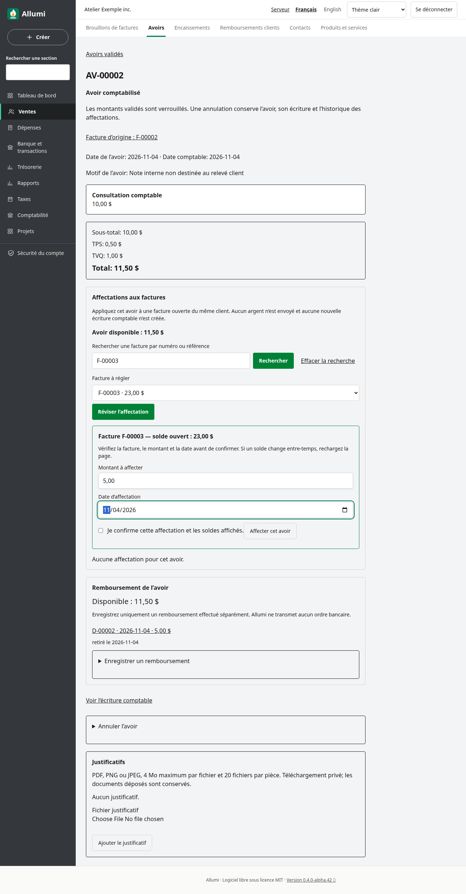
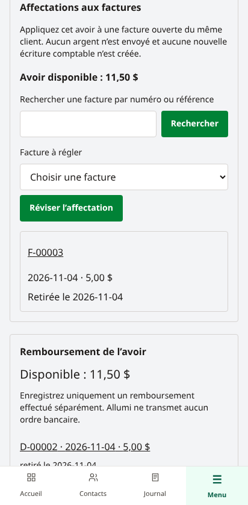
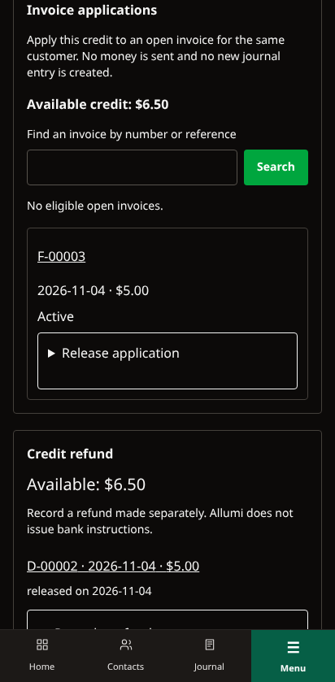

# Affectation des avoirs clients

Un avoir validé disposant encore d’un montant disponible peut régler, en tout ou en partie, une facture ouverte du **même client**. L’affectation réduit le disponible de l’avoir et le solde restant de la facture du même montant. Elle ne modifie ni leurs totaux ni leurs taxes.

**Aucun argent n’est envoyé et aucune nouvelle écriture comptable n’est créée.** La facture et l’avoir ont déjà été comptabilisés; cette opération associe leurs soldes. Pour comptabiliser un remboursement effectué séparément, consulter [[Avoirs-disponibles-et-remboursements]].

## Choisir et vérifier la facture

1. Ouvrir **Avoirs → Avoirs validés**, puis la fiche d’un avoir validé. Dans **Affectations aux factures**, vérifier **Avoir disponible**. Les formulaires sont proposés uniquement si l’avoir reste validé et si vos droits permettent l’opération.
2. Utiliser **Rechercher une facture par numéro ou référence**, puis **Rechercher** si nécessaire. Le choix présente au maximum les 50 premières factures admissibles; préciser la recherche pour en retrouver une autre. **Effacer la recherche** revient au choix initial.
3. Sous **Facture à régler**, choisir une facture puis **Réviser l’affectation**. Seules les factures validées, encore ouvertes et appartenant au même client sont proposées. Une facture ayant déjà une affectation active de cet avoir est exclue; une autre facture du même client peut être choisie si un disponible demeure.
4. Vérifier le numéro et le solde ouvert de la facture. Saisir le **Montant à affecter** et la **Date d’affectation**. Le montant proposé est le plus petit du disponible de l’avoir et du solde de la facture; il peut être réduit pour une affectation partielle.
5. Cocher **Je confirme cette affectation et les soldes affichés.**, puis **Affecter cet avoir**.

Exemple : un avoir disponible de 80,00 $ affecté à hauteur de 30,00 $ à une facture ouverte de 100,00 $ laisse 50,00 $ disponibles sur l’avoir et 70,00 $ à payer sur la facture. Le total des comptes clients au grand livre reste inchangé par cette seule affectation.

Les **deux soldes affichés**, celui de l’avoir et celui de la facture, sont revérifiés sous verrou à la confirmation. Si un paiement, un remboursement ou une autre affectation les a modifiés, Allumi refuse le formulaire périmé : recharger la fiche et revoir la facture et le montant. Une facture qui n’est plus proposée doit être recherchée et sélectionnée à nouveau. Un deuxième envoi ne doit pas servir à ajouter un montant à une affectation déjà active : désaffecter d’abord celle-ci, puis revoir le nouveau montant.

## Consulter et désaffecter

La section **Affectations aux factures** conserve les factures liées, montants, dates et états actifs ou retirés. L’historique est paginé par 25 affectations; **Précédent** et **Suivant** conservent la recherche. Le numéro de facture ouvre sa fiche.

Pour retirer une affectation active, ouvrir **Désaffecter**, saisir la **Date de désaffectation**, cocher **Je confirme la désaffectation de ce montant.**, puis confirmer avec **Désaffecter**. Le montant redevient disponible sur l’avoir et à payer sur la facture. Il n’y a ni transfert de fonds ni nouvelle écriture.

L’affectation originale reste conservée avec sa date de retrait; elle n’est pas supprimée. Une demande de désaffectation répétée conserve le premier retrait, sans changer sa date ni rendre le montant disponible deux fois. Une nouvelle affectation peut ensuite être préparée, avec les soldes et dates actualisés.

## Dates, accès et contrôles

- L’affectation ne peut être future, précéder la comptabilisation de l’avoir ou de la facture, ni le dernier mouvement d’affectation ou de libération concernant ces pièces. La désaffectation ne peut précéder l’affectation ni un mouvement ultérieur. La date doit appartenir à une période fiscale ouverte.
- Cette chronologie protège aussi les encaissements et les remboursements liés aux pièces. Un encaissement ou son retrait ne peut être antidaté avant le dernier mouvement d’affectation ou de retrait de la facture; la même règle s’applique aux remboursements et à leurs retraits pour l’avoir. Sinon, les soldes d’un rapport à une date passée pourraient devenir incohérents. Choisir une date admissible dans une période ouverte plutôt que modifier un mouvement historique.
- Le montant doit être positif et ne dépasser ni le disponible de l’avoir, net des affectations et remboursements actifs, ni le solde ouvert de la facture. Un brouillon, un document annulé ou une facture d’un autre client est refusé.
- La consultation exige **Ventes** et **Comptabilité** en lecture. Affecter ou désaffecter exige la gestion des ventes et la validation des écritures, correspondant aux accès en écriture de ces deux modules. Aucun droit Contacts supplémentaire n’est requis : le parcours utilise les pièces de vente déjà autorisées.
- Une affectation active sur une autre facture bloque l’annulation de l’avoir. La désaffecter explicitement avant de reprendre l’annulation; le parcours d’annulation ne retire pas automatiquement cette affectation. Un remboursement actif doit aussi être traité séparément.
- Les contrôles de date, de période, de droits et de concurrence sont renforcés en base. La migration `20261108000000_customer_credit_applications` est nécessaire; la procédure standard [[Mise-a-jour]] l’applique via le service de migration, sans réécrire les pièces historiques.

Le parcours est disponible en français et en anglais, sur ordinateur et téléphone, avec les thèmes clair et sombre.

Voir aussi [[Validation-des-avoirs]], [[Releve-de-compte-client]], [[Utilisateurs-et-permissions]] et [[Schema-de-donnees]].
