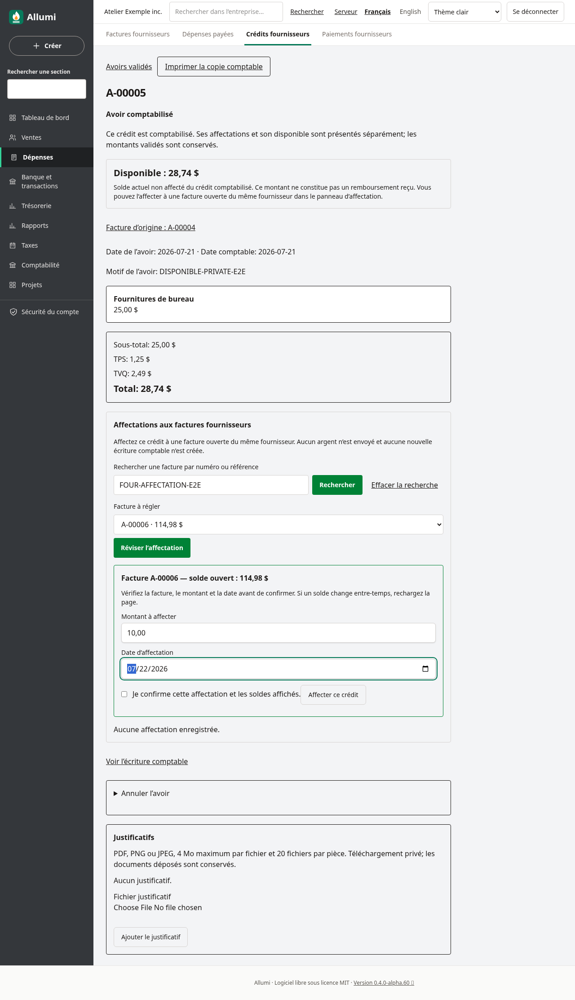
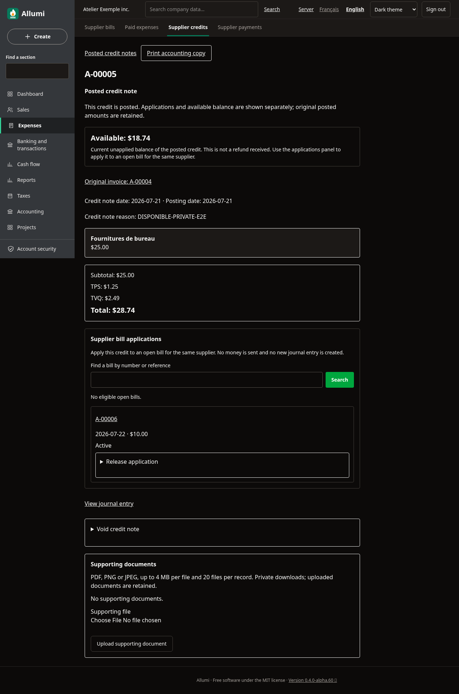
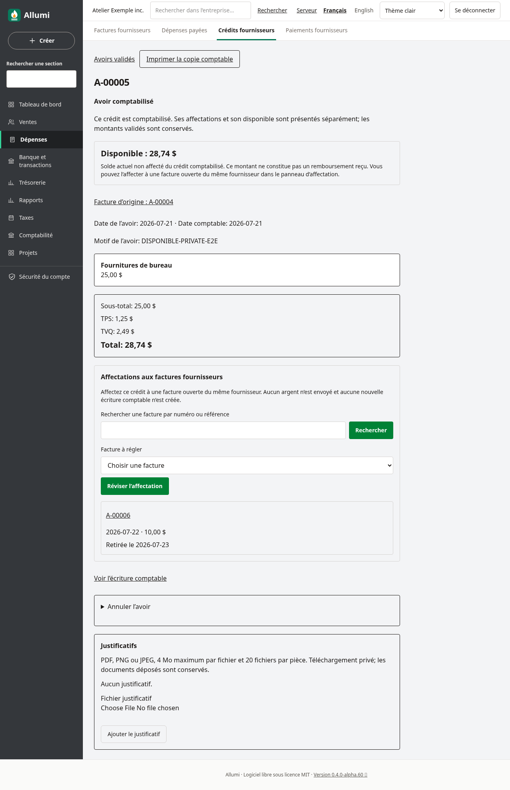
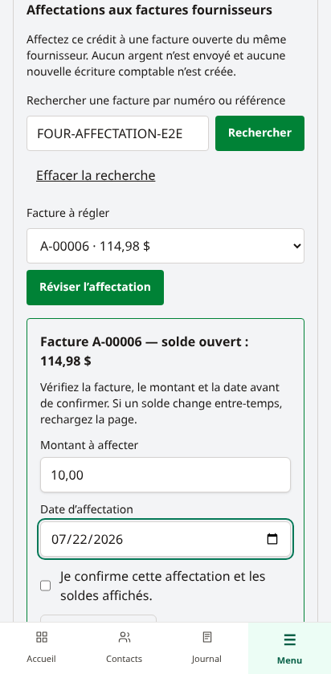
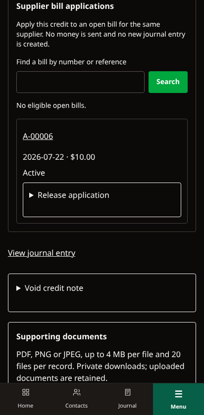
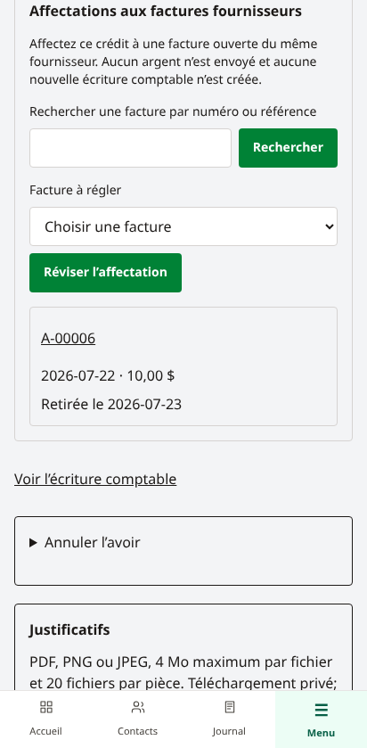

# Affecter un crédit fournisseur à une facture

Depuis **Dépenses → Crédits fournisseurs → Avoirs validés**, ouvrir un crédit dont le disponible est positif. Le panneau **Affectations aux factures fournisseurs** propose les factures validées, encore à payer, du même fournisseur et de la même entreprise. Une affectation ne transmet aucun argent et ne crée aucune écriture comptable supplémentaire : la facture et le crédit ont déjà été comptabilisés.

## Choisir et confirmer

1. Rechercher par numéro interne ou référence fournisseur. Les caractères `%`, `_` et `\` sont recherchés littéralement. Les 50 premières factures sont proposées; préciser la recherche si nécessaire.
2. Choisir la **Facture à régler**, puis **Réviser l’affectation**.
3. Vérifier son solde, le montant et la **Date d’affectation**. Le montant doit être positif et couvert par le disponible du crédit et le solde de la facture.
4. Cocher la confirmation, puis **Affecter ce crédit**.

Exemple : un crédit disponible de **28,74 $** peut régler **10,00 $** d’une autre facture de **114,98 $**. Le crédit conserve **18,74 $** disponibles et la facture reste à payer pour **104,98 $**. Les taxes originales ne sont pas recalculées.

Les soldes sont revérifiés sous verrou au moment de confirmer. Si un paiement, une autre affectation ou un retrait les a modifiés, actualiser et réviser à nouveau. Un seul lien actif est permis pour le même couple crédit/facture; pour modifier son montant, le désaffecter puis créer une nouvelle affectation.

## Désaffecter sans effacer l’historique

Dans l’affectation active, ouvrir **Désaffecter**, saisir la date, cocher la confirmation et valider. Le montant redevient disponible sur le crédit et dû sur la facture. L’affectation d’origine et sa date de retrait restent visibles; un nouvel envoi du même retrait ne modifie pas cette date. L’historique affiche 25 affectations par page, actives et retirées.

La date d’affectation ou de retrait doit appartenir à une période comptable ouverte, ne pas être future, et suivre les dates comptables et le dernier règlement, affectation ou retrait sur les pièces concernées. Cela empêche de dépenser rétroactivement une disponibilité restaurée plus tard.

Une affectation active bloque l’annulation de la facture cible. Pour annuler un crédit affecté à une autre facture, retirer d’abord cette affectation. L’affectation initiale à la facture source peut être retirée par l’annulation du crédit selon les contrôles habituels. Voir [[Factures-fournisseurs]].

## Rapports, droits et mise à jour

L’[[Age-des-comptes-fournisseurs]] utilise les dates d’affectation et de retrait. Un rapport antérieur au retrait conserve l’affectation. Le [[Releve-de-compte-fournisseur]] suit les écritures du grand livre : une affectation sans nouvelle écriture ne change ni ses mouvements ni son solde net. Le solde fournisseur reste rapproché avec le grand livre. Le [[Sommaire-des-taxes]] conserve les écritures originales et les contre-passations dans leurs périodes; une affectation seule ne modifie aucune taxe.

**Comptabilité en lecture** permet de consulter le disponible et l’historique. **Comptabilité en écriture** permet l’affectation et le retrait, sans exiger l’accès aux répertoires Contacts, Taxes ou Ventes. Toutes les lectures et modifications restent isolées par entreprise.

La migration `20261118000000_supplier_credit_applications` ajoute des gardes SQL de chronologie, de période ouverte et de sérialisation. Elle n’ajoute aucune table ni colonne. Le service de migration doit être exécuté lors de la mise à jour habituelle; les opérations concernées exigent l’isolation PostgreSQL **READ COMMITTED**, également utilisée par l’application. Voir [[Schema-de-donnees]] et [[Mise-a-jour]].

Les remboursements reçus sont disponibles dans [[Remboursements-fournisseurs]]. Les taxes partiellement récupérables restent indisponibles. Ce parcours utilise des crédits liés à une facture source; il ne crée pas de crédit autonome ni d’ordre bancaire.

