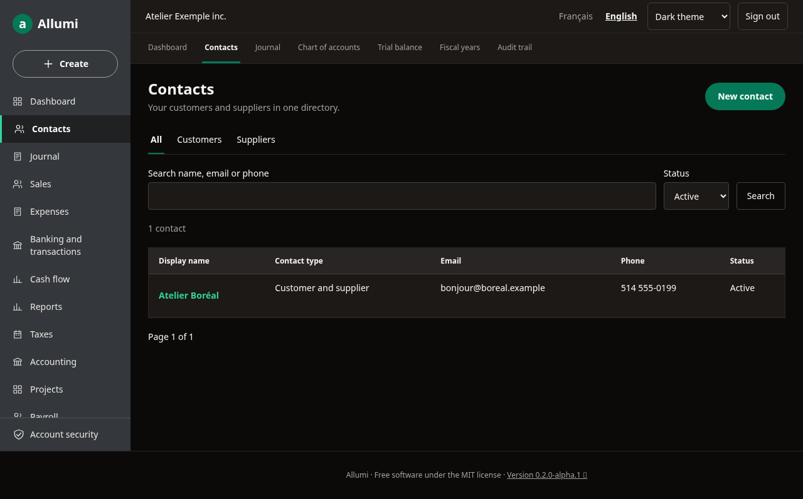
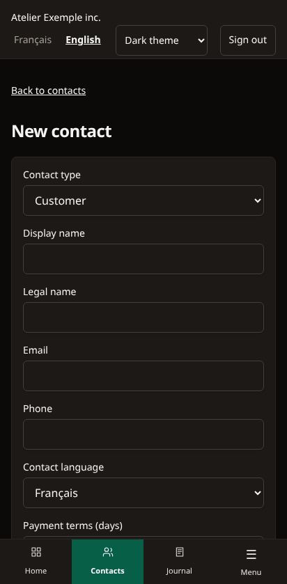

# Appearance and language

Allumi is available in **English** and **French**. Choose **English** in the header to switch the interface without changing the company or its accounting data. Your browser remembers the language. Account names from the starter chart have English and French labels; names and notes entered by your team remain as written.

## Choose your theme

The header includes an **Appearance** selector on desktop and mobile:

- **Light theme** always uses light surfaces, even when your device is in dark mode.
- **Dark theme** uses dark surfaces for the dashboard, contacts, tables, forms and navigation.
- **System theme** follows your device and responds when its appearance changes. This is the default.

Your choice is saved in a browser cookie for up to a year and is applied by the server when the page loads. Browser, Windows client and iOS home-screen app may have separate cookies, so choose your preference in each. Clearing cookies restores the system default. The setting does not change anyone else's account or device.

On iPhone, open your HTTPS server in Safari, use **Share → Add to Home Screen**, then launch Allumi from its icon. A server connection is required. The installation manifest uses the interface language selected in that browser. See [[Application-mobile]] for installation details.

## Reference screens

These are real screenshots from the fictional browser-test company. Mobile screenshots use Chromium emulation; they do not certify Safari or a physical iPhone. Theme selection, persistence, device-theme overrides and English navigation are covered by browser tests.
