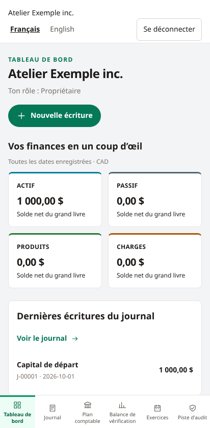
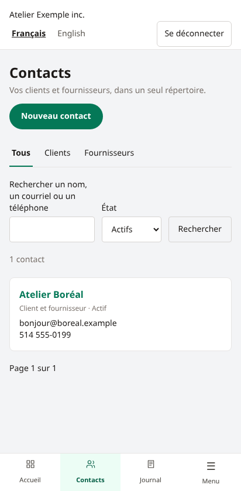

# Application mobile iOS

Sur iPhone ou iPad, ouvrir l’adresse **HTTPS** du serveur Allumi dans **Safari**, toucher **Partager**, puis **Sur l’écran d’accueil** et **Ajouter**. Si Safari propose « Ouvrir comme app web », laisser cette option activée. Le nom et l’icône Allumi apparaissent sur l’écran d’accueil.

Lancer ensuite Allumi depuis cette icône et se connecter. Une nouvelle connexion peut être nécessaire après l’ajout : la session de l’app web peut être distincte de celle de Safari. La navigation mobile donne accès au tableau de bord, aux contacts et à la comptabilité; le menu complet rassemble les autres rubriques.

L’application fonctionne **en ligne**. Elle ne conserve pas de copie hors ligne de la comptabilité. Après une mise à jour du serveur, fermer puis rouvrir l’application pour charger la nouvelle interface. Les versions se consultent depuis le pied de page, lien **Version** : voir [[Mise-a-jour]]. Aucun passage par l’App Store n’est nécessaire.

## Autorité HTTPS locale

Sur une instance par IP utilisant Caddy local, installer le certificat public vérifié puis activer sa confiance complète dans iOS avant d’ajouter l’app : [[HTTPS-local]]. Le profil téléchargé se gère dans Réglages → Général → VPN et gestion de l’appareil; la confiance complète dans Général → Informations → Réglages des certificats. Ne pas ignorer les avertissements de Safari. Une nouvelle IP ou une autorité remplacée peut nécessiter une nouvelle configuration et l’actualisation de l’icône.

## Références

Ces captures proviennent des tests Chromium à largeur mobile. L’ajout réel à l’écran d’accueil et le comportement de Safari restent à vérifier sur un iPhone physique; une émulation Chromium ne valide pas iOS.
