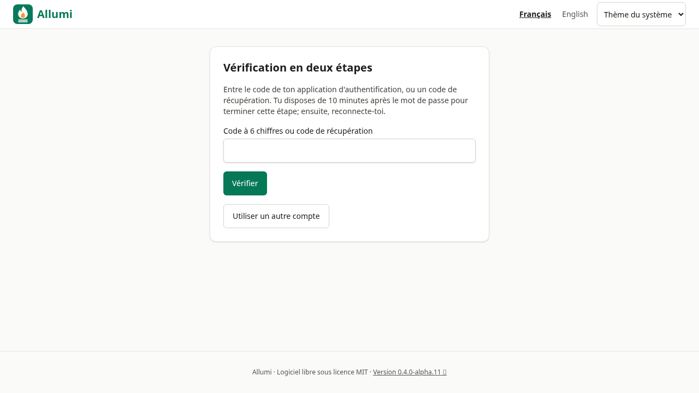
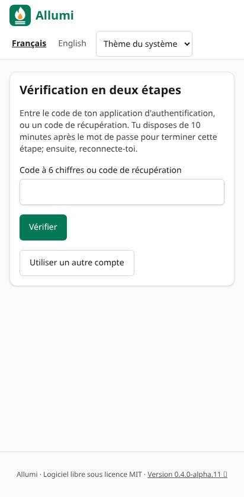
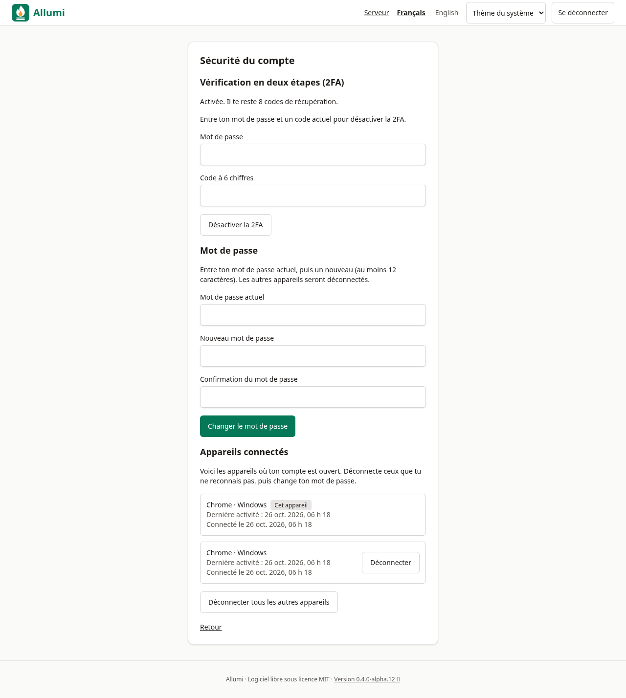
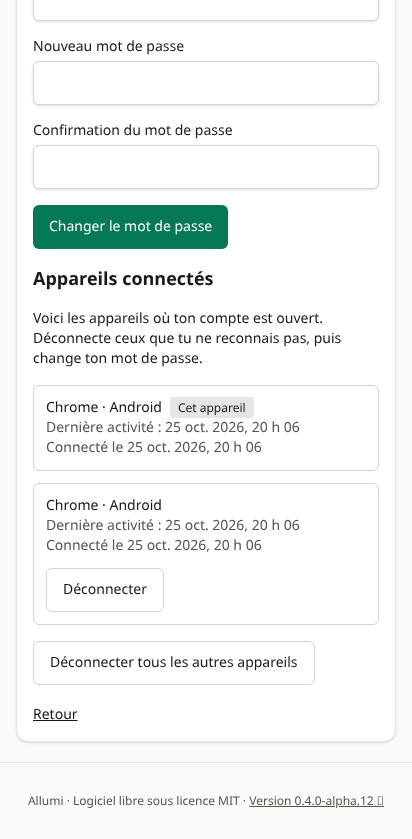
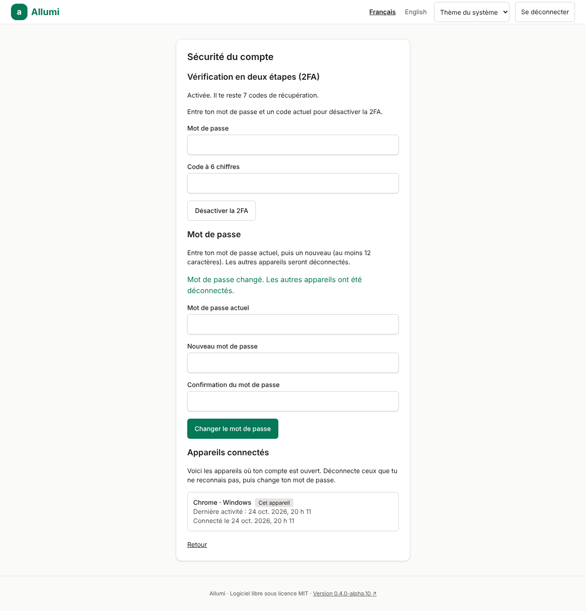
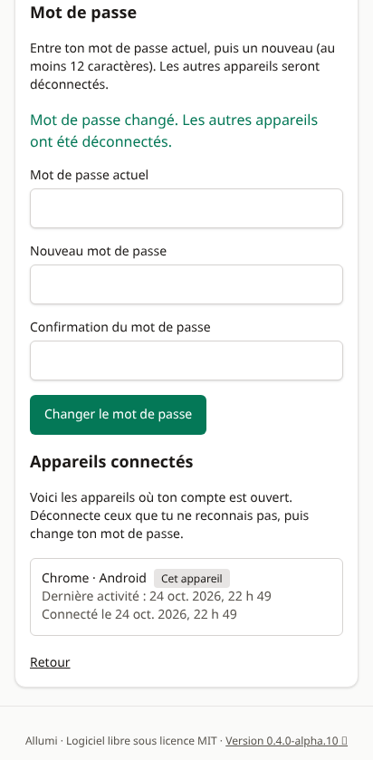

# Authentification

## Connexion
- Courriel et mot de passe. Les mots de passe sont hachés avec **argon2id** (paramètres recommandés par l'OWASP) et ne sont jamais journalisés.
- Une adresse inconnue, un mauvais mot de passe et un compte verrouillé donnent la **même réponse** (« Courriel ou mot de passe incorrect, ou compte temporairement verrouillé »), et prennent à peu près le même temps (l'écart résiduel est de quelques millisecondes, et le nombre d'essais par courriel est limité) : ces mesures réduisent les possibilités d’énumération des comptes sans garantir un temps de réponse constant.
- **Limitation de débit** (dans PostgreSQL, sans service externe) : 8 essais par courriel et 30 par adresse IP en 15 minutes. Les clés sont des empreintes HMAC : ni les adresses IP ni les courriels ne sont conservés.
- **Verrouillage** du compte pendant 15 minutes après 10 échecs de suite. Quand le verrou expire, le compteur repart à zéro. Compromis assumé : quelqu'un qui connaît ton courriel peut te faire attendre quelques minutes, mais personne ne peut deviner ton mot de passe en continu, d'où qu'il vienne.
- Chaque échec est inscrit à la piste d'audit et visible par la personne visée.

## Sessions
- Cookie `httpOnly`, `SameSite=Lax`, et `Secure` en HTTPS. En production (HTTPS), il porte le préfixe `__Host-` : il n'est valable que pour ton domaine exact.
- La base ne conserve que l'**empreinte SHA-256** du jeton : une fuite de la base ne permet pas de voler des sessions.
- Une connexion en attente de la 2FA expire **10 minutes après le mot de passe**, même si la page reste active. Recommencer la connexion si le délai est dépassé.
- Fermeture après **8 heures d'inactivité** ou **14 jours** au total.
- À la connexion depuis un navigateur qui n'a encore aucune langue choisie (nouvel appareil), la **langue enregistrée dans ton compte** est appliquée. Une langue choisie dans ce navigateur n'est jamais écrasée.
- « Se déconnecter » supprime la session côté serveur et efface le cookie.
- **Sécurité du compte → Appareils connectés** liste les sessions ouvertes (navigateur et système déduits de l’en-tête User-Agent, dernière activité, date de connexion) et permet de **déconnecter un appareil** ou **tous les autres**. Seul ton propre compte est visible; l’appareil courant n’est jamais fermé depuis cette liste (utilise « Se déconnecter »). Une connexion encore en attente de la 2FA y figure, marquée comme telle. Chaque déconnexion est inscrite à la piste d’audit (sans jeton ni identifiant de session).
- Activer ou désactiver la 2FA **déconnecte tous les autres appareils**, et une session vérifiée avant la désactivation ne saute pas la deuxième étape si tu réactives la 2FA.

## Changer le mot de passe
**Sécurité du compte → Mot de passe** demande le **mot de passe actuel**, puis le nouveau deux fois : un témoin de session volé ne suffit pas à prendre le compte. Le nouveau mot de passe suit la même règle qu’à l’installation (au moins 12 caractères, pas ton courriel) et doit différer de l’actuel.
- Le changement **déconnecte tous les autres appareils** dans la même transaction; l’appareil courant reste ouvert. Les verrous de compte et les codes de récupération ne changent pas.
- Les essais sont limités (8 par 15 minutes et par compte, réussis ou non), et deux changements simultanés sont sérialisés : un seul peut réussir.
- La piste d’audit note le changement et chaque refus du mot de passe actuel, jamais les mots de passe.

## Vérification en deux étapes (TOTP)
Compatible avec toute application d'authentification (Aegis, Google Authenticator, 1Password, etc.).
1. **Sécurité du compte → Activer la 2FA**. L'activation demande ton **mot de passe** en plus du code : un témoin de session volé ne suffit pas à enrôler l'appareil de quelqu'un d'autre (la clé en attente reste lisible sur la page tant qu'elle n'est pas confirmée).
2. Scanne le code QR (ou saisis la clé), puis entre le code à 6 chiffres pour confirmer.
3. Les **10 codes de récupération** s'affichent **une seule fois** : conserve-les en lieu sûr. Chacun ne sert qu'une fois.

Détails de sécurité :
- Le secret est **chiffré** (AES-256-GCM) avec `ENCRYPTION_KEY` : voir [[Configuration]]. Perdre cette clé rend les secrets illisibles.
- Un code déjà accepté **ne peut pas être rejoué** (RFC 6238, §5.2). Activation, remplacement du secret en attente, vérification et désactivation sont sérialisés par utilisateur; deux demandes concurrentes ne peuvent pas accepter le même état.
- À la connexion, la consommation du code et l’autorisation de la session sont atomiques. Une session expirée, révoquée, d’un autre utilisateur ou d’un compte désactivé est refusée avant de consommer un code de récupération.
- Les tentatives de code sont limitées (8 par 15 minutes).
- Pour **désactiver** la 2FA, il faut le mot de passe et un code actuel.
- **Rouvrir une période ou un exercice** ([[Exercices-et-periodes]]) et **anonymiser un contact** ([[Contacts]]) demandent aussi un code saisi à ce moment, même si la session est déjà vérifiée : un témoin de connexion volé ne suffit pas à rouvrir le passé ni à effacer une personne. Chaque essai de code, à la connexion ou pour une action privilégiée, compte dans la même limite de 8 essais par 15 minutes.
- Tant que la deuxième étape n'est pas faite, la session ne donne accès qu'à la page de vérification.

## Ce qui n'est pas encore là
Réinitialisation du mot de passe par courriel et invitations de membres arrivent avec les modules suivants (voir [[Feuille-de-route]]). Si tu perds ton mot de passe et tes codes de récupération, un administrateur de l'instance doit intervenir directement dans la base.

## Rôles
Les droits sont appliqués **par la base de données**, pas seulement par l'interface :

| | Propriétaire | Comptable | Lecture seule |
|---|:-:|:-:|:-:|
| Consulter les données | ✓ | ✓ | ✓ |
| Saisir et valider | ✓ | ✓ | — |
| Gérer les membres et l'entreprise (prévu, interface non livrée) | ✓ | — | — |
| Consulter la piste d'audit | ✓ | ✓ | — |

Voir aussi [[Architecture]] et [[Securite-et-Loi-25]].

## Écran de vérification

Captures issues de données fictives, avant saisie du code; aucune clé TOTP ni aucun code de récupération n’est affiché.

## Appareils connectés — références visuelles

Ces fonctions sont disponibles à partir de v0.4.0-alpha.11.

Dans **Sécurité du compte**, consulter les appareils puis déconnecter celui qui n’est plus utilisé. Le navigateur et le système affichés proviennent de l’en-tête envoyé par le client : ce sont des indications, pas une identification matérielle garantie. Le badge **Cet appareil** indique la session conservée.

## Changement de mot de passe — références visuelles

Saisir le mot de passe actuel puis le nouveau deux fois. Après confirmation, les autres appareils doivent se reconnecter; la session utilisée pour le changement reste ouverte. Les captures montrent la confirmation après effacement des champs.

Captures produites par les tests avec une entreprise fictive. Aucun mot de passe, jeton de session, secret TOTP ni code de récupération n’est affiché.
