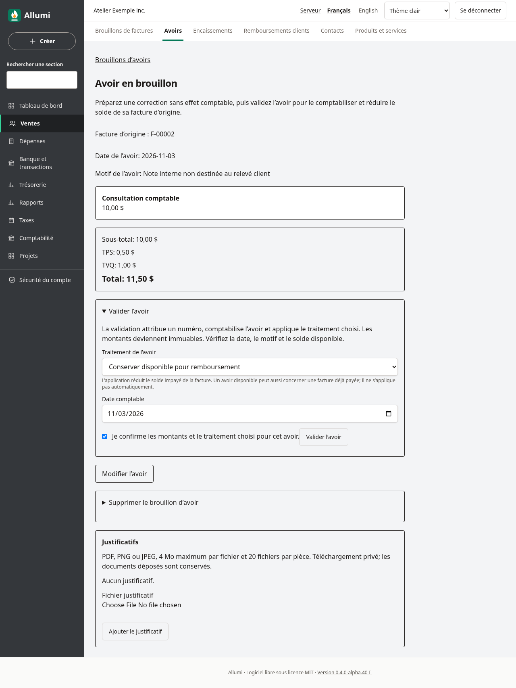
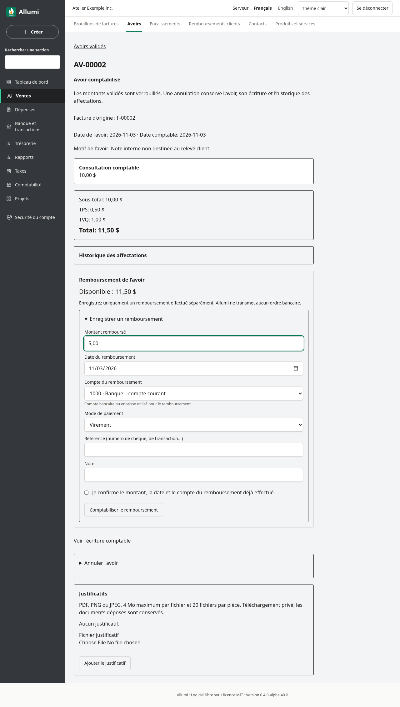
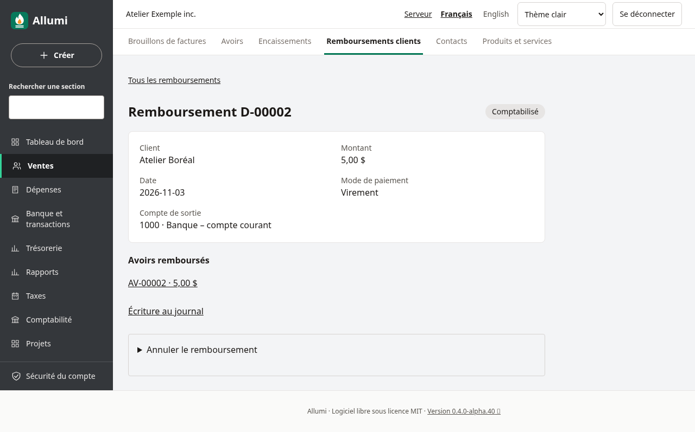
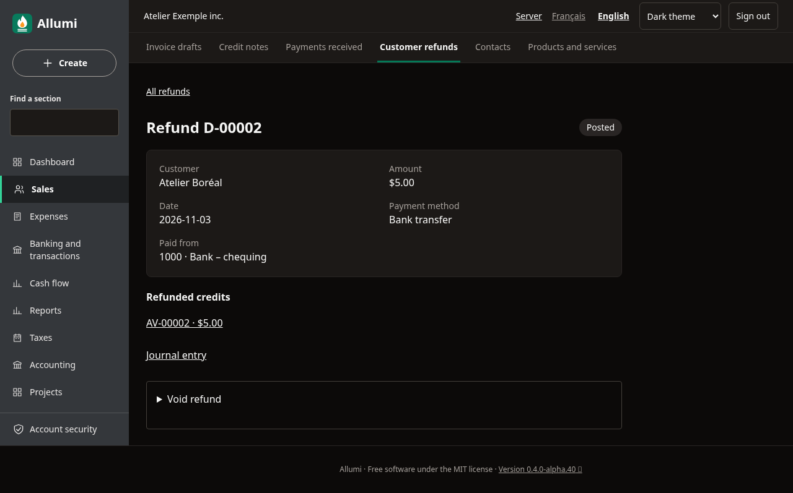
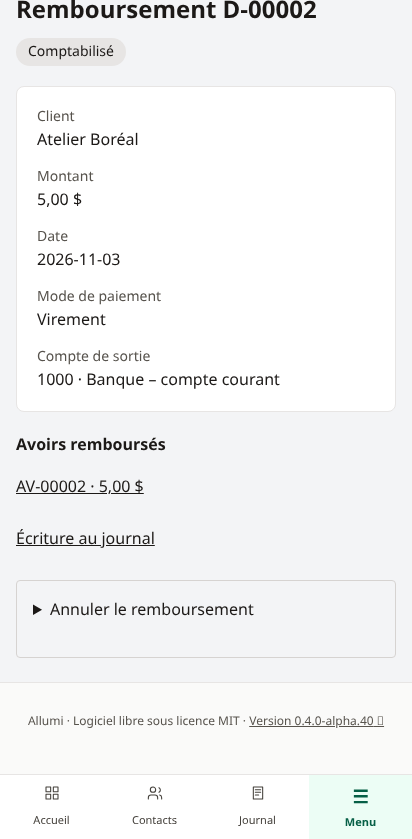

# Avoirs disponibles et remboursements clients

Depuis une facture validée, **Préparer un avoir** conserve le lien avec les lignes et taxes d’origine. La validation propose deux traitements :

- **Appliquer à la facture source** (*Apply to source invoice*) réduit son solde impayé. C’est le choix proposé par défaut.
- **Conserver disponible pour remboursement** (*Keep available for refund*) comptabilise l’avoir sans l’affecter. Ce choix fonctionne aussi lorsque la facture est déjà payée.

La somme des avoirs validés reste limitée aux montants et taxes de la facture d’origine. Une facture réglée ne devient pas impayée après création d’un avoir disponible. L’avoir crédite les comptes clients à sa date de validation.

## Enregistrer un remboursement

Ouvrir l’avoir validé. Dans **Remboursement de l’avoir**, consulter le montant disponible, puis **Enregistrer un remboursement**. Saisir le montant, la date, le compte bancaire ou l’encaisse, le mode de paiement et les références facultatives. Confirmer après vérification.

**Allumi comptabilise un remboursement effectué séparément. Il n’envoie pas d’argent et ne donne aucun ordre à une banque ou à un processeur de paiement.** Les fonds non déposés et les cartes de crédit ne sont pas proposés comme comptes de sortie.

Le remboursement débite les comptes clients et crédite la banque ou l’encaisse, sans comptabiliser une seconde vente ou une seconde taxe. Un remboursement partiel laisse le reste disponible. Une modification concurrente du disponible refuse le formulaire : recharger la page et vérifier le nouveau montant avant de soumettre à nouveau.

Les dates futures, antérieures à la validation de l’avoir ou au dernier mouvement d’affectation/libération sont refusées. Les périodes doivent être ouvertes. Le parcours n’affecte pas automatiquement un avoir à d’autres factures et ne rembourse pas les paiements sans avoir lié.

## Consulter et annuler

**Ventes → Remboursements clients** liste les remboursements, avec pagination. La fiche conserve le montant, le compte, les références, l’avoir d’origine et le lien vers l’écriture comptable.

**Annuler le remboursement** crée une contre-passation à la date choisie, libère l’affectation et rétablit le disponible de l’avoir. Le remboursement initial et le motif restent conservés. La fiche de l’avoir montre les affectations actives et libérées (les 200 plus récentes); la liste paginée des remboursements conserve l’ensemble des fiches. Cette action ne récupère pas l’argent envoyé; traiter séparément le mouvement bancaire réel.

Un avoir avec un remboursement actif ne peut pas être annulé. Annuler d’abord le remboursement si sa comptabilisation était erronée. Un remboursement libéré ultérieurement ne peut pas être remplacé par un remboursement antidaté avant cette libération.

## Droits, langue et mobile

La consultation exige **Ventes** et **Comptabilité** en lecture. La saisie exige la gestion des ventes et la validation des écritures; l’annulation exige aussi la contre-passation. Les permissions modulaires de l’entreprise restent applicables. Aucun droit de gestion des contacts n’est ajouté pour rembourser un avoir déjà validé : l’identité du client provient de l’instantané de la pièce. Si le module Taxes est désactivé, la fiche de l’avoir conserve les montants de taxes avec un libellé générique; les paramètres fiscaux restent masqués.

L’interface est disponible en français et en anglais, sur ordinateur et mobile, en thèmes clair et sombre. Voir aussi [[Validation-des-avoirs]], [[Encaissements]], [[Releve-de-compte-client]] et [[Utilisateurs-et-permissions]].
