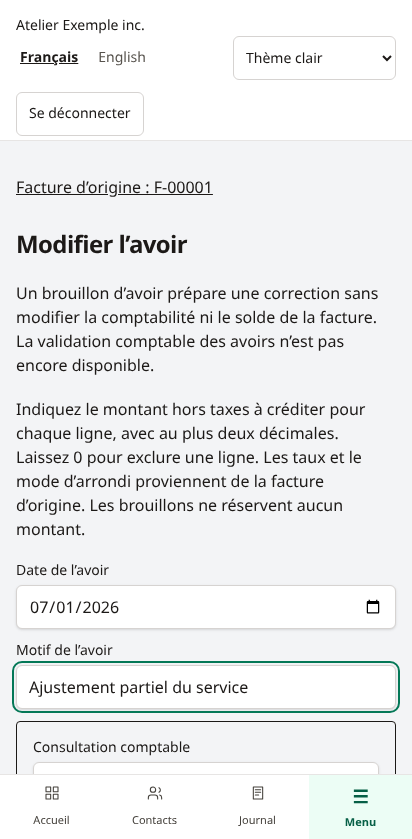

# Brouillons d’avoirs partiels

Un brouillon d’avoir prépare une réduction d’une facture validée. Il n’attribue aucun numéro, ne crée aucune écriture, ne réserve aucun montant et ne réduit pas le solde de la facture. **La validation et l’affectation comptables des avoirs ne sont pas encore disponibles.**

## Préparer une correction

1. Ouvrir **Factures validées**, puis une facture comptabilisée.
2. Choisir **Préparer un avoir**. Le propriétaire et le comptable peuvent enregistrer; le lecteur peut consulter.
3. Choisir une date au moins égale à la date comptable de la facture et saisir un motif.
4. Saisir, pour chaque ligne, le montant **hors taxes** à créditer en CAD, avec au plus deux décimales. Le point et la virgule sont acceptés comme séparateur décimal, sans séparateur de milliers. Laisser `0` pour exclure une ligne. Au moins une ligne doit être positive; aucune ne peut dépasser son montant original.
5. Enregistrer, puis vérifier le sous-total, les taxes et le total sur la fiche du brouillon.

Les descriptions, comptes, codes de taxe et positions des lignes proviennent de la facture. Les taxes sont calculées aux taux conservés sur cette facture, même si de nouveaux taux sont entrés en vigueur. Son mode d’arrondi est repris. Il s’agit d’une correction monétaire : la quantité du brouillon est `1` et son prix est le montant à créditer, sans modifier les quantités de la facture.

## Retrouver, modifier ou supprimer

Le menu **Avoirs**, l’espace **Ventes** et la facture d’origine permettent de retrouver les brouillons. La liste affiche les 100 plus récents. La fiche permet de revenir à la facture et de modifier le brouillon. Une modification ou suppression basée sur une ancienne révision est refusée : recharger et vérifier les changements de l’autre utilisateur.

La suppression demande une confirmation. Si la facture est annulée, ses brouillons restent consultables et supprimables, mais ils ne peuvent plus être modifiés. Un brouillon n’empêche pas l’annulation de la facture.

## Limites

Les plafonds du brouillon sont les montants originaux de chaque ligne et des taxes. Ils ne représentent pas un solde disponible après d’autres avoirs ou paiements. Plusieurs brouillons peuvent préparer la même correction; aucun ne réserve le montant. Les contrôles cumulés et concurrents du crédit disponible seront appliqués lors de la future validation et affectation.

Pas de validation, remboursement, PDF ou envoi dans ce parcours. Le journal reste inchangé. Pour une annulation complète admissible avec effet comptable, voir [[Annulation-des-factures]]. Les essais utilisent des données fictives; cette préversion ne convient pas à une comptabilité réelle. Captures issues des parcours Chromium ordinateur/mobile, pas d’essais sur iPhone physique.
