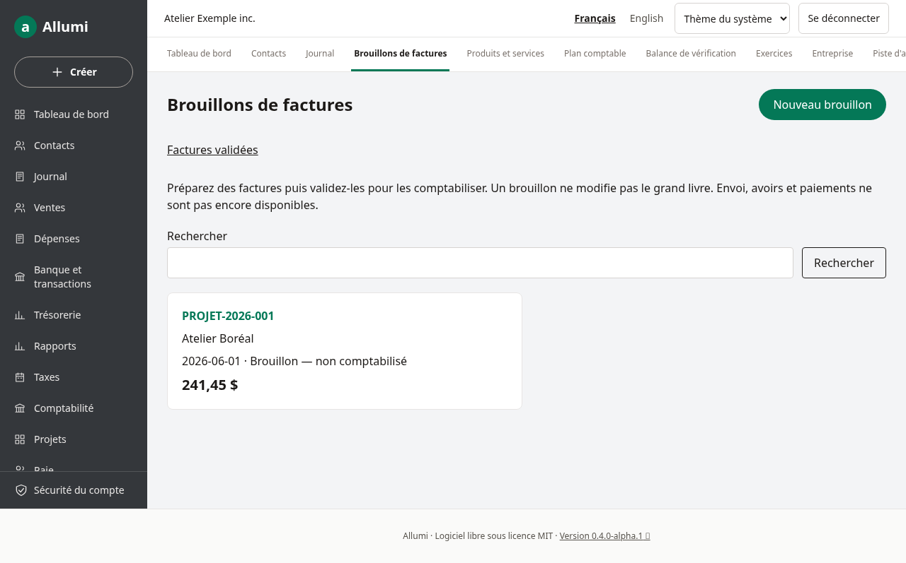
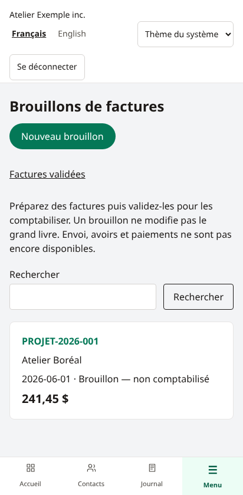
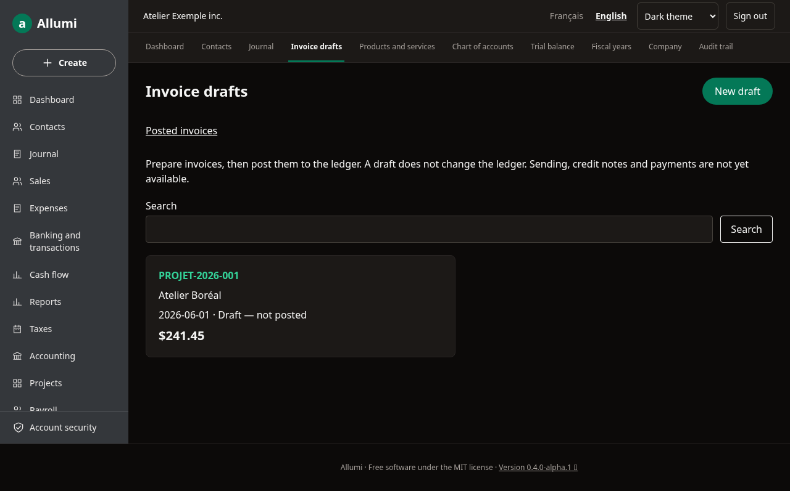

# Brouillons de factures

Le menu **Brouillons de factures**, également accessible depuis **Ventes**, permet de préparer des factures en français ou en anglais sur ordinateur et téléphone.

Un brouillon n’a **aucun numéro définitif et aucun effet comptable**. Il ne modifie ni les comptes clients ni le chiffre d’affaires du tableau de bord. La validation comptable est disponible : [[Validation-des-factures]]. L’envoi, les avoirs et les paiements ne sont pas encore disponibles.

## Préparer et enregistrer

Créer d’abord un client actif dans [[Contacts]], un compte de revenus dans [[Plan-comptable]] et les codes fiscaux dans [[Taxes-et-catalogue]]. Les articles du catalogue sont facultatifs.

Dans **Nouveau brouillon**, choisir le client, la date de facture et l’échéance. L’échéance doit être égale ou postérieure à la date de facture. La référence et la note sont facultatives.

Ajouter de une à cinquante lignes. Chaque ligne contient une description, une quantité positive, un prix positif ou nul, un compte de revenus et un code fiscal explicite. Une ligne sans taxe utilise un code détaxé, exonéré ou hors champ; laisser le code vide est refusé.

Choisir un article remplit sa description, son prix, son compte et son code fiscal. Ces valeurs restent modifiables dans le brouillon sans changer le catalogue. Le sélecteur affiche au maximum les 500 premiers clients et articles actifs.

Les quantités acceptent quatre décimales, les prix six. La virgule et le point sont acceptés comme séparateur décimal, sans séparateur de milliers. Le total doit être positif; les montants sont limités par le plafond comptable de l’application.

**Enregistrer le brouillon** recalcule les montants au cent et les taxes selon les taux en vigueur à la date de facture. Le calcul exact de l’application est comparé au calcul PostgreSQL. Si un taux manque, l’enregistrement est refusé et les valeurs restent dans le formulaire.

## Consulter et corriger

La liste présente le client, la référence, la date et le total enregistré. La recherche porte sur le client et la référence; au maximum 100 résultats sont affichés. La fiche détaille les lignes, taxes et totaux.

**Modifier le brouillon** permet de changer les champs et lignes puis de recalculer le total. L’arrondi et la langue de l’entreprise sont copiés à la création; modifier les réglages de l’entreprise ne change pas ceux d’un brouillon existant. Les totaux affichés sont ceux du dernier enregistrement : un changement ultérieur de taux ne réécrit pas les brouillons silencieusement.

Si un autre onglet ou membre a modifié le brouillon, l’enregistrement périmé est refusé. Rechargez la fiche et comparez les changements avant de les ressaisir. La même protection s’applique à la suppression.

## Suppression et permissions

Le propriétaire et les comptables peuvent créer, modifier et supprimer les brouillons. Les lecteurs peuvent les consulter. Les accès sont isolés par entreprise et les modifications sont conservées dans la [[Piste-d-audit]].

Pour supprimer, ouvrir **Supprimer le brouillon**, cocher la confirmation puis valider. La suppression retire définitivement le brouillon et ses lignes; elle ne supprime pas la piste d’audit. Les documents validés ne sont pas accessibles à ces opérations.

## Captures

Données fictives issues du parcours Chromium; vues mobiles émulées, sans remplacer les essais sur iPhone physique.

