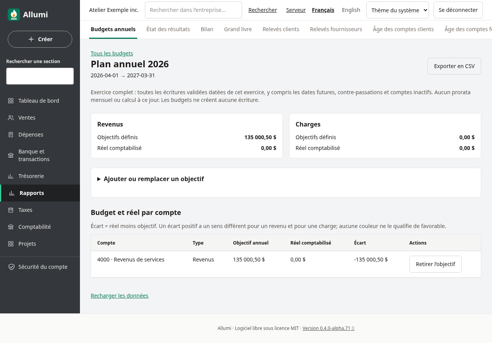
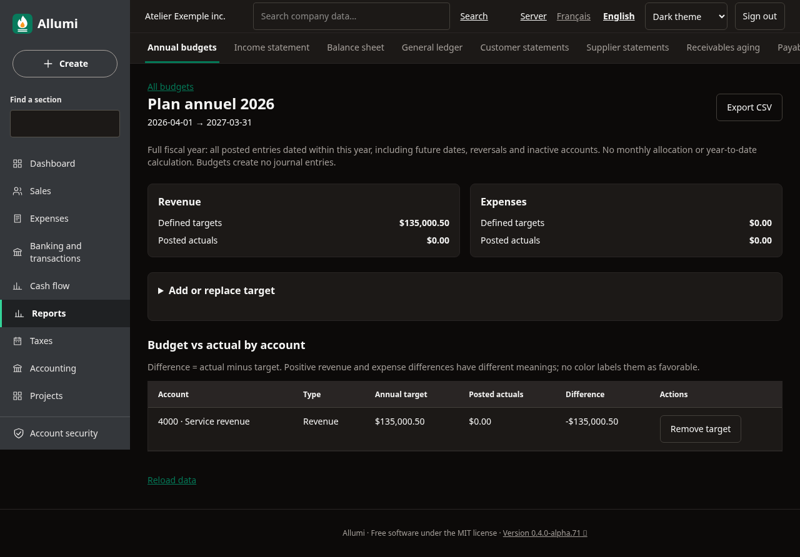
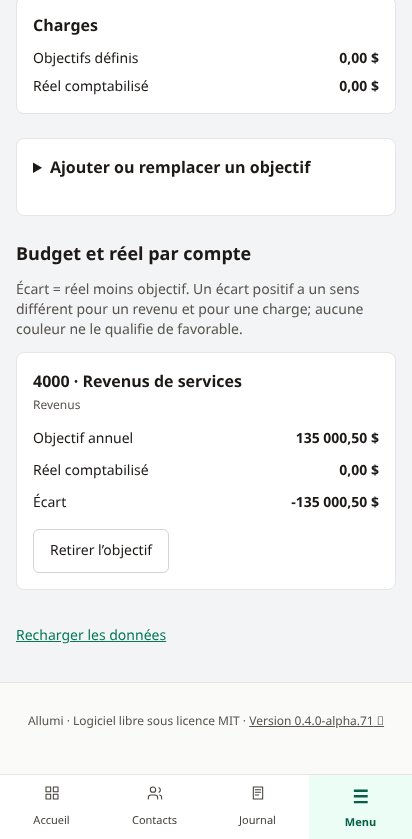
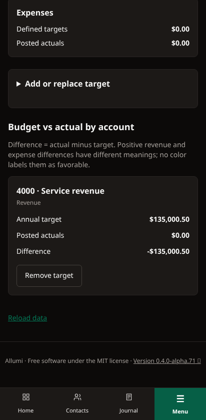

# Budgets annuels et réel comptabilisé

Depuis **Rapports → Budgets annuels**, créez un scénario nommé pour un exercice existant, puis ajoutez un objectif annuel à vos comptes de revenus ou de charges. Plusieurs scénarios peuvent partager le même exercice, mais leurs noms doivent être distincts. Le budget reste séparé du grand livre : il ne valide aucune écriture et ne modifie aucun solde.

## Créer et modifier un scénario

1. Choisissez **Créer un budget**, un nom de 1 à 120 caractères et l’exercice complet.
2. Ouvrez **Ajouter ou remplacer un objectif**, choisissez un compte et saisissez le montant annuel en CAD.
3. Choisir un compte déjà présent remplace son objectif. **Retirer l’objectif** conserve le compte dans le rapport s’il a de l’activité comptabilisée.

Les objectifs sont positifs ou nuls, avec deux décimales au plus, jusqu’à 1 000 milliards de dollars par compte. Le compte doit être de type revenu ou charge et actif lors de l’ajout. Un objectif existant sur un compte devenu inactif peut être remplacé ou retiré. Les comptes inactifs avec activité restent visibles.

**Zéro** signifie un objectif défini de zéro dollar. **Non défini** signifie qu’aucun objectif n’existe. Les comptes avec activité sans objectif déclenchent un avertissement; les cartes affichent les sommes des **objectifs définis**, qui ne constituent alors pas un budget complet. Le réel inclut toute l’activité des comptes de revenus/charges de l’exercice, même lorsqu’un solde net nul résulte d’une contre-passation.

## Lire le réel et les écarts

La période est exactement celle de l’exercice sélectionné, dates de début et de fin incluses. Toutes les écritures validées datées de cet exercice sont prises en compte, **y compris celles à date future**. Il ne s’agit pas d’un rapport à ce jour. Les dates exactes figurent au-dessus du tableau et dans le CSV.

- Revenus : crédits moins débits.
- Charges : débits moins crédits.
- Écart : réel moins objectif. Sans objectif, l’écart reste absent.

Les écarts gardent une présentation neutre : une hausse de revenu et une hausse de charge n’ont pas le même sens. Les contre-passations suivent leur propre date comptable. Un exercice fermé reste consultable, et ses objectifs peuvent être ajustés comme données de planification sans rouvrir de période.

## Permissions, concurrence et export

La lecture exige le module **Comptabilité** en lecture ou écriture. La création et les changements d’objectifs exigent Comptabilité en écriture; les comptes en lecture seule restent bloqués même avec une surcharge d’écriture. Aucun accès Contacts, Ventes ou Taxes n’est requis. Les règles d’entreprise et permissions SQL restent actives; les changements sont audités.

Si un autre utilisateur change le budget après le chargement de la page, votre modification est refusée. Le montant saisi reste disponible. Utilisez **Recharger les données**, vérifiez le nouvel état, puis réessayez. Chaque insertion, remplacement ou retrait d’objectif avance la révision en base, même hors de l’interface.

**Exporter en CSV** produit le rapport complet, sans notes privées, dans une réponse privée sans cache : UTF-8 avec BOM, séparateur `;` et décimales `,` en français, séparateur `,` et décimales `.` en anglais. Les montants restent exacts et les textes pouvant être interprétés comme formules sont neutralisés. La limite est de **1 000 comptes** : tout dépassement est refusé explicitement, sans affichage ni export partiel.

Sur téléphone, les comptes sont présentés en cartes avec objectif, réel et écart. Sur ordinateur, le tableau permet de comparer les comptes côte à côte.

## Installation et périmètre

La mise à jour ajoute les tables `budget` et `budget_line`, leurs politiques RLS, contraintes, gardes et déclencheurs d’audit/révision. Sauvegardez avant la mise à jour; le service de migration habituel applique cet ajout. Aucune nouvelle variable d’environnement. Aucun déploiement automatique sur votre serveur personnel.

Cette version couvre les scénarios **annuels** par compte. La ventilation mensuelle, les prévisions de trésorerie, le renommage et la suppression de scénarios ne sont pas proposés. Les captures proviennent d’une entreprise fictive, avec Chromium et émulation mobile; la validation physique Safari iOS reste à faire.

Voir [[Etats-financiers]], [[Exercices-et-periodes]], [[Utilisateurs-et-permissions]], [[Mise-a-jour]] et [[Schema-de-donnees]].

La reprise des objectifs dans un nouveau scénario est disponible avec aperçu et exclusions explicites : [[Duplication-des-budgets]].

L’ajout d’objectifs depuis un fichier, après aperçu local et confirmation, est disponible : [[Import-CSV-des-budgets]].
