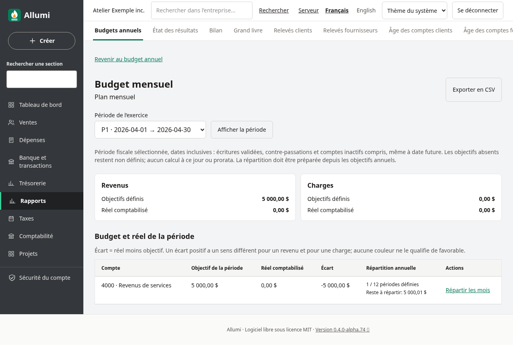
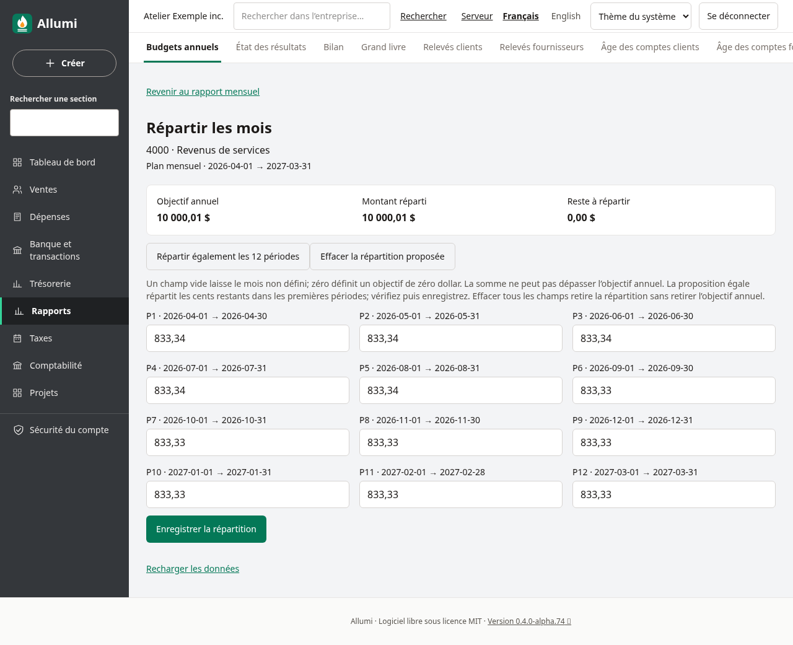
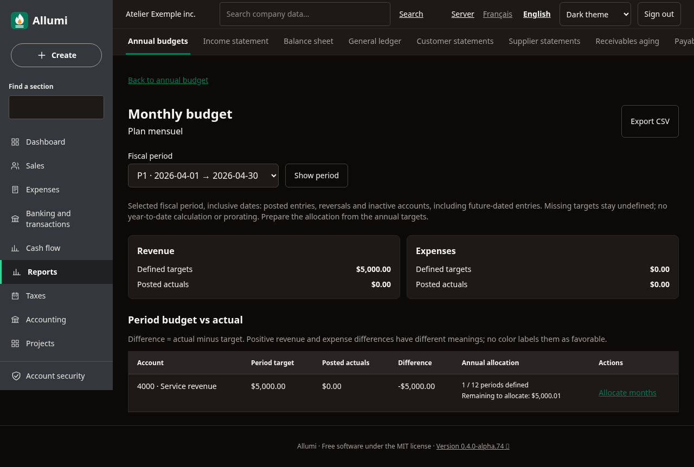
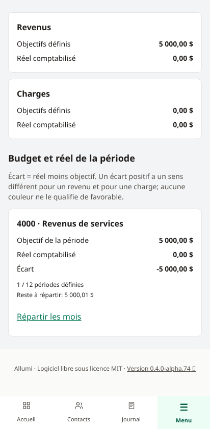
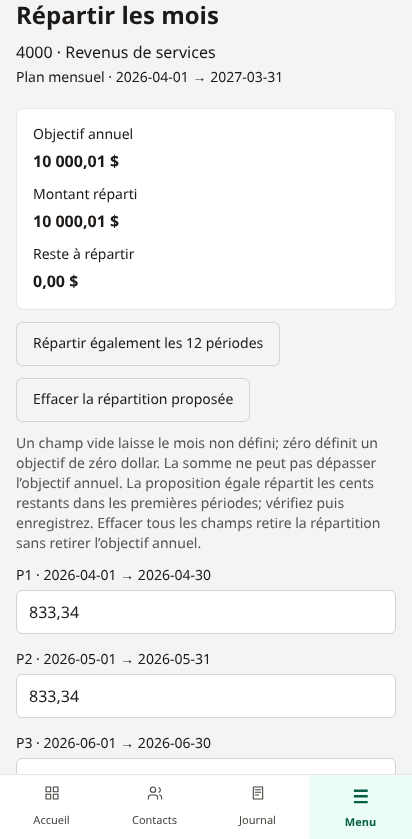
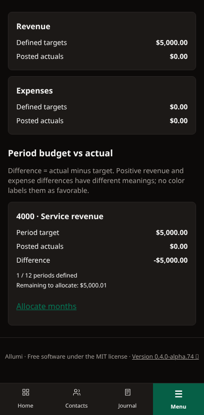

# Budgets mensuels et répartition des objectifs annuels

Depuis **Rapports → Budgets annuels**, ouvrez un scénario puis **Budget mensuel**. Choisissez une des douze périodes de son exercice : les dates fiscales exactes sont affichées, même lorsque l’exercice ne commence pas en janvier.

## Répartir un objectif

1. Ajoutez d’abord un objectif annuel au compte de revenu ou de charge dans le budget.
2. Dans le rapport mensuel, choisissez **Répartir les mois** pour ce compte.
3. Saisissez les objectifs des douze périodes. Un champ vide signifie **non défini**, tandis que zéro est un objectif défini.
4. Vérifiez le total réparti et le reste, puis **Enregistrer**.

La somme ne peut pas dépasser l’objectif annuel. Une répartition partielle est autorisée; l’indication complète exige douze objectifs définis et une somme égale à l’annuel. Les montants sont positifs ou nuls, au cent près, jusqu’à la limite annuelle de 1 000 milliards de dollars par compte.

**Répartir également** propose une division exacte en douze, avec les cents restants attribués aux premières périodes. **Effacer la proposition** vide les champs. Ces deux boutons modifient uniquement le formulaire : aucun changement n’est enregistré avant **Enregistrer**. Pour supprimer une répartition existante, effacez la proposition puis enregistrez les champs vides.

## Comparer au réel

Le rapport utilise toutes les écritures validées datées de la période sélectionnée, bornes incluses, y compris les dates futures. Il ne s’agit ni d’un cumul à ce jour, ni d’un prorata, ni d’une prévision. Les revenus sont crédits moins débits; les charges sont débits moins crédits. L’écart est le réel moins l’objectif et reste absent lorsqu’aucun objectif mensuel n’est défini.

Les comptes portant un objectif annuel restent affichés. Les autres comptes apparaissent s’ils ont une activité dans la période, même lorsque leur solde net est nul. Les contre-passations suivent leur propre date comptable et les comptes inactifs conservent leur historique. Un avertissement signale l’activité sans objectif mensuel; les totaux des objectifs définis peuvent donc être incomplets.

**Exporter en CSV** télécharge le rapport de la période, ses dates exactes, les objectifs, le réel, les écarts, l’annuel, le total réparti, le reste et le nombre de périodes définies. Le fichier est privé et sans cache, UTF-8 avec BOM, français point-virgule/virgule décimale ou anglais virgule/point décimal. Les textes pouvant être interprétés comme formules sont neutralisés. Les cents restent exacts.

## Cohérence, permissions et concurrence

La lecture et l’export exigent **Comptabilité en lecture**; l’édition exige **Comptabilité en écriture**. Un rôle en lecture seule reste bloqué même avec une surcharge d’écriture. Aucun droit Contacts, Ventes ou Taxes n’est requis.

L’enregistrement remplace les douze périodes dans une transaction, avec audit et vérification de révision. Une modification concurrente refuse votre formulaire périmé et conserve les valeurs saisies. Rechargez les données puis revérifiez votre proposition. Le serveur et les contraintes SQL revérifient l’entreprise, l’exercice, les montants et la somme après verrouillage du budget; un échec ne conserve ni répartition partielle ni audit partiel.

L’objectif annuel ne peut pas descendre sous la somme mensuelle. Son retrait est bloqué tant qu’il existe un objectif mensuel, y compris zéro : effacez et enregistrez la répartition avant de retirer l’annuel. Les objectifs existants de comptes devenus inactifs restent ajustables. Un exercice fermé autorise ces données de planification sans rouvrir ses périodes; aucune écriture financière n’est créée ou modifiée.

## Installation et limites

Une migration additive ajoute `budget_monthly_target`, les clés composites d’entreprise, les contraintes, les politiques RLS et les déclencheurs de garde, d’audit et de révision. Sauvegardez avant la mise à jour; le service de migration habituel applique cet ajout. Aucune nouvelle variable de configuration et aucun déploiement automatique sur votre serveur.

Le rapport exige les **douze périodes fiscales** et limite à **1 000 comptes** l’ensemble des comptes avec objectif annuel ou activité de l’exercice. Un dépassement est refusé explicitement, sans rapport ou export tronqué. L’éditeur peut charger un compte séparément. La [[Duplication-des-budgets-mensuels]] reprend maintenant les objectifs annuels et les répartitions définies selon le numéro de période, après aperçu des douze correspondances. L’[[Import-CSV-des-budgets-mensuels]] remplace aussi les répartitions des seuls comptes listés après aperçu actuel/proposé, en conservant les annuels et les comptes absents du fichier. La [[Previsions-de-tresorerie]] est un rapport distinct par échéances; les objectifs mensuels ne sont pas transformés automatiquement en mouvements de trésorerie.

Les six captures utilisent une entreprise fictive dans Chromium et son émulation mobile. Les essais physiques Safari iOS restent à effectuer.

Voir [[Budgets-annuels]], [[Duplication-des-budgets]], [[Import-CSV-des-budgets]], [[Exercices-et-periodes]], [[Utilisateurs-et-permissions]], [[Mise-a-jour]] et [[Schema-de-donnees]].
