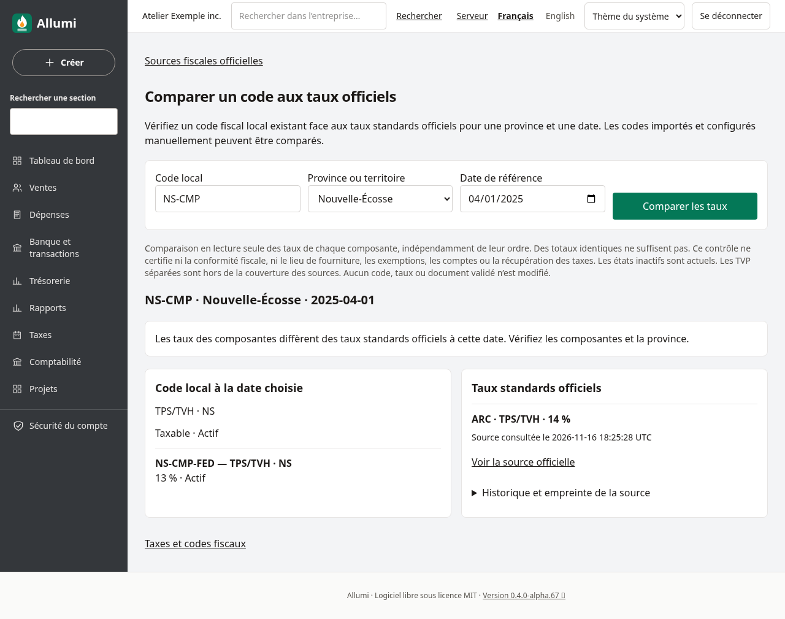
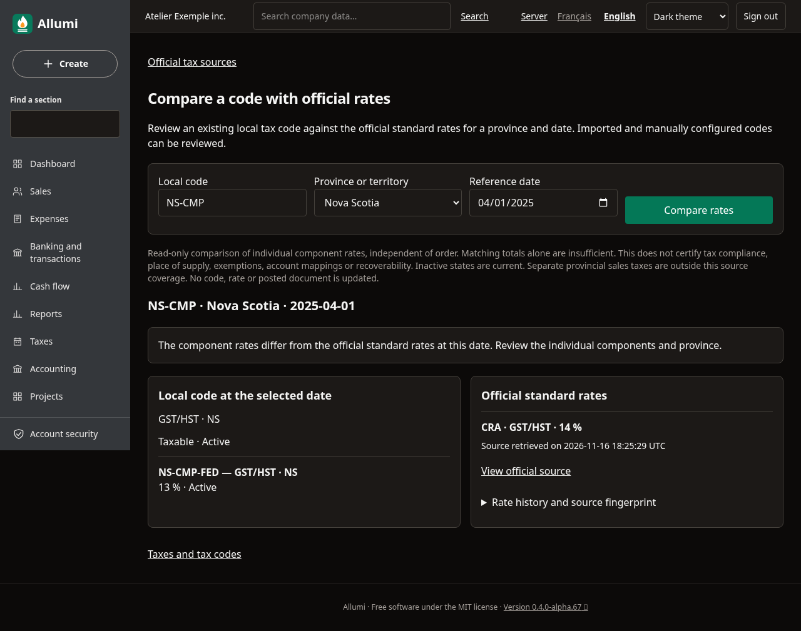
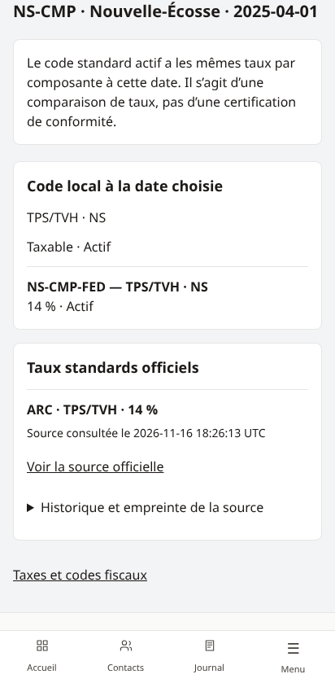
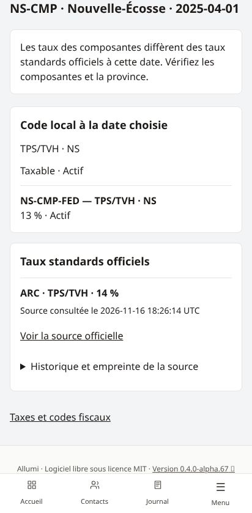
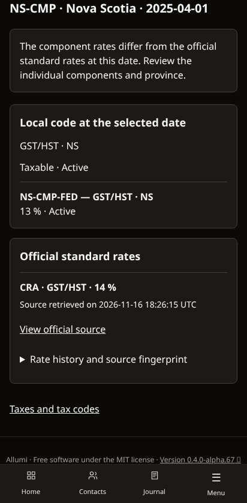

# Comparer un code aux taux officiels

Dans **Taxes**, chaque carte de code fiscal propose **Comparer un code aux taux officiels**. Le lien préremplit le code local, sans consulter les sources automatiquement. Le même outil est accessible dans **Sources fiscales officielles**.

Ce contrôle en lecture seule fonctionne pour les codes créés par l’import officiel et ceux configurés manuellement. Il compare les composantes locales aux taux standards ARC et, au Québec, Revenu Québec. Il ne modifie pas la configuration et ne recalcule aucune pièce validée.

## Choisir le périmètre

1. Saisir le **Code local** exact, avec sa casse et ses éventuels `+` ou `-`.
2. Choisir explicitement la **Province ou territoire** correspondant au contrôle souhaité. La valeur initiale Québec n’est pas une province déduite du code.
3. Choisir une **Date de référence** entre le 1er avril 2013 et aujourd’hui.
4. Cliquer **Comparer les taux**.

La page affiche les définitions locales actuellement configurées, en sélectionnant leurs taux applicables à la date choisie. Les périodes sont inclusives. Ce n’est pas une reconstruction d’une ancienne configuration du code.

Pour un code importé de Nouvelle-Écosse, le taux applicable passe de 15 % le 31 mars 2025 à 14 % le 1er avril 2025. Les mêmes dates sélectionnent les périodes correspondantes des deux côtés.

## Lire le résultat

| État | Signification |
| --- | --- |
| Mêmes taux par composante | Code standard actif, composantes actives et ensemble des taux identique à celui des sources pour cette date. Cela ne certifie pas la conformité fiscale. |
| Taux différents | Taux, nombre ou répétition des composantes différents. Vérifier la province et chaque composante. |
| Taux daté manquant ou ambigu | Au moins une composante n’a pas exactement un taux couvrant la date. Un taux manquant n’est jamais remplacé par zéro. |
| Inactif | Le code ou au moins une taxe est actuellement inactif. Des taux identiques ne le rendent pas utilisable. |
| Traitement non standard | Les taux standards ne peuvent pas valider un code détaxé, exonéré ou hors champ. |

Les comparaisons utilisent des décimales exactes. L’ordre des composantes et leurs noms n’établissent aucune correspondance avec un organisme fiscal. Leurs taux sont comparés comme un ensemble tenant compte des répétitions : **5 % + 9,975 %** correspond aux taux standards québécois, alors que **7 % + 7,975 %** ne correspond pas, même avec le même total. Une TVH de 14 % est une seule composante; sa part fédérale n’est pas ajoutée une deuxième fois.

Le traitement non standard est signalé en priorité, puis l’inactivité, puis les problèmes de couverture datée. La carte locale affiche les composantes et leur état même si le résultat global est inactif.

## Sources et confidentialité

La carte officielle affiche chaque organisme, son taux applicable, l’heure de collecte UTC et un lien fixe vers sa publication. **Historique et empreinte de la source** permet de consulter les périodes et l’empreinte SHA-256 de la réponse. Une nouvelle comparaison consulte de nouveau les sources; aucun résultat n’est enregistré comme certification ou notification.

Le serveur vérifie l’existence du code et les permissions avant de joindre les sources, puis relit les droits et la configuration locale après leur réponse. La lecture locale du code, de ses composantes et de ses taux partage un instantané SQL. Les sites officiels et la base locale ne constituent pas un instantané distribué atomique.

**Taxes en lecture** suffit, sans Comptabilité, Audit, Contacts ou Ventes. La projection ne contient ni coordonnées de comptes comptables, ni acteur d’import, ni notes ou données transactionnelles. Le code reste limité à l’entreprise courante. Les sites officiels reçoivent des requêtes fixes sans code local, identifiant d’entreprise ou document. Les paramètres du formulaire restent susceptibles d’apparaître dans l’historique du navigateur et les journaux du proxy.

Une indisponibilité ou une structure de source inconnue affiche une erreur; elle ne produit pas un résultat concordant par défaut. Un code absent ou interdit ne produit aucun résultat. Les dates et paramètres ambigus sont refusés.

## Anglais, sombre et téléphone

La page fonctionne en français et anglais, clair/sombre, avec cartes empilées sur téléphone. Les captures utilisent des données fictives et des sources publiques figées. L’exemple d’écart simule un taux local de 13 % face au taux standard de 14 %; il ne décrit pas un taux officiel de remplacement.

Les TVP séparées de Colombie-Britannique, Manitoba et Saskatchewan ne sont pas couvertes. Une concordance ne vérifie pas le lieu de fourniture, les exemptions, la nature fiscale attribuée à une composante, les comptes de remise ou le droit de récupération. Aucune synchronisation automatique ni correction de taux n’est effectuée. Les essais physiques Safari iOS restent ouverts.

Aucune migration ou nouvelle configuration. Voir [[Sources-fiscales-officielles]], [[Taxes-et-catalogue]], [[Sommaire-des-taxes]] et [[Utilisateurs-et-permissions]].
