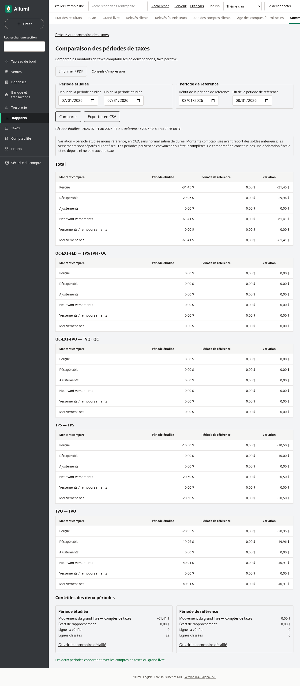
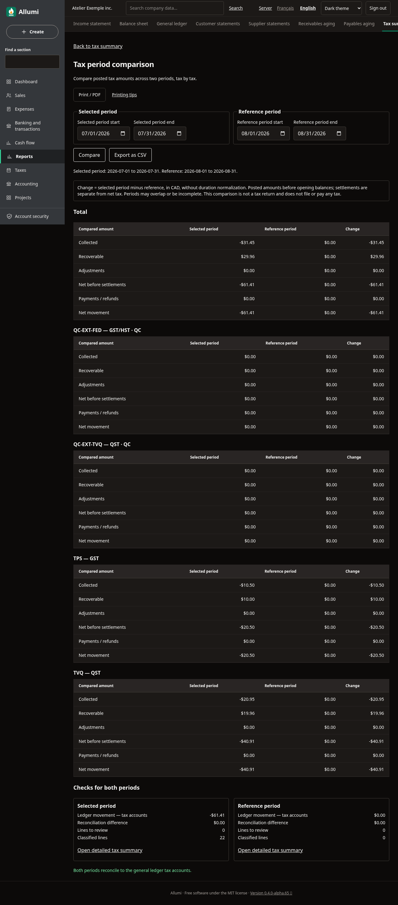
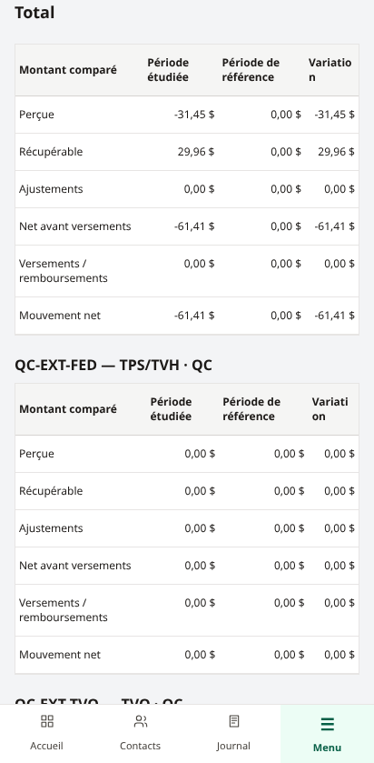
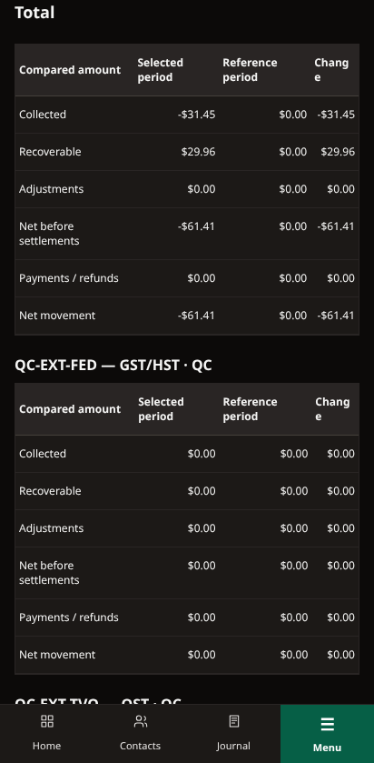

# Comparer deux périodes de taxes

Dans **Rapports → Sommaire TPS/TVQ**, choisir la période puis **Comparer les périodes de taxes**. La lecture de **Comptabilité** et de **Taxes** est requise; Contacts et Ventes ne sont pas nécessaires.

Ce rapport compare les montants réellement comptabilisés dans deux plages de dates inclusives. Il ne recalcule pas les taxes aux taux actuels, ne crée pas de déclaration et n’envoie aucun paiement.

## Choisir les périodes

Depuis un raccourci du sommaire, la référence proposée conserve la fréquence calendaire :

| Période étudiée | Référence proposée |
|---|---|
| Mars 2024 | Février 2024, du 1er au 29 |
| Premier trimestre 2026 | Quatrième trimestre 2025 |
| Année 2025 | Année 2024, y compris le 29 février |

Pour une période personnalisée ou le défaut de l’exercice à ce jour, la référence proposée est la plage immédiatement précédente de **même nombre de jours**. Elle ne correspond donc pas nécessairement à un mois ou trimestre entier. Vérifier les quatre dates avant utilisation.

Modifier **Début / Fin de la période étudiée** et **Début / Fin de la période de référence**, puis **Comparer**. Les deux plages peuvent avoir des durées différentes ou se chevaucher; elles sont calculées indépendamment. Aucun montant n’est normalisé au nombre de jours, aucun pourcentage ni annualisation n’est appliqué.

Les dates impossibles, inversées, incomplètes ou répétées, les mélanges contradictoires de raccourci/dates et les paramètres non pris en charge sont refusés à l’écran et au CSV. Une référence hors des dates prises en charge est refusée; saisir une référence explicite valide au lieu d’un repli silencieux.

## Montants et variations

Le tableau **Total** compare l’ensemble des taxes, puis chaque taxe dispose de son tableau :

- **Perçue** : crédits moins débits classés COLLECTED.
- **Récupérable** : débits moins crédits classés RECOVERABLE.
- **Ajustements** : crédits moins débits classés ADJUSTMENT.
- **Net avant versements** : perçue − récupérable + ajustements.
- **Versements / remboursements** : crédits moins débits classés SETTLEMENT, séparés du net fiscal.
- **Mouvement net** : net avant versements + versements / remboursements.

**Variation = période étudiée − référence**, en cents exacts, y compris pour des montants négatifs. Par exemple, un net de **5,25 $** en juin et de **−5,25 $** en juillet produit **10,50 $** de variation si juin est la période étudiée. Une facture annulée en juillet reste dans juin; sa contre-passation appartient à juillet.

Une taxe inactive ayant une activité dans l’une des périodes reste affichée, avec zéro de l’autre côté si nécessaire. Une taxe inactive sans activité des deux côtés est exclue. Les codes et noms sont ceux de la configuration actuelle, et non des libellés historiques figés.

## Contrôles et détail source

Les deux périodes, leurs métadonnées et leurs contrôles proviennent d’un **même instantané SQL**. Chaque période conserve son mouvement des comptes de taxes du grand livre, son écart de rapprochement, son nombre de lignes classées et ses lignes à vérifier.

Des anomalies opposées peuvent produire un écart nul : leur nombre reste visible et le rapport demande une vérification. **Ouvrir le sommaire détaillé** permet de consulter les écritures et les liens au journal pour chacune des deux plages. Le comparatif ne corrige aucune écriture.

Une période non terminée est signalée; les montants se limitent aux écritures déjà enregistrées. Le comparatif ne reporte pas les soldes d’ouverture, ne calcule pas les ajustements réglementaires manquants et n’indique pas un montant officiel à verser.

## CSV et impression

**Exporter en CSV** conserve les deux périodes, toutes les taxes du comparatif, les six montants et leurs variations, les totaux et les contrôles. Le fichier ne reprend pas les descriptions du journal, coordonnées, pièces jointes ou identifiants techniques. Pour le détail complet, exporter le [[Sommaire-des-taxes]] de chaque plage.

Le CSV utilise UTF-8 avec BOM, point-virgule/virgule décimale en français et virgule/point décimal en anglais. Les textes pouvant être interprétés comme des formules sont neutralisés, les montants restent numériques, et le téléchargement est privé et non mis en cache.

**Imprimer / PDF** utilise le navigateur, avec un document clair en orientation paysage et les mêmes chiffres que l’écran. Les formulaires, boutons et menus sont masqués sur papier. Aucune génération PDF serveur ni transmission à un service externe n’est utilisée.

Aucune migration, nouvelle configuration, modification de taux, déclaration ou écriture financière n’est ajoutée. Les règles des achats restent celles décrites dans [[Fonctionnalites-et-limites]]; le comparatif n’ajoute pas la récupération partielle des taxes.

Sur téléphone, les colonnes se resserrent pour afficher les deux périodes et la variation ensemble. Si de longs libellés ou de très grands montants dépassent la largeur disponible, faire défiler le tableau horizontalement; le document entier reste disponible à l’impression.

Les captures et essais mobiles utilisent Chromium; le partage et l’impression Safari iOS sur appareil réel restent à vérifier.
