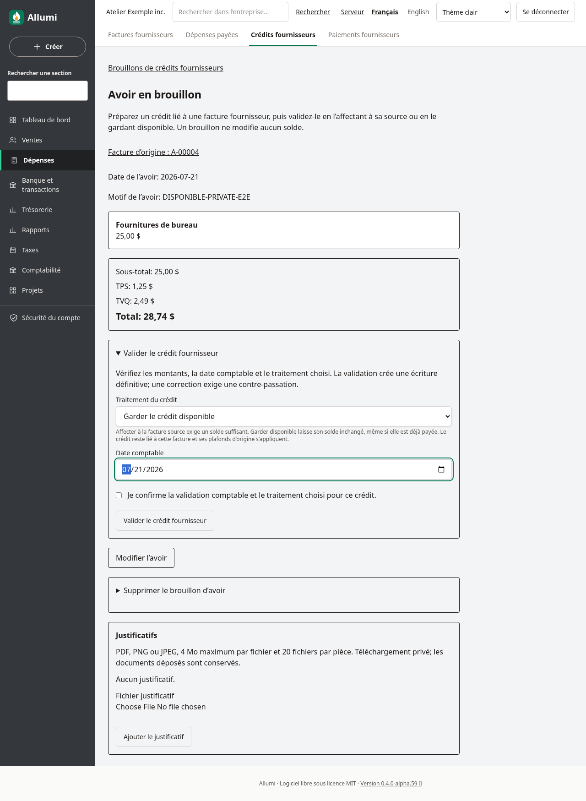
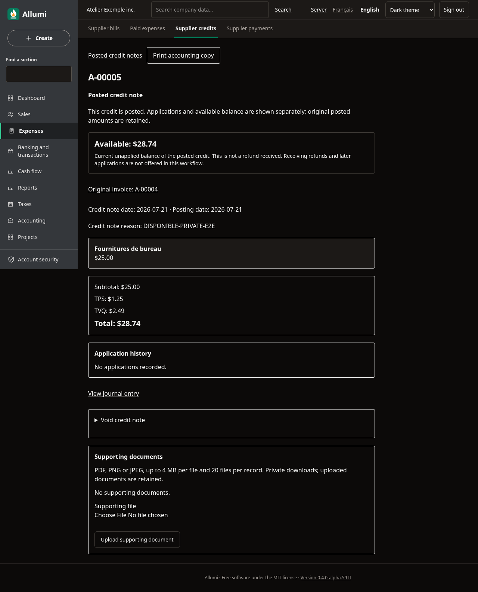
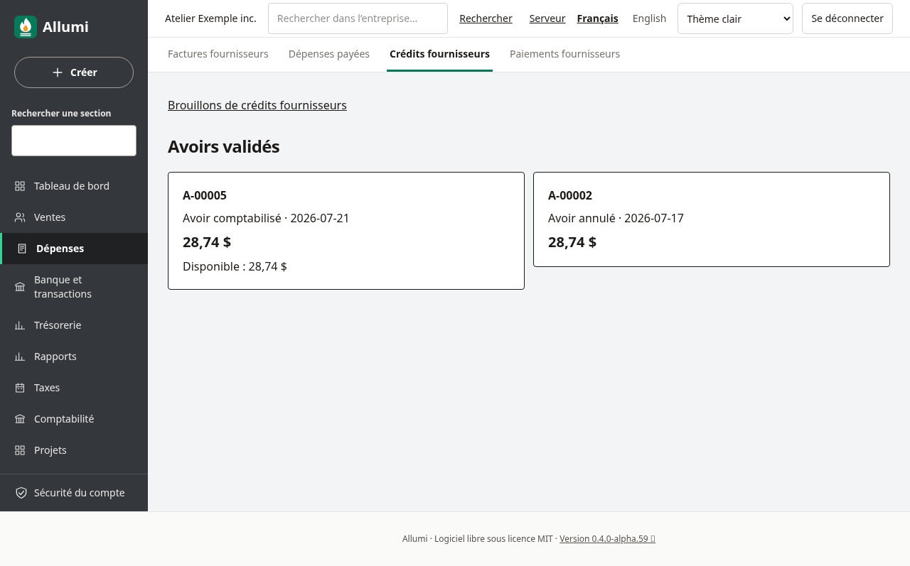
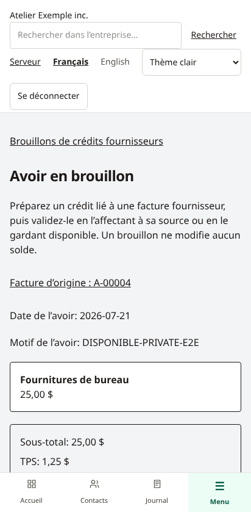
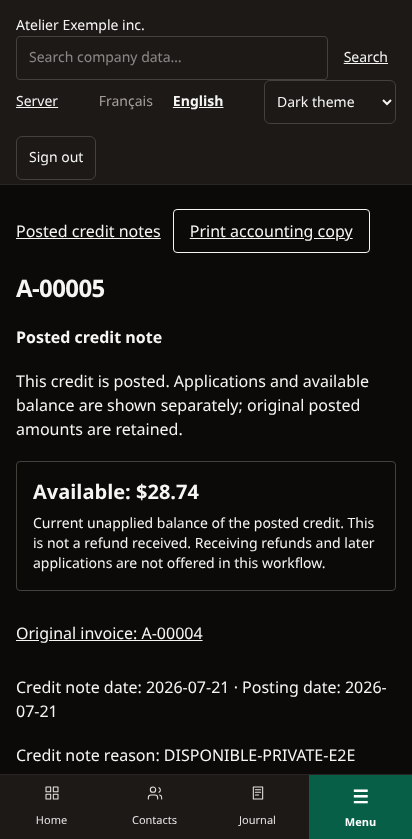
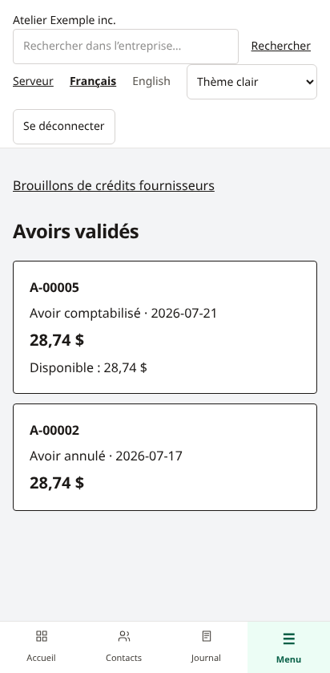

# Conserver un crédit fournisseur disponible

Un crédit peut être comptabilisé après le règlement de sa facture source. Depuis **Dépenses → Factures fournisseurs**, ouvrir une facture validée, même déjà payée, puis **Nouveau crédit fournisseur**. Saisir les lignes corrigées, la date et le motif; enregistrer le brouillon.

Le crédit reste lié à la facture d’origine : lignes, taux et mode d’arrondi sont repris. Les crédits validés cumulés ne peuvent dépasser les montants originaux de chaque ligne, de chaque taxe ou de la facture. Ce parcours ne crée pas un crédit fournisseur sans facture source.

## Choisir le traitement avant validation

Ouvrir **Valider le crédit fournisseur** (*Post supplier credit*), vérifier la date comptable et choisir **Traitement du crédit** (*Credit treatment*) :

| Choix | Effet sur la facture source | Disponible du crédit |
|---|---|---|
| Affecter intégralement à la facture source | Le solde est diminué du crédit, si le solde est suffisant | Zéro après affectation |
| Garder le crédit disponible | Aucun changement du solde, même sur une facture payée | Total du crédit validé |

Confirmer les montants et le traitement choisi. La validation crée une écriture définitive : débit des comptes fournisseurs, crédit des charges et taxes récupérables correspondantes. Elle attribue un numéro `A-…` et conserve les coordonnées figées du fournisseur. **Garder disponible ne signifie pas recevoir un remboursement** : aucun nouvel encaissement, décaissement ou virement n’est créé.

L’affectation à la source reste le choix initial. Sur une facture dont le solde est insuffisant, ce choix est refusé sans consommer de numéro ni créer une écriture; choisir explicitement **Garder le crédit disponible** pour un crédit non affecté. Un paiement concurrent peut modifier le solde avant la confirmation.

## Lire le disponible

La fiche du crédit indique le **Disponible** actuel; la liste **Crédits fournisseurs → Avoirs validés** l’affiche également pour chaque crédit encore validé. Un crédit conservé disponible présente **Aucune affectation enregistrée**. Le montant original du document reste affiché séparément.

La validation est définitive. Recharger ou renvoyer la même validation ne crée pas une deuxième écriture et ne change pas le traitement du crédit déjà validé.

## Annulation et rapports

**Annuler l’avoir** demande un motif et une date dans une période ouverte, au moins égale à la validation et aux mouvements liés. La contre-passation annule la créance disponible; elle ne rouvre pas une facture déjà réglée lorsque le crédit n’y avait pas été affecté. Les montants et événements historiques sont conservés.

L’[[Age-des-comptes-fournisseurs]] présente le crédit disponible en montant négatif, distinct des factures dues, et le rapproche des comptes fournisseurs du grand livre. Après annulation, il reste visible dans les rapports datés antérieurs à la contre-passation. Le [[Sommaire-des-taxes]] conserve le crédit et sa contre-passation dans leurs périodes comptables respectives; le paiement ordinaire de la facture ne recalcule aucune taxe.

Le relevé daté est accessible dans [[Releve-de-compte-fournisseur]]. La copie imprimable conserve les montants originaux, sans solde courant : [[Impression-des-achats]].

## Droits et limites

La préparation, validation et annulation exigent les droits d’écriture comptable et l’accès aux références nécessaires. La consultation du disponible exige **Comptabilité en lecture** et fonctionne sans accès aux répertoires Contacts, Taxes ou Ventes. Les crédits sont isolés par entreprise.

Le disponible peut être affecté à une facture ouverte du même fournisseur, avec retrait daté et historique : [[Affectation-des-credits-fournisseurs]]. La réception de remboursements fournisseurs reste indisponible. La récupération partielle des taxes et les ajustements fiscaux manuels ne sont pas pris en charge. Les crédits restent limités aux factures avec taxes entièrement récupérables ou sans taxe.

Voir [[Factures-fournisseurs]] et [[Utilisateurs-et-permissions]].
