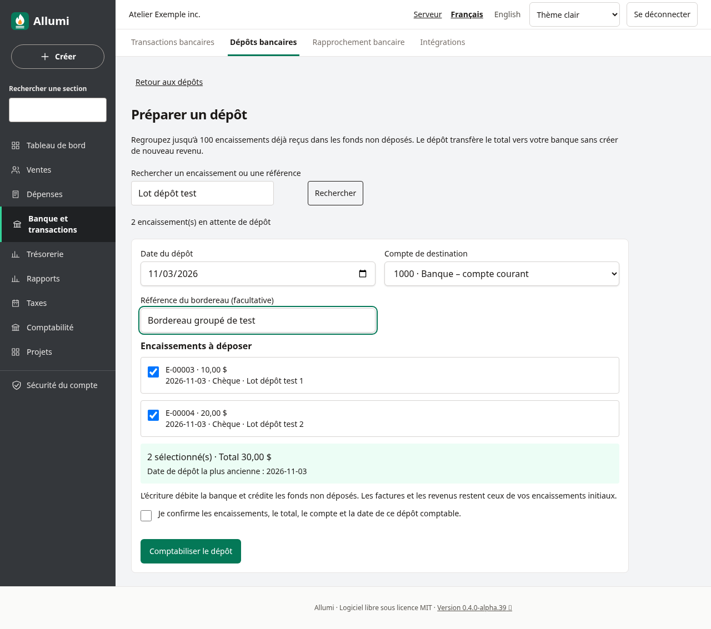
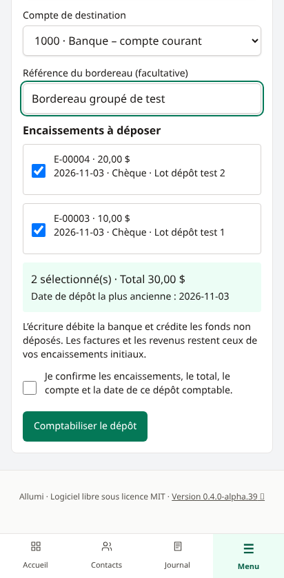
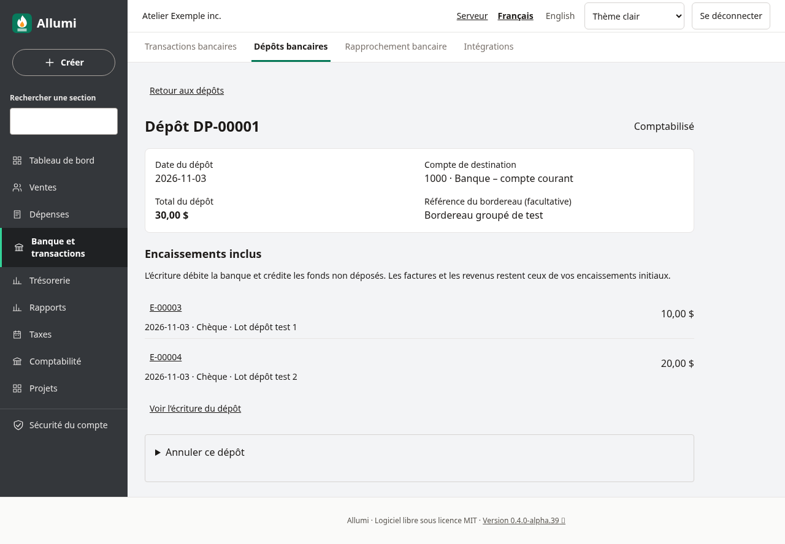
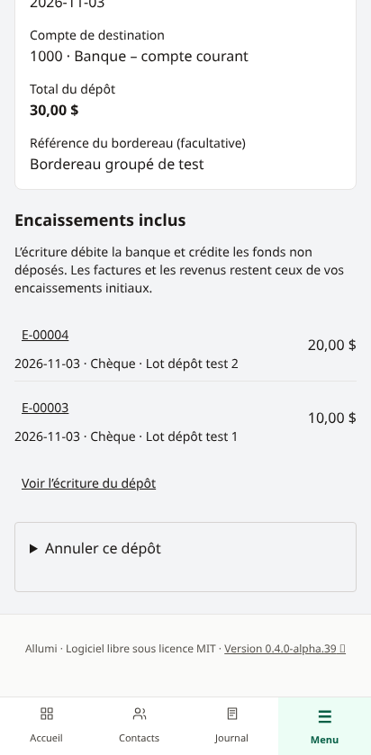
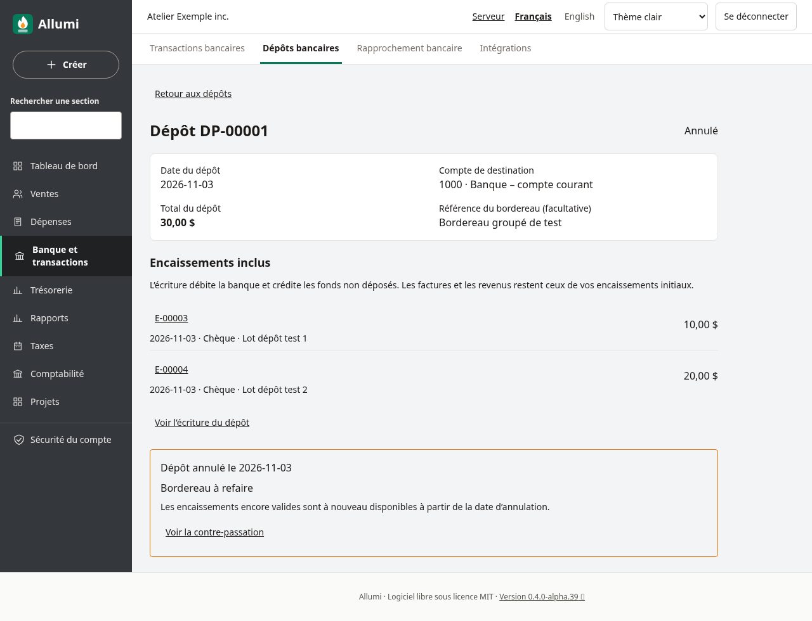
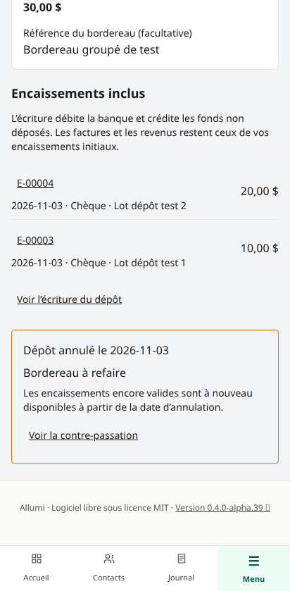
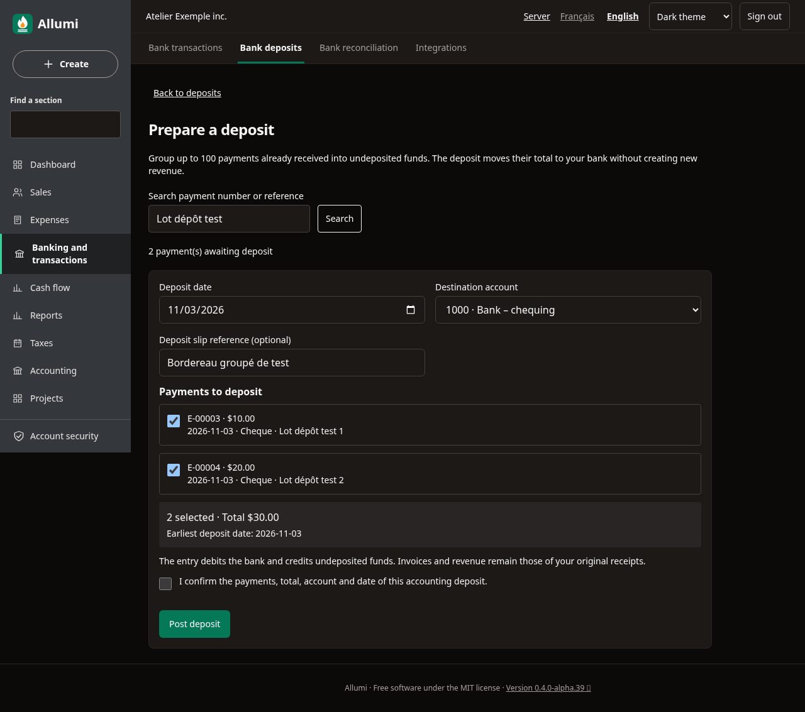
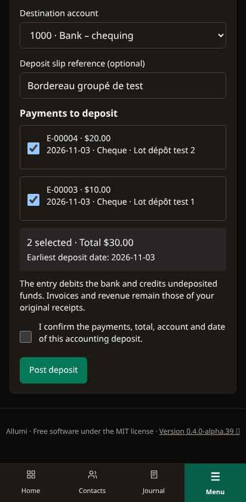

# Dépôts bancaires groupés

Le dépôt regroupe des encaissements déjà reçus dans **Fonds non déposés** et transfère leur total vers un compte de banque ou d’encaisse. Il ne crée ni nouveau revenu, ni nouveau paiement client, ni nouvelle affectation à une facture.

## Recevoir puis déposer

1. Depuis une facture validée, enregistrez les encaissements dans le compte **1050 · Fonds non déposés**, au lieu de la banque.
2. Ouvrez **Banque et transactions → Dépôts bancaires → Préparer un dépôt**.
3. Recherchez au besoin un numéro d’encaissement ou une référence. Sélectionnez les encaissements de la page, choisissez la banque ou l’encaisse de destination et la date du bordereau.
4. Vérifiez le total et saisissez une référence facultative. Confirmez les informations, puis **Comptabiliser le dépôt**.

Un dépôt contient au maximum **100 encaissements entiers**. La liste est paginée et la sélection concerne seulement la page affichée; changer de page ou de recherche la réinitialise. Les encaissements sont comptabilisés, reçus dans les fonds non déposés et absents de tout dépôt actif. Les paiements reçus directement en banque ne doivent pas être déposés une deuxième fois.

La date ne peut être ni future, ni antérieure à la réception d’un paiement sélectionné. Pour un encaissement libéré par l’annulation d’un ancien dépôt, la date la plus ancienne est celle de la contre-passation. L’écran indique cette disponibilité.

## Consulter et rapprocher

La fiche conserve le numéro DP-, la date, le compte, le total, la référence et les encaissements inclus. **Voir l’écriture du dépôt** ouvre le journal : débit de la banque, crédit des fonds non déposés, exactement pour le total sélectionné. L’écriture renvoie à sa fiche d’origine.

Lors de l’import du relevé, appariez sa ligne de dépôt à cette écriture existante. Ne créez pas un deuxième revenu depuis la ligne bancaire. Les frais bancaires sont traités séparément; ce lot ne les déduit pas automatiquement du dépôt.

La fiche d’encaissement affiche l’historique de ses dépôts. Un encaissement inclus dans un dépôt actif ne peut pas être annulé : annulez d’abord le dépôt, puis annulez l’encaissement si nécessaire. Les liens vers les encaissements suivent le droit de consultation Ventes.

## Annuler un dépôt

Ouvrez **Annuler ce dépôt**, renseignez une date et un motif, puis confirmez. La date d’annulation doit suivre ou égaler celle du dépôt, être au plus aujourd’hui et appartenir à une période ouverte.

Une contre-passation annule le transfert bancaire. Les encaissements encore valides redeviennent disponibles à partir de cette date. L’historique, le bordereau initial et ses éléments restent conservés. Un nouvel enregistrement crée un nouveau numéro de dépôt. L’annulation ne rembourse pas le client et n’annule pas ses paiements.

Un dépôt apparié ou pointé dans un rapprochement ne peut pas être annulé. Défaites d’abord l’appariement et le pointage; un rapprochement terminé doit être rouvert selon les permissions prévues. Ces contrôles restent actifs si deux personnes travaillent simultanément. Une sélection devenue indisponible est refusée : actualisez la page et vérifiez-la.

## Permissions, langues et limites

La consultation exige **Comptabilité — lecture**; la préparation et l’annulation exigent **Comptabilité — écriture**. Les permissions modulaires s’appliquent aussi aux utilisateurs délégués. L’opération n’a pas besoin de modifier les factures. Toutes les modifications sont auditées et les entreprises restent isolées.

L’interface est disponible en français et en anglais, en thème clair ou sombre, sur ordinateur et mobile. La sélection reste conservée lors d’un changement de langue ou de thème.

Les dépôts manuels sans encaissement, montants partiels d’un encaissement, frais intégrés au bordereau et remboursements clients ne font pas partie de ce parcours. Utilisez une écriture adaptée ou les parcours existants selon l’opération réelle; ne recréez pas un revenu pour transférer vos propres fonds.

Voir [[Encaissements]], [[Appariement-bancaire]], [[Rapprochement-bancaire]], [[Journal-et-ecritures]] et [[Piste-d-audit]].
