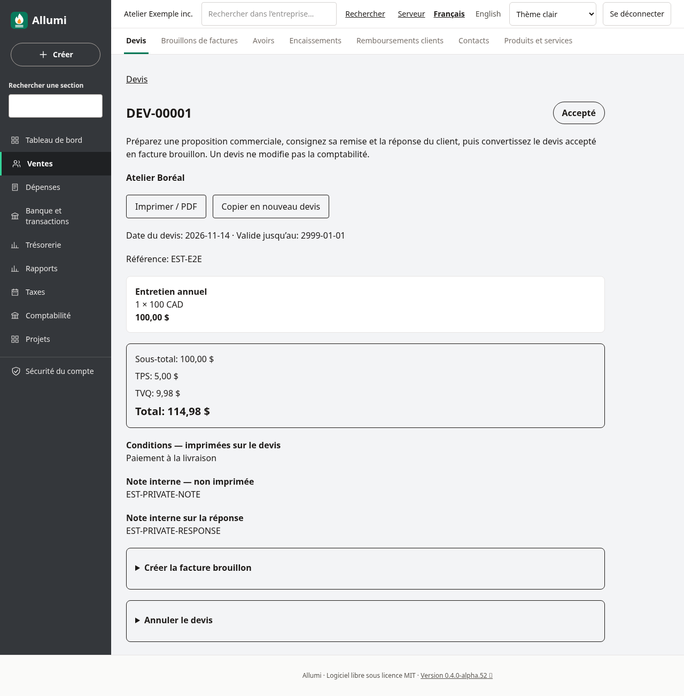
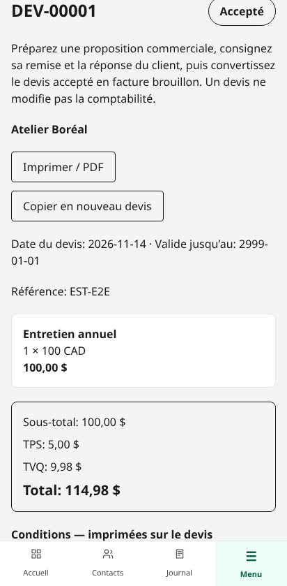
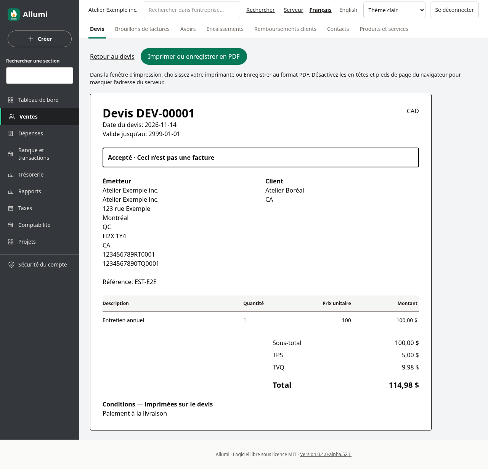
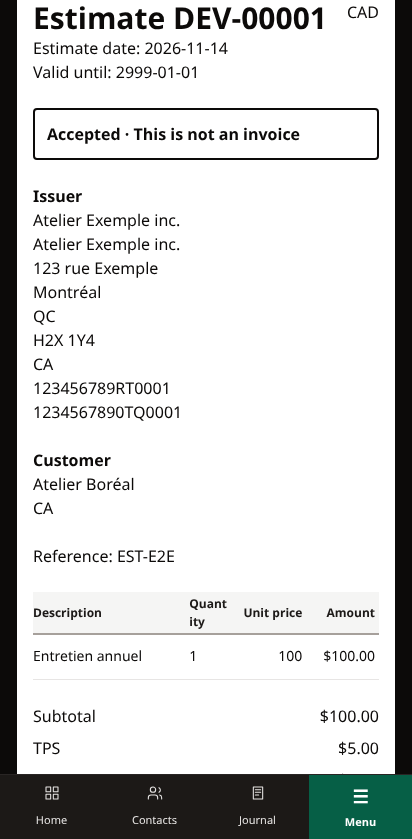

# Devis et conversion en facture

Ouvrez **Ventes → Devis**. Les devis sont des propositions commerciales en CAD : ils ne modifient ni le journal, ni les taxes comptabilisées, ni le solde à recevoir. Les écrans existent en français et en anglais, sur ordinateur et téléphone, avec les thèmes clair et sombre.

## Préparer le devis

Choisissez **Nouveau devis**, un client actif, une date au plus tard aujourd’hui et une date de validité au moins égale à celle du devis. Saisissez les lignes, leurs comptes de revenus et leurs codes fiscaux. La saisie libre et le catalogue sont proposés; un code explicite est requis même sans taxe. Jusqu’à 50 lignes sont acceptées, avec quantités à quatre décimales et prix à six décimales.

L’enregistrement recalcule les montants en cents avec les taux applicables à la date du devis. L’arrondi de l’entreprise est copié à la création et reste celui du devis. La **Note interne** et la **Note interne sur la réponse** ne sont jamais imprimées. Les **Conditions** figurent sur la version imprimable.

Un brouillon reste modifiable et peut être supprimé. Deux modifications simultanées ne s’écrasent pas : rechargez la page si la version a changé.

## Remise et réponse du client

**Marquer comme remis** consigne une remise que vous avez effectuée vous-même. Cette action n’envoie aucun courriel. Elle attribue un numéro `DEV-00001`, puis fige les lignes, les montants et les coordonnées du client et de l’émetteur. Le numéro est propre à l’entreprise, distinct de la séquence des factures.

Consignez ensuite l’acceptation ou le refus reçu du client. Ces opérations internes ne constituent ni un portail client ni une signature électronique. Un devis expiré ne peut plus être remis ou accepté. Un devis accepté pendant sa validité reste convertible après cette date.

Un devis brouillon, remis ou accepté peut être annulé sans écriture comptable. Les devis remis et leurs réponses restent dans l’historique; ils ne sont plus supprimables. Utilisez **Copier en nouveau devis** pour préparer une autre proposition, avec des dates et des références actives vérifiées à l’enregistrement.

## Créer la facture brouillon

Sur un devis accepté, ouvrez **Créer la facture brouillon**, choisissez la date de facture et son échéance, puis confirmez. Les lignes, prix et client sont repris; les taxes sont recalculées à la date de facture choisie. Une modification de taux entre les deux dates peut donc changer le total. L’arrondi du devis est conservé même si le réglage de l’entreprise a changé.

Vérifiez le brouillon obtenu avant de valider la facture; consultez [[Validation-des-factures]]. La conversion seule ne comptabilise rien. Les notes internes restent sur le devis et ne sont pas copiées dans la note imprimable de la facture. Les conditions commerciales restent consultables sur le devis source; elles ne deviennent pas automatiquement une note de facture. La facture conserve le client du devis; le brouillon propose un lien **Devis source**.

Deux tentatives concurrentes ouvrent la même facture. Si vous supprimez la facture tant qu’elle est brouillon, le devis redevient accepté et peut être converti à nouveau. Une facture validée reste liée au devis, même si elle est ensuite contre-passée : les corrections suivent les règles habituelles de [[Annulation-des-factures]].

## Retrouver et imprimer

La liste filtre par numéro, référence ou client, avec les statuts Brouillon, Remis, Accepté, Refusé, Annulé, Converti ou Expiré. Elle affiche 50 résultats par page. Les devis sont aussi inclus dans la [[Recherche-globale]], avec type, statut, dates et montant exact. Les notes internes et les conditions ne sont pas recherchées.

**Imprimer / PDF** ouvre une page privée. Dans la boîte de dialogue du navigateur, choisissez une imprimante ou l’enregistrement PDF; désactivez les en-têtes/pieds de page pour masquer l’adresse du serveur. Les notes internes, motifs de réponse et identifiants techniques sont exclus du document. Le statut et la mention **Ceci n’est pas une facture** restent visibles.

## Permissions et limites

La consultation exige Ventes en lecture. La création, la modification, la remise et la conversion exigent Ventes en écriture, ainsi que Contacts, Comptabilité et Taxes en lecture pour valider les références. Un article utilisé exige aussi sa lecture dans Catalogue. La réponse, l’annulation et la suppression d’un brouillon exigent Ventes en écriture. Une restriction supplémentaire peut empêcher la validation comptable de la facture; voir [[Utilisateurs-et-permissions]].

Les coordonnées figées d’un devis remis restent lisibles avec le droit Ventes, même sans lecture du répertoire Contacts. Les coordonnées actuelles d’un brouillon ne sont pas révélées sans ce droit. Les politiques PostgreSQL, clés étrangères composites, transitions et contrôles différés des totaux appliquent aussi ces limites en base; les changements sont audités.

Ce lot ne fournit pas l’envoi SMTP du devis, l’acceptation par lien public, la signature électronique, les acomptes, les révisions d’un devis remis ou la facturation progressive. Les devis ne constituent pas une validation complète de tous les parcours QuickBooks.
