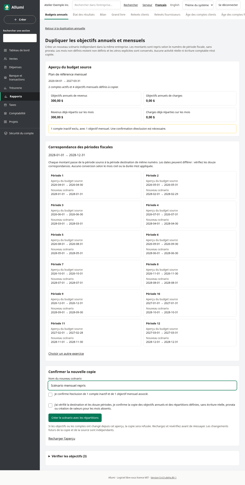
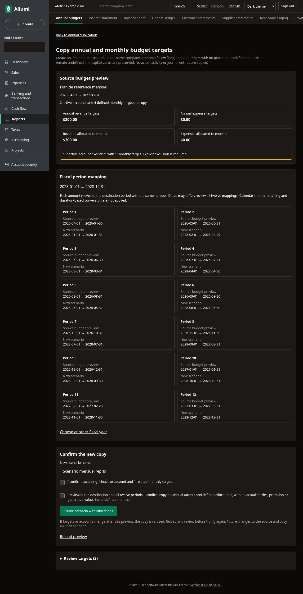
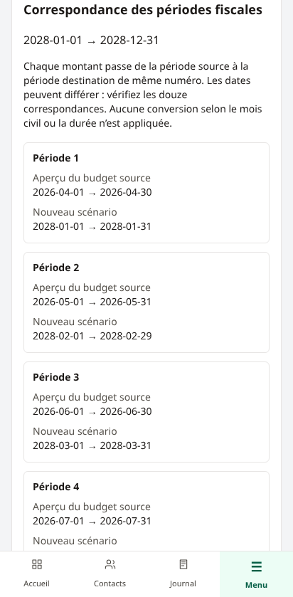
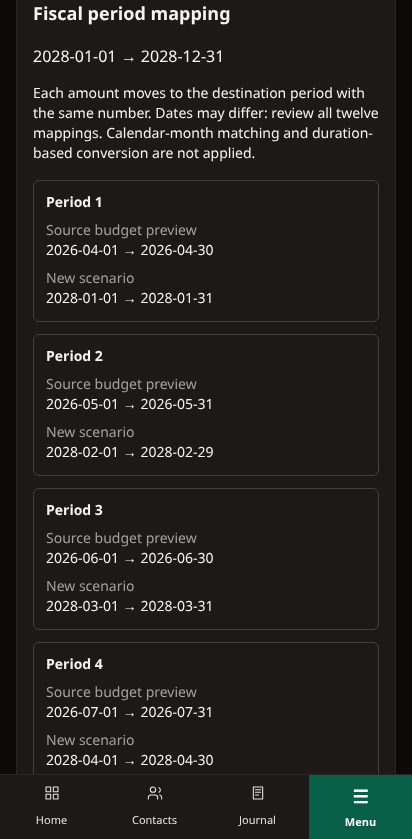

# Dupliquer les objectifs annuels et mensuels

Depuis **Budget mensuel → Dupliquer avec les répartitions mensuelles**, reprenez un budget dans un nouveau scénario indépendant de la **même entreprise**. Le lien est aussi disponible sur la page de duplication annuelle. Les objectifs annuels et les répartitions déjà définies sont copiés; la source reste intacte et aucune écriture réelle n’est créée.

## Choisir puis vérifier la destination

Choisissez un exercice existant, puis **Vérifier la correspondance des périodes**. Les douze cartes montrent les dates source et destination. La destination devient fixe pour cet aperçu; **Choisir un autre exercice** permet de recommencer la vérification.

La copie suit le **numéro de période fiscale**, de 1 à 12. Si la source commence en avril et la destination en janvier, la période 1 d’avril passe à celle de janvier. Aucune conversion selon le mois civil, la durée ou un prorata n’est appliquée. Les deux exercices doivent avoir exactement douze périodes. Un exercice fermé peut servir à la planification sans rouvrir ses périodes.

Le résumé distingue les objectifs annuels de revenus et de charges des montants déjà répartis. **Vérifier les objectifs** affiche chaque compte, l’annuel, le montant réparti, le reste et les montants définis par période.

## Confirmer la copie

1. Donnez un nouveau nom au scénario, unique dans l’exercice cible.
2. Confirmez l’exclusion des comptes inactifs lorsqu’ils existent. Leurs objectifs annuels et mensuels sont exclus ensemble; les nombres sont annoncés avant confirmation. Pour les conserver, réactivez les comptes puis rechargez l’aperçu.
3. Confirmez la destination et les douze correspondances, puis **Créer le scénario avec les répartitions**.

Le rapport mensuel du nouveau scénario s’ouvre sur sa première période. La copie reprend les **cents exacts**, conserve un objectif explicite de **zéro** et laisse les **mois absents non définis**. Une répartition incomplète reste incomplète; aucun montant restant n’est réparti automatiquement. Une source vide crée un scénario vide. Les futurs changements de la copie et de la source sont indépendants.

Le réel est recalculé depuis le grand livre aux dates du nouvel exercice : il n’est jamais copié. Deux scénarios du même exercice partagent donc le réel comptabilisé de cet exercice. Les soldes, factures, paiements et contre-passations ne sont pas dupliqués.

## Aperçu périmé et accès

Une modification du budget source, des montants mensuels, de l’identité ou du statut de ses comptes, ou des dates/périodes vérifiées invalide l’aperçu. La confirmation refuse alors toute création et conserve le nom saisi. **Recharger l’aperçu** remet le formulaire à son état initial; vérifiez de nouveau les montants et cochez les confirmations.

La lecture de cet aperçu et la création exigent **Comptabilité en écriture**, revérifiée au moment de la confirmation. Un rôle en lecture seule reste bloqué même avec une surcharge d’écriture. Aucun droit Contacts, Ventes ou Taxes n’est nécessaire. Un changement de permission peut donc refuser un formulaire déjà ouvert.

## Cohérence et limites

Le serveur verrouille le budget source, les comptes et les références fiscales, puis revérifie la révision et l’empreinte de l’aperçu. La création du scénario, des objectifs annuels et mensuels et de l’événement `budget.duplicate_monthly` est atomique. Une erreur annule tout. L’audit conserve la source, sa révision, les exercices, les nombres copiés et exclus et la correspondance des périodes. Les politiques RLS et gardes SQL restent actives.

La limite est de **1 000 objectifs annuels et 12 000 montants mensuels**, sans troncature. L’ensemble des comptes à objectif actif et des comptes avec activité réelle dans l’exercice destination doit aussi rester sous la limite de 1 000 comptes du rapport. Une grande copie peut prendre plusieurs dizaines de secondes; le bouton annonce l’opération en cours. Cette seule transaction bornée dispose de 60 secondes, puis est annulée en cas de dépassement. Les transactions ordinaires gardent leur limite de 20 secondes.

Aucune migration ni nouvelle configuration. La duplication annuelle seule reste disponible dans [[Duplication-des-budgets]]. L’[[Import-CSV-des-budgets]] concerne encore les objectifs annuels uniquement. Pas de copie entre entreprises, de conversion de devise ni de prévision automatique de trésorerie.

Les captures utilisent exclusivement une entreprise fictive avec Chromium et émulation mobile. Les essais physiques Safari iOS restent à effectuer.

Voir [[Budgets-mensuels]], [[Budgets-annuels]], [[Exercices-et-periodes]], [[Utilisateurs-et-permissions]] et [[Mise-a-jour]].
