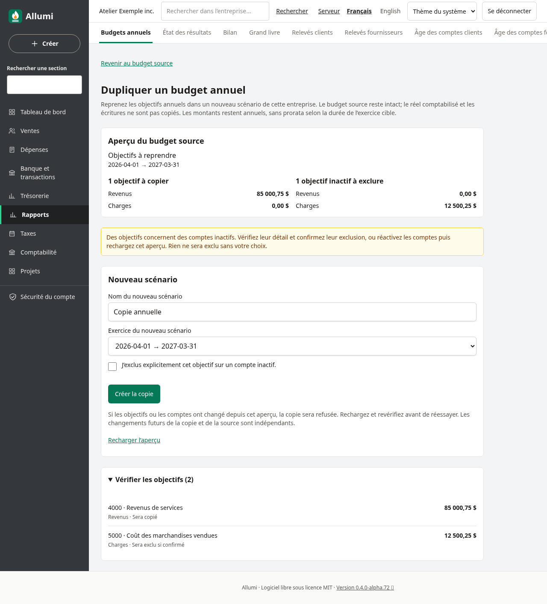
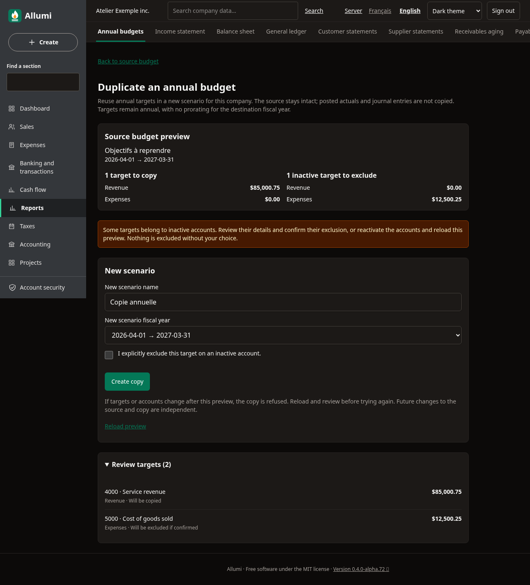
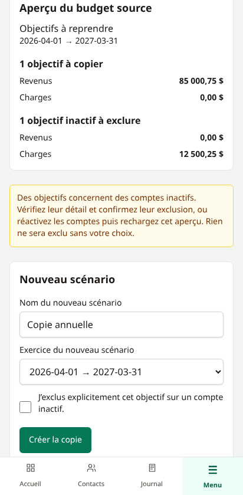
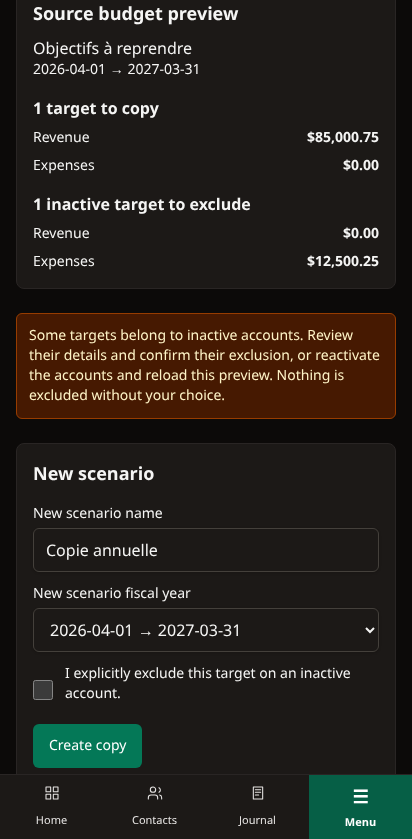

# Dupliquer un budget annuel

Depuis la fiche d’un budget, **Dupliquer le budget** reprend les objectifs dans un nouveau scénario de la **même entreprise**. Choisissez un nom et un exercice déjà créé. Cela permet de préparer un autre scénario ou de reprendre des objectifs pour l’exercice suivant sans les ressaisir.

Le budget source reste intact. Cette option copie seulement les objectifs annuels. Pour reprendre aussi les répartitions définies, choisissez **Dupliquer avec les répartitions mensuelles** : [[Duplication-des-budgets-mensuels]]. Seuls les objectifs annuels sont copiés : les écritures, les soldes réels et les contre-passations ne sont pas dupliqués. Le nouveau rapport calcule son réel depuis le grand livre aux dates de son propre exercice. Si deux scénarios utilisent le même exercice, ils affichent donc le même réel à cet instant. Les montants annuels ne sont pas répartis ou proratisés selon la durée de l’exercice cible.

## Vérifier l’aperçu

La page présente le nom et les dates du budget source, le nombre d’objectifs à copier et les sommes séparées de revenus et de charges. **Vérifier les objectifs** déplie tous les comptes concernés, leur objectif exact et le résultat proposé pour chacun. Un objectif de zéro reste un objectif défini et est conservé.

Les comptes inactifs figurent séparément, avec leurs nombres et montants. Rien ne sera exclu sans votre choix : cochez la case d’exclusion pour continuer, ou réactivez les comptes dans le plan comptable puis rechargez l’aperçu. Si aucun objectif actif ne reste, la page annonce la création d’un scénario vide; cette possibilité est aussi disponible pour une source vide.

## Créer le nouveau scénario

1. Saisissez un nouveau nom, unique pour l’exercice cible.
2. Choisissez l’exercice, qui peut être le même que la source ou un autre exercice existant.
3. Confirmez l’exclusion des objectifs inactifs si nécessaire, puis **Créer la copie**.

La fiche du nouveau budget s’ouvre. Ses futurs changements sont indépendants de la source. Un exercice source fermé peut être repris sans rouvrir ses périodes : il s’agit de données de planification, sans mouvement comptable.

## Si l’aperçu devient périmé

Une modification du budget source ou de l’identité affichée/l’état actif de ses comptes invalide l’aperçu. La copie est refusée avant la création; le nom et l’exercice saisis restent disponibles dans le formulaire refusé. Utilisez **Recharger l’aperçu**, revérifiez les objectifs et soumettez à nouveau. La recharge remet le formulaire à son état initial.

La confirmation verrouille le budget source et les comptes, vérifie la révision et l’empreinte de l’aperçu, puis crée le scénario et ses objectifs dans une seule transaction. Une erreur annule toute la copie, y compris ses traces d’insertion; aucun scénario partiel n’est conservé. Une double soumission du même nom/exercice est refusée par l’unicité existante.

## Permissions et limites

La duplication exige **Comptabilité en écriture**. Les comptes en lecture seule ne voient pas ce bouton et ne peuvent pas ouvrir l’aperçu, même avec une surcharge d’écriture. Aucun droit Contacts, Ventes ou Taxes n’est nécessaire. Les accès sont revérifiés lors de la confirmation, et les nouvelles données restent soumises à la RLS et à l’audit existants. L’événement `budget.duplicate` conserve le budget source, sa révision, le nombre d’objectifs copiés et les identifiants des comptes exclus; l’entreprise et l’auteur sont imposés par le serveur.

La limite est de **1 000 objectifs** : une source plus grande est refusée, jamais tronquée. Les objectifs absents ne sont pas transformés en zéros. Les noms, montants et comptes conservés restent soumis aux règles des [[Budgets-annuels]].

Aucune migration et aucune nouvelle configuration. Pas de copie entre entreprises, de conversion de devise, de ventilation mensuelle ou de prévision automatique. Les captures utilisent une entreprise fictive avec Chromium et émulation mobile; les essais physiques Safari iOS restent ouverts.

Voir [[Budgets-annuels]], [[Exercices-et-periodes]], [[Utilisateurs-et-permissions]] et [[Mise-a-jour]].
