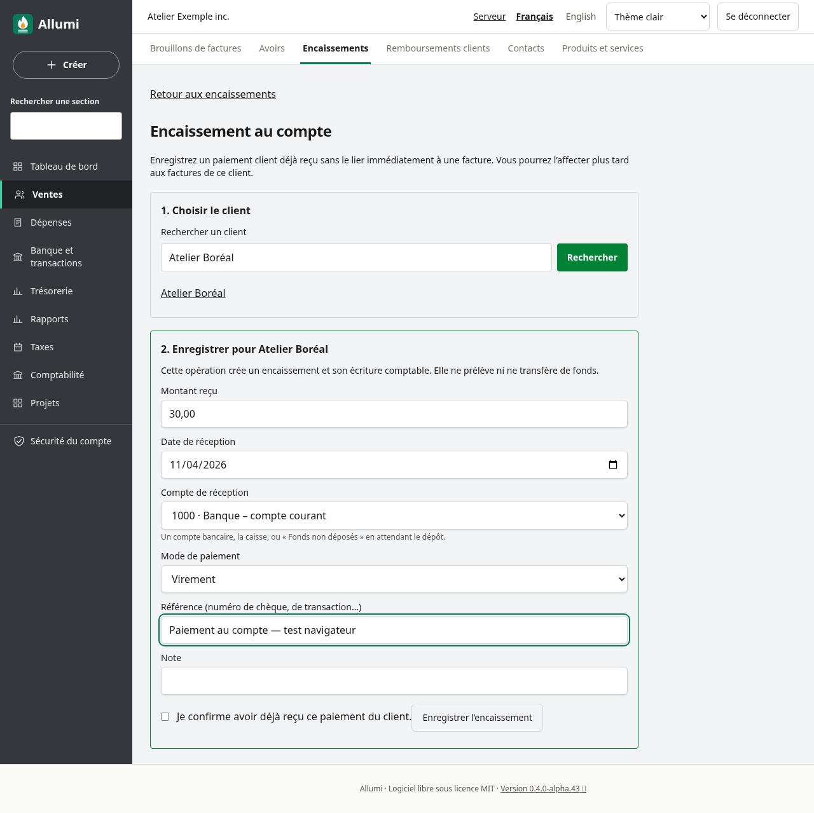
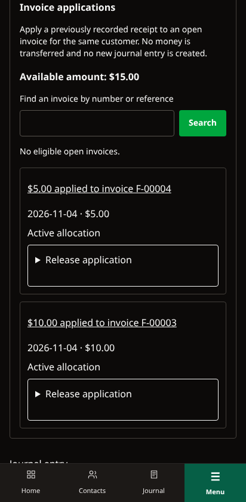

# Encaissements au compte client

Enregistrer un encaissement au compte permet de comptabiliser de l’argent **réellement reçu** d’un client sans choisir immédiatement une facture. Le montant reste disponible pour régler ensuite une ou plusieurs factures du même client, en totalité ou en partie. Ce n’est ni une facture ni une promesse de paiement.

Allumi n’effectue aucun prélèvement et ne transmet aucun ordre bancaire. À la création, il comptabilise une nouvelle écriture : débit du compte de réception, crédit des comptes clients pour ce client. Il ne crée ni vente ni taxe supplémentaire.

## Enregistrer les fonds reçus

Depuis **Ventes → Encaissements**, ouvrir **Encaissement au compte**. Sous **1. Choisir le client**, utiliser **Rechercher un client** et **Rechercher**, puis choisir son nom. Vérifier l’identité affichée sous **2. Enregistrer pour…**. Un client archivé ou un contact uniquement fournisseur n’est pas admissible.

Saisir le montant positif réellement reçu, la date de réception et un compte bancaire, de caisse ou de fonds non déposés. Ajouter le mode de paiement et, si utile, une référence ou une note. Vérifier les informations, cocher **Je confirme avoir déjà reçu ce paiement du client.**, puis **Enregistrer l’encaissement**. La date ne peut être future et doit appartenir à une période fiscale ouverte; le compte de réception doit être actif et admissible.

La création attribue le numéro d’encaissement et enregistre le paiement et son écriture dans une seule transaction, sans affectation automatique à une facture. Un identifiant de soumission protège la reprise du même formulaire : une demande répétée retrouve le même encaissement, sans deuxième paiement ni deuxième écriture. Réutiliser cet identifiant avec un montant, une date ou d’autres données différents est refusé. Pour une autre réception réelle, ouvrir un nouveau formulaire.

## Affecter le disponible à des factures

Sur la fiche d’encaissement, ouvrir **Affectations aux factures** et consulter **Montant disponible**. Il correspond au montant reçu diminué des affectations actives et des compensations déjà enregistrées. Les remboursements du disponible créent une compensation avec le paiement sortant; leur enregistrement est décrit dans [[Remboursements-des-encaissements]].

Utiliser **Rechercher une facture par numéro ou référence**, puis **Rechercher**. Sous **Facture à régler**, choisir une facture et cliquer sur **Réviser l’affectation**. La recherche est littérale, y compris pour les caractères `%`, `_` et `\`, et propose au plus 50 factures. Préciser la recherche si nécessaire. Seules les factures validées, ouvertes et du même client sont admissibles. Une facture ayant déjà une affectation active de cet encaissement est exclue du choix.

Vérifier le solde de la facture et le disponible de l’encaissement, saisir le **Montant à affecter** et la **Date d’affectation**, cocher **Je confirme cette affectation et les soldes affichés.**, puis **Affecter cet encaissement**. Le montant peut être partiel, sans dépasser l’un ou l’autre de ces deux soldes. Recommencer sur une autre facture pour répartir le reste. L’affectation ne crée **aucune nouvelle écriture comptable** et ne déplace pas d’argent : les fonds ont déjà été comptabilisés à la réception.

Exemple : sur 120,00 $ reçus, affecter 50,00 $ à une première facture et 40,00 $ à une seconde laisse 30,00 $ disponibles. Les totaux initiaux des factures et du paiement restent inchangés.

Les deux soldes revus sont contrôlés sous verrou lors de la confirmation. Une modification concurrente du paiement ou de la facture refuse le formulaire périmé : recharger la fiche, vérifier le disponible et choisir de nouveau la facture avant de confirmer. Un deuxième envoi ne peut pas doubler une affectation active.

## Retirer une affectation sans annuler les fonds reçus

L’historique conserve les affectations actives et retirées, avec numéro de facture, montant et dates, par pages de 25. Les liens de pagination conservent la recherche.

Ouvrir **Désaffecter** sur la ligne concernée, saisir la **Date de désaffectation**, cocher **Je confirme la désaffectation de ce montant.**, puis confirmer avec **Désaffecter**. Le montant redevient disponible sur l’encaissement et à payer sur la facture. Le paiement reçu et son écriture restent conservés : **désaffecter ne rembourse pas le client**. L’affectation initiale reste dans l’historique avec son retrait daté. Répéter le même retrait conserve le premier résultat sans changer sa date ni libérer deux fois le montant.

L’affectation et son retrait sont permis même si l’encaissement a déjà été inclus dans un dépôt bancaire. L’**annulation de l’encaissement**, qui contre-passe la réception des fonds, reste distincte et exige d’abord l’annulation de tout dépôt actif : [[Depots-bancaires]] et [[Encaissements]].

## Rembourser un disponible

Un montant non affecté peut être remboursé en partie ou en totalité depuis la fiche de l’encaissement : [[Remboursements-des-encaissements]]. Le paiement au client doit avoir été effectué séparément. Allumi comptabilise la sortie, la compense avec le disponible et conserve les affectations existantes aux factures. Un remboursement actif bloque l’annulation de l’encaissement; sa propre annulation rétablit le disponible sans retirer les affectations aux factures.

## Dates et droits

Les dates d’affectation ne peuvent être futures ni précéder la réception du paiement, la comptabilisation de la facture ou un mouvement ultérieur d’affectation ou de retrait sur les pièces concernées. Une désaffectation ne peut précéder son affectation ou les mouvements ultérieurs. La date doit appartenir à une période fiscale ouverte. Ces contrôles maintiennent des soldes historiques cohérents; ils sont aussi appliqués en base, avec sérialisation des opérations et refus des instantanés de transaction non pris en charge.

La **création** exige Ventes et Comptabilité en écriture ainsi que Contacts en lecture pour choisir le client actif. La **consultation** d’un encaissement existant exige Ventes et Comptabilité en lecture. L’**affectation et la désaffectation** exigent la gestion des ventes et la validation des écritures, correspondant aux accès en écriture de ces deux modules, sans permission Contacts supplémentaire. Toutes les opérations restent isolées par entreprise et auditées.

Le parcours est disponible en français et en anglais, sur ordinateur et téléphone, en thèmes clair et sombre.

Voir aussi [[Recherche-des-paiements-clients]], [[Releve-de-compte-client]], [[Affectation-des-avoirs-clients]], [[Utilisateurs-et-permissions]] et [[Mise-a-jour]].
