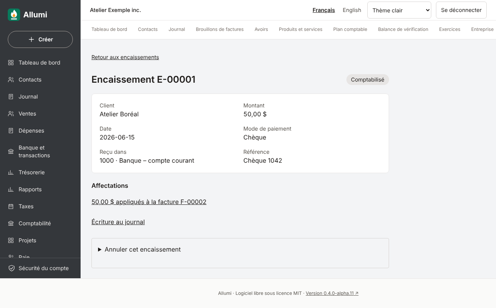

# Encaissements

Un **encaissement** est un paiement reçu d’un client et appliqué à une facture validée. Il met à jour le solde de la facture et ajoute une écriture au [[Journal-et-ecritures]]. Cette page décrit l’enregistrement, la consultation et l’annulation d’un encaissement. Les remboursements, les dépôts groupés, les trop-perçus et acomptes, l’affectation d’un paiement à plusieurs factures et le côté fournisseurs ne sont pas encore disponibles : voir [[Feuille-de-route]].

## Enregistrer un encaissement

Ouvrir la facture dans **Brouillons de factures → Factures validées**. Sous le solde restant, le bloc **Encaissements de cette facture** indique si elle est **non payée**, **partiellement payée** ou **payée**, et liste les encaissements appliqués. Le propriétaire et les comptables ouvrent **Enregistrer un encaissement** et saisissent :

- le **montant reçu**, proposé avec le solde restant (virgule en français, point en anglais), jamais plus que ce solde et avec deux décimales au plus;
- la **date de réception**, égale ou postérieure à la date comptable de la facture, pas dans le futur, dans une période ouverte;
- le **compte de réception** : un compte bancaire, la caisse, ou **Fonds non déposés** en attendant le dépôt;
- le **mode de paiement** (comptant, chèque, virement, Interac, cartes, autre), une **référence** (numéro de chèque ou de transaction) et une **note**, facultatives.

À l’enregistrement, Allumi crée **en une seule transaction** :

1. l’écriture au journal : l’argent **entre** dans le compte choisi (débit) et le compte **clients** diminue (crédit, pour ce client);
2. l’encaissement, avec son numéro définitif sans trou (`E-00001`, `E-00002`…);
3. l’affectation du montant à la facture.

La base de données vérifie tout une seconde fois à la validation : écriture équilibrée, même client, montant dans le solde de la facture, période ouverte.

Le solde d’une facture tient compte des encaissements **et** des avoirs appliqués ([[Validation-des-avoirs]]). Plusieurs encaissements partiels s’additionnent jusqu’au solde; une fois à zéro, la facture est payée et le formulaire disparaît.

### Doubles envois et formulaires périmés

Le solde que la page affichait est joint à la demande. Si la facture a changé entre-temps (un autre encaissement, un avoir), l’enregistrement est refusé avec le message « Le solde de cette facture a changé » : recharger la page et vérifier le solde. Cliquer deux fois, ou envoyer le même formulaire depuis deux onglets, n’enregistre donc qu’un seul encaissement. Deux encaissements simultanés sur une même facture sont traités l’un après l’autre; la facture n’est jamais payée au-delà de son solde. Un refus ne consomme pas de numéro et conserve ce qui a été saisi.

## Consulter

**Ventes → Encaissements** liste les encaissements du plus récent au plus ancien, 25 par page, avec le client, le montant, l’état et les factures visées. La fiche d’un encaissement montre ses données, ses **affectations** (avec les liens vers les factures) et le lien **Écriture au journal**. Tous les membres peuvent consulter.

## Annuler un encaissement

Le propriétaire ou un comptable ouvre **Annuler cet encaissement** sur sa fiche et indique une **date d’annulation** (égale ou postérieure à l’encaissement, dans une période ouverte), un **motif** obligatoire de 1 à 500 caractères et la confirmation.

L’annulation retire l’affectation à cette date, ajoute une **écriture inverse** exacte et garde l’encaissement avec son motif; le solde de la facture est rétabli et peut être encaissé de nouveau. Rien n’est supprimé. Répéter la demande ne crée pas une seconde écriture inverse.

Tant qu’un encaissement est appliqué à une facture, celle-ci ne peut pas être annulée ([[Annulation-des-factures]]) : annuler d’abord l’encaissement.

## Permissions et audit

Lecture pour tous les membres; enregistrement et annulation pour le propriétaire et les comptables. L’isolation par entreprise est appliquée côté serveur et par la base. Chaque changement est consigné par la base dans la [[Piste-d-audit]] (encaissement, affectation, écritures).

## Captures

Données fictives, Chromium ordinateur et téléphone émulé.

