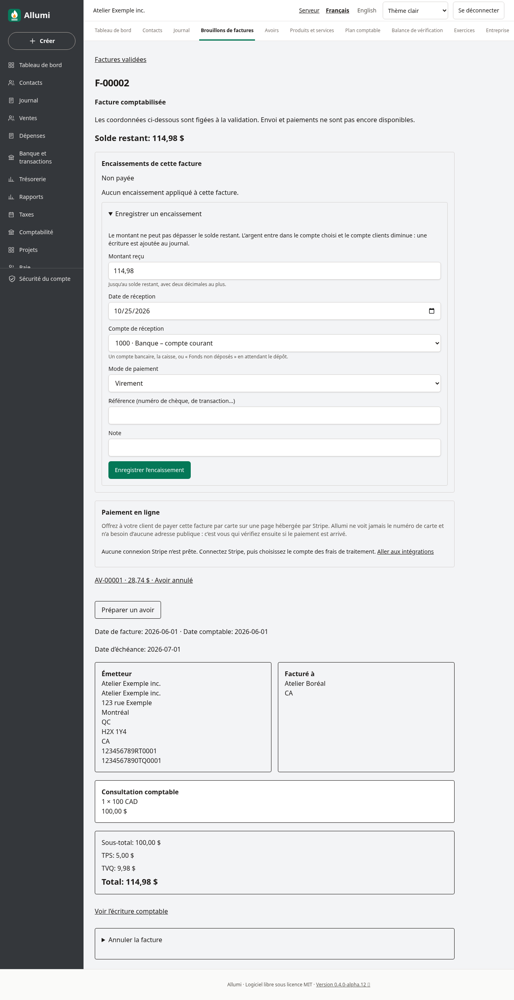
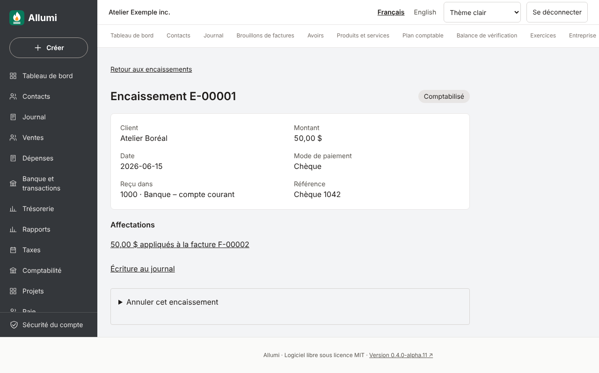
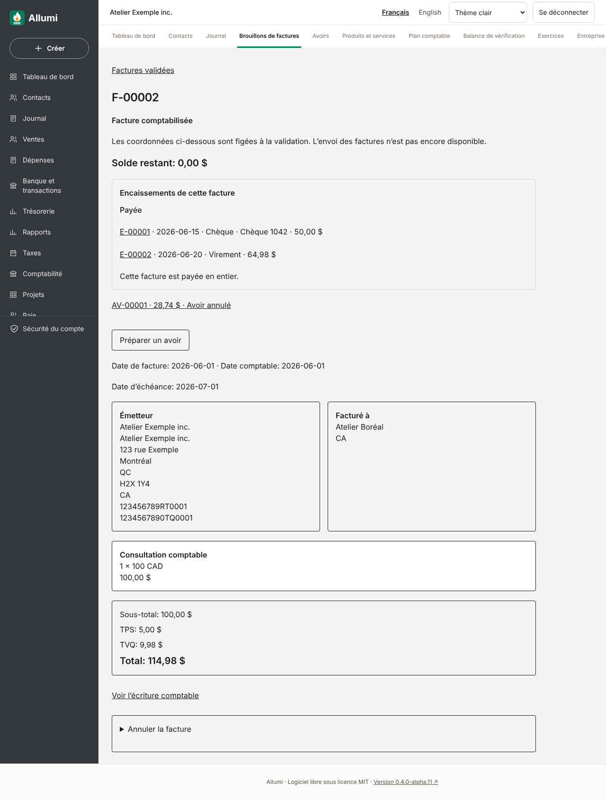
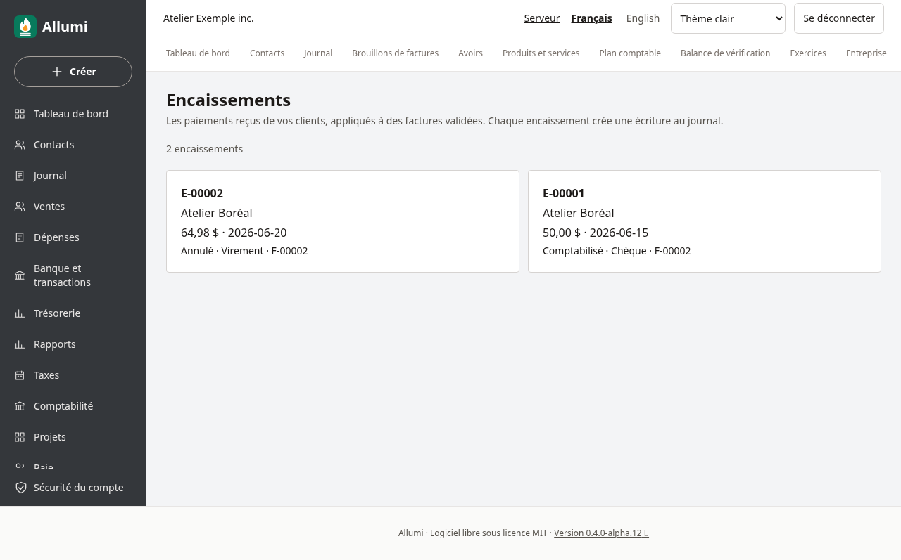
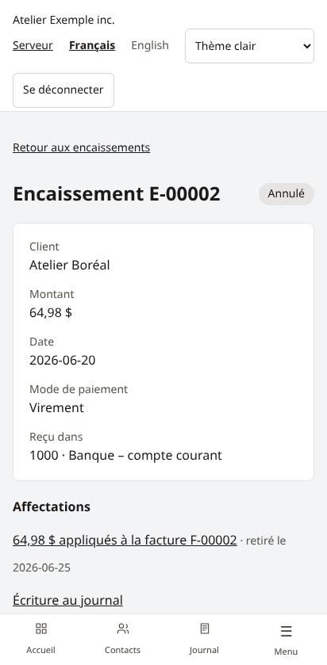

# Encaissements

Un **encaissement** est un paiement réellement reçu d’un client. Il peut être appliqué directement à une facture validée ou enregistré au compte, puis réparti sur une ou plusieurs factures du même client : [[Encaissements-au-compte]]. La réception ajoute une écriture au [[Journal-et-ecritures]]; une affectation ultérieure ne crée pas de seconde écriture. Cette page décrit le parcours depuis une facture, la consultation et l’annulation.

Les dépôts groupés sont disponibles dans [[Depots-bancaires]], les remboursements liés aux avoirs dans [[Avoirs-disponibles-et-remboursements]] et les paiements fournisseurs dans [[Factures-fournisseurs]].

## Enregistrer un encaissement

Ouvrir la facture dans **Brouillons de factures → Factures validées**. Sous le solde restant, le bloc **Encaissements de cette facture** indique si elle est **non payée**, **partiellement payée** ou **payée**, et liste les encaissements appliqués. Les membres autorisés à gérer les ventes et valider les écritures ouvrent **Enregistrer un encaissement** et saisissent :

- le **montant reçu**, proposé avec le solde restant (virgule en français, point en anglais), jamais plus que ce solde et avec deux décimales au plus;
- la **date de réception**, égale ou postérieure à la date comptable de la facture, pas dans le futur, dans une période ouverte;
- le **compte de réception** : un compte bancaire, la caisse, ou **Fonds non déposés** en attendant le dépôt;
- le **mode de paiement** (comptant, chèque, virement, Interac, cartes, autre), une **référence** (numéro de chèque ou de transaction) et une **note**, facultatives.

Un paiement par carte reçu par un **lien de paiement Stripe** est enregistré par Allumi lui-même, sur demande du propriétaire (section **Paiement en ligne** de la facture) : encaissement au montant brut, mode « carte de crédit », référence = identifiant du paiement chez Stripe, et frais de traitement dans une écriture à part. Voir [[Integrations]].

À l’enregistrement, Allumi crée **en une seule transaction** :

1. l’écriture au journal : l’argent **entre** dans le compte choisi (débit) et le compte **clients** diminue (crédit, pour ce client);
2. l’encaissement, avec son numéro définitif sans trou (`E-00001`, `E-00002`…);
3. l’affectation du montant à la facture.

La base de données vérifie tout une seconde fois à la validation : écriture équilibrée, même client, montant dans le solde de la facture, période ouverte.

Le solde d’une facture tient compte des encaissements **et** des avoirs appliqués ([[Validation-des-avoirs]]). Plusieurs encaissements partiels s’additionnent jusqu’au solde; une fois à zéro, la facture est payée et le formulaire disparaît.

### Doubles envois et formulaires périmés

Le solde que la page affichait est joint à la demande. Si la facture a changé entre-temps (un autre encaissement, un avoir), l’enregistrement est refusé avec le message « Le solde de cette facture a changé » : recharger la page et vérifier le solde. Cliquer deux fois, ou envoyer le même formulaire depuis deux onglets, n’enregistre donc qu’un seul encaissement. Deux encaissements simultanés sur une même facture sont traités l’un après l’autre; la facture n’est jamais payée au-delà de son solde. Un refus ne consomme pas de numéro et conserve ce qui a été saisi.

## Consulter

**Ventes → Encaissements** liste les encaissements du plus récent au plus ancien, 25 par page, avec le client, le montant, l’état et les factures visées. La fiche d’un encaissement montre ses données, ses **affectations** (avec les liens vers les factures) et le lien **Écriture au journal**. La consultation exige Ventes et Comptabilité en lecture; Contacts peut rester désactivé.

## Annuler un encaissement

Un membre disposant aussi du droit de contre-passation ouvre **Annuler cet encaissement** sur sa fiche et indique une **date d’annulation** (égale ou postérieure à l’encaissement, dans une période ouverte), un **motif** obligatoire de 1 à 500 caractères et la confirmation.

L’annulation retire l’affectation à cette date, ajoute une **écriture inverse** exacte et garde l’encaissement avec son motif; le solde de la facture est rétabli et peut être encaissé de nouveau. Rien n’est supprimé. Répéter la demande ne crée pas une seconde écriture inverse.

Tant qu’un encaissement est appliqué à une facture, celle-ci ne peut pas être annulée ([[Annulation-des-factures]]). Retirer explicitement l’affectation depuis la fiche de l’encaissement pour conserver les fonds reçus au compte, ou annuler l’encaissement si sa comptabilisation était erronée : [[Encaissements-au-compte]]. Un dépôt actif doit d’abord être annulé avant l’annulation de l’encaissement.

## Permissions et audit

La lecture exige Ventes et Comptabilité en lecture; l’enregistrement exige la gestion des ventes et la validation des écritures, et l’annulation exige aussi la contre-passation. La création d’un encaissement au compte exige en plus Contacts en lecture pour choisir le client; les affectations sur un encaissement existant ne l’exigent pas. L’isolation par entreprise est appliquée côté serveur et par la base. Chaque changement est consigné par la base dans la [[Piste-d-audit]] (encaissement, affectation, écritures).

## Captures

Données fictives, Chromium ordinateur et téléphone émulé.

Les encaissements reçus dans les fonds non déposés peuvent être regroupés vers la banque : [[Depots-bancaires]]. Un encaissement inclus dans un dépôt actif nécessite d’abord l’annulation du dépôt avant sa propre annulation.

La recherche, les filtres de dates/état et la pagination des paiements sont décrits dans [[Recherche-des-paiements-clients]]. La consultation exige Ventes et Comptabilité en lecture; Contacts peut rester désactivé.
