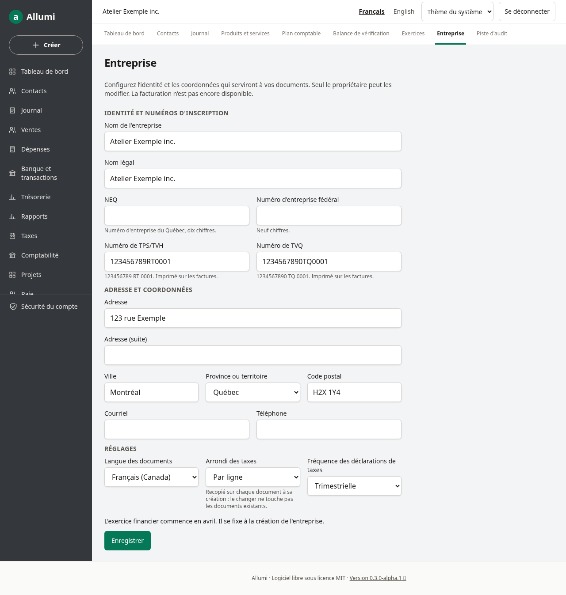

# Identité et coordonnées de l’entreprise

Ouvrir **Entreprise** dans la navigation, ou dans le menu sur téléphone. Le propriétaire peut modifier les renseignements; les comptables et lecteurs disposent d’une fiche de consultation. L’interface est disponible en français et en anglais, en thème clair ou sombre.

## Renseignements

Le nom affiché est obligatoire. Le nom légal, l’adresse, le courriel, le téléphone et les numéros d’inscription sont facultatifs. Vider un champ facultatif retire sa valeur. En cas de refus, les valeurs saisies restent dans le formulaire pour correction.

Les numéros sont normalisés sans espaces, points ou tirets, avec les lettres en majuscules :

| Champ | Format enregistré |
| --- | --- |
| NEQ | 10 chiffres |
| Numéro d’entreprise fédéral | 9 chiffres |
| TPS/TVH | 9 chiffres, RT, 4 chiffres |
| TVQ | 10 chiffres, TQ, 4 chiffres |

Un format accepté ne confirme ni l’existence du numéro ni une inscription active auprès d’une autorité fiscale. Le code postal canadien est normalisé, par exemple `h2x1y4` devient `H2X 1Y4`.

## Réglages des documents

La langue des documents, l’arrondi des taxes et la fréquence déclarative sont enregistrés pour l’entreprise. Ils ne changent pas la langue du navigateur ni les données des documents existants. L’arrondi et la langue serviront de valeurs par défaut lors de la création des futurs documents. La fréquence enregistrée ne produit ni déclaration ni transmission automatique.

La devise reste CAD. Le mois de début d’exercice est affiché mais ne peut pas être modifié ici : les exercices déjà créés se gèrent dans [[Exercices-et-periodes]]. Les changements sont enregistrés dans la [[Piste-d-audit]].

La facturation n’est pas encore disponible dans cette préversion. Cette fiche prépare l’identité d’émetteur; voir [[Taxes-et-catalogue]] et [[Fonctionnalites-et-limites]].

## Captures

Entreprise fictive du parcours navigateur automatisé; les vues mobiles sont émulées sous Chromium.

