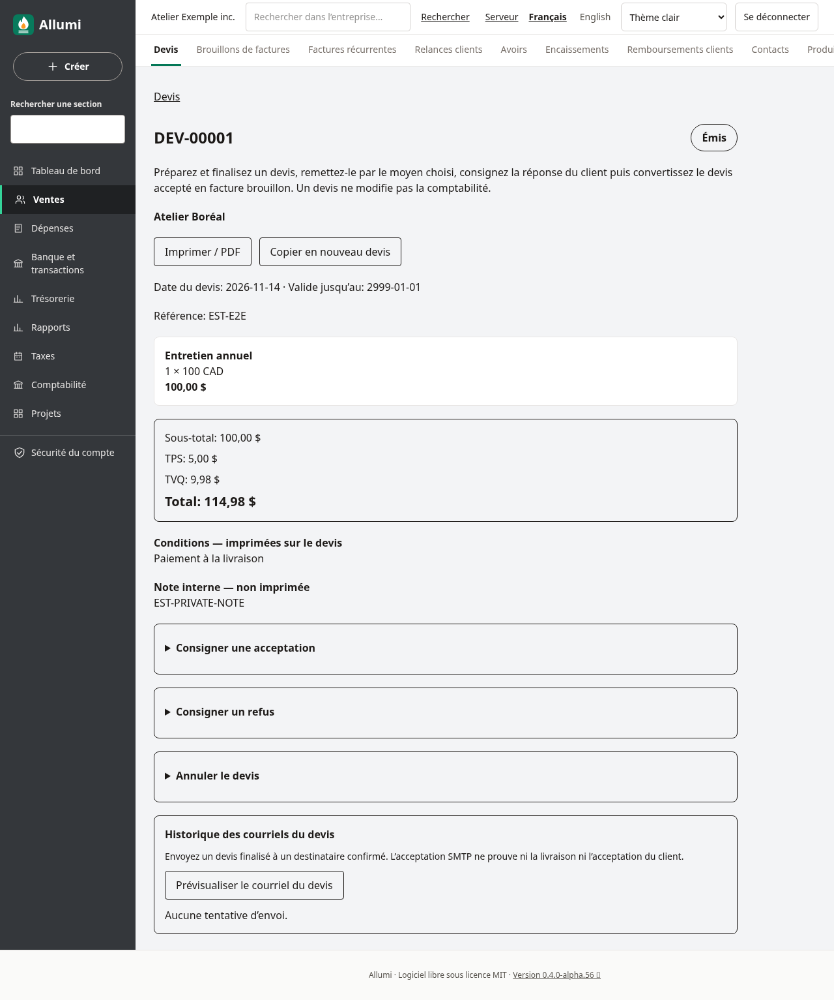
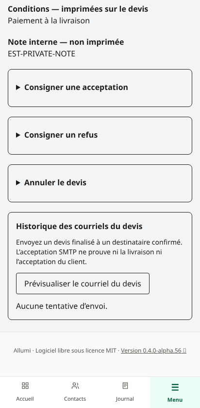
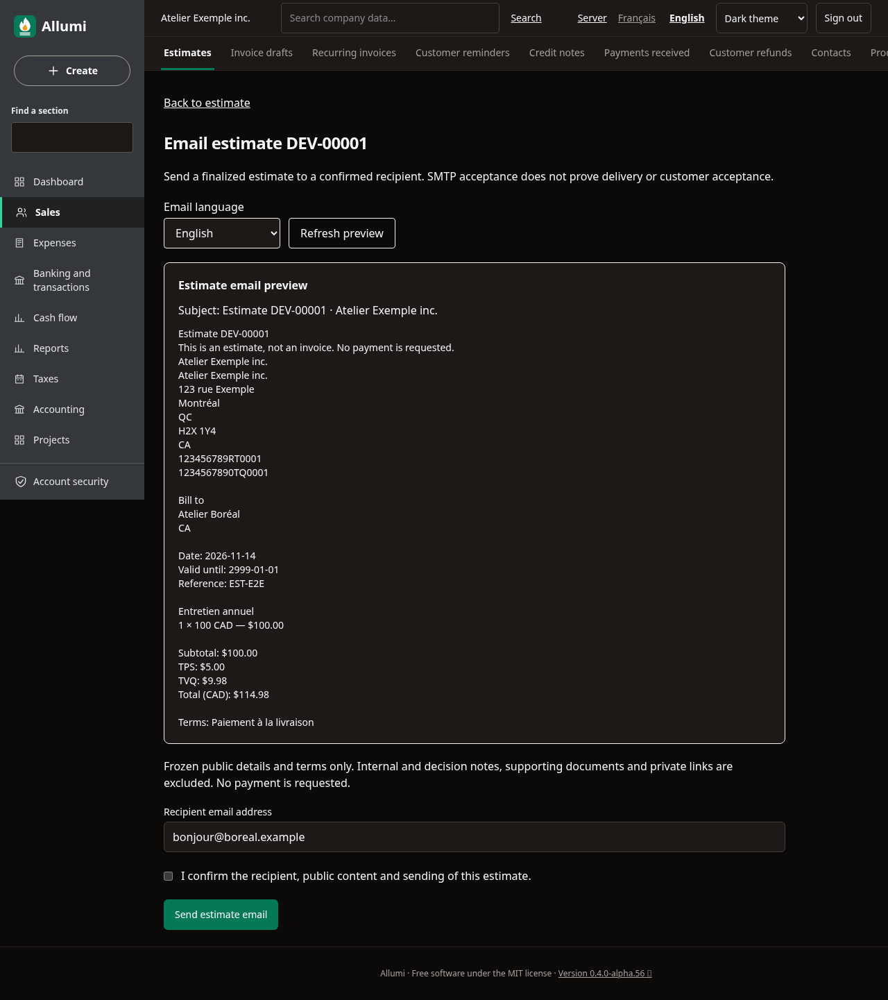
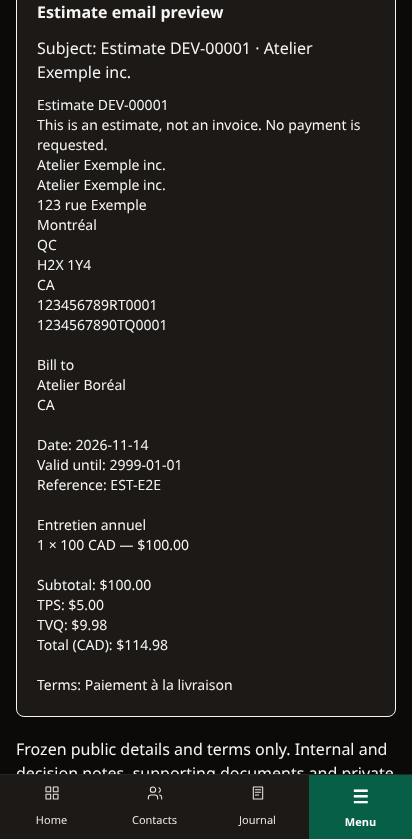
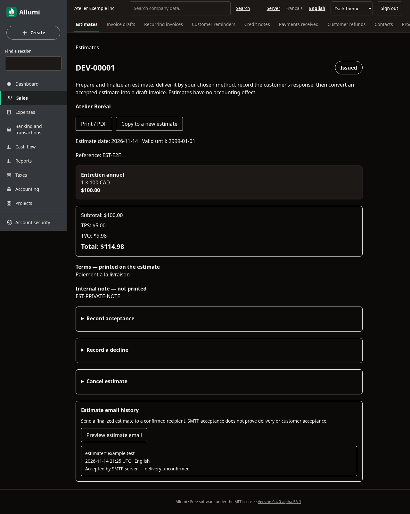
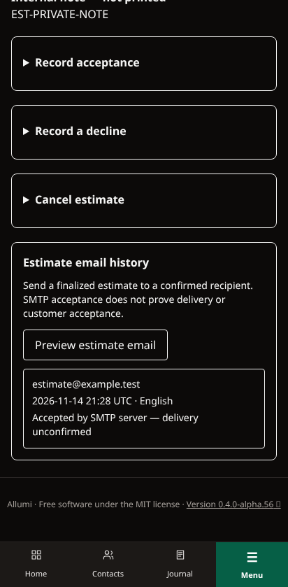

# Envoi des devis par courriel

Depuis un devis **Émis**, non expiré et en attente d’une réponse, ouvrez **Prévisualiser le courriel du devis**. L’envoi est individuel et confirmé; aucune finalisation, acceptation ou conversion ne déclenche de courriel.

## Finaliser avant l’envoi

**Finaliser et numéroter** attribue le numéro `DEV-…` et fige les coordonnées, lignes, prix, taxes, référence et conditions publiques. Le statut technique `SENT`, affiché **Émis**, signifie que le document est finalisé; il ne prouve aucune remise au client. L’ancien libellé « Marquer comme remis » est remplacé pour clarifier cette distinction. Vous pouvez remettre la version imprimée vous-même ou utiliser SMTP. Voir [[Devis]].

## Vérifier le message

1. Ouvrez l’aperçu depuis le devis finalisé.
2. Choisissez la langue du courriel puis **Actualiser l’aperçu**. La langue du message peut différer de celle de l’interface.
3. Vérifiez les données figées, la date de validité, les lignes, les montants CAD, les taxes et les conditions publiques. Le message précise qu’il s’agit d’un devis, pas d’une facture, et ne demande aucun paiement.
4. Vérifiez l’adresse proposée depuis les coordonnées figées du client. Une autre adresse unique peut être saisie; les listes de destinataires sont refusées.
5. Confirmez le destinataire et le contenu public, puis envoyez. Un envoi antérieur impose une confirmation supplémentaire.

Les notes internes du devis et de réponse ne sont jamais chargées par le parcours d’envoi. Les pièces jointes et liens privés sont exclus. Les taxes proviennent du résumé figé : l’envoi ne recalcule pas les taux et ne dépend pas de la lecture du module Taxes.

## Résultats et nouvel envoi

L’historique conserve le destinataire, la langue, l’heure UTC et le résultat : en attente, accepté par le relais, refusé ou incertain. **Accepté par le serveur SMTP** ne prouve ni la livraison ni l’acceptation commerciale du client. Une interruption ou une révocation des droits peut laisser le résultat non confirmé; vérifiez auprès du destinataire avant de réessayer.

Chaque soumission possède son identifiant. Un double clic ou une répétition identique ne réémet pas le message. Un nouvel identifiant doit respecter les limites : une minute entre les tentatives, cinq minutes si une tentative récente est en cours, maximum 20 par devis sur 24 heures. Le relais est appelé hors transaction, sans reprise automatique. Une réponse du client peut arriver après la réservation ou pendant le transport; le message représente le devis finalisé au moment de cette réservation.

Un devis brouillon, expiré, accepté, refusé, annulé ou converti ne permet pas de nouvel envoi. Ce statut est revérifié sous verrou avant réservation, puis en base. Une répétition identique d’une tentative déjà réservée retourne son historique sans nouvel appel SMTP, même après une réponse. Les tentatives restent consultables après une réponse ou une conversion.

La finalisation et le résultat SMTP ne changent pas la comptabilité et ne consignent pas une acceptation client. Les réponses restent enregistrées manuellement; la conversion en facture brouillon reste séparée.

## Configuration et permissions

Le serveur utilise la même configuration SMTP que l’[[Envoi-des-factures]] : [[Configuration]]. Sans SMTP valide, l’aperçu et l’historique restent disponibles, avec un message explicatif pour l’utilisateur autorisé à envoyer.

Ventes en lecture suffit pour l’aperçu et l’historique d’un devis finalisé, même sans Contacts, Comptabilité ou Taxes. Ventes en écriture est nécessaire pour envoyer. La finalisation conserve ses droits de validation des références : [[Utilisateurs-et-permissions]]. Les tentatives sont immuables, auditées et isolées par entreprise.

Ce parcours SMTP direct ne fournit pas de suivi d’ouverture ni de signature. Le partage distinct via [[Contrats-et-signatures]] propose une ouverture explicite du document et une signature déclarée, sans accepter/convertir automatiquement le devis source. Aucun envoi planifié ou groupé ni preuve de livraison. Les captures utilisent des données fictives et un relais SMTP local de test.
