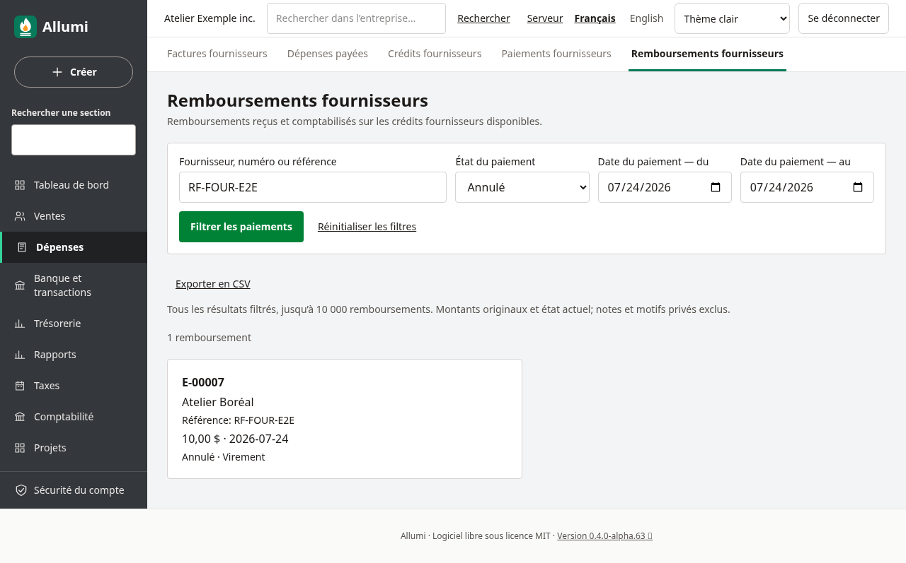
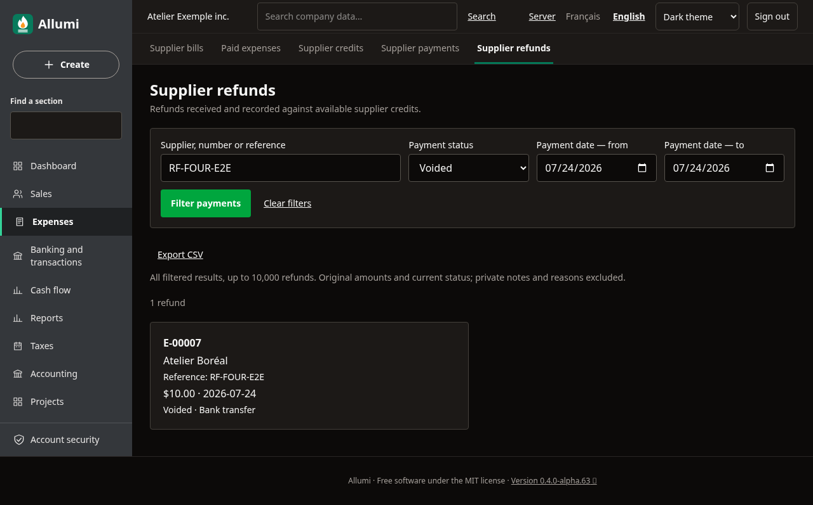
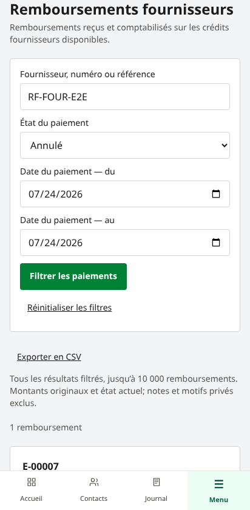
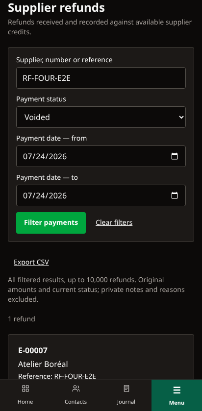

# Exporter les remboursements fournisseurs

Ouvrir **Dépenses → Remboursements fournisseurs**, choisir la recherche, l’état et les dates de réception, puis appliquer les filtres. **Exporter en CSV** télécharge tous les résultats correspondants, pas seulement les 25 remboursements de la page affichée.

## Résultats exportés

L’export utilise les mêmes critères et le même ordre que l’historique : date de réception décroissante, puis ordre de création et identifiant. La recherche porte sur le fournisseur, le numéro et la référence; `%`, `_` et `\` sont recherchés littéralement. Les dates de début et fin sont inclusives. Un filtre mal formé ou répété est refusé.

| Colonne | Contenu |
|---|---|
| Numéro | Numéro d’encaissement du remboursement |
| Date | Date originale de réception |
| Fournisseur | Nom figé sur la pièce d’origine, lorsqu’il existe |
| Montant | Montant original exact, avec deux décimales |
| État | Comptabilisé ou annulé au moment de l’export |
| Mode de paiement | Mode enregistré, traduit dans la langue de l’interface |
| Référence | Référence de transaction enregistrée |
| Devise | CAD |

Les notes internes, motifs d’annulation, identifiants de contacts et autres champs privés ne sont pas exportés. Un fournisseur sans identité historique disponible est signalé comme indisponible; son identité n’est pas inventée. Les identités figées restent consultables sans ouvrir les répertoires Contacts, Taxes ou Ventes.

## Annulations et périodes

Un remboursement annulé conserve son montant original positif, avec l’état **Annulé** et sa date originale. Le filtre de dates ne se déplace pas vers la date de contre-passation. Pour exporter seulement les remboursements encore comptabilisés, choisir cet état avant l’export.

Ce fichier est un historique de paiements, pas un calcul du solde net ou une déclaration de taxes. Pour les effets comptables et les contre-passations à une date donnée, utiliser [[Releve-de-compte-fournisseur]], [[Age-des-comptes-fournisseurs]] et [[Sommaire-des-taxes]].

## Langue, tableur et limite

Le fichier `supplier_refunds.csv` utilise la langue de l’interface : séparateur `;` et virgule décimale en français canadien, séparateur `,` et point décimal en anglais. Il est encodé en UTF-8 avec marque d’ordre des octets; les textes sont cités si nécessaire et les préfixes de formule neutralisés pour le tableur. Les montants sont écrits exactement, sans conversion en nombre flottant.

L’export accepte jusqu’à **10 000 résultats**. Au-delà, il refuse le téléchargement et demande de préciser la recherche ou la période; il ne fournit pas un fichier tronqué. Sans résultat, il produit uniquement les en-têtes de colonnes.

**Comptabilité en lecture** est nécessaire, pour la page comme pour l’adresse de téléchargement. Le contenu reste isolé par entreprise. Le téléchargement utilise une réponse privée non mise en cache. Il n’enregistre aucun nouveau paiement, ne modifie aucune écriture et ne nécessite aucune migration ou nouvelle configuration.

Voir [[Remboursements-fournisseurs]] et [[Recherche-des-paiements-fournisseurs]].
