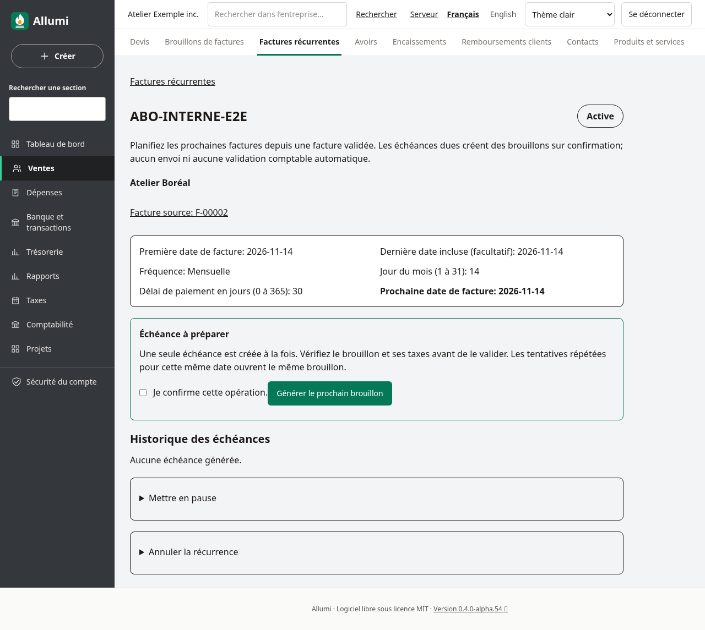
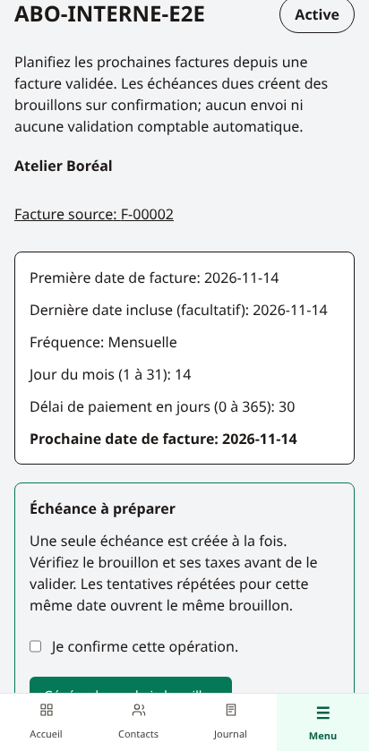
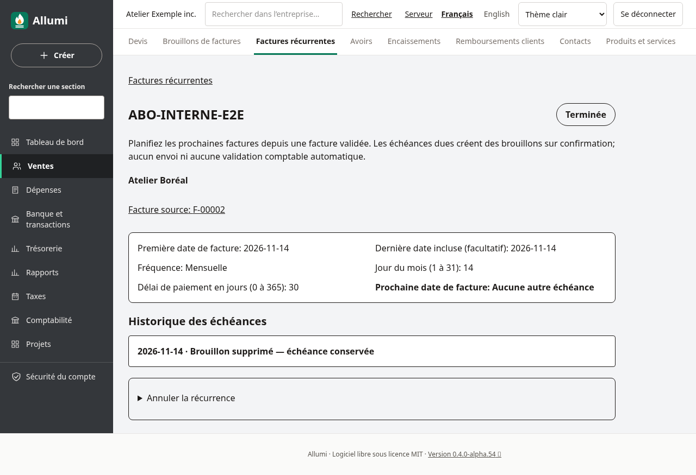
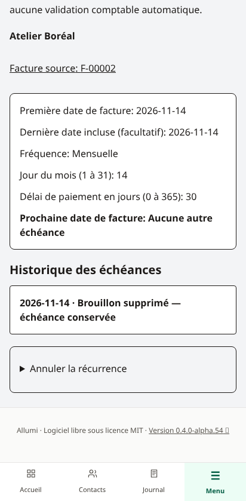
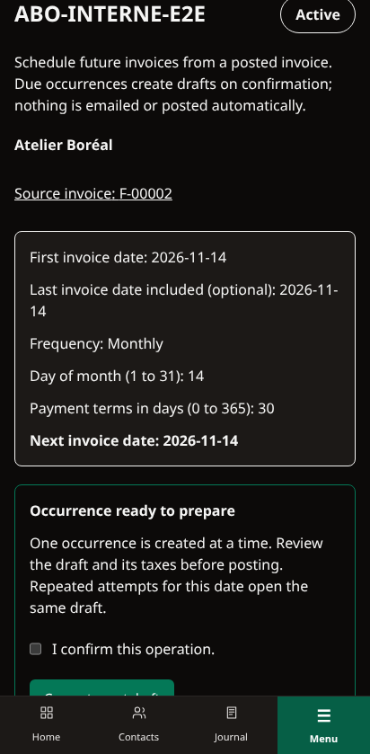

# Factures récurrentes

Ouvrez **Ventes → Factures récurrentes**, ou **Nouvelle récurrence** sur une facture client validée. Le modèle reprend une facture existante figée : lignes, quantités, prix, référence et note imprimable. Il prépare les échéances suivantes en brouillons, sans validation comptable ni envoi automatique.

## Créer un calendrier

Choisissez une facture source validée et donnez au modèle un nom interne. Ce nom ne devient ni la référence ni la note imprimable de la facture. Si la source n’a pas de référence, son numéro est utilisé. La note imprimable de la facture source est reprise; les notes internes d’un devis ne sont pas réintroduites dans ce parcours.

Définissez la première date de facture, obligatoirement après celle de la source, puis :

- Une fréquence mensuelle, trimestrielle ou annuelle.
- Un jour du mois entre 1 et 31. Un mois trop court utilise son dernier jour, sans décaler les mois suivants : le 31 janvier donne le 28 février, puis le 31 mars; un 29 février annuel revient le 29 lors de la prochaine année bissextile.
- Un délai de paiement de 0 à 365 jours calendaires, calculé depuis chaque date de facture.
- Une dernière date incluse, facultative. Elle limite les dates de facture et ne tronque pas leurs dates d’échéance de paiement.

La première date doit correspondre au jour choisi, éventuellement réduit au dernier jour du mois. Vérifiez-la si vous changez de facture source dans le sélecteur. Le calendrier et la source sont fixes après création : annulez le modèle et créez-en un autre pour changer les prix, la fréquence ou les dates. Les derniers modèles et leurs historiques restent consultables.

## Préparer une échéance due

La liste propose une recherche par nom, client ou numéro source et un filtre **Échéances dues seulement**. Chaque page contient au plus 50 modèles. Sur un modèle actif dont la prochaine date est arrivée, confirmez **Générer le prochain brouillon**. Une seule échéance est traitée par action, y compris en cas de retard sur plusieurs mois.

Les taxes sont recalculées à la date prévue de cette facture, avec l’arrondi figé sur la source. Les montants peuvent donc changer si les taux ont évolué. Le client, les articles éventuels, les comptes de revenus et les codes fiscaux doivent rester actifs; les taux doivent couvrir la date demandée. Un refus ne crée pas de facture et n’avance pas le calendrier.

Le brouillon est à revoir et peut être modifié selon les règles habituelles, mais son client reste celui de la source. Son lien **Modèle récurrent source** retrouve le calendrier. Sa validation comptable reste séparée : voir [[Brouillons-de-factures]] et [[Validation-des-factures]].

Deux tentatives simultanées pour la même échéance ouvrent la même facture. Répéter l’enregistrement d’un formulaire de création ne crée pas plusieurs modèles. Il reste possible de créer volontairement deux modèles distincts; vérifiez vos calendriers pour éviter une double facturation métier.

## Pause, annulation et suppression d’un brouillon

**Mettre en pause** bloque les nouvelles générations sans avancer la date. **Reprendre** conserve les éventuels retards à traiter. **Annuler la récurrence** est définitif et conserve les factures et l’historique existants.

Supprimer un brouillon généré ne rend pas son échéance disponible à nouveau. L’historique indique **Brouillon supprimé — échéance conservée**; le calendrier garde sa progression. Cela empêche une nouvelle tentative ancienne de recréer une facture supprimée. Si une nouvelle pièce est nécessaire, créez-la explicitement et vérifiez la facturation déjà effectuée.

Quand la prochaine date dépasse la fin du calendrier, le modèle est affiché **Terminé**. Une facture source annulée bloque aussi la génération : les pièces déjà créées restent conservées et le modèle peut être annulé.

## Permissions et limites

Ventes en lecture permet le suivi, avec le nom client figé sur la facture source. Créer et générer exige Ventes en écriture et Contacts, Comptabilité et Taxes en lecture; Catalogue en lecture est aussi nécessaire pour les articles repris. La pause et l’annulation demandent Ventes en écriture. Les références et droits sont contrôlés au moment de la génération, avec RLS forcée, liens de la même entreprise et piste d’audit.

L’historique affiche les 50 dernières échéances; toutes les occurrences restent conservées en base. Les sélecteurs proposent les 100 dernières factures validées; le bouton d’une facture plus ancienne permet de la présélectionner directement.

Cette version fonctionne sur confirmation dans l’interface. Elle ne fournit pas de traitement planifié en arrière-plan, d’envoi de courriels, de prélèvement automatique, d’échéance à ignorer ou de relance des impayés. Les fréquences hebdomadaires et les modifications d’un calendrier existant ne sont pas proposées. Aucun document n’est comptabilisé automatiquement.

