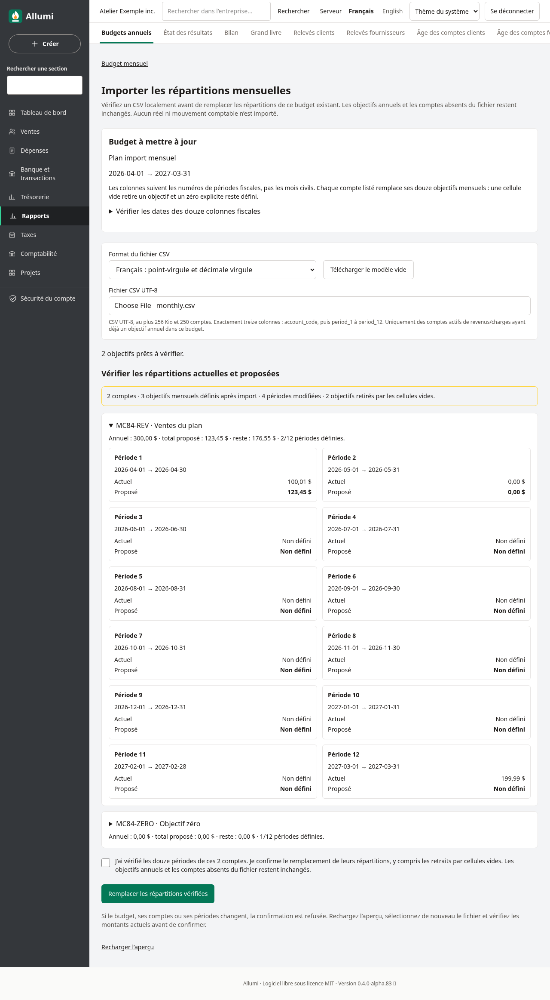
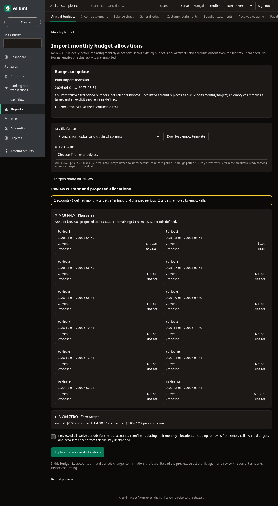
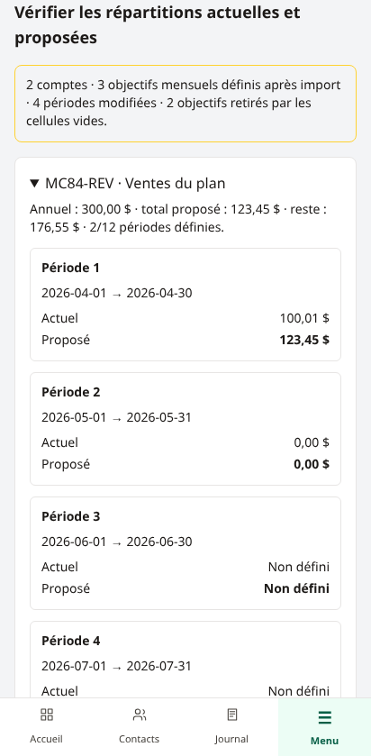
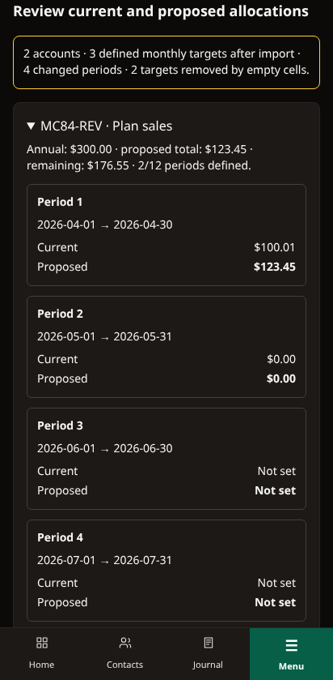

# Importer les répartitions mensuelles d’un budget

Depuis **Budget mensuel → Importer les répartitions mensuelles**, préparez les douze périodes de plusieurs comptes à partir d’un CSV. L’import met à jour **le budget existant affiché**. Il conserve ses objectifs annuels et les répartitions des comptes absents du fichier. Aucun scénario, solde réel ou mouvement comptable n’est créé.



## Préparer le fichier

Choisissez **Format du fichier CSV**, puis **Télécharger le modèle vide**. Le modèle ne contient que l’en-tête, avec BOM UTF-8 et fin de ligne CRLF; aucune donnée d’entreprise ni exemple. Le téléchargement conserve le fichier sélectionné, l’aperçu et le consentement. Le format du CSV est indépendant de la langue de l’interface.

Le fichier doit avoir exactement treize colonnes, dans cet ordre :

```csv
account_code;period_1;period_2;period_3;period_4;period_5;period_6;period_7;period_8;period_9;period_10;period_11;period_12
4000;123,45;0,00;;;;;;;;;;
```

Cet exemple français propose 123,45 $ pour la période 1 du compte 4000 et un objectif explicite de zéro pour la période 2. Les dix autres périodes seront **non définies**, même si elles avaient un montant auparavant. L’objectif annuel existant doit être au moins de 123,45 $.

- Français : point-virgule entre colonnes, virgule décimale.
- Anglais : virgule entre colonnes, point décimal.
- UTF-8, avec ou sans BOM; fins de ligne LF, CRLF ou CR. Les champs peuvent être entre guillemets. Les montants ont au plus deux décimales, sans signe, devise, séparateur de milliers, exposant ou arrondi.
- Au plus **256 Kio et 250 comptes** par fichier, soit 3 000 montants mensuels. Un compte doit apparaître une seule fois. Un dépassement refuse le fichier entier, sans troncature.

Seuls les comptes actifs de revenus/charges portant déjà un objectif annuel dans ce budget sont acceptés. Les codes et leurs zéros initiaux sont conservés. Un compte inconnu, inactif ou sans objectif annuel, un montant invalide, un doublon ou une somme mensuelle dépassant l’annuel refuse tout le lot. Préparez d’abord les objectifs dans [[Budgets-annuels]] si nécessaire.

## Vérifier les périodes et les montants

Le budget et l’exercice de destination sont fixes. **Vérifier les dates des douze colonnes fiscales** affiche les dates exactes correspondant à chaque colonne. `period_1` désigne la première période de cet exercice; elle peut commencer en avril plutôt qu’en janvier. Aucune conversion selon le mois civil ni prorata n’est appliqué. Les douze périodes fiscales doivent exister.

La lecture et l’aperçu se font **dans le navigateur avant l’envoi**. Le résumé annonce le nombre de comptes, de montants définis après import, de périodes modifiées et de montants retirés. Dépliez un compte pour voir les douze valeurs **Actuel → Proposé**, leurs dates, l’annuel, la somme proposée et le reste.



## Confirmer le remplacement

Pour chaque compte présent dans le CSV, ses **douze objectifs mensuels sont remplacés** :

- Une cellule vide retire l’objectif de cette période; elle ne conserve pas l’ancien montant.
- Un zéro reste un objectif défini et figure dans le rapport.
- Une ligne de compte avec douze cellules vides efface toute sa répartition mensuelle, en conservant son objectif annuel.
- Un compte absent du fichier conserve intégralement ses objectifs actuels.

Cochez la confirmation après vérification, puis **Remplacer les répartitions vérifiées**. Le rapport du même budget s’ouvre sur sa première période. La sélection d’un autre fichier, le changement de format ou de langue, ou l’actualisation du snapshot impose une nouvelle confirmation. Revenir à la langue initiale ne rétablit pas un ancien accord. Télécharger le modèle laisse le consentement intact.

## Aperçu périmé, permissions et sécurité

La page, le modèle et la confirmation exigent **Comptabilité en écriture**. Les comptes en lecture seule restent bloqués même avec une surcharge d’écriture. Aucun droit Contacts, Ventes ou Taxes n’est requis. Une permission retirée après ouverture du formulaire bloque l’envoi.

Le serveur relit le CSV et compare son contenu aux montants vérifiés, après contrôle de l’entreprise, de l’auteur et des permissions. Il verrouille le budget, les comptes et les références fiscales, puis revérifie révision et empreinte. Toute modification du budget, de l’identité/du statut des comptes ou des périodes invalide l’aperçu. Un refus conserve le fichier dans le formulaire; **Recharger l’aperçu** remet la sélection à zéro et impose une nouvelle vérification.

Les suppressions et insertions des seuls comptes listés, les révisions et l’audit sont dans **une seule transaction**. Une erreur, y compris dans un lot tardif, annule toutes les modifications et leurs traces. Les insertions se font par lots de 500, avec toutes les gardes SQL et politiques RLS actives. L’événement `budget.import_monthly_csv` conserve l’auteur/l’entreprise, la révision source, l’empreinte SHA256 du contenu, les comptes et périodes concernés et les nombres remplacés, définis, modifiés et retirés; le CSV complet n’est pas stocké dans cet événement.

Les périodes fermées autorisent ces données de planification sans rouvrir de période ni poster d’écriture. Ce lot borné dispose de la fenêtre de 120 secondes des écritures en masse; une expiration annule tout. Les opérations ordinaires gardent leur limite de 20 secondes.





Aucune migration ni nouvelle configuration. Le CSV de rapport d’une seule période n’a pas ce format : partez du modèle à treize colonnes. L’import annuel vers un nouveau scénario reste dans [[Import-CSV-des-budgets]], et la copie entre scénarios dans [[Duplication-des-budgets-mensuels]]. Pas de copie entre entreprises, de conversion de devise, de création d’objectifs annuels ou de prévision automatique de trésorerie.

Les captures utilisent une entreprise fictive dans Chromium et son émulation mobile. Les essais physiques Safari iOS restent à effectuer.

Voir [[Budgets-mensuels]], [[Budgets-annuels]], [[Exercices-et-periodes]], [[Utilisateurs-et-permissions]] et [[Mise-a-jour]].
