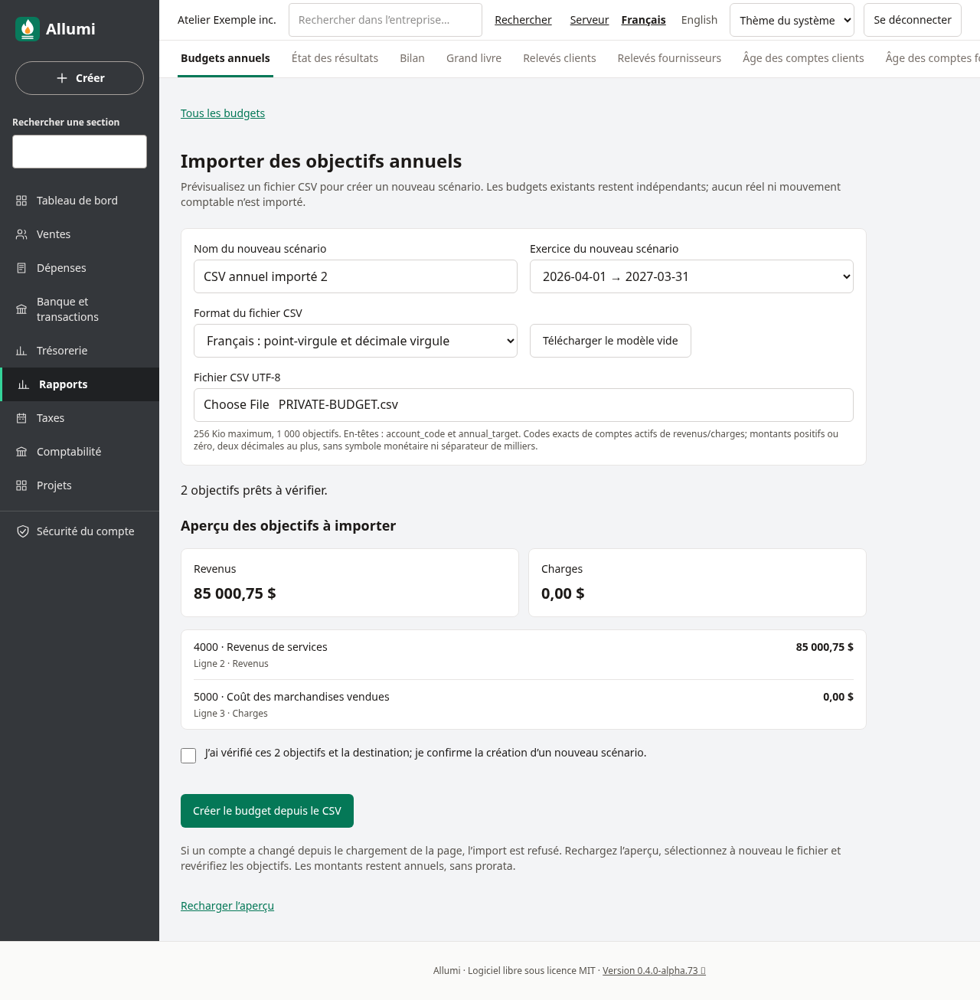
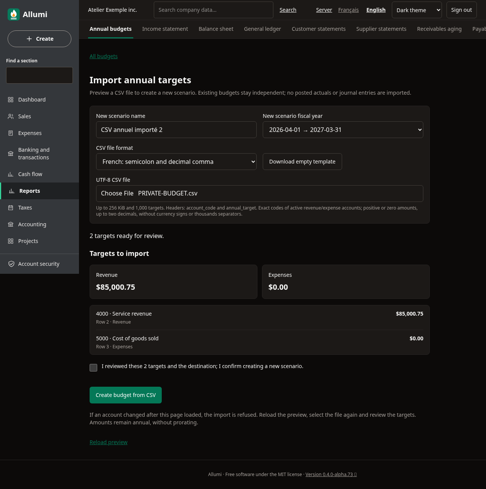
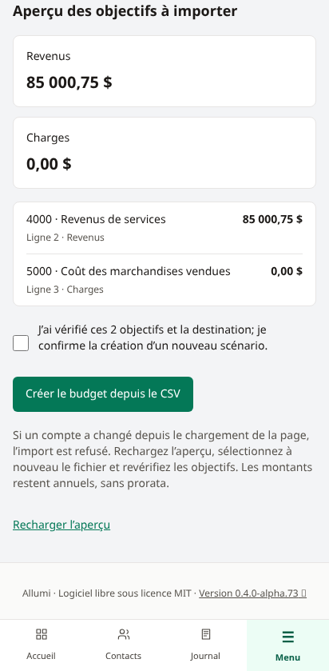
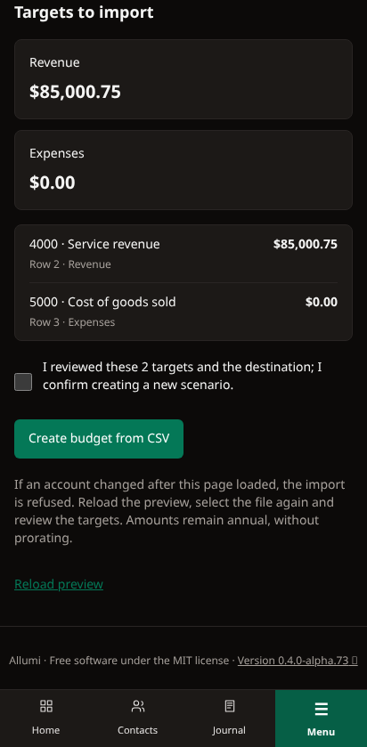

# Importer les objectifs annuels d’un budget en CSV

Depuis **Rapports → Budgets annuels → Importer un CSV**, créez un nouveau scénario à partir des codes de comptes et de leurs objectifs annuels. Le fichier est prévisualisé **localement dans le navigateur** avant confirmation. Les budgets existants ne sont pas écrasés; aucune écriture ni aucun montant réel n’est importé.



## Préparer le fichier

Choisissez le format du **fichier**, indépendamment de la langue de l’interface. **Télécharger le modèle vide** produit un CSV UTF-8 avec uniquement les deux en-têtes fixes `account_code` et `annual_target`. Ajoutez vos objectifs avant de l’importer.

Format français : séparateur point-virgule, décimale virgule.

```csv
account_code;annual_target
4000;85000,75
5000;0,00
```

Format anglais : séparateur virgule, décimale point.

```csv
account_code,annual_target
4000,85000.75
5000,0.00
```

Les codes ci-dessus sont des exemples : utilisez les **codes exacts de votre entreprise**. Les comptes doivent déjà exister, être actifs et de type revenu ou charge. Le fichier ne crée ni ne modifie de compte. Conservez les codes comme du texte dans votre tableur, particulièrement s’ils commencent par zéro. N’ajoutez pas de noms, de dates ou d’autres colonnes.

- UTF-8, avec ou sans BOM; fins de lignes CRLF, LF ou CR. Pas de fichier Excel `.xlsx`.
- Deux colonnes exactement, dans cet ordre. Les cellules peuvent être entourées de guillemets CSV; les guillemets mal formés sont refusés.
- Objectifs positifs ou nuls, deux décimales au plus, maximum 1 000 milliards de dollars par compte. Pas de signe, symbole monétaire, notation exponentielle ou séparateur de milliers.
- Un objectif par code : un doublon refuse tout le lot. Zéro est conservé comme objectif défini; un compte absent du fichier ne reçoit pas automatiquement un objectif zéro.
- Maximum **256 Kio et 1 000 objectifs**. Un en-tête sans donnée est refusé.

## Prévisualiser et confirmer

1. Saisissez un nom de scénario et choisissez un exercice existant.
2. Sélectionnez le format et le fichier. Le navigateur affiche les objectifs et les totaux de revenus/charges sans téléverser le fichier.
3. Corrigez toute erreur signalée, puis vérifiez les comptes et montants. Un seul compte inconnu, inactif ou de type incompatible refuse le lot entier.
4. Cochez la confirmation et choisissez **Créer le budget depuis le CSV**.

Changer le fichier, le format, le nom ou l’exercice efface la confirmation. L’approbation est aussi liée aux données des comptes affichées. JavaScript est nécessaire pour l’aperçu local. Le fichier reste uniquement en mémoire; il n’est pas enregistré dans le stockage local du navigateur.



## Contrôles à la confirmation

Le serveur relit le fichier en UTF-8 strict, valide le format et compare chaque objectif à l’aperçu transmis. Il ne fait pas confiance aux montants ou identifiants du navigateur. Les comptes sont résolus dans l’entreprise et verrouillés, leur état est revérifié, puis le budget et ses objectifs sont créés dans **une transaction**. Une erreur ne conserve ni scénario partiel ni lignes d’audit d’insertion partielles.

Si un compte a changé depuis l’aperçu, l’import est refusé. Utilisez **Recharger l’aperçu**, sélectionnez à nouveau le fichier et revérifiez les données. Les champs saisis restent disponibles après un refus, mais une recharge repart de zéro. Un nom déjà utilisé pour l’exercice est refusé, y compris lors de soumissions concurrentes.

Le serveur vérifie aussi la limite de 1 000 comptes du rapport, en comptant l’activité existante sans objectif. Un lot qui la dépasserait déjà est refusé. L’écran de sélection est limité à un plan comptable de **5 000 comptes**, sans liste partielle.

## Résultat et permissions

La fiche du nouveau budget s’ouvre après succès. Les objectifs restent annuels, sans prorata. Le réel est calculé depuis le grand livre aux dates exactes de l’exercice sélectionné; importer vers un autre exercice ne transporte pas le réel du précédent.

L’import et le modèle exigent **Comptabilité en écriture**. Les utilisateurs en lecture seule n’y accèdent pas, même avec une surcharge d’écriture. Aucun droit Contacts, Ventes ou Taxes n’est requis. La RLS, les contraintes et l’audit existants restent actifs. L’événement `budget.import_csv` conserve le format, le nombre d’objectifs et une empreinte SHA256 du contenu UTF-8 décodé. L’auteur et l’entreprise sont imposés par le serveur; le fichier et son nom ne sont pas conservés dans cet événement ni dans le stockage serveur.





Aucune migration ni nouvelle configuration. Cet import concerne des objectifs annuels CAD : pas de ventilation mensuelle, de devise étrangère, d’écriture financière ou de remplacement d’un budget existant. Les captures utilisent une entreprise fictive dans Chromium et son émulation mobile; les essais physiques Safari iOS restent ouverts.

Voir [[Budgets-annuels]], [[Duplication-des-budgets]], [[Exercices-et-periodes]], [[Utilisateurs-et-permissions]] et [[Mise-a-jour]].
