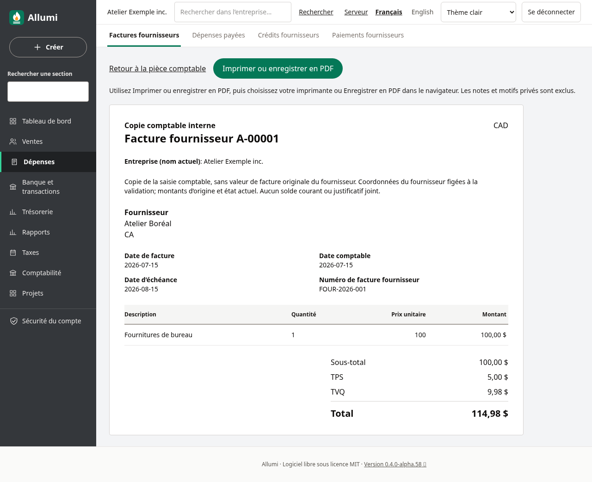
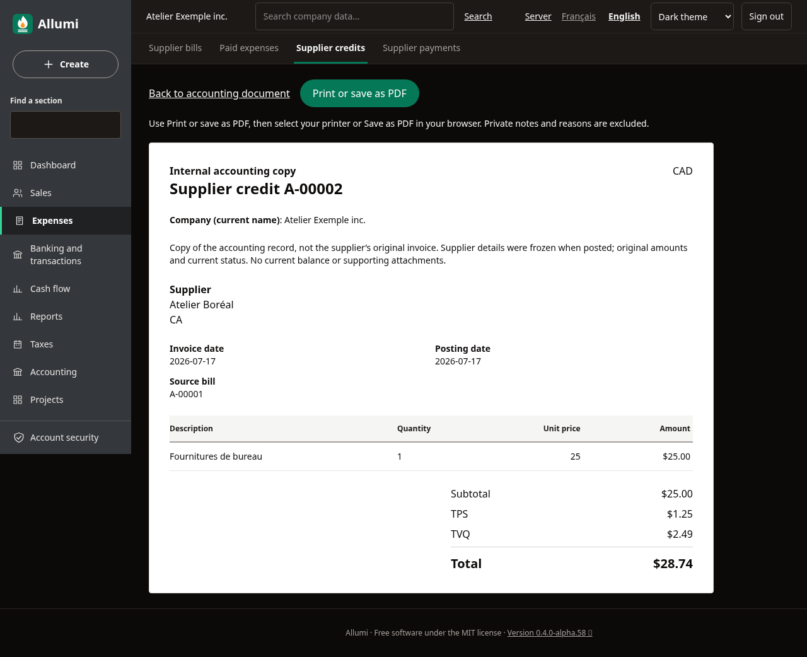
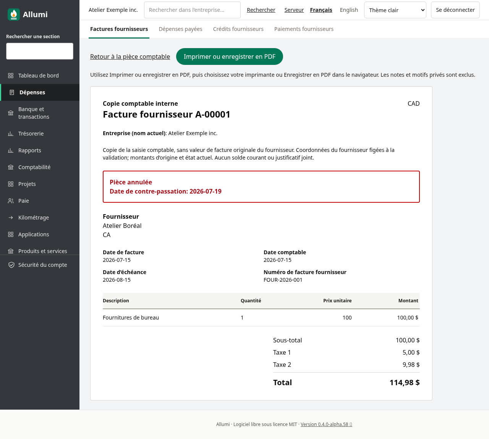
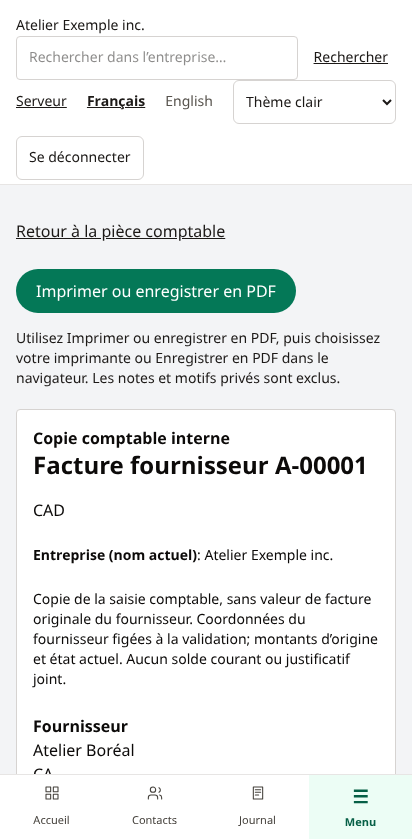
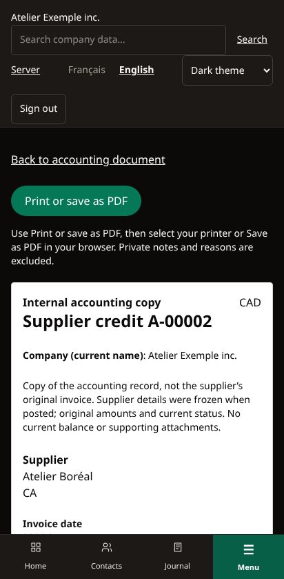
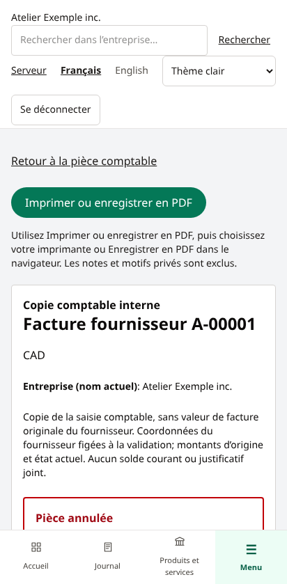

# Imprimer une copie comptable des achats

Dans **Dépenses → Factures fournisseurs** ou **Crédits fournisseurs**, ouvrir une pièce validée ou annulée, puis choisir **Imprimer la copie comptable** (*Print accounting copy*).

Cette vue est une **copie de la saisie comptable interne**. Elle ne remplace pas la facture ou la note de crédit originale émise par le fournisseur. Conserver cette pièce originale dans les [[Justificatifs]]. Les brouillons ne disposent pas de cette vue.

## Contenu de la copie

- Entreprise comptabilisant la pièce, avec son nom actuel explicitement indiqué (ce nom n’est pas un instantané historique).
- Type de pièce et numéro comptable interne, en CAD.
- Coordonnées du fournisseur figées sur la pièce lors de sa validation : nom, adresse et numéros fiscaux disponibles. Le renommage du contact ne les remplace pas.
- Date de la pièce, date comptable, échéance et référence fournisseur lorsqu’elles existent; numéro de facture source pour un crédit.
- Descriptions, quantités, prix unitaires, sous-total, taxes et total enregistrés. Les nombres décimaux et les montants au cent sont conservés sans calcul flottant ni recalcul fiscal.
- Pour une pièce annulée, mention **Pièce annulée** et date de contre-passation. Les montants originaux restent affichés.

La copie n’affiche pas le solde courant ou l’état des règlements. Utiliser [[Releve-de-compte-fournisseur]] pour les mouvements datés et [[Recherche-des-paiements-fournisseurs]] pour les paiements.

## PDF et imprimante

Choisir **Imprimer ou enregistrer en PDF** (*Print or save as PDF*), puis sélectionner une imprimante ou **Enregistrer en PDF** dans la boîte de dialogue du navigateur. L’application ne transmet pas la pièce à un service d’impression externe et ne génère pas de PDF sur le serveur.

Le papier reste blanc et lisible dans les thèmes clair et sombre. Le menu, l’en-tête de l’application, le pied de page et les boutons sont masqués à l’impression. Les en-têtes de colonnes sont répétés sur plusieurs pages; les lignes et totaux évitent les coupures lorsque leur taille le permet.

Dans la boîte de dialogue, désactiver les en-têtes et pieds de page du navigateur si l’adresse ou la date d’impression ne sont pas souhaitées. Sur iPhone/iPad, les options de partage/impression/PDF dépendent de Safari et du système; les références ci-dessous proviennent de Chromium en émulation mobile.

## Confidentialité et permissions

La lecture **Comptabilité** suffit, même sans accès aux modules Contacts, Taxes ou Ventes. Les liens et les accès directs à la vue sont contrôlés pour l’entreprise courante. Un identifiant appartenant à une autre entreprise, un brouillon ou un mauvais type de pièce ne donne aucune copie.

La vue utilise une sélection explicite des données : les notes internes, motifs du crédit et de l’annulation, identifiants de contacts ou d’écritures et pièces jointes sont absents du contenu imprimable et de son HTML. Une description ou une référence saisie sur la pièce reste un champ imprimé; éviter d’y écrire des informations réservées aux notes internes.

Les montants fiscaux proviennent des lignes enregistrées sur la pièce. Les libellés des codes fiscaux sont ceux du répertoire actuel lorsqu’ils sont lisibles; ils ne constituent pas un historique de renommage. Si Taxes est masqué, **Taxe 1**, **Taxe 2**, etc. remplacent les libellés dans la copie, sans masquer ni modifier les montants. Les fiches détaillées restent également consultables avec un libellé générique **Taxe**.

## Téléphone

Les coordonnées et les contrôles s’adaptent à l’écran; les descriptions et les montants peuvent revenir à la ligne. Le PDF et le papier conservent les colonnes du document.

Voir [[Factures-fournisseurs]] et [[Utilisateurs-et-permissions]].
