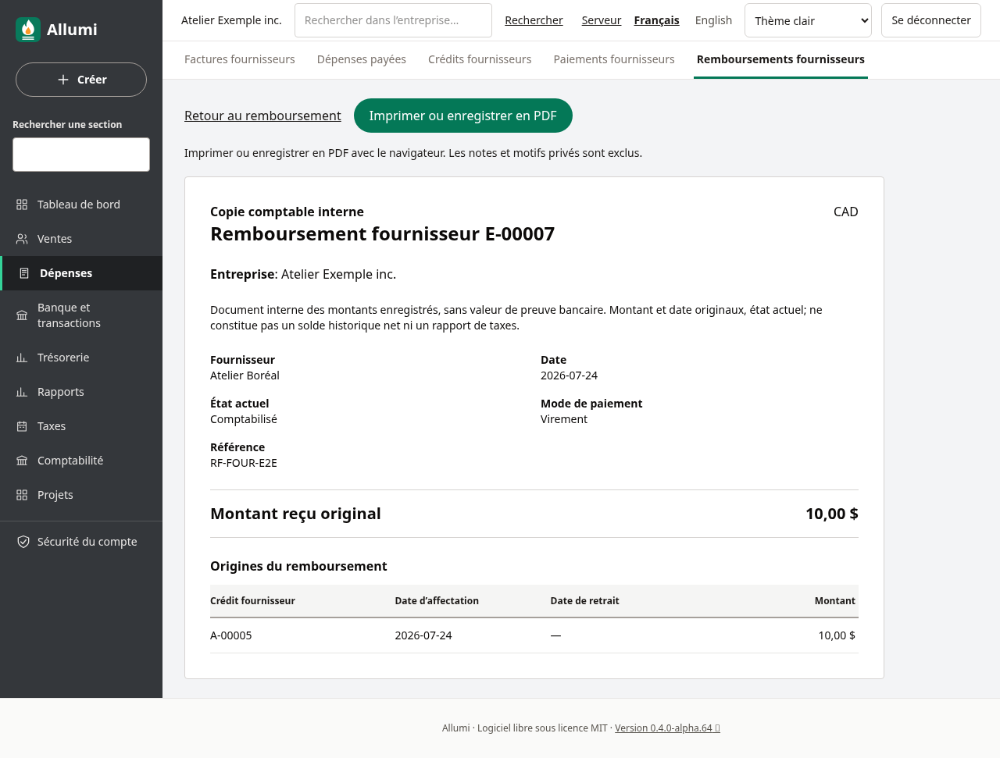
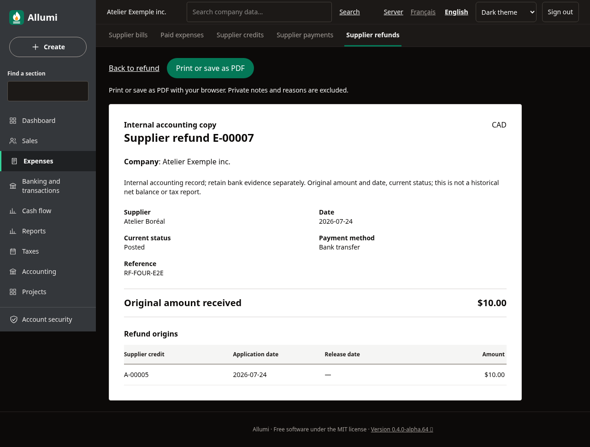
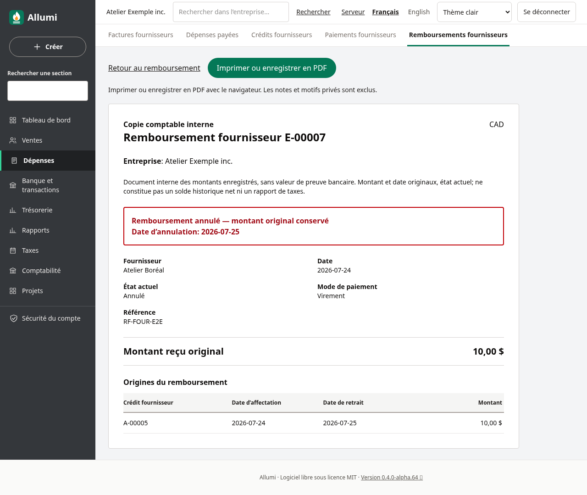
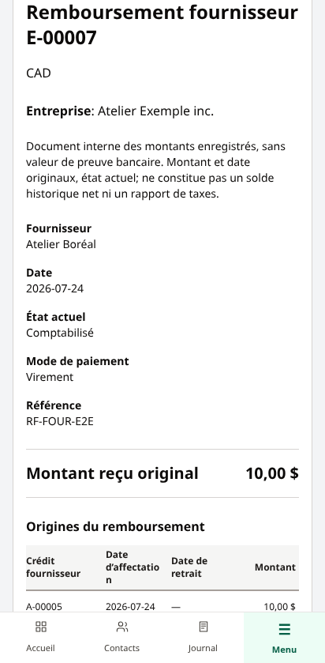
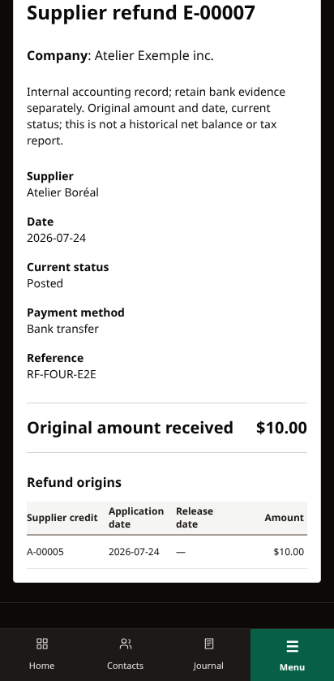
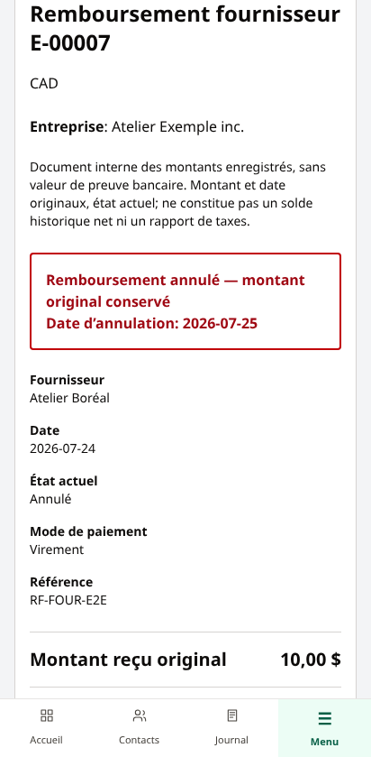

# Imprimer un remboursement fournisseur

Dans **Dépenses → Remboursements fournisseurs**, ouvrir un remboursement, puis **Imprimer la copie comptable** (*Print accounting copy*). La même option est disponible après l’enregistrement depuis un crédit fournisseur.

La **Copie comptable interne** présente un remboursement déjà enregistré. Elle ne remplace ni le justificatif bancaire ni la pièce originale du fournisseur, ne confirme pas le règlement auprès d’une banque et n’envoie aucun ordre bancaire. Conserver les pièces sources dans [[Justificatifs]].

## Contenu

- Nom actuel de l’entreprise (non figé historiquement), numéro interne du remboursement et devise CAD.
- Fournisseur issu du nom figé sur une pièce d’origine. Sans instantané exploitable, le nom du contact est utilisé uniquement s’il est accessible; sinon **Fournisseur indisponible** est affiché.
- Date de réception et montant positifs originaux, mode, référence si renseignée et état actuel.
- Toutes les affectations aux crédits d’origine, y compris celles retirées : numéro de crédit, montant, date d’affectation et date de retrait. Elles sont classées par date puis identifiant, de la plus ancienne à la plus récente, indépendamment de la page de la fiche.
- En cas d’annulation, mention **Remboursement annulé — montant original conservé** et date de contre-passation. Le montant original n’est pas remplacé par zéro.

Un historique sans affectation affiche explicitement l’absence d’origines. Les compensations entre paiements ne sont pas détaillées ici. La copie refuse plus de **1 000 origines** au lieu de produire un document partiel; consulter alors l’historique paginé de la fiche. Les montants des affectations retirées ne doivent pas être additionnés comme un montant net reçu.

La copie n’est pas un solde historique à une date ni un rapport fiscal. Utiliser [[Releve-de-compte-fournisseur]] pour les mouvements et contre-passations datés, [[Export-des-remboursements-fournisseurs]] pour les remboursements filtrés et [[Sommaire-des-taxes]] pour les taxes. Aucun montant fiscal n’est recalculé.

## Impression et PDF

Choisir **Imprimer ou enregistrer en PDF** (*Print or save as PDF*), puis sélectionner une imprimante ou **Enregistrer en PDF** dans le navigateur. Aucun service d’impression externe ni génération PDF serveur n’est utilisé.

Le document reste blanc en thème sombre. Navigation, en-tête, pied de page et commandes de l’application sont masqués sur papier. Les en-têtes du tableau se répètent sur plusieurs pages; les lignes évitent les coupures lorsque leur taille le permet. Désactiver les en-têtes et pieds de page du navigateur si l’adresse et la date d’impression ne sont pas souhaitées.

## Confidentialité et accès

**Comptabilité en lecture** suffit, même sans accès à Contacts, Taxes ou Ventes. L’accès direct est limité à l’entreprise courante et aux remboursements fournisseurs : un décaissement, un encaissement client, un identifiant inconnu ou étranger ne donne pas de copie.

Les notes du remboursement ou du crédit, motifs d’annulation, coordonnées privées, compte bancaire, identifiants internes de contacts/écritures et pièces jointes ne sont pas sélectionnés dans la projection imprimable. Ils sont absents du document et de son HTML. Une référence saisie reste imprimable; réserver les renseignements confidentiels au champ Note. La lecture stabilise le remboursement pendant la construction de sa copie, pour ne pas mélanger une annulation avec ses anciennes affectations.

Aucune migration, nouvelle configuration, écriture ou paiement supplémentaire n’est nécessaire. Voir [[Remboursements-fournisseurs]] et [[Utilisateurs-et-permissions]].

## Téléphone

Les contrôles et colonnes s’adaptent à la largeur de l’écran. Les captures utilisent Chromium en émulation mobile; l’impression et le partage PDF Safari iOS restent à vérifier sur appareil réel.

