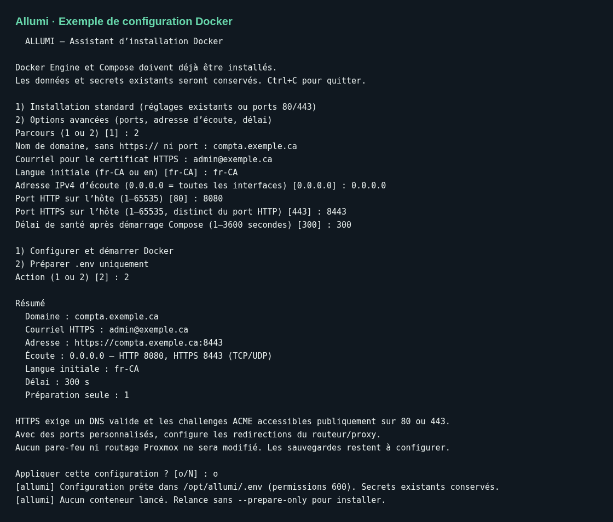

# Installation Docker

À partir de v0.4.0-alpha.10, la pile fournit **l’application en HTTP et PostgreSQL privé**, sans Caddy, certificat, domaine obligatoire ni service ACME. Le service ponctuel `migrate` applique les migrations avant le démarrage de l’application. Linux **AMD64 et ARM64** sont construits et testés nativement; Docker sélectionne l’architecture du serveur.

## Images déjà construites

Chaque version étiquetée a ses images **application** et **migrations** construites et publiées (`ghcr.io/installation-04/allumi` et `…-migrate`, AMD64 et ARM64) **avant** la publication de la release : le workflow Release garde la release en brouillon tant que les deux architectures et leurs manifestes ne sont pas vérifiés. Une copie placée exactement sur une version (`git checkout v0.4.0-alpha.10`) **télécharge** ces images au lieu de les compiler, ce qui évite le build sur la VM (minutes de calcul, mémoire, accès aux dépôts de paquets).

L’installateur choisit seul, et l’indique dans sa sortie :

| Situation | Résultat |
|---|---|
| Copie sur une étiquette de version, fichiers suivis non modifiés | images publiées téléchargées, aucune compilation |
| Branche, commit quelconque, fichiers modifiés | images construites sur place |
| `--build` | images construites sur place, même sur une version |
| Images publiées introuvables (hors ligne, version sans images, architecture non publiée) | repli automatique sur la construction, avec un avertissement |

Le choix est inscrit dans `.env` (`ALLUMI_APP_IMAGE`, `ALLUMI_MIGRATE_IMAGE`, gérés par les scripts) pour que `docker compose up -d` reste cohérent. `./scripts/install-docker.sh`, `./scripts/update.sh` et `./scripts/up.sh` le recalculent à chaque passage; après un `git checkout` manuel, utiliser `./scripts/up.sh` plutôt que `docker compose up -d --build`. Les images ne sont pas signées; elles proviennent du workflow Release du dépôt.

## Installation en une commande

`scripts/get.sh` détecte le système, le processeur et les prérequis, récupère la version la plus récente, puis lance l’installateur qui convient. Il s’exécute avec `sh` (sans Bash), donc directement depuis `curl` :

```bash
curl -fsSL https://raw.githubusercontent.com/Installation-04/Allumi/main/scripts/get.sh | sh
```

Pour **voir ce qu’il ferait sans rien modifier ni télécharger** :

```bash
curl -fsSL https://raw.githubusercontent.com/Installation-04/Allumi/main/scripts/get.sh | sh -s -- --check
```

Le rapport indique le système (distribution, WSL), le processeur (`x86_64` ou `aarch64`, ramené à AMD64 ou ARM64), la mémoire, l’espace disque, la virtualisation (VM ou LXC), les droits (root ou sudo), Docker et Compose, un ancien conteneur Caddy éventuel, et si une installation existe déjà.

| Détecté | Décision |
|---|---|
| Debian, Ubuntu ou dérivée | `install.sh` : installe Docker au besoin, configure Allumi, active le pare-feu `ufw` (SSH et port HTTP) et planifie les sauvegardes |
| Autre Linux avec Docker | `install-docker.sh` (essais; demande `--force`) |
| Autre Linux sans Docker | arrêt, avec le lien d’installation de Docker Engine |
| macOS | réservé aux essais, avec `--force` et Docker Desktop ou OrbStack |
| Windows (Git Bash) | arrêt : le serveur tourne sous Linux (VM ou WSL 2); le client Windows s’y connecte |
| Processeur autre qu’AMD64 ou ARM64 | arrêt (ex. ARM 32 bits) |

Options : `--version v0.4.0-alpha.15` (sinon la plus récente, préversions comprises), `--branch main` (essais), `--dir`, `--docker-only` (Docker déjà installé : ni pare-feu ni tâche planifiée), `--yes` (sans confirmation), `--force`. Ce qui suit `--` va à l’installateur : `-- --app-url http://192.168.1.20:28080 --prepare-only`.

Avant d’agir, le script résume l’installateur retenu et demande confirmation sur le terminal; sans terminal, il exige `--yes`. Le dépôt est cloné dans `/opt/allumi` (ou `~/allumi` sans droits), sur l’étiquette de version. Un dépôt existant n’est mis à jour que s’il est sans modification locale, et une installation existante garde ses secrets, ses volumes et son `APP_URL`.

Exécuter du code téléchargé revient à lui faire confiance : pour relire d’abord, télécharger le fichier (`curl -fsSLo get.sh …`), le lire, puis lancer `sh get.sh`. Pour figer la version du script lui-même, remplacer `main` dans l’adresse par une étiquette qui le contient.

## Assistant dans une VM Linux

Prérequis : Docker Engine, Compose v2, Bash, OpenSSL et Git; un compte autorisé à utiliser Docker. Sur Proxmox, utiliser une VM dédiée, pas l’hôte Proxmox.

```bash
git clone https://github.com/Installation-04/Allumi.git allumi
cd allumi
git checkout v0.4.0-alpha.15
./scripts/install-docker.sh
```

L’assistant propose un parcours standard ou avancé, puis demande :

- L’URL utilisée dans le navigateur, par exemple `http://192.168.1.20:28080` (remplacer l’adresse par celle de la VM).
- La langue initiale, `fr-CA` ou `en`.
- En mode avancé : adresse IPv4 d’écoute, port HTTP et délai de vérification.
- Configurer et démarrer, ou préparer `.env` uniquement.
- Confirmation après affichage du récapitulatif. Annulation et fin de saisie ne modifient pas la configuration.

Le port par défaut est **28080**. `0.0.0.0` écoute sur toutes les interfaces IPv4; `127.0.0.1` limite l’accès à la machine. L’URL et le port d’écoute sont distincts pour permettre un proxy externe : en accès direct, leurs ports doivent correspondre. `localhost` ne fonctionne que depuis le serveur lui-même.



Cette capture reproduit le dialogue du script avec des données fictives.

## Installation sans questions

```bash
./scripts/install-docker.sh \
  --app-url http://192.168.1.20:28080 \
  --http-port 28080 --bind 0.0.0.0 --locale fr-CA
```

Options : `--interactive`, `--app-url`, `--http-port`, `--bind`, `--locale`, `--timeout` (1 à 3600 secondes après le démarrage Compose), `--prepare-only`, `--help`. Sans argument et sans terminal, le script refuse de démarrer. Les anciennes options `--domain`, `--email` et `--https-port` ne sont plus utilisées.

Le script génère les secrets, prépare `.env` atomiquement avec permissions 600, conserve les secrets existants, valide Compose et attend la santé de l’application. Il refuse une configuration absente si des volumes du projet existent déjà : restaurer alors le `.env` associé, sans régénérer les mots de passe. Les ports et URL existants sont conservés sauf option explicite. Il n’installe pas Docker et ne configure ni pare-feu, ni VM, ni sauvegardes automatiques.

## Premier accès

Ouvrir `http://ADRESSE_VM:28080`. **Le jeton d’installation est affiché à la fin de l’installation** (ligne « Jeton »); il se saisit une seule fois pour créer l’entreprise et l’administrateur. Il n’est montré que tant que la page `/setup` est ouverte : sur une instance déjà configurée, le script dit qu’il est inutile au lieu de l’afficher, et si l’application ne répond pas il renvoie vers `SETUP_TOKEN` dans le `.env` privé. C’est le seul secret affiché; les autres restent dans `.env`. Le résumé peut finir dans l’historique du terminal ou dans un journal : ne le copie pas dans un canal public. En production, `/setup` reste fermé sans ce jeton, même en HTTP. Les cookies de session fonctionnent en HTTP; l’URL `APP_URL` doit correspondre au protocole effectivement utilisé. Voir [[Premier-demarrage]].

```bash
docker compose ps
curl -fsS http://127.0.0.1:28080/api/health
docker compose logs migrate app db
```

PostgreSQL n’a aucun port publié sur l’hôte. Ne pas utiliser `docker compose down -v` pour mettre à jour : cela supprime les volumes de données.

## Passer de la version avec Caddy

Sauvegarder la base et `.env` avant de changer de version. Depuis le dossier existant, récupérer le tag publié puis choisir explicitement la nouvelle URL HTTP :

```bash
./scripts/backup.sh
git fetch --tags origin
git checkout v0.4.0-alpha.15
./scripts/install-docker.sh --app-url http://192.168.1.20:28080 --http-port 28080
```

L’installateur retire le conteneur Caddy devenu orphelin (`--remove-orphans`), conserve les volumes PostgreSQL et applicatifs et ne supprime pas les anciens volumes de certificats. Les clés `ALLUMI_DOMAIN`, `ACME_EMAIL` et `ALLUMI_HTTPS_PORT` d’un ancien `.env` sont désormais ignorées. Le passage à cette pile remet une fois `TRUSTED_PROXY_HOPS` à `0`, suivi par le marqueur `ALLUMI_NETWORK_MODE=direct`; les réglages de proxy ultérieurs sont conservés.

La mise à jour automatique conserve `APP_URL` : elle ne convertit pas une URL HTTPS en HTTP, car un proxy externe peut déjà fournir HTTPS. Pour abandonner le SSL intégré, effectuer cette transition manuellement avec l’URL HTTP explicite ci-dessus. Les anciennes sessions HTTPS ne sont pas réutilisées en HTTP : se reconnecter.

## Proxy externe facultatif

HTTP direct convient aux essais sur un réseau privé. Pour HTTPS, votre proxy peut transmettre vers `http://ADRESSE_VM:28080`; Allumi ne gère aucun certificat. Définir `APP_URL=https://compta.exemple.ca`, limiter l’accès au port applicatif au proxy et configurer `TRUSTED_PROXY_HOPS` selon les proxys de confiance (1 pour un seul proxy). Sans proxy, laisser **0** : les en-têtes `X-Forwarded-For` sont ignorés et les clients partagent le budget de limitation par IP inconnue; les limites par compte restent actives.

Le client Windows exige toujours HTTPS. Les fonctions PWA iOS nécessitant un contexte sécurisé demandent également un HTTPS fourni à l’extérieur de cette pile. Pour les essais HTTP, utiliser le navigateur web. Voir [[Configuration]], [[Application-mobile]] et [[Client-Windows]].
