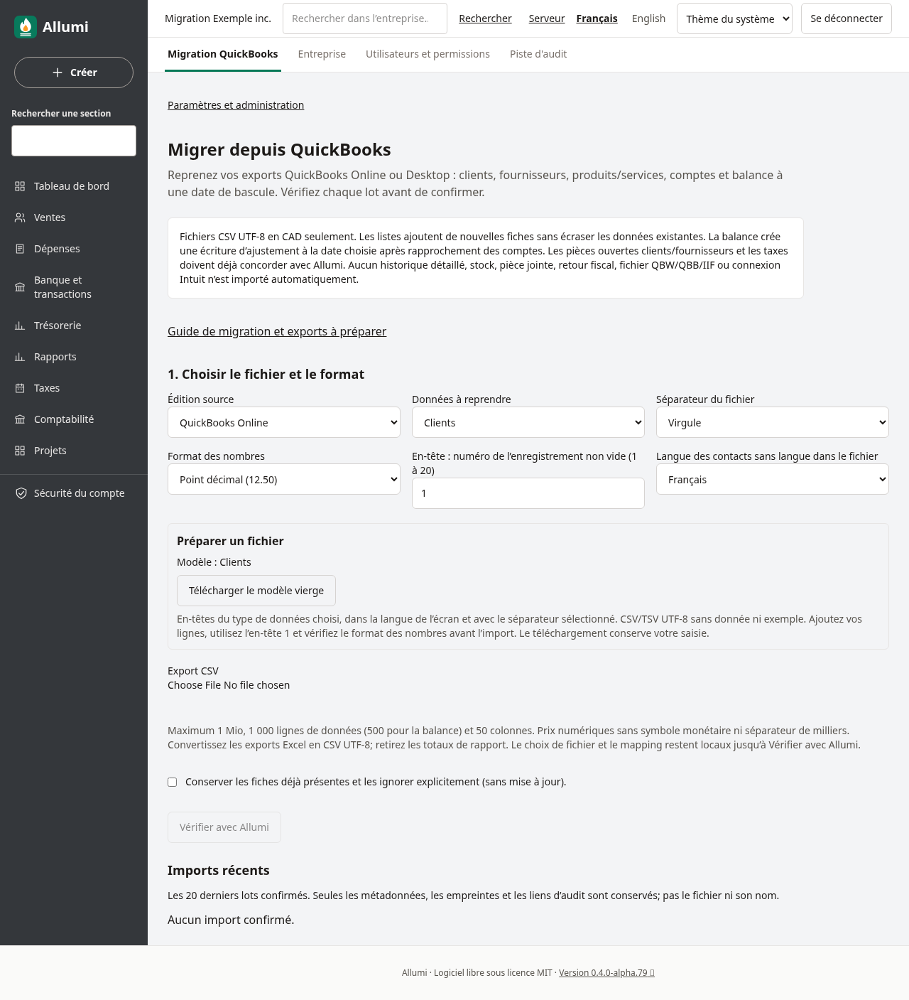
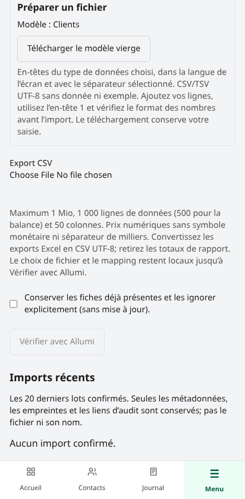
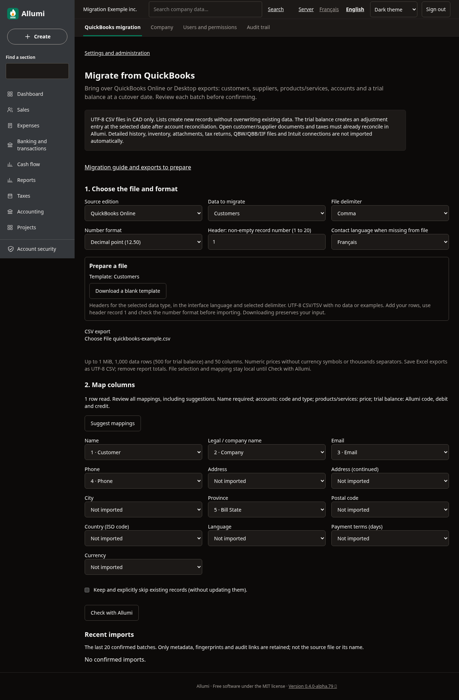
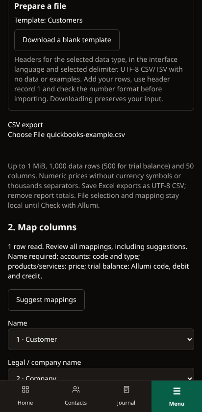
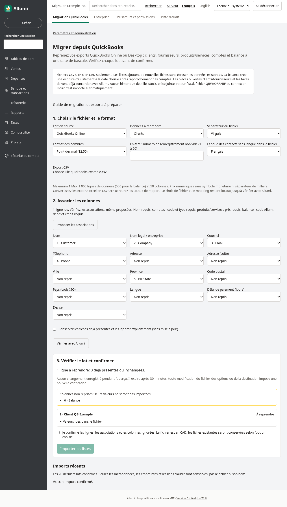
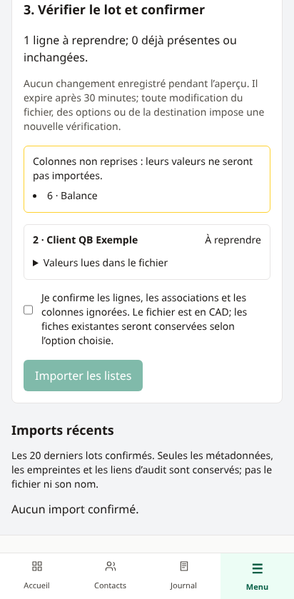
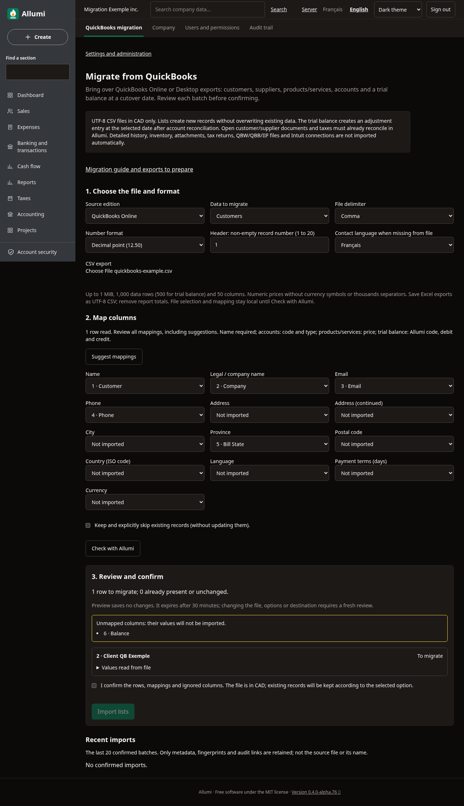
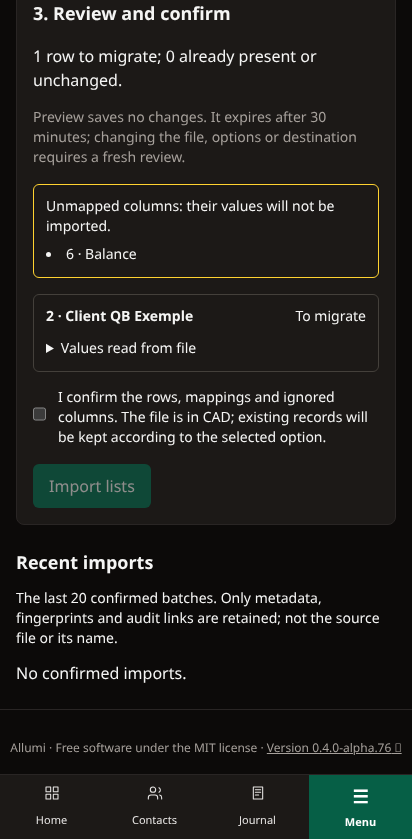
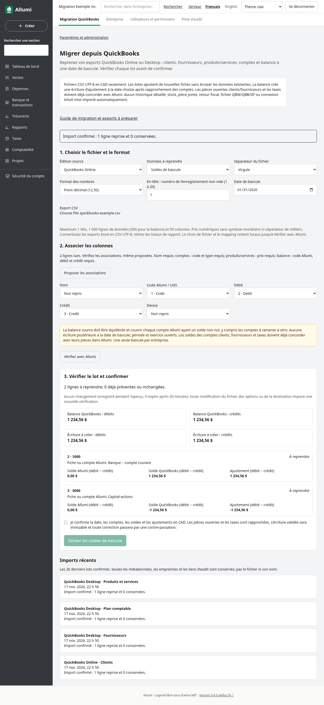
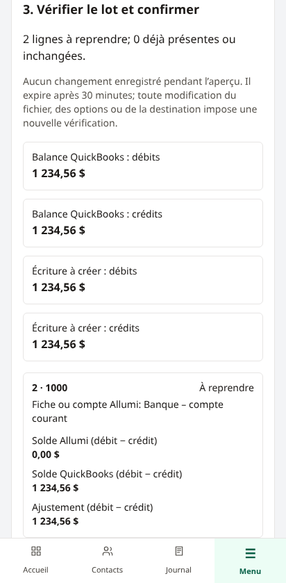

# Migrer depuis QuickBooks

Allumi reprend les **listes et une balance de bascule en dollars canadiens**, depuis des exports de **QuickBooks Online ou Desktop**. Dans **Paramètres → Connexions → Migrer depuis QuickBooks**, un administrateur de l’entreprise choisit un fichier CSV, associe ses colonnes et vérifie chaque ligne avant confirmation.

## Périmètre

| Données | Reprise disponible |
|---|---|
| Clients et fournisseurs | Nom, société, courriel, téléphone, adresse, langue et conditions de paiement |
| Produits/services | Services et produits sans inventaire, code, description, prix et références aux comptes/codes fiscaux Allumi |
| Plan comptable | Nouveaux comptes ordinaires à plat; rapprochement des comptes existants par code et type |
| Balance à une date | Soldes cibles débit/crédit par code Allumi, rapprochement au grand livre et écriture d’ouverture pour les écarts autorisés |

L’historique des factures/paiements, les pièces jointes, les stocks, les déclarations de taxes et les fichiers natifs `.QBW`, `.QBB` ou `.IIF` ne sont pas importés. Il n’y a pas de connexion OAuth ni de synchronisation avec Intuit. Le choix Online/Desktop consigne la provenance; les mêmes contrôles CSV s’appliquent aux deux éditions.

**Les comptes clients, fournisseurs et de taxes ne peuvent pas être ajustés directement.** Leurs pièces ouvertes et positions fiscales doivent d’abord être préparées et rapprochées avec les parcours natifs Allumi, avec votre comptable. La balance accepte leurs soldes lorsqu’ils correspondent déjà au grand livre. Un écart bloque la validation : importer une liste de clients ne crée aucune créance. Cet assistant ne remplace pas une reprise automatique des postes ouverts.

## Préparer les exports

Dans QuickBooks Online, exportez les listes et la balance de vérification à la date choisie, généralement vers Excel. Dans QuickBooks Desktop, utilisez les exports des listes/rapports vers Excel ou CSV. Les menus varient selon l’édition et le pays; les références officielles ci-dessous décrivent les parcours Intuit.

Depuis votre tableur, enregistrez une copie **CSV UTF-8**, sans modifier les originaux. Retirez les sous-totaux, lignes de regroupement et pieds de rapport. Les sous-comptes ne sont pas reconstruits automatiquement. Convertissez les références de comptes et codes fiscaux en **codes de destination Allumi**, sans deviner les équivalences.

Chaque fichier est limité à **1 Mio, 1 000 lignes de données et 50 colonnes**; la balance est limitée à **500 comptes**. La destination est limitée à 5 000 contacts, produits, comptes ou codes fiscaux consultés selon le lot. Une limite dépassée bloque le lot entier.

L’assistant accepte la virgule, le point-virgule ou la tabulation comme séparateur. Indiquez le numéro de l’enregistrement non vide contenant les en-têtes, entre 1 et 20 : les titres précédents sont ignorés. Les cellules entre guillemets et les retours de ligne cités sont acceptés. Les lignes vides sont ignorées; les autres lignes doivent avoir le même nombre de colonnes.

## Modèles CSV vierges

Dans **Préparer un fichier**, choisissez d’abord les données et le séparateur dans le formulaire, puis **Télécharger le modèle vierge**. Les cinq modèles sont disponibles : clients, fournisseurs, produits/services hors inventaire, comptes et soldes de bascule. Les en-têtes suivent la langue actuelle de l’interface, français ou anglais. Les deux langues sont reconnues par les associations d’import.

Le fichier contient **uniquement une ligne d’en-têtes**, en UTF-8 avec marqueur BOM et fin de ligne CRLF pour les tableurs. Il ne contient ni exemple, ni nom d’entreprise, ni donnée comptable. Ajoutez vos propres lignes avant de l’importer : le modèle vide est volontairement refusé comme un lot sans données.

- Virgule ou point-virgule : extension `.csv`.
- Tabulation : extension `.tsv`.
- Nom prévisible, par exemple `quickbooks_customers_fr-CA.csv` ou `quickbooks_balances_en.tsv`.

Utilisez **l’en-tête 1** pour un fichier issu du modèle. Le format des nombres reste le choix explicite du formulaire : changer la langue des en-têtes ne convertit pas les montants. La balance doit toujours être équilibrée et employer vos codes Allumi; le modèle ne renseigne aucun solde ou compte à votre place. Les conditions de reprise des comptes clients, fournisseurs et de taxes restent celles décrites ci-dessous.

Télécharger ne réinitialise ni le fichier sélectionné, ni ses associations, ni l’aperçu ou le consentement déjà saisis. Une modification des options d’import continue d’exiger une nouvelle vérification. Le téléchargement est réservé à l’administrateur de l’entreprise, avec session complète; il ne crée ni fiche, ni lot, ni écriture. Les réponses sont privées et sans cache. Ces modèles servent à préparer des données pour Allumi; ce ne sont pas des exports produits par Intuit.

Captures avec données fictives dans Chromium et en émulation mobile; Safari sur appareil physique reste à valider.






## Importer les listes

1. Initialisez la comptabilité dans l’entreprise de destination et sauvegardez l’instance.
2. Choisissez l’édition, les données, le séparateur et le format numérique, puis le fichier. La lecture initiale et les propositions d’associations se font dans le navigateur.
3. Cliquez sur **Proposer les associations**, puis vérifiez chaque association. Un en-tête ambigu reste sans association : par exemple `Account` et `Account #` peuvent nécessiter de choisir explicitement la colonne du nom.
4. Cliquez sur **Vérifier avec Allumi**. Le fichier est alors envoyé au serveur pour validation, sans création de données.
5. Examinez les nouvelles lignes, les correspondances existantes, les conflits, les détails et les colonnes non reprises. Cochez la confirmation puis **Importer les listes**.

Importez d’abord les comptes et contacts, puis les produits qui les référencent. Les champs obligatoires sont le **nom** pour les contacts, le **nom et le prix** pour les produits, et le **nom, code et type** pour les comptes. Les comptes de produits doivent être actifs, de revenu ou de charge selon le champ; les codes fiscaux doivent être actifs. L’absence d’une référence reste une absence : aucun code fiscal n’est attribué automatiquement.

Les montants sont des nombres sans symbole monétaire ni séparateur de milliers : `12.345678` en format anglais ou `12,345678` en format français. Un prix peut avoir six décimales et doit être positif ou nul. La balance accepte deux décimales. Si une colonne de devise ou de type de produit est reconnue, son association est obligatoire : seules les données CAD et les produits hors inventaire sont acceptés.

Les conditions de paiement acceptent un nombre de jours entre 0 et 365, notamment `Net 30`; en l’absence de valeur, 30 jours sont utilisés. Sans langue source, la langue choisie dans le formulaire s’applique aux contacts. Sans pays, le Canada est utilisé.

### Correspondances et conflits

Les contacts sont rapprochés par nom normalisé, les comptes par code, les produits par code ou nom. **Aucune fiche existante n’est modifiée.** Pour conserver une correspondance existante, choisissez explicitement **Conserver les fiches déjà présentes et les ignorer explicitement** et revérifiez le lot. Les valeurs Allumi restent inchangées, même si le fichier diffère.

Un contact existant uniquement comme client ne devient pas automatiquement fournisseur : corrigez sa fiche en client et fournisseur avant de recommencer. Plusieurs correspondances, un code produit associé à un autre nom, un type de compte incompatible, une référence absente ou un compte système réservé bloquent l’import. Les doublons internes au fichier sont refusés. Un lot entièrement déjà présent n’ajoute rien et ne peut pas être confirmé.

## Reprendre les soldes de bascule

Après préparation des postes ouverts et contrôles fiscaux, exportez une **balance complète, équilibrée, à la date de bascule**. Associez les colonnes code, débit et crédit; le nom est facultatif. Utilisez les codes Allumi. Chaque ligne porte un débit, un crédit ou deux zéros; jamais les deux montants non nuls, ni un montant négatif.

```csv
Code,Debit,Credit
1000,1234.56,0
3000,0,1234.56
```

Cet exemple suppose une entreprise sans mouvement et les comptes ordinaires 1000 et 3000 initialisés. Les montants représentent des **soldes cibles**, pas des montants à ajouter. L’aperçu affiche, pour chaque compte, le solde Allumi courant à la date, la cible et l’écart à comptabiliser, ainsi que les totaux de la source et des ajustements.

La balance doit inclure tous les comptes dont le solde Allumi courant est non nul, même pour les ramener à zéro. Une omission bloque l’import. La date doit appartenir à un exercice et une période ouverts; aucune écriture ne doit exister après cette date. Les comptes ajustés doivent être actifs et autoriser les écritures manuelles. Tout écart sur un contrôle clients, fournisseurs ou taxes bloque le lot.

Après révision et confirmation explicite, une **écriture d’ouverture équilibrée et immuable** comptabilise uniquement les écarts; les écritures précédentes sont conservées. L’historique de migration fournit son lien. **Une seule bascule est autorisée par entreprise.** Une contre-passation n’autorise pas une seconde importation : les corrections ultérieures suivent les parcours comptables ordinaires.

Comparez ensuite la balance Allumi et celle de QuickBooks à la même date, ainsi que les âges des comptes clients/fournisseurs et les positions de taxes. Conservez vos exports originaux et votre sauvegarde de bascule hors de l’application.

## Confirmation, sécurité et historique

L’import est réservé aux administrateurs d’entreprise (`OWNER`). Les autres profils ne peuvent ni consulter l’assistant ni confirmer un lot. Les permissions, l’entreprise et l’auteur sont revérifiés au serveur et en base.

L’aperçu est signé, lié au fichier, aux options, à l’utilisateur, à l’entreprise et à l’état de destination, et expire après 30 minutes. Un changement de fichier/options/langue ou une modification concurrente nécessite une nouvelle vérification et un nouveau consentement. La confirmation relit et verrouille les données pertinentes. Les créations, l’écriture éventuelle, le lot et l’audit sont atomiques : une erreur annule l’ensemble.

Le même lot logique ne peut pas être rejoué en changeant simplement d’édition source. Les 20 derniers lots sont consultables avec leurs comptes de lignes et leur date. Le CSV brut n’est pas conservé : les données métier importées, les empreintes, les identifiants de provenance et l’audit sont conservés. Les fichiers rejetés ne créent pas de lot.

## Références visuelles

Captures de données fictives obtenues dans Chromium sur ordinateur et en émulation mobile; elles ne constituent pas une validation sur Safari iOS physique.








## Références Intuit

- [Exporter les clients vers Excel — QuickBooks Online Canada](https://quickbooks.intuit.com/learn-support/en-ca/help-article/import-export-files/export-customer-data-excel/L0ZerVWiO_CA_en_CA)
- [Exporter les rapports et listes — QuickBooks Online](https://quickbooks.intuit.com/learn-support/en-us/help-article/list-management/export-reports-lists-data-quickbooks-online/L1xleDrLp_US_en_US)
- [Importer et exporter avec Excel — QuickBooks Desktop Canada](https://quickbooks.intuit.com/learn-support/en-ca/help-article/list-management/import-export-ms-excel-files/L9BDPsTTX_CA_en_CA)
- [Exporter des fichiers CSV — QuickBooks Desktop](https://quickbooks.intuit.com/learn-support/en-us/help-article/manage-lists/import-export-csv-files/L9AiGRdT9_US_en_US)

Voir aussi [[Contacts]], [[Taxes-et-catalogue]], [[Plan-comptable]], [[Journal-et-ecritures]], [[Sauvegardes]] et [[Mise-a-jour]].
