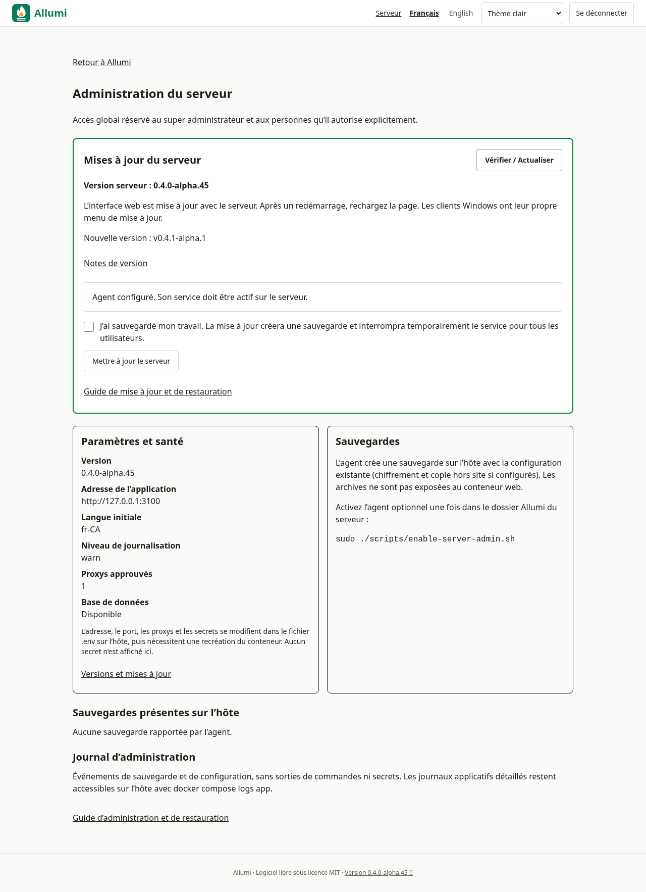
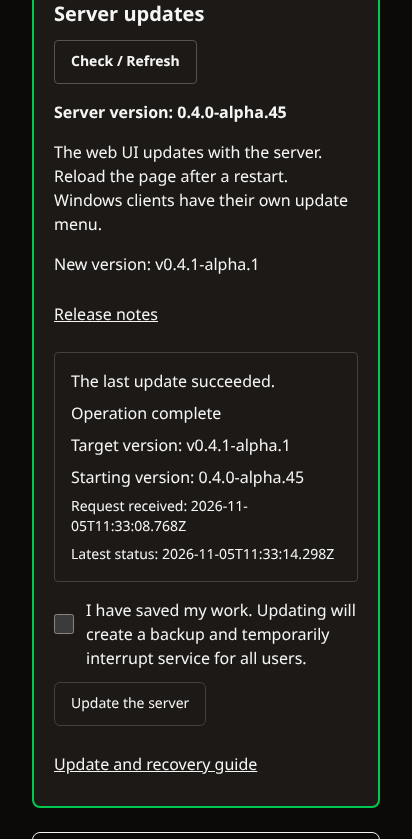

# Mise à jour

## Procédure normale
```bash
cd /opt/allumi
sudo ./scripts/update.sh
```
Le script : sauvegarde, récupère la nouvelle version (`git pull --ff-only` sur une branche), complète ton `.env` des variables ajoutées depuis (sans toucher aux existantes), reconstruit les images, applique les migrations (service `migrate`) et vérifie le healthcheck. Lis le `CHANGELOG.md` avant, surtout pour les versions majeures.

Options : `--no-backup` (déconseillé) et une version, par exemple `sudo ./scripts/update.sh v0.4.0-alpha.55` (voir ci-dessous).

## Épingler une version
Les numéros et le processus de publication sont décrits dans [[Versions-et-releases]].

Pour la production, utilise une version étiquetée plutôt que `main` :
```bash
sudo ./scripts/update.sh v0.4.0-alpha.55
```
Le script sauvegarde, se place sur l'étiquette, **télécharge les images publiées de cette version** (aucune compilation; repli automatique sur la construction si elles sont introuvables, ou avec `--build`) et vérifie le healthcheck. Sur une version épinglée (HEAD détachée), lancer `update.sh` sans version ne tire rien : il redémarre seulement avec les images de la version courante. Voir [[Installation-Docker]], « Images déjà construites ». La première mise à jour depuis une version antérieure à ce changement construit encore sur place : c’est l’ancien script qui s’exécute.

## Retour arrière
Les migrations de base de données ne sont pas toujours réversibles. Le retour arrière sûr est donc :
1. `git checkout <ancienne-version>`
2. Restaurer la sauvegarde faite juste avant la mise à jour ([[Sauvegardes]]).
3. `./scripts/up.sh` (images publiées de l'ancienne version, ou construites sur place si elles sont introuvables)

## Mises à jour du système
- `sudo apt update && sudo apt upgrade` régulièrement; active `unattended-upgrades`.
- Images : `docker compose pull db && docker compose up -d` (PostgreSQL reste en version 17; un changement de version majeure demande un dump/restore).

## Depuis le web ou le client Windows

Les versions antérieures à alpha.47 utilisaient un redémarrage limité au Compose principal. Lors du premier passage depuis ces versions, si une installation déjà équipée de l’agent affiche ensuite celui-ci comme désactivé, lancer `sudo docker compose up -d app` depuis le dossier Allumi pour réappliquer son `compose.override.yaml` existant. Les nouveaux scripts conservent ce fichier lors des redémarrages et rechargent les helpers de la version récupérée.

Le lien **Version** du pied de page ouvre `/versions`, affiche la version du serveur et consulte GitHub Releases. Le serveur doit pouvoir joindre `api.github.com`. Les versions stables ignorent les préversions; un serveur de préversion les inclut. L’interface web et l’app iOS suivent la version du serveur : recharger la page après son redémarrage.

La mise à jour du serveur depuis l’interface est réservée à l’**administrateur de l’instance ou opérateur serveur explicitement autorisé**. Sur une nouvelle installation Docker, l’agent est activé par défaut après vérification de santé si l’installateur s’exécute en root sur Linux avec Python 3 et systemd actif. Il prépare seulement le traitement des demandes : aucune nouvelle version n’est installée automatiquement. `--no-web-updates` omet cette activation et `--prepare-only` n’active aucun agent. Sans root, sans Python 3 ou sans systemd actif, l’installateur avertit que l’activation a été omise.

Pour une installation ancienne ou sans activation, depuis le clone installé dans une VM Linux Docker/systemd compatible, exécuter :

```bash
sudo ./scripts/enable-web-updates.sh
```

Le script installe un agent root et un timer systemd, puis monte une boîte de demandes dans le conteneur de l’application. Il ne donne **aucun accès au socket Docker** au site. Le script peut être relancé pour sa configuration gérée sans multiplier les services ou montages. Il accepte le `compose.override.yaml` généré à l’identique, mais refuse un fichier personnalisé ou un lien symbolique sans l’écraser. Dans ce cas, l’administrateur système doit intégrer manuellement le montage requis et organiser l’installation de l’agent; relancer le script ne contourne pas ce refus. Sans systemd actif, utiliser la procédure manuelle de mise à jour plutôt que compter sur cet agent.

Dans **Serveur**, la carte **Mises à jour du serveur** présente la version installée, la dernière release admissible et l’état de l’agent. Le même parcours reste accessible depuis **Versions et mises à jour** (`/versions`). Un admin d’entreprise sans droit global serveur ne peut pas demander l’opération.

Ouvrir **Notes de version**, enregistrer son travail, vérifier la configuration des sauvegardes et cocher **J’ai sauvegardé mon travail. La mise à jour créera une sauvegarde et interrompra temporairement le service pour tous les utilisateurs.**, puis **Mettre à jour le serveur**. La cible est la release publiée plus récente proposée par le serveur, pas un tag ou une commande libre. Sans agent activé sur l’hôte, le bouton ne lance aucune mise à jour : suivre d’abord l’activation ci-dessus. Le timer traite la demande sous environ une minute : il exige un tag officiel publié, plus récent, descendant du commit installé, un dépôt propre et l’origine GitHub officielle. Il arrête l’application, sauvegarde obligatoirement, lance la reconstruction et les migrations, puis vérifie la santé. Les demandes expirent après une heure. La première installation n’aura pas de mise à jour disponible avant la publication suivante.

Le suivi distingue la demande en attente et les étapes **Vérification de la demande**, **Sauvegarde avant mise à jour**, **Installation et redémarrage** et **Opération terminée**. Pendant une demande en attente ou en cours, l’écran interroge l’état toutes les cinq secondes, pendant dix minutes au maximum. **Vérifier / Actualiser** permet de reprendre la vérification ensuite. Une impossibilité de joindre GitHub est signalée explicitement; elle ne signifie pas que le serveur est à jour. Pendant le redémarrage, une perte temporaire de connexion est attendue; il réessaie pour retrouver le serveur. Le lien **Rouvrir cette page** permet de revenir après le redémarrage. Si la session expire ou que le droit serveur est retiré, le suivi s’arrête et demande une nouvelle connexion. Après son retour, vérifier la version et le résultat, puis recharger les autres onglets et l’app iOS pour charger l’interface installée. Un état en attente ne prouve pas que le timer fonctionne : consulter son statut sur l’hôte si rien ne progresse. Ne pas lancer une mise à jour manuelle simultanément. Le journal conserve l’acteur, le tag et les erreurs :

```bash
sudo journalctl -u allumi-update.service
sudo systemctl status allumi-update.timer
```

En cas d’échec de sauvegarde, l’ancienne application redémarre. Après le lancement de l’installation, aucun retour arrière automatique n’est tenté : utiliser la sauvegarde et la procédure de restauration. Un ancien agent reste compatible avec les états simples (en attente, en cours, succès ou échec); il ne fournit pas nécessairement les étapes détaillées. Une mise à jour de l’application ne remplace pas automatiquement la copie root de l’agent. Pour obtenir les protections récentes, notamment le contrôle HTTPS avant interruption, examiner les scripts depuis le clone de la release publiée installée puis actualiser volontairement l’agent. Avec le `compose.override.yaml` généré resté intact, relancer `sudo ./scripts/enable-web-updates.sh` actualise la copie root, les unités et le timer. Avec une configuration personnalisée gérée par votre administrateur, l’autre procédure reste la copie explicite après revue : `sudo install -m 0755 scripts/update-agent.py /usr/local/sbin/allumi-update-agent`.





Ces captures sont une démonstration contrôlée du parcours administrateur : les demandes, états et versions affichés peuvent être simulés. Elles ne montrent pas une mise à jour réelle de serveur.

Pour désactiver le traitement des demandes web : `sudo systemctl disable --now allumi-update.timer`, puis retirer la variable et le montage ajoutés au service app et le recréer. Les mises à jour du client Windows restent indépendantes : [[Client-Windows]].

## Ancienne transition vers HTTP direct

La transition introduite en v0.4.0-alpha.10 retirait l’ancien Caddy intégré; elle reste une procédure explicite vers HTTP direct, distincte du nouveau HTTPS local par IP. Pour passer d’un ancien accès HTTPS intégré à HTTP direct, effectuer la transition manuelle de [[Installation-Docker]] et définir la nouvelle `APP_URL` avant de redémarrer. La mise à jour conserve les URL existantes, les secrets et les volumes; elle ne réécrit pas une URL HTTPS qui peut être servie par un proxy externe.


## Conserver le protocole et l’autorité locale

Une mise à jour conserve l’URL et le mode réseau existants : le nouveau défaut HTTPS ne convertit pas silencieusement une instance HTTP ou un proxy externe. Pour une conversion volontaire par IP, suivre [[HTTPS-local]]. Conserver les volumes de l’autorité locale et les inclure dans la reprise après sinistre; ne pas recréer cette autorité à chaque mise à jour. Après restauration, vérifier son empreinte avant de réutiliser la confiance des appareils : [[Sauvegardes]].


## Contrôle HTTPS avant interruption

En mode HTTPS local, les scripts vérifient la configuration Compose rendue avant de changer de version ou d’images et avant les opérations de démarrage. Une surcharge incompatible est refusée avant ces changements. Corriger le fichier concerné puis lancer `sudo ./scripts/enable-local-https.sh --check`, qui reste en lecture seule, avant de relancer : [[HTTPS-local]].

L’agent hôte récent effectue ce contrôle avant d’arrêter l’application ou d’entreprendre la sauvegarde. Un échec est présenté comme une erreur de validation et laisse le service existant fonctionner; il ne remplace ni la version ni l’autorité locale. Une ancienne copie de l’agent ne reçoit pas cette protection simplement parce que le site a été mis à jour : l’actualiser explicitement selon la procédure ci-dessus.
