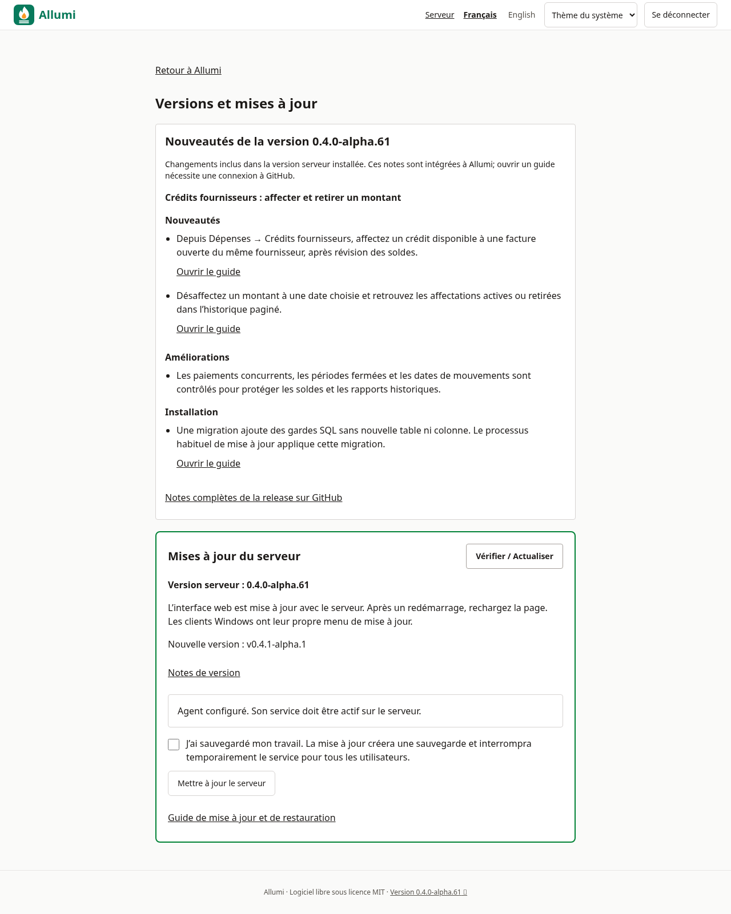
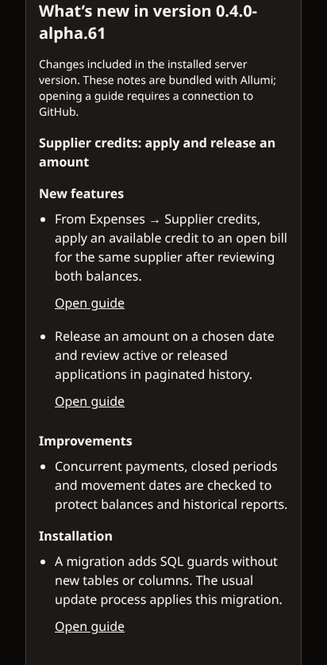
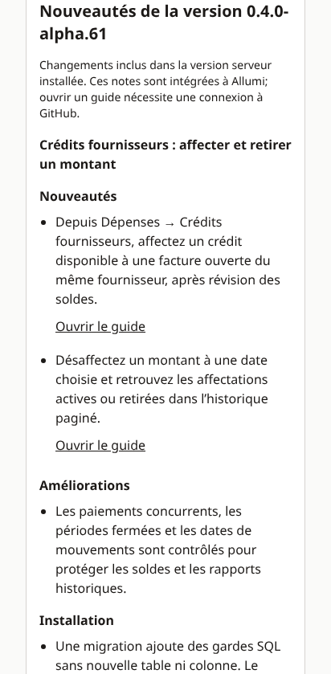
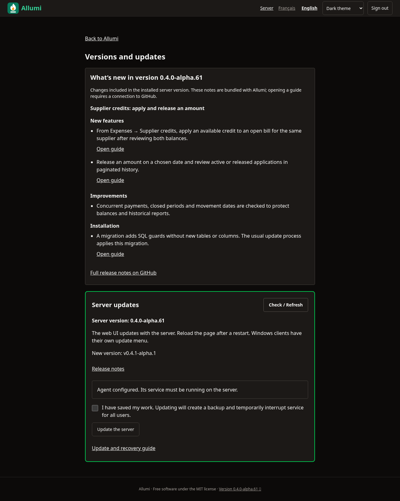

# Nouveautés des versions

Ouvrir **Versions et mises à jour** depuis le lien de version en bas de l’application ou depuis **Paramètres et administration**. La section **Nouveautés de la version…** présente les changements de la version serveur installée :

- **Nouveautés** : fonctions ajoutées et où les trouver.
- **Améliorations** : changements apportés aux parcours existants.
- **Corrections** : problèmes corrigés, lorsqu’il y en a.
- **Installation** : migrations, configuration ou actions nécessaires; leur absence est indiquée aussi.

Les catégories vides ne sont pas affichées. **Ouvrir le guide** donne les instructions détaillées pour un changement. Les notes suivent la langue française ou anglaise de l’interface et les thèmes clair/sombre.

Les captures illustrent les changements d’alpha.61; le contenu varie selon la version serveur installée.

## Version installée et historique

Les notes sont intégrées au serveur et restent lisibles lorsque GitHub est inaccessible. Les liens vers les guides et releases nécessitent une connexion à GitHub. Le lien **Notes complètes de la release sur GitHub** vise la version exacte, pas la dernière release disponible.

**Versions précédentes documentées** contient au maximum cinq versions antérieures à la version installée. Une version future n’y est pas présentée comme installée. Les notes intégrées commencent à alpha.61; pour une version inconnue ou personnalisée, Allumi indique explicitement qu’aucune note correspondante n’est disponible. Il ne lui attribue pas les nouveautés d’une autre version.

Tous les utilisateurs connectés peuvent lire les notes, y compris ceux qui ne peuvent pas administrer le serveur. Les opérateurs autorisés retrouvent également un lien **Nouveautés de cette version** sur la page Serveur. Consulter les notes ne demande ni n’installe une mise à jour.

## Installer une mise à jour

Les contrôles et confirmations d’installation restent dans **Mises à jour du serveur**. Lire les consignes de la release cible sur GitHub avant l’installation; la section de nouveautés décrit le serveur actuellement installé. Le client Windows a son propre mécanisme de mise à jour; ces notes ne vérifient pas sa version locale. Voir [[Mise-a-jour]] et [[Versions-et-releases]].

Après mise à jour du serveur, recharger la page pour lire les notes de la nouvelle version. Le processus habituel de sauvegarde et de migration s’applique. L’ajout de cette section ne nécessite ni migration de base ni nouvelle variable de configuration. La préparation et la publication des prochaines releases vérifient que leurs notes bilingues sont présentes.

