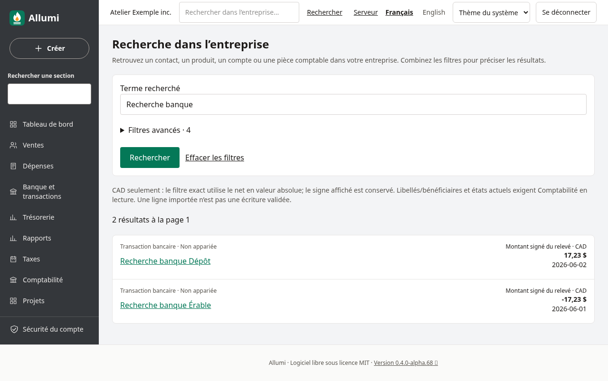
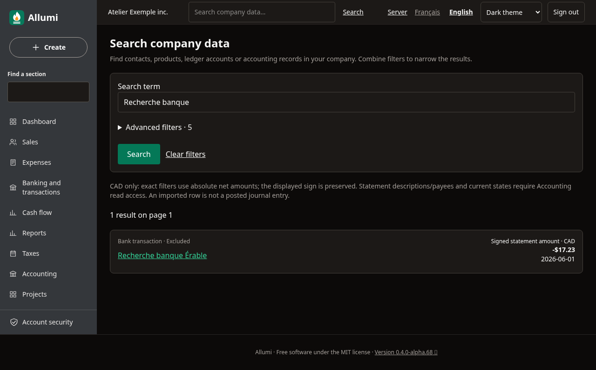
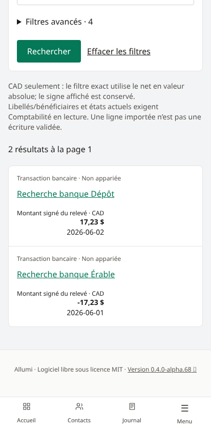
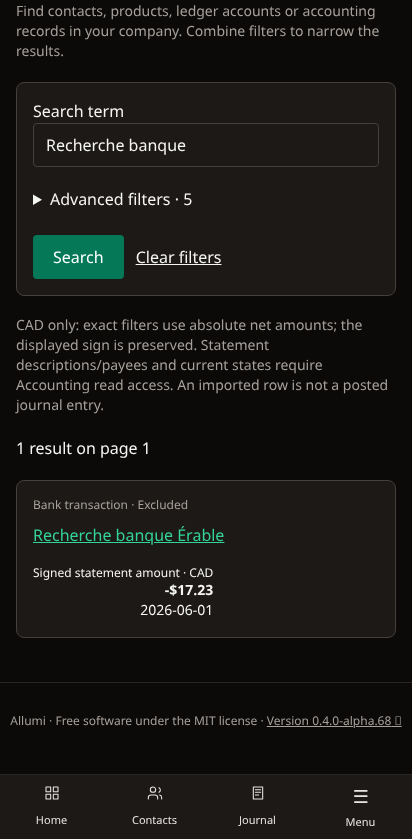

# Rechercher les transactions bancaires

La recherche de l’en-tête inclut les **Transactions bancaires** importées en **CAD**, qu’elles proviennent d’un relevé ou d’un connecteur. Choisir ce type dans les filtres avancés pour limiter les résultats aux lignes bancaires.

Rechercher un **libellé** ou un **bénéficiaire** du relevé. Les caractères `%`, `_` et `\` restent littéraux. Le résultat affiche le libellé, la date, l’état actuel et le montant net signé; son lien ouvre la fiche de transaction existante. Le bénéficiaire sert à la recherche sans être ajouté comme un champ distinct au résultat.

## Dates, montants et états

- **Du / Au** : date de la transaction importée, bornes inclusives.
- **Montant exact** : valeur absolue du montant net, saisie positive. `17,23` trouve aussi bien une sortie de −17,23 $ qu’une entrée de 17,23 $. Le signe affiché reste celui du relevé.
- Un montant positif dans le terme recherché retrouve également les deux signes; un terme négatif, comme `-17.23`, peut retrouver le montant signé négatif. Un filtre exact négatif reste refusé.
- **Non appariée**, **Appariée**, **Exclue** : état actuel de la ligne importée. Le filtre de dates ne reconstruit pas son ancien état.

Une ligne importée n’est pas une écriture validée. Une transaction appariée et son écriture comptable représentent deux objets distincts; ne pas additionner les résultats pour établir un rapport. Une ligne exclue reste consultable. Le montant n’est ni le brut ni les frais d’un service externe : il s’agit du net importé. Les lignes en devise étrangère sont exclues de cette recherche plutôt qu’étiquetées CAD.

## Accès et confidentialité

Le droit **Banque en lecture** suit le module **Comptabilité** existant. Comptabilité en lecture suffit sans Contacts, Ventes ou Taxes. Les droits et les données partagent un instantané SQL et les politiques de lignes de l’entreprise courante. Le lien de destination conserve les permissions de la fiche bancaire; la recherche n’accorde aucun droit d’import, d’appariement ou de comptabilisation supplémentaire.

Les noms de fichiers, identifiants externes, clés de dédoublonnage, comptes, détails techniques des fournisseurs et notes comptables ne sont ni recherchés ni projetés dans ces résultats. Le libellé et le bénéficiaire sont des données du relevé autorisées par le droit bancaire; ils peuvent contenir des renseignements personnels. La fiche existante conserve ses propres informations autorisées sur l’origine et l’appariement. Les termes saisis peuvent rester dans l’historique du navigateur ou les journaux du proxy.

## Pagination et téléphone

Les filtres se combinent avec les règles de [[Recherche-globale]] : 50 résultats par page, ordre stable date décroissante/type/identifiant, limite de 5 000 résultats et aucune énumération sans terme ou filtre. Affiner les critères en cas de limite. Les interfaces française/anglaise, claire/sombre et mobile utilisent les mêmes règles.

Les captures utilisent une entreprise fictive et Chromium en émulation mobile; les essais physiques Safari iOS restent ouverts. Aucune migration ni configuration supplémentaire, aucune transaction ou écriture créée par la recherche. Les recherches de rapports, suggestions et historique restent hors de ce parcours.

Voir [[Import-de-releves]], [[Appariement-bancaire]], [[Integrations]] et [[Utilisateurs-et-permissions]].
