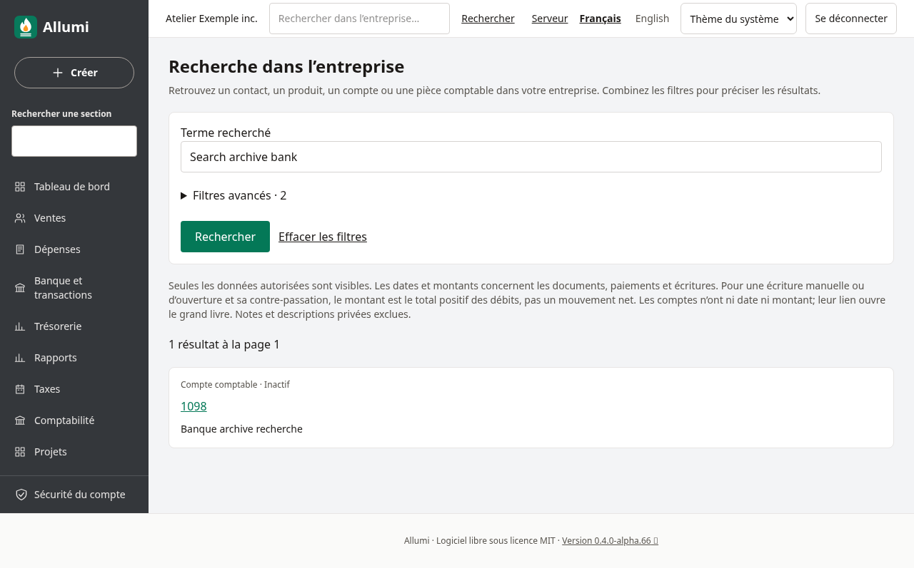
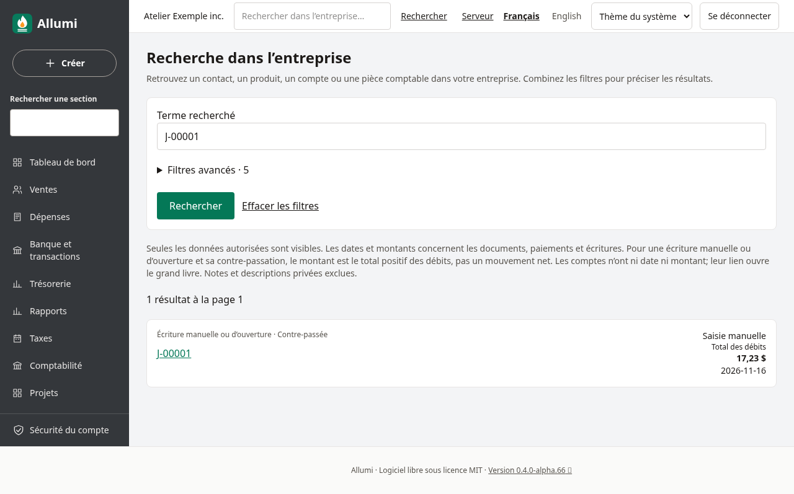
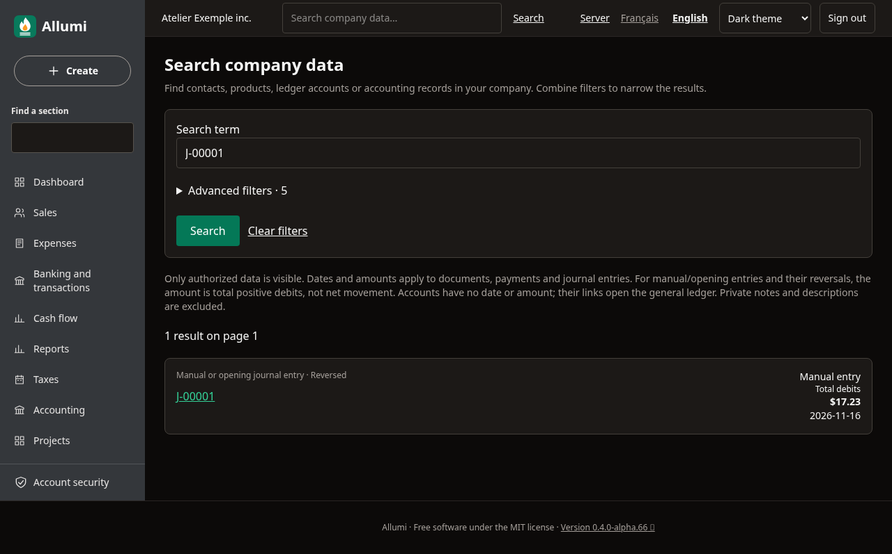
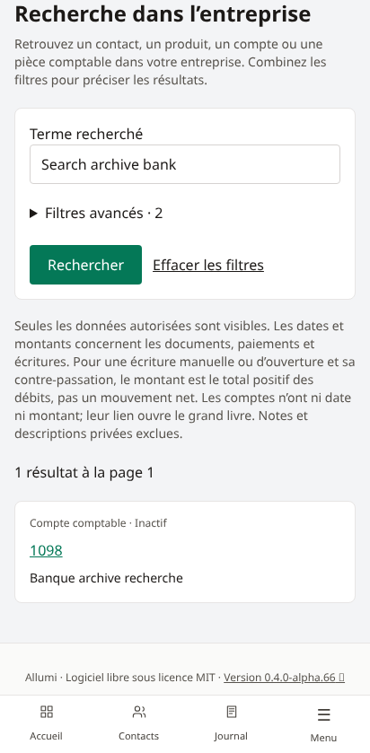
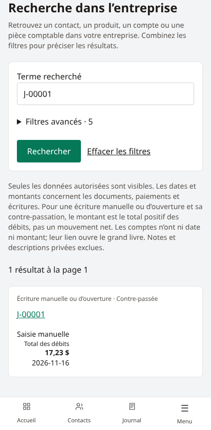
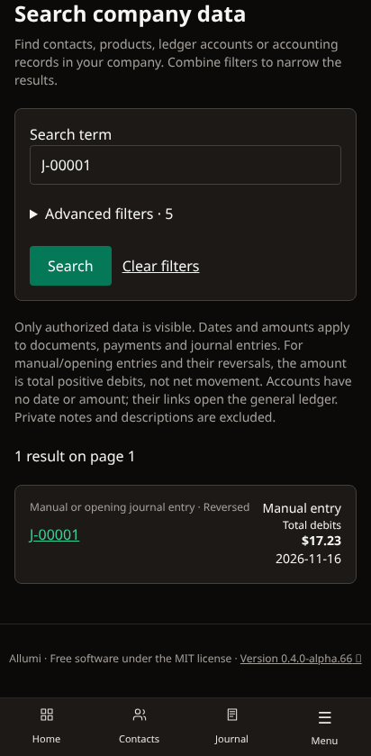

# Rechercher les comptes et écritures manuelles

La recherche de l’en-tête, **Rechercher dans l’entreprise**, inclut les comptes du plan comptable et les écritures manuelles/d’ouverture, avec leurs contre-passations. Les accès sont ceux de l’entreprise courante; **Comptabilité en lecture** suffit sans Contacts, Catalogue, Ventes ou Taxes.

## Comptes du plan comptable

Choisir **Type → Compte comptable**, puis un code ou un nom. Les noms français et anglais sont tous deux recherchés; le nom affiché suit la langue de l’interface. Les caractères `%`, `_` et `\` sont littéraux.

**Actif** ou **Inactif** permet de limiter les comptes. Le compte n’a ni date de pièce ni montant comparable : ajouter une date ou un montant l’exclut des résultats. Le nombre affiché dans son lien est son code, pas son solde.

Un code numérique peut aussi correspondre à un montant dans une recherche sans type. Choisir **Compte comptable** pour éviter cette ambiguïté.

Le lien ouvre le **Grand livre** avec le compte sélectionné, y compris un compte inactif. Il n’ouvre pas le formulaire d’édition réservé à la gestion des comptes. Le grand livre propose désormais les comptes inactifs avec la mention **Inactif** pour conserver l’accès à leur historique. Sa période par défaut reste celle du rapport; modifier les dates pour consulter une autre période.

Les noms et codes sont ceux de la configuration actuelle. La description privée du compte et les coordonnées bancaires ne sont ni recherchées ni présentes dans le résultat. Désactiver un compte ne supprime pas ses mouvements et ne permet pas d’y créer de nouvelles écritures.

## Écritures manuelles et soldes d’ouverture

Choisir **Type → Écriture manuelle ou d’ouverture**, puis un numéro affiché au journal, par exemple `J-00042`, une date AAAA-MM-JJ ou un montant exact. Le numéro sans préfixe est aussi recherché comme texte; un terme numérique peut simultanément rechercher un montant.

Les résultats comprennent :

- Les saisies **Manuelles**.
- Les **Soldes d’ouverture**.
- Les **Contre-passations** dont la source est une de ces écritures.

Les écritures générées par les factures, avoirs, paiements, dépôts, transactions bancaires ou versements fiscaux, et leurs contre-passations, ne deviennent pas des résultats de ce type. Les pièces et paiements continuent d’utiliser leurs catégories existantes. Consulter le journal ou les rapports pour les autres sources.

Le lien ouvre l’écriture autorisée au journal. Le numéro suit le préfixe et la largeur de numérotation actuellement configurés, comme la fiche du journal; les numéros dépassant cette largeur ne sont pas tronqués.

## Montants, dates et états

Le montant est le **Total des débits**, égal au total des crédits pour une écriture équilibrée. Il est positif et exact au cent. Ce n’est ni un solde de compte, ni un montant net de contre-passation, ni nécessairement une entrée ou sortie de banque. Une écriture de 17,23 $ et sa contre-passation affichent chacune 17,23 $; ne pas additionner les résultats pour reconstituer un rapport financier.

Les filtres **Du / Au** portent sur la date comptable de chaque écriture, bornes inclusives. **Montant exact (CAD)** porte sur le total des débits de l’écriture entière, et non sur une ligne. Les grands totaux répartis sur plusieurs lignes restent recherchables en entier, y compris au-delà de la précision des nombres flottants. Les formats français et anglais sont acceptés et la langue peut être changée sans modifier le montant.

Le plafond du filtre correspond au total maximal théorique des débits d’une écriture équilibrée de 500 lignes, chacune plafonnée à 1 000 000 000 000 $ : **250 000 000 000 000 $**. Ce plafond de consultation n’augmente pas les limites de saisie des lignes ni les gardes comptables.

Une écriture ayant une contre-passation est marquée **Contre-passée**; sinon elle est **Validée** dans la recherche. Une contre-passation reste elle-même une écriture validée. Les écritures d’origine et leurs lignes restent immuables et présentes au journal; l’état n’est pas un solde historique à une date et ne dépend pas du filtre de dates.

## Permissions, confidentialité et pagination

Retirer Comptabilité retire ces deux types des résultats et interdit leurs vues de destination. Connaître un numéro ou un identifiant ne donne aucun accès supplémentaire. La recherche respecte les droits modulaires et les politiques de lignes PostgreSQL dans le même instantané que les données. Chaque requête est limitée à l’entreprise active.

Les notes des écritures, descriptions de lignes, identités de contacts et motifs des contre-passations ne sont ni recherchés ni affichés pour ces résultats. Ouvrir une écriture reste soumis aux permissions du journal existant. Le texte et les filtres saisis peuvent rester dans l’historique du navigateur ou les journaux d’un proxy; ne pas utiliser la recherche pour saisir des secrets.

Les mêmes règles de [[Recherche-globale]] restent applicables : dates et montants exacts, combinaison des filtres, 50 résultats par page, ordre stable par date décroissante/type/identifiant et limite de 5 000 résultats. Une recherche sans terme ni filtre n’énumère aucune donnée.

## Téléphone

Les résultats restent des cartes avec lien, type, état, source et total des débits; aucun tableau horizontal n’est ajouté à la recherche. Les captures utilisent Chromium en émulation mobile. Les essais physiques Safari iOS restent ouverts.

Aucune migration ni nouvelle configuration; la recherche ne crée ni ne modifie une écriture ou un compte. Voir [[Grand-livre]], [[Plan-comptable]] et [[Utilisateurs-et-permissions]].
