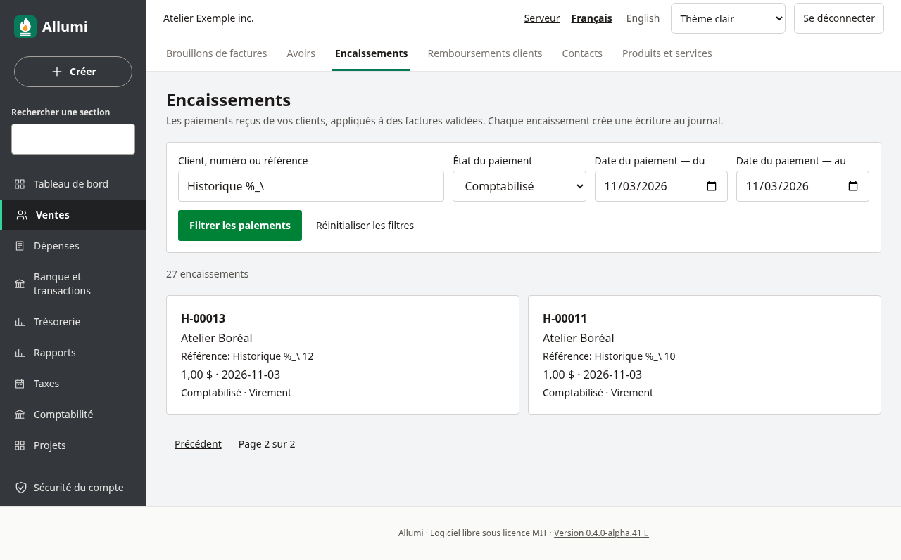
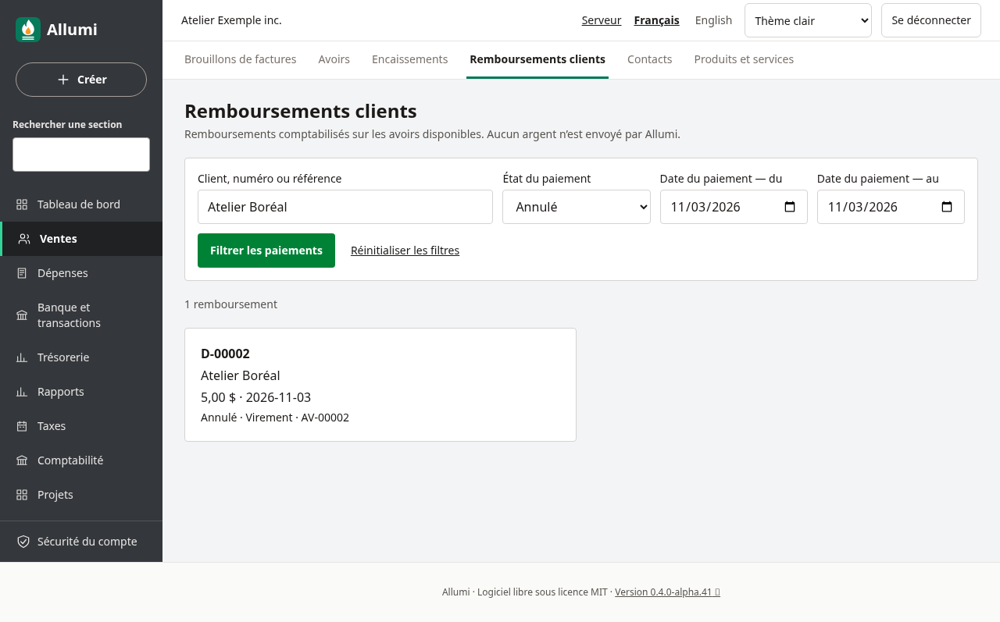
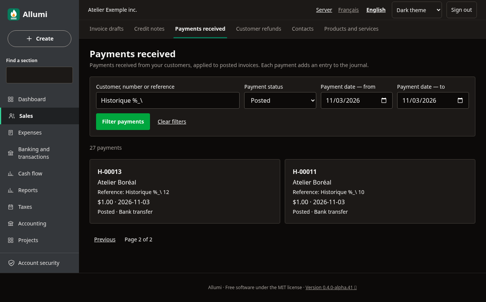
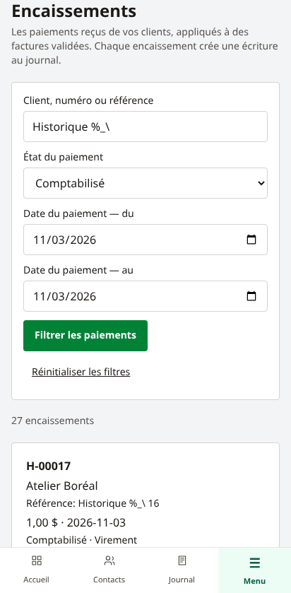

# Rechercher les paiements clients

Dans **Ventes → Encaissements** ou **Remboursements clients**, le formulaire permet de retrouver un paiement sans parcourir tout l’historique.

- **Client, numéro ou référence** (*Customer, number or reference*) : recherche partielle sans distinction de majuscules. Les caractères `%`, `_` et `\` sont recherchés littéralement. La saisie est limitée à 120 caractères; les notes internes ne sont pas recherchées.
- **État du paiement** (*Payment status*) : tous les états, comptabilisé ou annulé.
- **Date du paiement — du / au** (*Payment date — from / to*) : bornes inclusives. Chaque borne est facultative.

Dans les remboursements, la recherche peut également retrouver le numéro de l’encaissement d’origine, y compris pour les compensations retirées. Les caractères spéciaux restent recherchés littéralement.

Choisir **Filtrer les paiements** (*Filter payments*). Les liens de pagination conservent la recherche, les dates et l’état. Le nombre affiché couvre tous les résultats filtrés; chaque page contient au plus 25 paiements.

## Corriger ou retirer un filtre

**Réinitialiser les filtres** (*Clear filters*) revient à la première page de l’historique complet et efface aussi les modifications non soumises. Sans résultat, ajuster les critères ou réinitialiser.

Les dates s’appliquent à la date originale du paiement, même s’il a été annulé plus tard. Un encaissement reçu le 2 janvier et annulé le 20 janvier reste dans le filtre du 2 janvier. Une date impossible, une période inversée, un état inconnu ou un paramètre de filtre répété dans l’adresse est refusé : aucun repli vers une liste plus large n’est effectué.

## Identité et permissions

La consultation des encaissements et remboursements exige **Ventes** et **Comptabilité** en lecture. L’absence d’accès Comptabilité n’est pas présentée comme une liste vide.

Le nom du client des encaissements provient d’abord de l’identité figée sur les documents liés. Un changement ultérieur du répertoire ne réécrit pas cette identité. La recherche peut aussi utiliser le nom actuel du contact lorsqu’il est accessible. Pour les anciens encaissements sans pièce liée, le nom du contact est affiché seulement s’il est lisible; sinon **Client non disponible** apparaît.

Désactiver le module Contacts ne bloque pas la consultation des pièces financières déjà autorisées et ne donne aucun accès supplémentaire à la fiche du contact. Les remboursements liés aux avoirs utilisent l’identité figée sur les pièces. Ceux provenant d’encaissements conservent leurs liens vers les paiements sources; ces liens financiers ne donnent pas accès au répertoire Contacts.

Les encaissements au compte sans facture sont aussi accessibles depuis cette liste. Leur disponible et leurs affectations sont détaillés dans [[Encaissements-au-compte]].

Les remboursements du disponible d’un encaissement sont décrits dans [[Remboursements-des-encaissements]].

L’interface s’adapte au téléphone et aux thèmes clair/sombre. Voir [[Encaissements]], [[Avoirs-disponibles-et-remboursements]] et [[Utilisateurs-et-permissions]].
