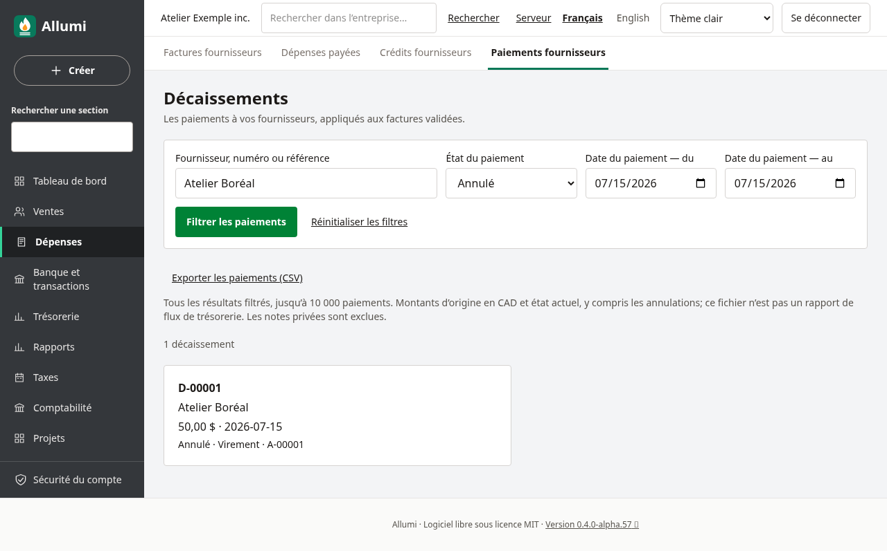
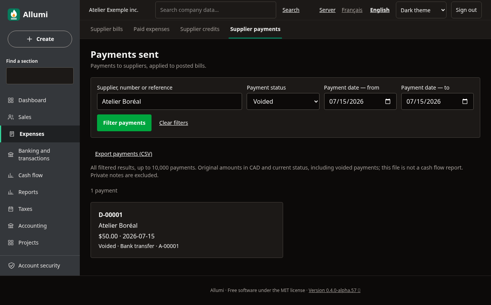
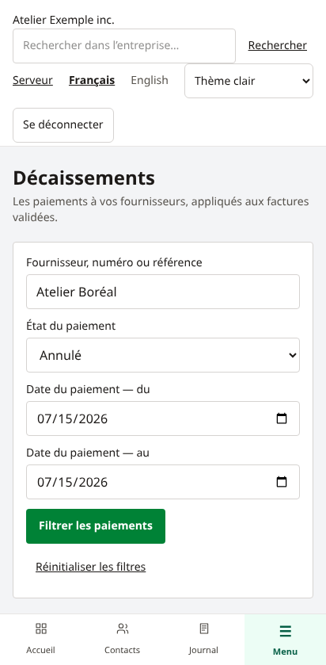
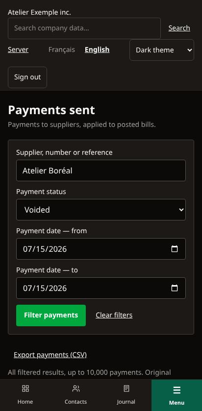

# Rechercher et exporter les paiements fournisseurs

Dans **Dépenses → Décaissements** (*Expenses → Supplier payments*), retrouver les paiements déjà comptabilisés ou annulés sans parcourir tout l’historique.

## Filtres et pagination

- **Fournisseur, numéro ou référence** (*Supplier, number or reference*) : recherche partielle sans distinction de majuscules, jusqu’à 120 caractères. `%`, `_` et `\` restent des caractères littéraux. Les notes et motifs d’annulation privés ne sont pas recherchés.
- **État du paiement** : tous les états, comptabilisé ou annulé. Il s’agit de l’état actuel.
- **Date du paiement — du / au** : bornes facultatives et inclusives sur la date originale du paiement. Un paiement du 15 juillet annulé le 16 reste dans la période du 15 juillet.

Choisir **Filtrer les paiements** (*Filter payments*). Chaque page affiche au plus 25 résultats; le nombre couvre tous les résultats filtrés et la pagination conserve les critères. **Réinitialiser les filtres** revient à l’historique complet. Sans résultat, ajuster la recherche ou les dates.

Une date impossible, une période inversée, un filtre répété ou un état inconnu est refusé, sans élargir la recherche. Une page invalide est également refusée. Les cartes affichent au plus cinq affectations; la fiche conserve les autres factures liées.

## Télécharger le CSV

**Exporter les paiements (CSV)** (*Export payments (CSV)*) télécharge tous les résultats des filtres appliqués, y compris les autres pages. Modifier un champ puis appliquer les filtres avant d’exporter.

Une ligne représente un paiement : numéro, date originale, fournisseur, montant original, état actuel, mode de paiement, référence et devise CAD. Le montant original d’un paiement annulé reste positif et son état indique l’annulation. **Ce fichier n’est pas un rapport de flux de trésorerie, ni un relevé daté** : utiliser [[Suivi-de-tresorerie]] ou [[Releve-de-compte-fournisseur]] pour ces besoins.

Les notes internes, motifs d’annulation et identifiants techniques sont exclus. Les montants sont exacts au cent, sans arrondi flottant. Le fichier UTF-8 s’ouvre dans un tableur : séparateur point-virgule et virgule décimale en français, virgule et point décimal en anglais. Les textes pouvant être interprétés comme une formule sont neutralisés par une apostrophe.

Au-delà de **10 000 paiements**, l’export est refusé avec un message invitant à réduire la période ou préciser la recherche; aucun fichier partiel n’est produit. Un export sans résultat contient seulement les en-têtes.

## Identité et accès

La consultation et l’export exigent **Comptabilité en lecture**. Ils restent disponibles sans accès aux modules Contacts ou Ventes et ne donnent aucun droit de modification ou d’ordre bancaire.

Le nom affiché provient en priorité de l’identité figée sur une facture liée, même après renommage du contact ou annulation du paiement. Pour un ancien paiement sans identité figée, le nom actuel est utilisé seulement si Contacts est lisible; sinon **Fournisseur indisponible** apparaît. La recherche utilise les identités figées et, lorsqu’il est accessible, le nom actuel du contact.

Les pièces et les exports sont limités à l’entreprise courante. Les réponses d’export ne sont pas mises en cache. Consulter [[Utilisateurs-et-permissions]] pour la configuration des rôles.

## Téléphone et thème sombre

Les filtres s’empilent sur téléphone et les cartes restent lisibles sans défilement horizontal. Le téléchargement CSV utilise le navigateur; sur iOS, ouvrir ou partager le fichier avec une application compatible.

