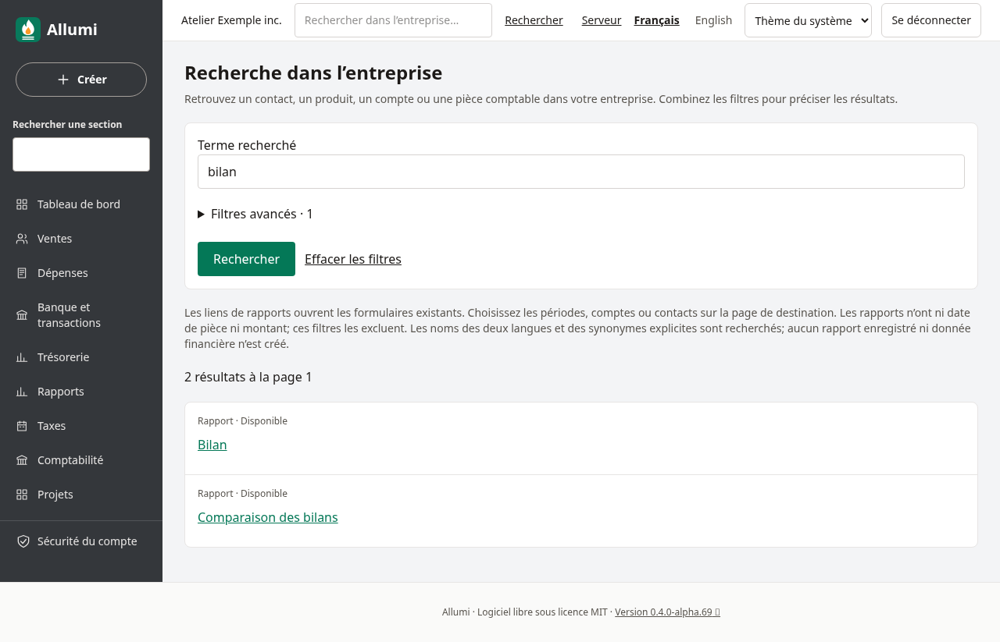
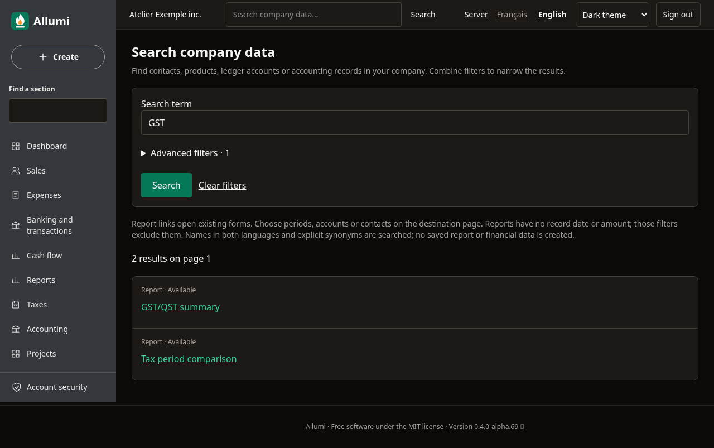
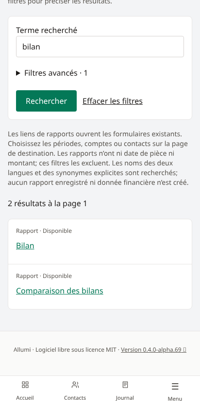
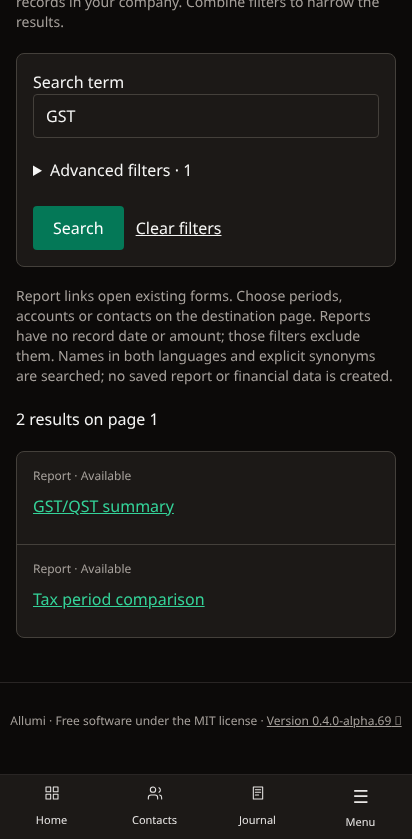

# Retrouver les rapports dans la recherche

Dans **Rechercher dans l’entreprise**, choisir **Type → Rapport**. La recherche propose les formulaires des rapports financiers existants, selon les permissions actuelles. Elle ne recherche ni un rapport enregistré ni le contenu des chiffres.

Saisir un nom français ou anglais, ou un synonyme prévu : `Etat des resultats`, `income statement`, `p&l`, `trial balance`, `GST` ou `TVQ`. Les noms de rapports sont aussi recherchables sans accents; cette tolérance concerne ce catalogue et ne modifie pas la recherche des données comptables. Les caractères `%`, `_` et `\` restent littéraux. Le chemin du rapport peut également être recherché.

## Rapports proposés

| Destination | Droits nécessaires |
| --- | --- |
| Balance de vérification | Comptabilité en lecture |
| État des résultats et comparaison | Comptabilité en lecture |
| Bilan et comparaison | Comptabilité en lecture |
| Grand livre | Comptabilité en lecture |
| Suivi de trésorerie comptabilisée | Comptabilité en lecture |
| Âge des comptes fournisseurs | Comptabilité en lecture |
| Âge des comptes clients | Comptabilité et Ventes en lecture |
| Sommaire TPS/TVQ et comparaison des périodes | Comptabilité et Taxes en lecture |
| Relevé de compte fournisseur | Comptabilité et Contacts en lecture |
| Relevé de compte client | Comptabilité, Ventes et Contacts en lecture |

Il s’agit de **13 destinations**, comparatifs compris. Les noms affichés suivent la langue de l’interface; les noms des deux langues restent recherchés. La trésorerie proposée est le suivi des mouvements comptabilisés, pas une prévision ni un état des flux par activité.

Le lien ouvre la page existante dans l’entreprise courante. Choisir sur cette page les dates, comptes ou contacts nécessaires. Les paramètres de recherche ne deviennent pas automatiquement des paramètres de rapport. Les valeurs par défaut du formulaire restent celles du rapport existant.

## Dates, montants et état

Un résultat de type Rapport n’a **ni date de pièce ni montant**. Un filtre **Du / Au** ou **Montant exact**, même zéro, exclut ces destinations; il ne calcule pas un rapport sur cette période ou ce montant. Effacer ces filtres pour les retrouver.

L’état **Disponible** indique une destination autorisée. Il ne signifie pas qu’un rapport a déjà été calculé, validé, rempli ou enregistré. Les autres états de pièces, par exemple **Validée**, excluent les rapports.

Choisir uniquement le type Rapport liste les destinations autorisées. Une recherche entièrement vide continue de ne rien énumérer. Les règles habituelles de [[Recherche-globale]] s’appliquent aux recherches mixtes : pagination de 50 résultats et plafond de 5 000, tri stable et filtres combinés. Dans le catalogue seul, 13 destinations au maximum tiennent sur la première page.

## Permissions et confidentialité

Les combinaisons de permissions sont vérifiées dans le même instantané SQL que les autres résultats de recherche. Les données comptables restent protégées par leurs politiques de lignes; la recherche n’accorde aucun accès supplémentaire. Une destination interdite n’est pas annoncée et sa page conserve son contrôle d’accès. Changer d’entreprise change le préfixe des liens; connaître une URL ne donne aucun droit dans une autre entreprise.

Le catalogue ne contient que les noms, chemins et synonymes fixes des rapports. Il ne contient aucun montant, compte, identité de client ou fournisseur, période choisie, note privée ou résultat financier. La recherche ne crée ni écriture ni rapport enregistré. Les termes saisis restent susceptibles d’apparaître dans l’historique du navigateur ou les journaux du proxy.

## Téléphone et périmètre

Les cartes, liens et filtres fonctionnent en français et anglais, clair/sombre et sur téléphone. Les références utilisent une entreprise fictive dans Chromium; les essais physiques Safari iOS restent ouverts.

Aucune migration ou nouvelle configuration. Les suggestions pendant la frappe, l’historique, l’interprétation de phrases et les rapports personnalisés/enregistrés ne sont pas ajoutés. Voir [[Etats-financiers]], [[Sommaire-des-taxes]], [[Grand-livre]], [[Suivi-de-tresorerie]] et [[Utilisateurs-et-permissions]].
