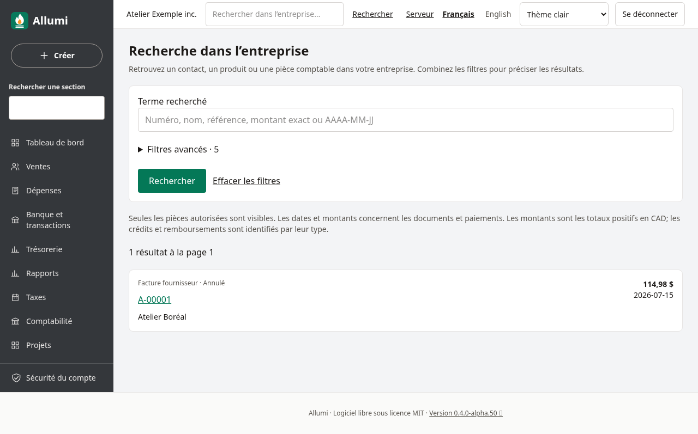
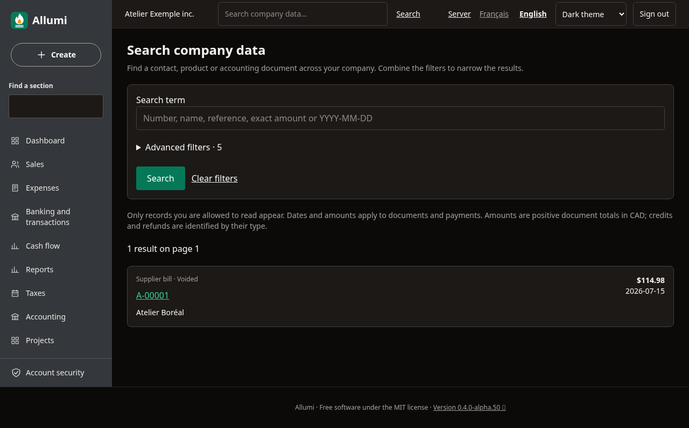
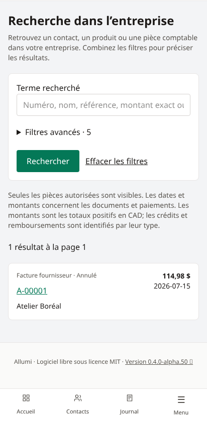
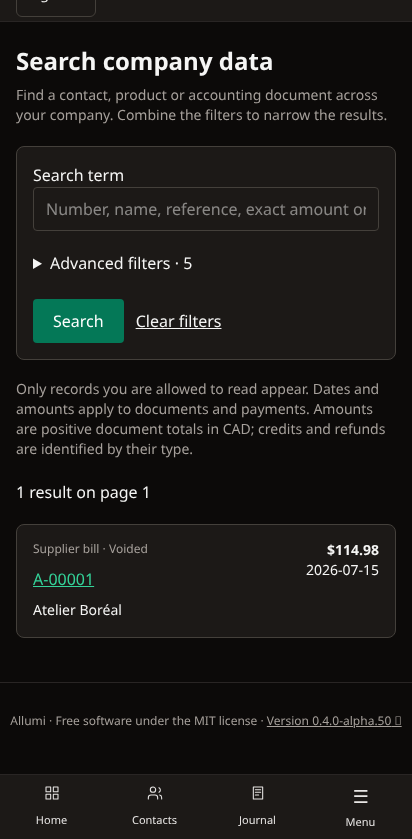

# Recherche dans l’entreprise

Le champ **Rechercher dans l’entreprise** de l’en-tête ouvre une recherche dans les données de l’entreprise courante. Il est distinct du champ du menu latéral, qui retrouve uniquement les sections de navigation.

## Retrouver une pièce

Saisissez un numéro Allumi, une référence, un nom, un montant exact ou une date au format **AAAA-MM-JJ**, puis **Rechercher**. Les résultats couvrent les contacts, les produits et services, les factures et avoirs clients, les factures et crédits fournisseurs, les dépenses, les encaissements, les décaissements et les remboursements.

Exemples : `F-00001`, une référence fournisseur comme `FOUR-2026-001`, `Atelier Boréal`, `123,45` ou `2026-07-15`. Un terme numérique recherche à la fois son texte et le montant exact correspondant; les dates recherchent la date du document ou du paiement. Les caractères `%`, `_` et `\` sont recherchés littéralement.

Le lien d’un résultat ouvre sa fiche ou sa pièce, en conservant la distinction entre brouillon et document validé. Un remboursement fournisseur historique ouvre son écriture comptable. Les notes internes, descriptions de lignes et motifs d’annulation ne sont pas recherchés ni affichés.

## Combiner les filtres

Dépliez **Filtres avancés** pour choisir le type, le statut, les dates et le montant. Après une recherche, ces champs sont repliés pour laisser les résultats visibles sur téléphone; le nombre de critères avancés actifs reste indiqué. Dépliez-les à nouveau pour les modifier.

- **Type** : limiter les résultats à une catégorie.
- **Statut** : Brouillon, Validé, Annulé, Actif ou Archivé, selon le type d’enregistrement.
- **Du / Au** : bornes inclusives sur la date du document ou du paiement; chaque borne est facultative.
- **Montant exact (CAD)** : total du document ou montant du paiement, calculé en cents exacts. Les formats canadiens français et anglais sont acceptés (`123,45` ou `123.45`, avec groupements valides). Changer de langue conserve le montant exact. Zéro est accepté. Les montants sont positifs; le type précise s’il s’agit d’un crédit ou d’un remboursement.

Les filtres se combinent entre eux et avec le terme recherché. Les dates et montants excluent les contacts et produits, qui n’ont pas de date de pièce ou de total comparable. Le filtre « Annulé » décrit un document contre-passé; il ne signifie pas « impayé ».

Les résultats sont classés par date décroissante, puis type et identifiant stable. Chaque page contient jusqu’à 50 résultats; les liens **Précédent / Suivant** conservent les filtres. Au-delà de 5 000 résultats, précisez les critères. Une recherche sans terme et sans filtre n’énumère pas toutes les données. **Effacer les filtres** revient à cet état initial.

## Permissions et confidentialité

La recherche exige une session et une adhésion active à l’entreprise. Chaque source respecte les permissions modulaires : Contacts, Catalogue, Ventes ou Comptabilité. Les paiements clients exigent à la fois Ventes et Comptabilité. Retirer un accès retire aussi ses résultats; connaître un numéro ne donne pas un droit de lecture supplémentaire.

Les noms figés sur les pièces validées restent visibles avec leur droit financier, comme sur la pièce elle-même. En revanche, sans accès Contacts, la recherche ne consulte pas les noms et adresses courriel actuels du répertoire pour compléter les documents ou paiements. Aucun résultat d’une autre entreprise n’est mélangé.

Comme les autres recherches par URL, le terme et les filtres peuvent figurer dans l’historique du navigateur et dans les journaux d’un proxy configuré par l’administrateur. Évitez d’y saisir des secrets. Aucun historique de recherche propre à Allumi ni service de recherche tiers n’est créé.

## Anglais, thème sombre et mobile

En anglais, le champ et la page sont nommés **Search company data**. Les filtres et liens sont traduits; les références des pièces restent identiques. Sur téléphone, les résultats s’affichent en cartes, sans tableau horizontal.

Cette recherche porte sur les types décrits ci-dessus. Elle ne recherche pas encore les lignes d’import bancaire, les rapports, le plan comptable ou les écritures manuelles autonomes. Elle ne fournit pas de suggestions pendant la frappe ni d’interprétation de phrases en langage naturel. Les données restent dans PostgreSQL sur votre serveur.

Voir [[Interface-et-navigation]], [[Recherche-des-paiements-clients]] et [[Utilisateurs-et-permissions]].
