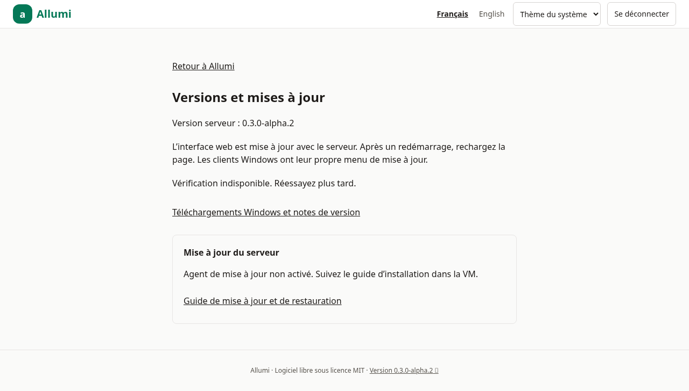
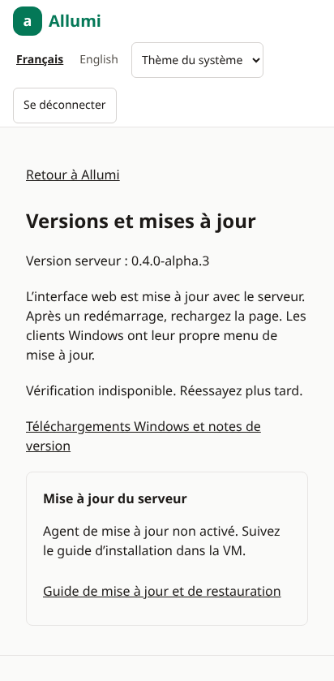

# Références visuelles

Captures réelles d’Allumi avec le lot contacts 4.1, réalisées avec Chromium le 19 octobre 2026. Elles montrent uniquement **Atelier Exemple inc.**, entreprise fictive créée par les tests. La refonte et le lot contacts sont intégrés à `main`. Les montants, les dates et les événements illustrent un parcours de test.

Ordinateur : 1280 × 720 px (capture pleine page). Téléphone : émulation Pixel 7, 412 × 839 px CSS (zone visible du téléphone, navigation inférieure comprise). Ces images ne constituent pas une validation Safari ou sur appareil physique. Sur téléphone, les tableaux larges se font défiler horizontalement; la capture en montre le début.

## Tableau de bord

Soldes nets réels et écriture fictive d’apport de 1 000,00 $. Voir [[Interface-et-navigation]].

### Ordinateur

### Téléphone

## Nouvelle écriture

Saisie équilibrée avant validation, avec champs adaptés à l’écran. Voir [[Journal-et-ecritures]].

### Ordinateur

### Téléphone

## Journal

Liste des écritures et filtres. Voir [[Journal-et-ecritures]].

### Ordinateur

### Téléphone

## Plan comptable

Gabarit canadien et accès aux comptes. Voir [[Plan-comptable]].

### Ordinateur

### Téléphone

## Balance de vérification

Soldes nets et vérifications comptables. Voir [[Journal-et-ecritures]].

### Ordinateur

### Téléphone

## Exercices et périodes

Contrôles de verrouillage et réouverture. Voir [[Exercices-et-periodes]].

### Ordinateur

### Téléphone

## Piste d’audit

Événements de l’entreprise fictive. Voir [[Piste-d-audit]].

### Ordinateur

### Téléphone

## Premier démarrage

Installation locale sans jeton public; une installation HTTPS publique demande aussi son jeton. Voir [[Premier-demarrage]].

### Ordinateur

### Téléphone

## Interface anglaise

Même parcours traduit en anglais; cette capture est prise après la contre-passation, donc l’actif revient à zéro.

### Ordinateur

### Téléphone

## Actualiser les références

La procédure de génération et de publication se trouve dans [[Publication-du-wiki]]. Les fichiers originaux sont versionnés dans `docs/images/` du dépôt.

## Contacts

Répertoire et saisie d’un client/fournisseur fictif, voir [[Contacts]].

### Répertoire

### Saisie du contact

## Domaines d’activité et menu complet

Les sections donnent accès aux outils existants et indiquent ce qui reste à livrer. Voir [[Fonctionnalites-et-limites]].

## Versions et mises à jour

Captures du serveur de test : l’agent hôte est désactivé et la consultation GitHub peut être indisponible dans l’environnement isolé. Elles ne représentent pas une mise à jour réelle de Proxmox. Voir [[Mise-a-jour]] et [[Application-mobile]].
