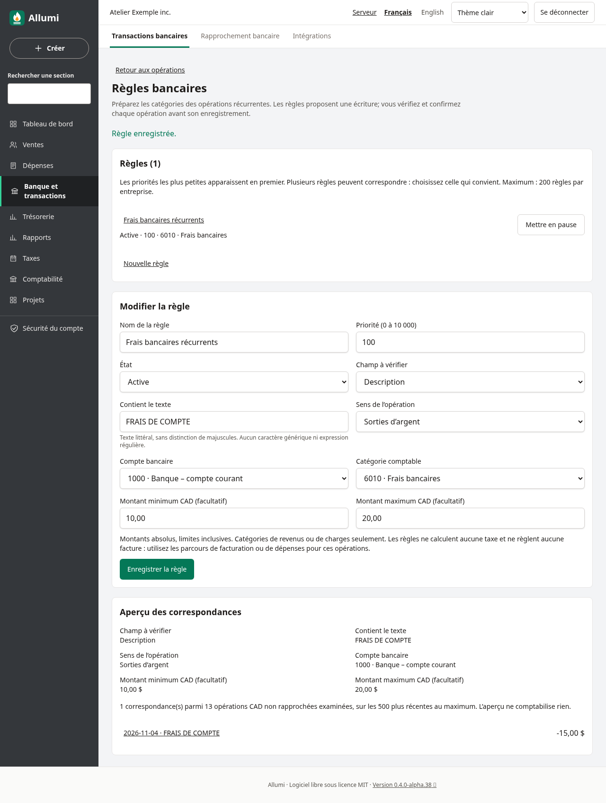
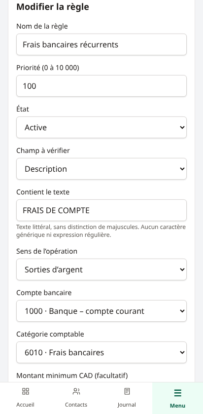
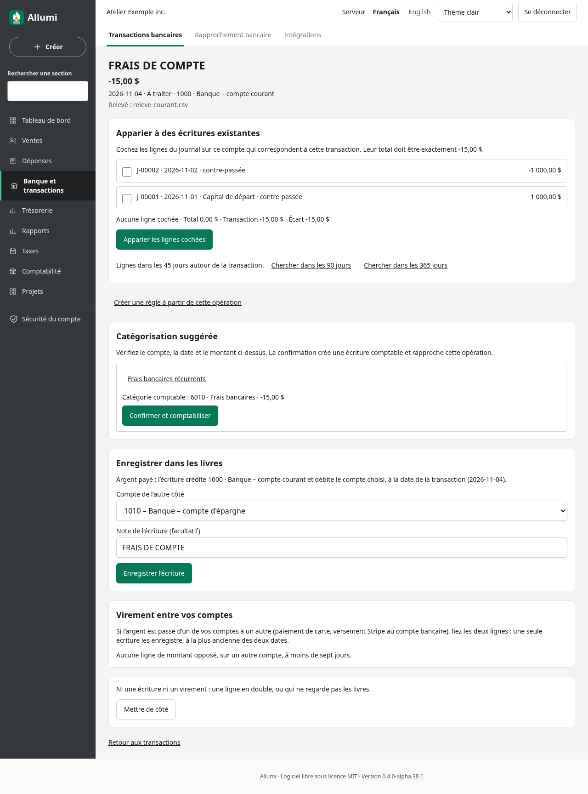
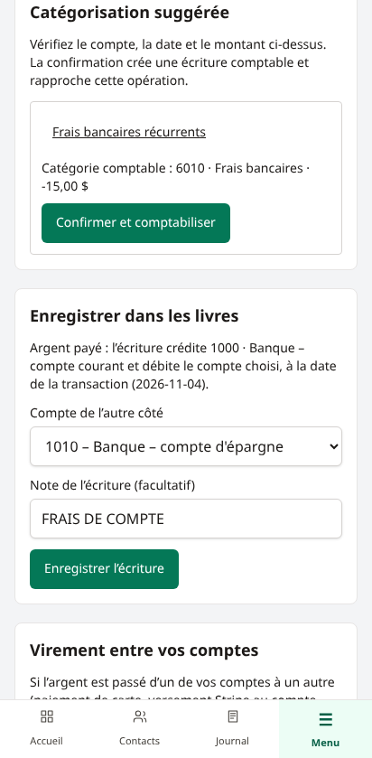
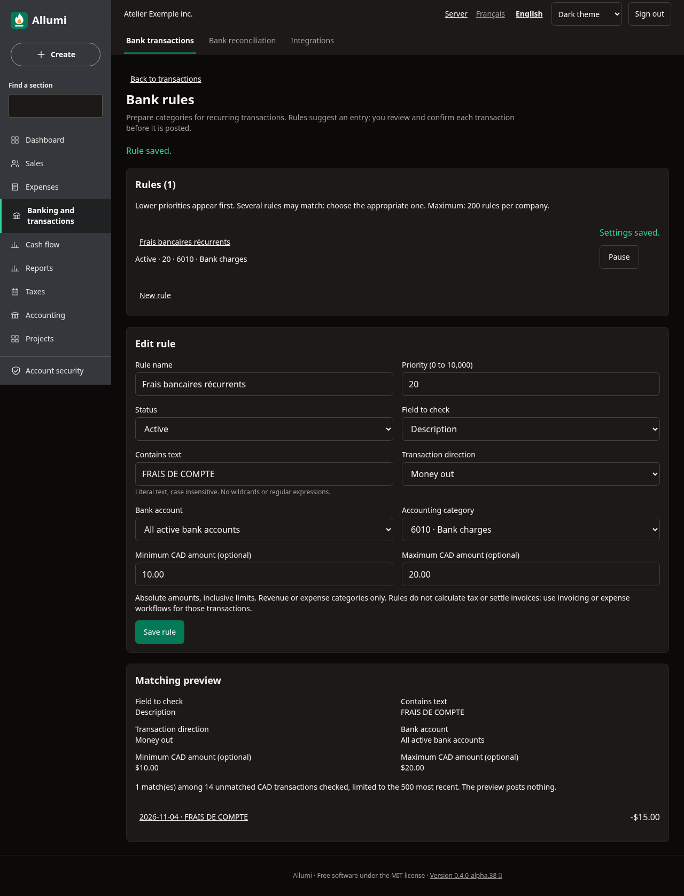
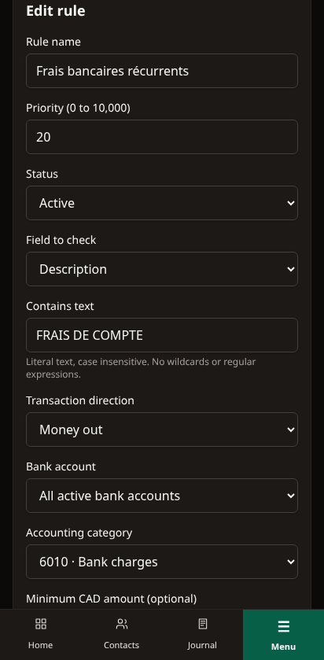

# Règles bancaires

Les règles préparent les catégories des opérations récurrentes. Elles proposent une écriture; chaque opération demande votre confirmation. Elles ne comptabilisent rien en arrière-plan.

## Créer une règle

Dans **Transactions bancaires → Règles bancaires**, renseignez un nom et les conditions. Depuis une opération à traiter en CAD, **Créer une règle à partir de cette opération** préremplit le bénéficiaire ou la description, le sens et le compte bancaire. Choisissez ensuite la catégorie comptable et enregistrez.

- **Champ et texte** : description ou bénéficiaire contenant un texte littéral, sans distinction de majuscules. `%`, `_` et les autres caractères sont du texte ordinaire; aucune expression régulière.
- **Sens** : entrée, sortie ou les deux. La devise prise en charge est CAD.
- **Compte bancaire** : un compte banque, encaisse ou carte actif, ou tous ces comptes.
- **Montants facultatifs** : valeurs absolues positives en CAD; minimum et maximum inclus. Par exemple, 10 à 20 correspond à une sortie de 15,00 $.
- **Catégorie** : compte actif de revenus ou de charges. Les comptes de contrôle, de taxes et les virements entre banques utilisent leurs parcours dédiés.
- **Priorité** : de 0 à 10 000, les plus petites valeurs apparaissant en premier. Si plusieurs règles correspondent, vous choisissez; aucune priorité ne déclenche une écriture automatique.

## Prévisualiser et modifier

Ouvrez une règle pour voir son formulaire et ses correspondances. L’aperçu examine au maximum les **500 opérations CAD non rapprochées les plus récentes**, dans la portée du compte choisi, et indique combien ont été examinées. Ce n’est pas un historique exhaustif. Les liens ouvrent les opérations pour vérification.

**Mettre en pause** retire une règle des suggestions; **Activer** la rétablit. Une modification augmente sa révision. Il y a au maximum 200 règles par entreprise, règles en pause incluses. L’historique reste dans la piste d’audit; il n’y a pas de suppression définitive.

Un compte archivé ou devenu inadmissible bloque l’application. Corrigez les comptes pour réactiver la règle; sa mise en pause reste possible.

## Confirmer une suggestion

Sur le détail d’une opération, le bloc **Catégorisation suggérée** affiche les règles correspondantes et leur catégorie. Vérifiez la date, le compte bancaire, le montant et la catégorie, puis choisissez **Confirmer et comptabiliser**.

Cette action crée une écriture datée comme l’opération et rapproche la ligne bancaire dans la même transaction. Une double confirmation ne produit pas deux écritures. Si la règle ou l’opération a changé depuis l’affichage, actualisez et vérifiez la nouvelle suggestion. Les périodes verrouillées et les autres protections comptables s’appliquent.

Pour une opération déjà comptabilisée ailleurs, utilisez l’appariement à l’écriture existante. Les règles ne déduisent aucune TPS/TVQ et n’affectent aucun paiement à une facture. Utilisez les factures, dépenses et paiements pour ces besoins. Si vous défaites un rapprochement, l’écriture initiale reste au journal : le moteur refuse une deuxième comptabilisation tant qu’elle existe sans contre-passation.

## Accès, anglais et thème sombre

La lecture suit le droit **Comptabilité — lecture**; la gestion et la confirmation exigent **Comptabilité — écriture**, selon les permissions modulaires. Les entreprises restent isolées. Les changements de règles et les confirmations sont audités avec la révision appliquée et l’écriture créée.

En anglais : **Bank rules**, **Matching preview**, **Suggested categorization**, **Confirm and post**. La même interface fonctionne sur le web, le client Windows et la web app mobile.

Voir aussi [[Import-de-releves]], [[Appariement-bancaire]], [[Rapprochement-bancaire]], [[Journal-et-ecritures]] et [[Piste-d-audit]].
