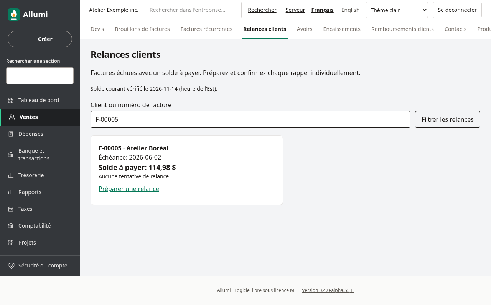
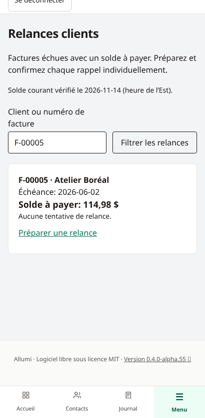
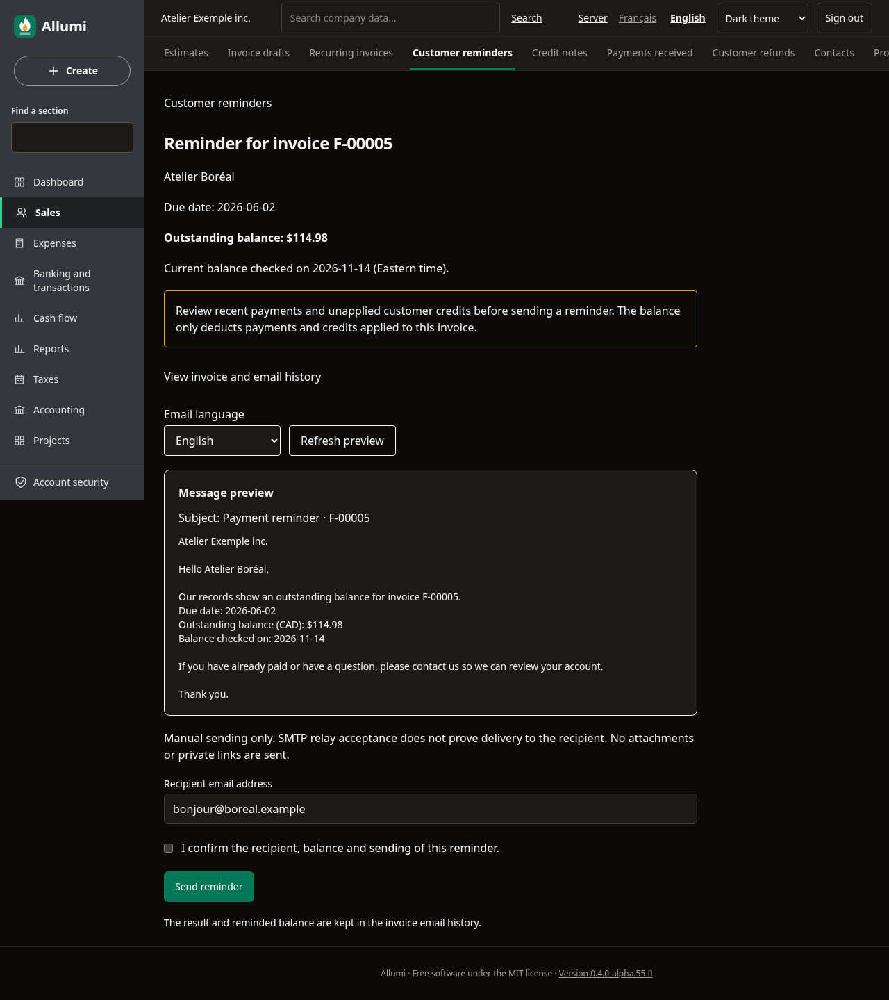
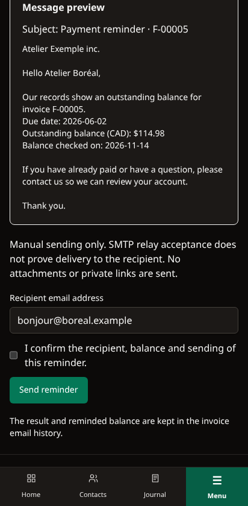
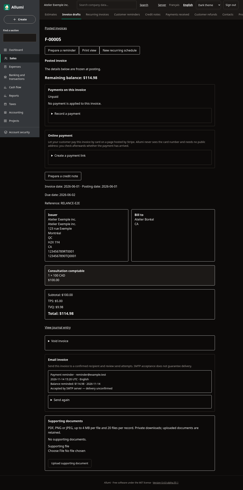
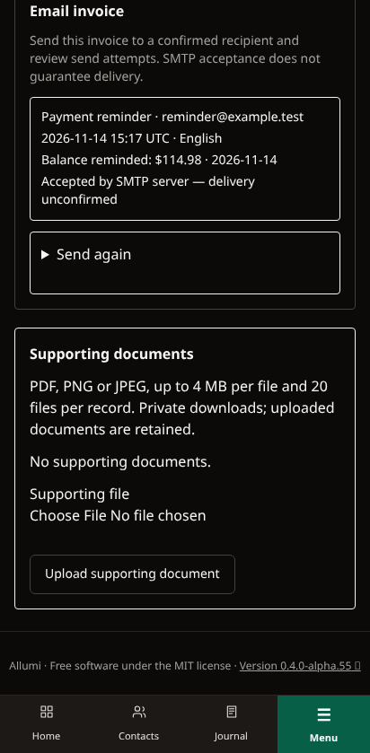

# Relances clients

Ouvrez **Ventes → Relances clients**, ou **Préparer une relance** sur une facture validée échue avec un solde positif. Chaque message est préparé, vérifié et envoyé individuellement. Aucun envoi n’est planifié.

## Trouver les factures à relancer

La liste présente les factures validées dont la date d’échéance est strictement passée et le solde courant reste positif. La date comptable ne peut pas être future. Les factures réglées, annulées et les brouillons sont exclus. Les paiements et avoirs affectés réduisent le solde; les crédits non affectés du client ne le réduisent pas automatiquement. Vérifiez-les dans le [[Releve-de-compte-client]] avant de relancer.

La date de référence utilise l’heure de l’Est (America/Toronto). La recherche porte sur le numéro et le nom du client figé à la validation; les caractères `%`, `_` et `\` sont recherchés littéralement. Les pages contiennent au plus 50 factures, triées par échéance puis identifiant. La dernière tentative est affichée, quel que soit son résultat : elle ne prouve pas un envoi réussi.

## Préparer et envoyer

1. Ouvrez **Préparer une relance** et vérifiez les paiements récents et crédits non affectés.
2. Choisissez la langue du courriel et **Actualiser l’aperçu**. Le message reprend le numéro, l’échéance, les noms figés et le solde courant. Il ne contient ni notes de facture, ni pièces jointes, ni liens privés.
3. Vérifiez le destinataire proposé depuis la facture. Une autre adresse unique peut être saisie; les listes ne sont pas acceptées.
4. Confirmez le destinataire, le solde et l’envoi. Une relance précédente impose une confirmation supplémentaire, même si son résultat est incertain.
5. Consultez le résultat dans le panneau **Envoi par courriel** de la facture. Chaque tentative distingue facture et relance; une relance conserve le montant rappelé et sa date.

Le serveur exige une configuration SMTP valide : [[Configuration]] et [[Envoi-des-factures]]. Sans SMTP, la liste et l’aperçu restent disponibles. Le texte est fixe; il ne comprend ni intérêts ni frais ajoutés.

## Contrôles avant envoi

Le solde, l’échéance et la date de l’aperçu sont revérifiés sous verrou avant de réserver une tentative. Un paiement ou un avoir affecté entre l’affichage et la confirmation bloque la soumission et demande de recharger l’aperçu. Une facture réglée ou annulée ne peut plus être relancée. Le contrôle est répété en base de données.

Le même identifiant de soumission ne crée qu’une tentative, y compris lors d’un double clic concurrent. Factures et relances partagent les limites SMTP : au moins une minute entre les tentatives, cinq minutes lorsqu’une tentative est en cours, maximum 20 par facture sur 24 heures. Le relais est appelé hors transaction; un paiement peut toujours arriver après la réservation ou pendant le transport. L’historique indique le solde vérifié avant cet appel, pas une garantie que le client reste débiteur à la réception.

**Accepté par le serveur SMTP** indique seulement l’acceptation du relais. Une interruption peut laisser un résultat en attente ou incertain. Vérifiez auprès du destinataire avant de renvoyer; aucune reprise automatique n’est effectuée.

## Permissions et limites

La liste et l’aperçu exigent Ventes et Comptabilité en lecture. L’envoi exige Ventes en écriture et Comptabilité en lecture; aucun droit d’écriture comptable n’est nécessaire. L’historique des courriels reste consultable avec Ventes en lecture. Voir [[Utilisateurs-et-permissions]]. Les tentatives sont immuables et auditées, avec isolation par entreprise.

Aucun traitement groupé, règle de retard, tâche de fond, échéancier de relances, suivi d’ouverture, preuve de livraison ou débit bancaire n’est livré. Les relances ne modifient ni la facture validée, ni ses taxes, ni le grand livre. Les captures utilisent uniquement des données fictives.
