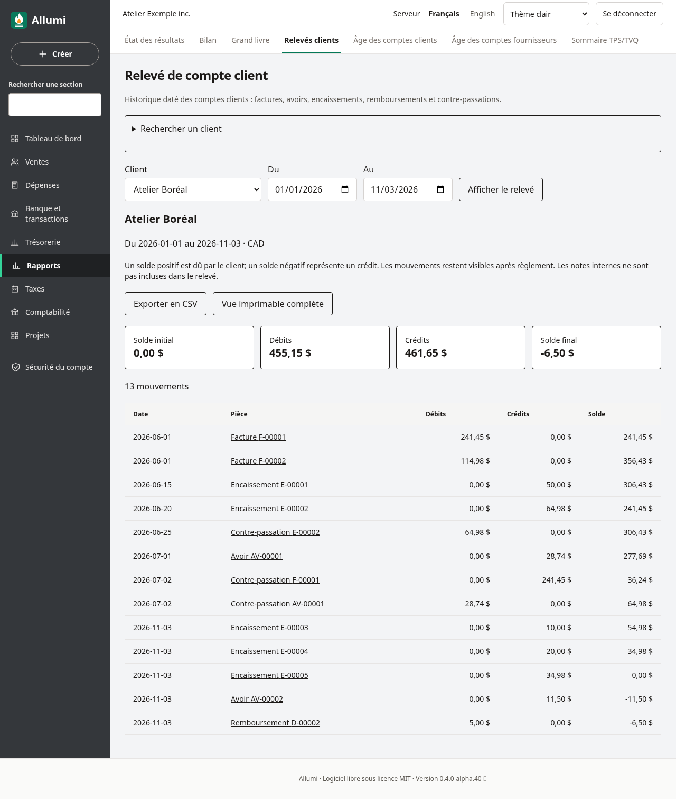
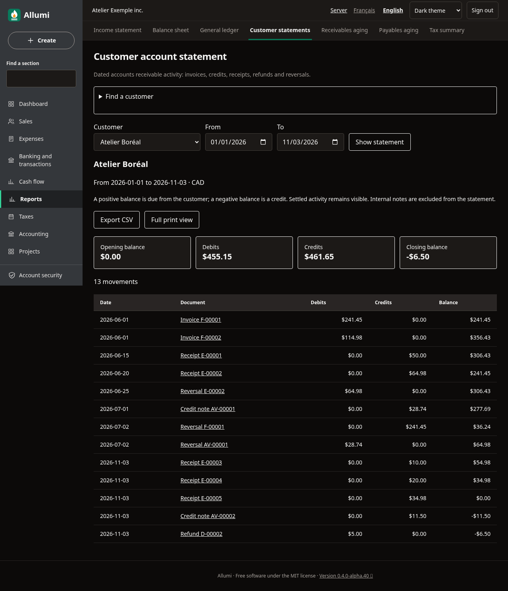
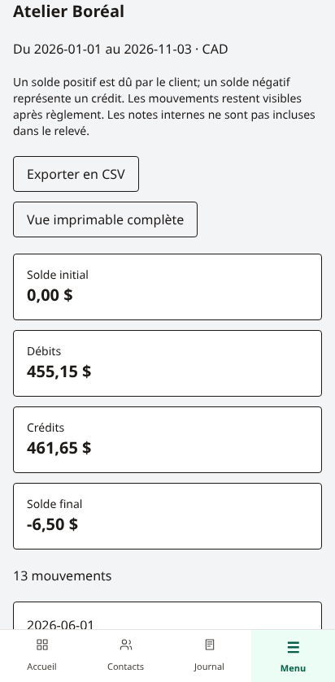

# Relevé de compte client

**Rapports → Relevés clients** présente les mouvements comptabilisés des comptes clients pour un client et une période. La fiche du contact propose aussi un lien **Relevé de compte client** lorsque vos droits permettent la consultation.

Choisir un client et les dates **Du** et **Au**, puis **Afficher le relevé**. La recherche limite la liste à 100 clients; préciser le nom si nécessaire. Un client archivé peut être consulté pour son historique.

## Comprendre les soldes

- **Solde initial** : mouvements antérieurs au premier jour demandé.
- **Débits** : montants qui augmentent ce que doit le client, notamment factures et remboursements.
- **Crédits** : montants qui réduisent ce que doit le client, notamment encaissements et avoirs.
- **Solde final** : solde initial + débits − crédits.

Un montant positif est dû par le client; un montant négatif représente un crédit en sa faveur. La devise est CAD. Le relevé suit les écritures datées du grand livre, y compris les contre-passations associées au client. Il conserve les factures déjà réglées et les écritures annulées, avec leurs contre-passations à leur propre date. Une affectation d’avoir ne crée pas une seconde écriture.

Les lignes sont classées par date, numéro d’écriture et position dans l’écriture. Chaque page contient jusqu’à 100 mouvements; les totaux couvrent toute la période et le solde courant continue entre les pages. Identité, soldes et lignes sont lus dans un même instantané de base de données.

## Exporter ou imprimer

**Exporter en CSV** télécharge tous les mouvements de la période, pas seulement la page visible. Le séparateur et la notation des décimales suivent la langue de l’interface. Les montants restent exacts et les cellules textuelles sont protégées contre les formules de tableur.

**Vue imprimable complète**, puis **Imprimer / PDF** prépare une version destinée au client, avec l’entreprise, son nom, les dates et les soldes. La navigation disparaît à l’impression; le papier reste blanc en thème sombre. Désactiver les en-têtes et pieds de page du navigateur pour ne pas imprimer l’adresse du serveur. Le CSV et la vue complète sont limités à 200 000 lignes : réduire la période au-delà.

Les notes internes, motifs privés, identifiants techniques et liens d’administration ne sont pas inclus dans le CSV ou les références des pièces imprimées. L’écran de consultation authentifié propose des liens vers les pièces et écritures autorisées. L’export ne crée aucun lien public et n’envoie rien au client.

## Permissions et téléphone

La consultation, le CSV et l’impression exigent **Comptabilité**, **Ventes** et **Contacts** en lecture. Un identifiant invalide, inconnu, répété ou provenant d’une autre entreprise est refusé; il n’est jamais remplacé par un relevé de tous les clients. Les lectures restent possibles sur les périodes verrouillées ou clôturées.

Sur téléphone, chaque mouvement affiche ses montants dans une carte. L’interface anglaise utilise **Customer account statement**, **Opening balance**, **Debits**, **Credits**, **Closing balance** et **Full print view**. Voir [[Avoirs-disponibles-et-remboursements]], [[Grand-livre]], [[Age-des-comptes]] et [[Utilisateurs-et-permissions]].
