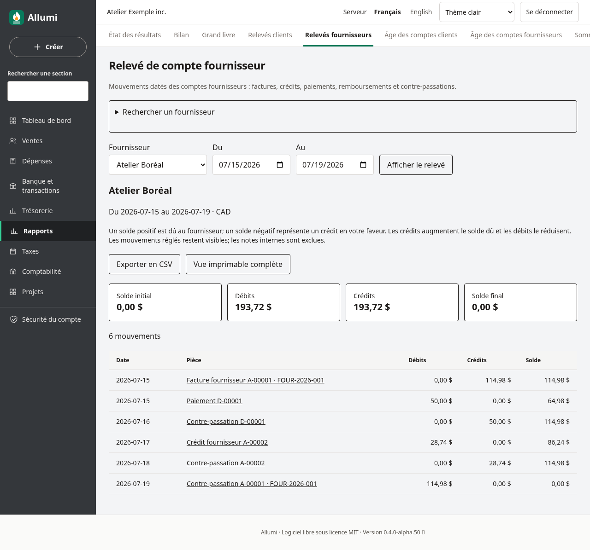
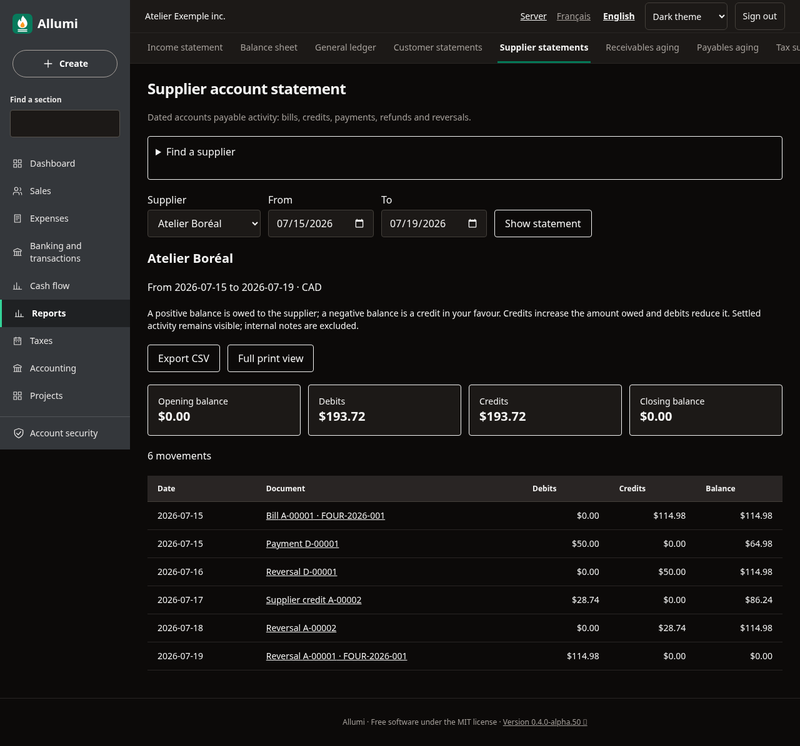
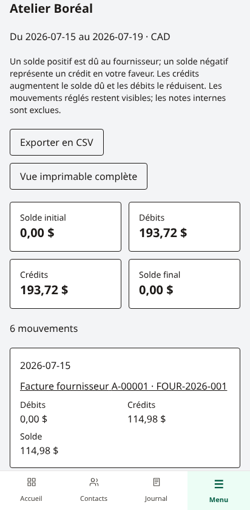
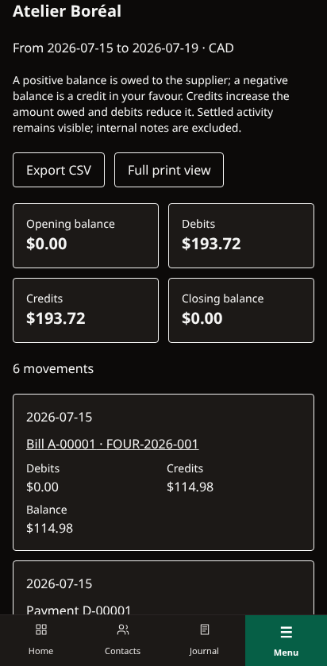

# Relevé de compte fournisseur

Dans **Rapports → Relevés fournisseurs**, consultez les mouvements comptabilisés d’un fournisseur sur une période. La fiche du contact propose aussi **Relevé de compte fournisseur**. Ce rapport ne crée aucune écriture et ne transmet aucun paiement.

Choisissez le fournisseur, les dates **Du** et **Au**, puis **Afficher le relevé**. La recherche affiche au maximum 100 fournisseurs; précisez leur nom si nécessaire. Les fournisseurs archivés et les contacts de type Client et fournisseur restent consultables.

## Comprendre les montants

- **Solde initial** : solde des comptes fournisseurs avant le premier jour choisi.
- **Crédits** : mouvements qui augmentent le montant dû, dont les factures et les remboursements reçus du fournisseur.
- **Débits** : mouvements qui réduisent le montant dû, dont les paiements et crédits fournisseurs.
- **Solde final** : solde initial + crédits − débits.

Un solde positif représente un montant dû au fournisseur. Un solde négatif représente un crédit en votre faveur. La devise est CAD. Les montants proviennent des lignes des comptes fournisseurs du grand livre; les mouvements des comptes clients du même contact sont exclus.

La référence saisie sur la facture fournisseur est affichée avec son numéro Allumi et conservée dans le CSV et l’impression.

Factures réglées, paiements, crédits et contre-passations restent visibles à leur date comptable. Une affectation de crédit ne crée pas de seconde écriture. Le relevé peut donc différer d’une liste des factures encore ouvertes : il présente l’historique comptabilisé, pas seulement les échéances impayées. Les remboursements historiques peuvent être consultés même si leur saisie ne dispose pas encore d’un formulaire fournisseur.

Les mouvements sont classés par date, numéro d’écriture et position dans l’écriture. Chaque page contient jusqu’à 100 lignes. Les totaux couvrent toute la période et le solde courant se poursuit d’une page à l’autre. Identité, soldes et lignes sont lus dans un même instantané de base de données.

## Exporter et imprimer

**Exporter en CSV** télécharge tous les mouvements de la période, pas seulement la page affichée. Le séparateur et les décimales suivent la langue de l’interface. Les montants restent exacts et les textes sont protégés contre les formules de tableur.

**Vue imprimable complète**, puis **Imprimer / PDF** prépare le rapport avec l’entreprise, le fournisseur, la période et les soldes. La navigation est masquée à l’impression; le papier reste blanc en thème sombre. Désactivez les en-têtes et pieds de page du navigateur pour ne pas imprimer l’adresse du serveur. CSV et impression complète sont limités à 200 000 mouvements : réduisez la période au-delà.

Les notes internes, motifs privés et identifiants techniques ne figurent pas dans le CSV ou les références imprimées. Les liens vers les pièces et écritures sont réservés à l’écran authentifié. Aucun lien public n’est créé et le relevé n’est pas envoyé au fournisseur.

## Permissions, anglais et téléphone

Consultation, recherche, CSV et impression exigent **Comptabilité** et **Contacts** en lecture. Le droit Ventes n’est pas requis. Un fournisseur invalide, inconnu ou d’une autre entreprise est refusé; il n’est jamais remplacé par un relevé de tous les fournisseurs. Les paramètres de contact, de dates ou d’impression répétés sont également refusés. Les lectures restent disponibles sur les périodes verrouillées ou clôturées.

Sur téléphone, les lignes sont présentées en cartes. L’interface anglaise utilise **Supplier account statement**, **Opening balance**, **Debits**, **Credits**, **Closing balance** et **Full print view**.

Voir [[Factures-fournisseurs]], [[Age-des-comptes-fournisseurs]], [[Grand-livre-par-contact]], [[Releve-de-compte-client]] et [[Utilisateurs-et-permissions]].
