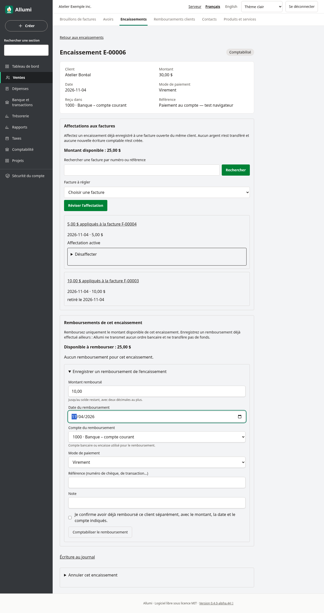
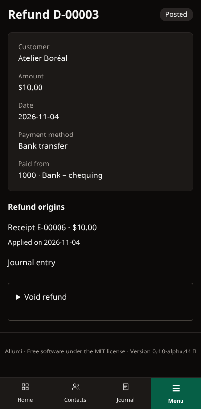

# Remboursements des encaissements clients

Un encaissement peut conserver un montant disponible après réception des fonds, avant son affectation à des factures ou après une désaffectation. Allumi permet de comptabiliser le remboursement partiel ou complet de ce disponible **sans créer d’avoir**. Pour rembourser une correction de vente portée par un avoir, utiliser plutôt [[Avoirs-disponibles-et-remboursements]].

**Le paiement au client doit avoir été effectué séparément. Allumi n’envoie aucun argent et ne transmet aucun ordre bancaire ou à un processeur de paiement.** Ce parcours enregistre le mouvement réel et conserve son lien avec l’encaissement d’origine.

## Enregistrer un remboursement

Ouvrir **Ventes → Encaissements**, puis la fiche de l’encaissement comptabilisé. Dans **Remboursements de cet encaissement**, consulter **Disponible à rembourser**, puis ouvrir **Enregistrer un remboursement de l’encaissement**. Le disponible tient compte des affectations actives aux factures et des remboursements ou autres compensations actives : un montant déjà utilisé ne peut pas être remboursé une seconde fois.

Saisir le **Montant remboursé**, positif et au plus égal au disponible, la **Date du remboursement**, le **Compte du remboursement**, le **Mode de paiement** et, si utile, une référence ou une note. Le compte doit être une banque ou une caisse active. Les fonds non déposés et les cartes de crédit ne sont pas des comptes de sortie admissibles. Vérifier les données, cocher **Je confirme avoir déjà remboursé ce client séparément, avec le montant, la date et le compte indiqués.**, puis **Comptabiliser le remboursement**.

L’opération crée, dans une même transaction, un paiement sortant numéroté, son écriture et une compensation avec l’encaissement d’origine. L’écriture **débite les comptes clients et crédite la banque ou la caisse**. Elle ne crée ni vente ni taxe supplémentaire. Les affectations déjà présentes sur les factures restent inchangées.

Exemple : un encaissement de 100,00 $ déjà affecté à hauteur de 60,00 $ possède un disponible de 40,00 $. En rembourser 15,00 $ laisse 25,00 $ disponibles, sans modifier les 60,00 $ appliqués à la facture.

## Formulaire périmé, dates et doubles envois

Le disponible affiché est revérifié sous verrou lors de l’enregistrement. S’il a changé à cause d’une affectation, d’un retrait ou d’un autre remboursement, le formulaire est refusé : recharger la fiche et vérifier le montant avant de recommencer.

Un identifiant de soumission protège les reprises du même formulaire. Répéter la même demande retrouve le remboursement existant sans deuxième paiement ni deuxième écriture, y compris si celui-ci a été annulé depuis. Réutiliser cet identifiant avec d’autres données est refusé. Pour un autre remboursement réel, ouvrir un nouveau formulaire.

La date ne peut être future, précéder la réception de l’encaissement ni son dernier mouvement d’affectation, de retrait ou de compensation. Elle doit appartenir à une période fiscale ouverte. Ces contrôles portent sur l’historique global de l’encaissement, afin de conserver des soldes cohérents à une date passée; ils sont aussi appliqués en base.

## Historique et origine

La section **Remboursements de cet encaissement** conserve les remboursements et leurs liens, montants et dates, par pages de 25. **Part de cet encaissement** distingue le montant compensé du total du remboursement lorsque ceux-ci diffèrent. Les compensations retirées restent visibles. La liste **Ventes → Remboursements clients** rassemble les remboursements provenant d’avoirs et d’encaissements; la fiche du remboursement permet de retrouver ses origines et son écriture au journal.

La section **Origines du remboursement** est paginée par 25, y compris pour les anciennes pièces associées à plusieurs sources. Le montant attribué à chaque origine est distingué du total du remboursement; aucune origine n’est remplacée par une source unique supposée. Rechercher le numéro de l’encaissement d’origine permet aussi de retrouver son remboursement : [[Recherche-des-paiements-clients]].

## Annuler une comptabilisation erronée

Sur la fiche du remboursement, ouvrir **Annuler le remboursement**, saisir la **Date d’annulation**, admissible dans une période ouverte, et un motif. Cocher **Je confirme la contre-passation de ce remboursement.**, puis **Contre-passer le remboursement**. Allumi crée l’écriture inverse exacte et retire la compensation à cette date. Le disponible de l’encaissement est rétabli du montant correspondant; les affectations aux factures ne sont pas retirées ou modifiées. Le remboursement, le motif et les liens historiques restent conservés. Répéter l’annulation ne crée pas de seconde contre-passation.

Cette annulation **ne récupère pas l’argent envoyé** : traiter séparément le mouvement bancaire réel. Sa date ne peut précéder le remboursement ou un mouvement ultérieur de l’encaissement d’origine.

Un encaissement ayant une compensation active ne peut pas être annulé. Annuler d’abord le remboursement uniquement si sa comptabilisation était erronée. Si l’encaissement appartient aussi à un dépôt bancaire actif, l’annulation du dépôt reste nécessaire avant celle de l’encaissement : [[Depots-bancaires]].

## Droits et affichage

La consultation exige **Ventes** et **Comptabilité** en lecture. Enregistrer un remboursement exige la gestion des ventes et la validation des écritures, correspondant aux accès en écriture de ces deux modules. L’annulation exige aussi le droit de contre-passation. Aucun accès Contacts supplémentaire n’est nécessaire pour traiter un encaissement existant; les droits sur les pièces financières et l’isolation par entreprise restent appliqués.

Le parcours est disponible en français et en anglais, sur ordinateur et téléphone, en thèmes clair et sombre.

La migration `20261110000000_customer_receipt_refunds` renforce les contrôles en base. La procédure standard [[Mise-a-jour]] l’applique via le service de migration.

Voir aussi [[Encaissements-au-compte]], [[Encaissements]], [[Releve-de-compte-client]], [[Utilisateurs-et-permissions]] et [[Mise-a-jour]].
