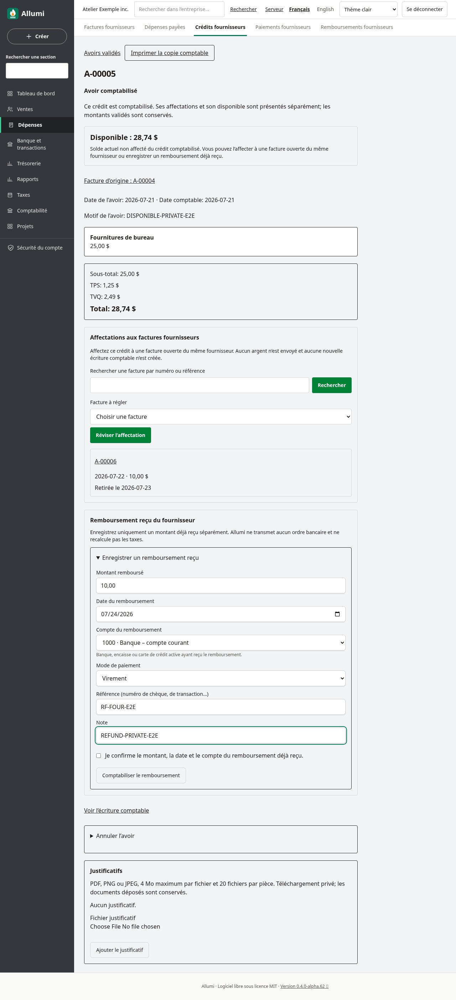
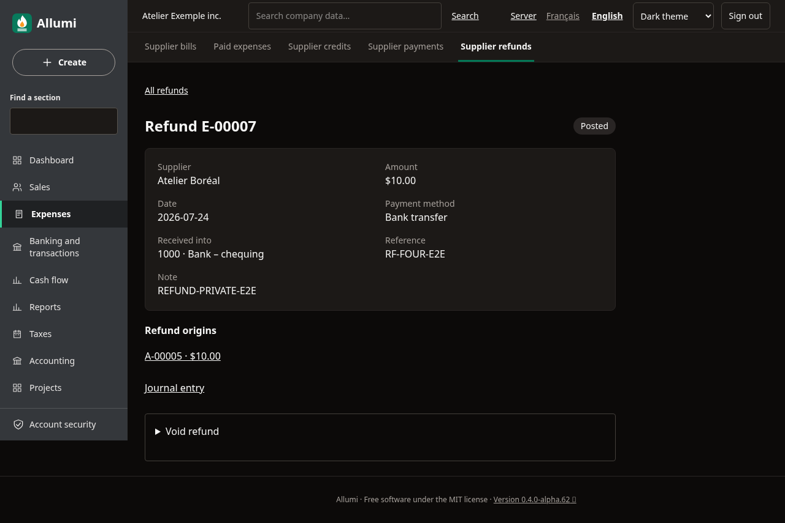
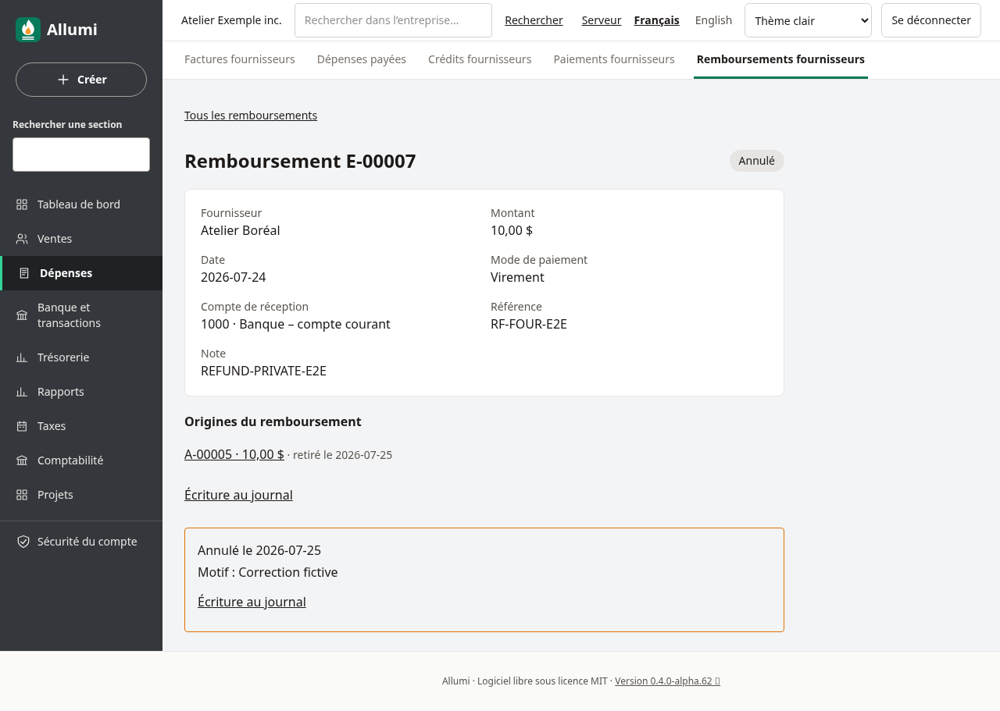
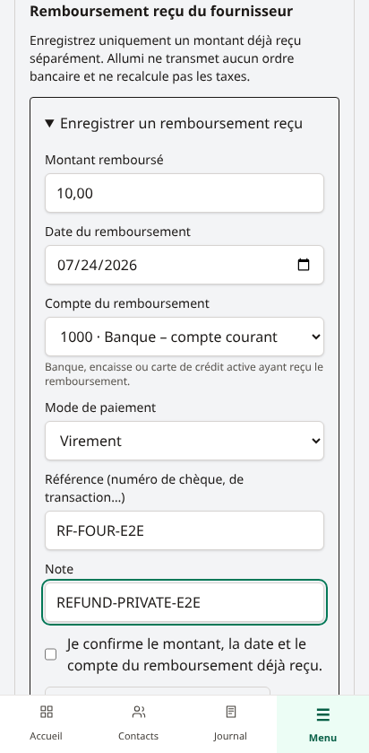
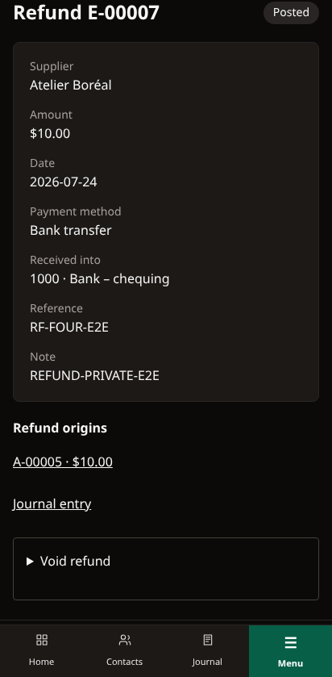
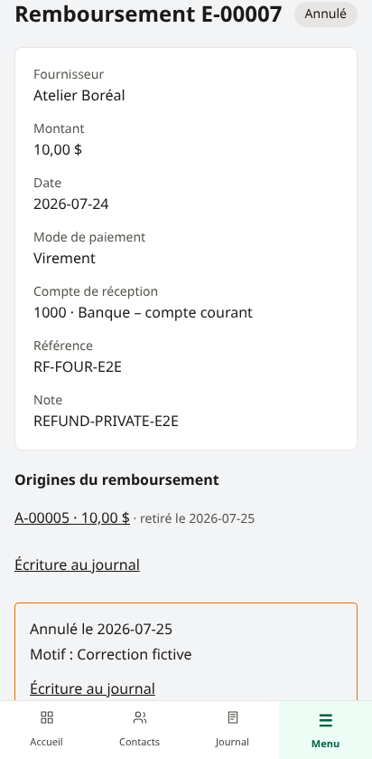

# Remboursements reçus des fournisseurs

Depuis **Dépenses → Crédits fournisseurs → Avoirs validés**, ouvrir un crédit dont le disponible est positif. Le panneau **Remboursement reçu du fournisseur** permet de comptabiliser un montant déjà reçu sur une banque, une encaisse ou une carte de crédit active.

Allumi enregistre l’opération; il ne demande aucun remboursement au fournisseur et ne transmet aucun ordre bancaire. Pour simplement réduire une facture à payer, utiliser [[Affectation-des-credits-fournisseurs]].

## Enregistrer un remboursement reçu

1. Ouvrir **Enregistrer un remboursement reçu** sur le crédit validé.
2. Vérifier le montant reçu, sa date et le compte de réception. Une carte de crédit peut recevoir un remboursement qui réduit sa dette.
3. Choisir le mode de paiement et, si nécessaire, une référence et une note interne.
4. Cocher la confirmation du montant déjà reçu, puis **Comptabiliser le remboursement**.

Le montant est positif et ne dépasse pas le crédit disponible. Les soldes sont revérifiés sous verrou; si une affectation ou un autre remboursement les modifie, recharger la page. La date n’est pas future, ne précède ni la validation du crédit ni son dernier mouvement, et appartient à une période ouverte.

Le remboursement reçoit un numéro de la séquence des encaissements. Dans la même transaction, Allumi crée une écriture définitive — débit de la banque/encaisse/carte, crédit des comptes fournisseurs — et l’affecte intégralement au crédit choisi. Le journal reste équilibré; le fournisseur est porté sur la ligne des comptes fournisseurs. Une erreur annule l’ensemble, y compris la consommation des numéros.

Exemple : un crédit disponible de **28,74 $**, remboursé pour **10,00 $**, conserve **18,74 $** disponibles. Les taxes du crédit ne sont pas recalculées et sa facture source déjà payée ne change pas de solde.

## Consulter et rechercher

La fiche présente le fournisseur figé sur la pièce source, le montant, le compte, la date, la référence, l’écriture et les origines du remboursement. Les origines historiques sont paginées par 25; un remboursement créé par ce parcours possède une seule origine. Le panneau du crédit montre les 25 remboursements les plus récents et signale les éléments supplémentaires.

**Dépenses → Remboursements fournisseurs** présente l’historique avec recherche littérale fournisseur/numéro/référence, état et dates, par pages de 25. Les notes internes ne sont pas recherchées. La recherche globale ouvre directement la fiche d’un remboursement fournisseur; le relevé fournisseur possède également ce lien. Le filtre de fournisseur de l’historique utilise les coordonnées figées lorsque Contacts est masqué. La recherche globale conserve ses règles de visibilité des noms.

Ces remboursements ne figurent pas dans les encaissements clients ni dans les remboursements clients : leur auxiliaire comptable est celui des fournisseurs. **Exporter en CSV** télécharge tous les résultats filtrés jusqu’à 10 000 remboursements, avec montants exacts et état actuel, sans notes privées : [[Export-des-remboursements-fournisseurs]]. Le [[Releve-de-compte-fournisseur]] permet également d’exporter les mouvements comptables du fournisseur.

## Copie comptable

Depuis la fiche, **Imprimer la copie comptable** ouvre une vue papier/PDF navigateur avec montant reçu original, état actuel, éventuelle contre-passation et toutes les origines jusqu’à 1 000, sans notes ni motifs privés. Voir [[Impression-des-remboursements-fournisseurs]].

## Annuler par contre-passation

Ouvrir **Annuler le remboursement**, saisir une date et un motif, confirmer puis **Contre-passer le remboursement**. La date suit le remboursement et les mouvements liés, reste non future et appartient à une période ouverte.

L’écriture inverse annule l’effet sur la banque/encaisse/carte et les comptes fournisseurs. Le disponible du crédit est restauré. Les affectations d’origine restent présentes, avec la date de retrait; une nouvelle soumission de l’annulation ne déplace pas cette date et ne crée pas une seconde contre-passation. Une période fermée provoque un refus sans retirer l’affectation.

Un crédit ne peut pas être annulé tant qu’un remboursement actif y reste affecté. Annuler d’abord le remboursement, puis le crédit si nécessaire. Les compensations historiques actives doivent être résolues séparément avant l’annulation; leur création ou résolution n’est pas proposée ici. Une contre-passation ne déplace aucun argent réel.

## Rapports et droits

L’[[Age-des-comptes-fournisseurs]] et le grand livre restent rapprochés; un rapport antérieur à une annulation conserve le remboursement. Le [[Releve-de-compte-fournisseur]] affiche le remboursement et sa contre-passation à leurs dates respectives. Le [[Sommaire-des-taxes]] ne change pas : seules les écritures du crédit et de son éventuelle annulation portent les taxes.

**Comptabilité en lecture** autorise les fiches, listes et historiques. **Comptabilité en écriture** permet l’enregistrement et la contre-passation selon les permissions de validation/annulation. L’accès aux répertoires Contacts, Taxes ou Ventes n’est pas exigé. Toutes les opérations sont isolées par entreprise.

Ce parcours utilise les tables et gardes existantes; aucune migration ni nouvelle configuration n’est nécessaire. Il ne prend pas en charge les remboursements fournisseurs autonomes sans crédit disponible, la récupération partielle des taxes ou les transferts bancaires réels. Voir [[Credits-fournisseurs-disponibles]] et [[Utilisateurs-et-permissions]].

