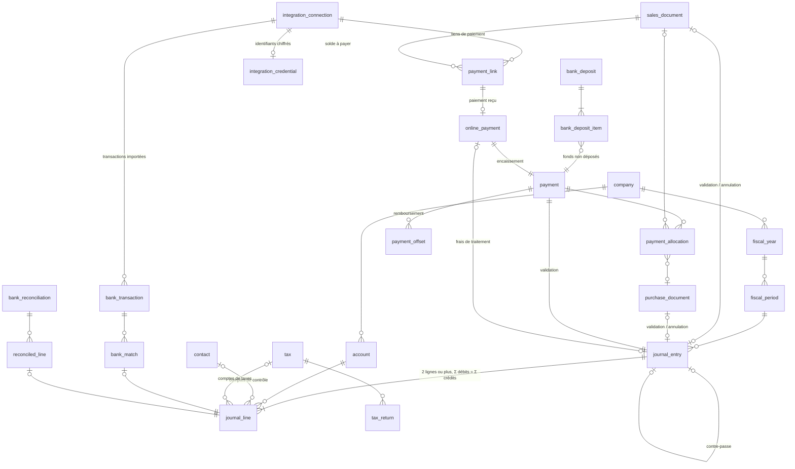

# Schéma de données

> Conception de la phase 1, révisée après une revue adversariale (sécurité, comptabilité, PostgreSQL, complétude). En phase 2, ce schéma devient `prisma/schema.prisma`, et le SQL complémentaire est ajouté à la fin de la migration initiale. Toute modification ultérieure passe par une migration **et** par cette page, dans le même commit.

Voir aussi [[Architecture]], [[Regles-comptables]], [[Plan-de-tests]].

## Conventions
- Tables et colonnes en `snake_case` (`@@map`/`@map`), modèles Prisma en `PascalCase`.
- Clés primaires `uuid` v7 générées par Prisma (`@default(uuid(7))`). Exceptions : `session` et `password_reset_token` (SHA-256 du jeton), `number_sequence` (clé composée), `audit_log` (`bigint` séquentiel), `user_credential` (clé de l'utilisateur).
- Argent en `BIGINT` (cents, colonnes `*_cents`). Quantités `NUMERIC(19,4)`, prix unitaires `NUMERIC(19,6)`, taux `NUMERIC(9,6)`.
- Dates comptables en `DATE`; horodatages en `timestamptz`.
- Toute table de données d'entreprise porte `company_id`, avec RLS `ENABLE` + `FORCE`.
- Les références entre tables d'une entreprise sont des **clés étrangères composites** `(company_id, x_id) → (company_id, id)`. Les index et unicités consultés par les triggers commencent par `company_id`.
- Les colonnes d'auteur (`created_by_id`, `posted_by_id`…) n'ont pas de clé étrangère, sauf sur `journal_entry` et `audit_log` : un utilisateur n'est jamais supprimé, et la piste d'audit fait foi.
- Les `CHECK` qui comparent une colonne d'enum à un littéral s'écrivent sur `::text` (voir [la recette de changement d'enum](#changer-un-enum)).

## Vue d'ensemble
49 tables : 7 sans `company_id` (`instance` et `rate_limit` sans RLS; les 5 tables d'identité sous RLS par utilisateur) et 42 par entreprise (RLS par entreprise).

| Domaine | Tables |
|---|---|
| Instance et identité | `instance`, `app_user`, `user_credential`, `user_recovery_code`, `session`, `password_reset_token`, `rate_limit` |
| Entreprise | `company`, `membership`, `invitation`, `number_sequence` |
| Exercices | `fiscal_year`, `fiscal_period` |
| Grand livre | `account`, `journal_entry`, `journal_line` |
| Contacts | `contact`, `item` |
| Taxes | `tax`, `tax_rate`, `tax_code`, `tax_code_component`, `tax_return` |
| Ventes | `sales_document`, `sales_document_line`, `sales_document_tax`, `sales_credit_application` |
| Achats | `purchase_document`, `purchase_document_line`, `purchase_document_tax`, `purchase_credit_application` |
| Paiements | `payment`, `payment_allocation`, `payment_offset`, `bank_deposit`, `bank_deposit_item` |
| Banque | `bank_account_profile`, `bank_import`, `bank_transaction`, `bank_match`, `bank_reconciliation`, `reconciled_line` |
| Intégrations | `integration_connection`, `integration_credential`, `payment_link`, `online_payment` |
| Pièces jointes | `attachment`, `attachment_link` |
| Audit | `audit_log` |



## Partie double et immuabilité
| Garantie | Mécanisme en base |
|---|---|
| Une ligne a un seul côté non nul, positif | `CHECK journal_line_one_side` |
| Une écriture a au moins 2 lignes et Σ débits = Σ crédits | Triggers de contrainte **différés** (`journal_line_balanced`, `journal_entry_complete`), évalués au `COMMIT` |
| Écriture datée dans une période **ouverte** de son entreprise | Trigger `journal_entry_validate` (période verrouillée en `FOR SHARE` : une fermeture concurrente attend le `COMMIT`) |
| Aucune modification ni suppression, même par le propriétaire | Triggers `*_append_only`, `*_no_truncate`, et aucun privilège `UPDATE`/`DELETE` pour `allumi_app` |
| Pas de ligne ajoutée à une écriture existante | `journal_entry.created_txid` : estampille posée par trigger (`pg_current_xact_id()`, exacte même dans un savepoint) que la ligne doit égaler. Un registre en variable de session avait été écarté : n'importe quel rôle pouvait le falsifier |
| Contre-passation : miroir exact (lignes, contacts et étiquettes de taxe), une seule par écriture, jamais d'une contre-passation, jamais datée avant l'originale | Vérification différée (`EXCEPT ALL`) et contrainte unique `(company_id, reverses_entry_id)` |
| L'écriture d'un document, d'un paiement ou d'un dépôt ne se contre-passe qu'en l'annulant | Vérification différée : la contre-passation doit être le `void_entry_id` de l'objet |
| Comptes clients/fournisseurs : seulement documents, paiements, contre-passations, toujours avec le contact de la pièce d'origine | Triggers `journal_line_validate` et `journal_entry_complete` |
| **Imputation exacte** : l'écriture d'une facture, d'un avoir, d'une facture fournisseur, d'une dépense, d'un paiement ou d'un dépôt existe pour sa pièce, et ses montants sur les comptes de contrôle et de paiement égalent le total de la pièce | Vérification différée dans `journal_entry_check_deferred`. L'âge des comptes concilie donc toujours avec le grand livre |
| Compte inactif refusé (sauf contre-passation); type d'un compte utilisé figé | Triggers `journal_line_validate`, `account_guard` (verrou `FOR SHARE` sur le compte) |

## Documents, paiements, dépôts, banque
- **Documents** (`sales_document`, `purchase_document`) : créés en `DRAFT`, librement modifiables. Le passage à `POSTED` exige une écriture dont la source est ce document, **datée de sa date comptable** (`posting_date`, distincte de la date du document : facture fournisseur reçue après la fermeture de sa période, documents d'ouverture), des totaux égaux à la somme des lignes et des taxes, et des instantanés figés (client et émetteur pour les ventes, fournisseur pour les achats; ce sont des objets JSON, pas un JSON `null`). Un document `POSTED` est figé : seuls les champs d'annulation changent, vers `VOID`, avec la contre-passation de son écriture. Seuls les brouillons se suppriment. Lignes et taxes d'un brouillon sont protégées contre une modification concurrente de la validation (`FOR SHARE` sur le parent).
- **Montant de ligne** = `round(quantité × prix × 100)`, vérifié par `CHECK` (demi s'éloignant de zéro). Les lignes d'un document n'imputent jamais les comptes de contrôle ni de taxes : le moteur s'en charge.
- **Taxes des ventes** : à la validation, la base de données recalcule les taxes depuis les lignes, les codes de taxe et le taux en vigueur à la date du document (ou celui de la facture corrigée, pour un avoir), selon le mode d'arrondi figé du document, et refuse tout écart. Pour les achats, les montants du fournisseur sont conservés, mais chaque ligne porte un code et chaque taxe vient d'un code de ligne.
- **Avoirs** : `credited_document_id` désigne la facture ou la facture fournisseur corrigée (même contact, déjà validée).
- **Paiements** : créés validés, avec leur écriture, sur un compte de banque, d'encaisse, de carte ou de fonds non déposés. Jamais supprimés; annulés par contre-passation une fois toutes leurs affectations retirées et leur dépôt annulé.
- **Affectations, applications d'avoirs et compensations** (`payment_allocation`, `*_credit_application`, `payment_offset`) : portent une date d'effet et ne s'effacent jamais. On les retire avec `unapplied_date`, dans une période ouverte. Le solde ouvert d'une pièce « au `date` » (âge des comptes d'une date passée) est reproductible. Sens, contact, statut et plafonds sont vérifiés au `COMMIT`, avec des verrous de ligne pris dès l'insertion (aucune course entre deux transactions).
- **Remboursements** : `payment_offset` compense un encaissement et un décaissement du même contact et du même sous-grand livre (trop-perçu, acompte), sans faux avoir.
- **Dépôts** : `bank_deposit` regroupe des paiements reçus dans « fonds non déposés ». Un dépôt contient au moins un paiement et son total égale la somme de ses éléments (`AL010`, vérifié au `COMMIT`). Chaque paiement n'est déposé qu'une fois; un paiement déposé ne s'annule qu'après l'annulation du dépôt.
- **Banque** : `amount_cents` exprime l'effet sur le compte du grand livre (+ débit, − crédit). Une transaction `MATCHED` est égale à la somme des lignes appariées, toutes sur son compte. Un rapprochement complété est figé; son solde pointé doit égaler le solde du relevé. Seul le dernier rapprochement peut être rouvert.
- **Intégrations** (`integration_connection`, `integration_credential`, colonnes ajoutées à `bank_transaction`) : une connexion à Stripe ou à PayPal alimente un compte de banque du grand livre (`AL005` sinon). Les identifiants chiffrés sont dans une table à part que seul le propriétaire lit; la piste d'audit ne les copie jamais (colonne déclarée secrète). Une connexion ne se supprime pas (on la désactive et on efface ses identifiants) et son service, son compte, son environnement de test et sa date de départ ne changent pas. Une transaction importée porte sa connexion, son type d'origine et un identifiant externe unique par compte (l'import est idempotent); `brut − frais = montant` (le montant est l'effet net sur le solde du service) et elle n'arrive que par une connexion active sur le compte de cette connexion (`AL010`). Comme tout relevé, elle ne change plus que de statut.
- **Pièces jointes** : le justificatif d'une pièce validée ne se détache pas, et une pièce jointe est immuable (seul `deleted_at`, une fois détachée).

## Taxes
- `tax` : une taxe, son compte « à payer » et son compte « récupérable » (CTI/RTI), de sous-type `SALES_TAX`, distincts.
- `tax_rate` : taux à date d'effet, sans chevauchement (`EXCLUDE`).
- `tax_code` : un code `STANDARD` a au moins une taxe; détaxé, exonéré et hors champ n'en ont aucune.
- **Les déclarations se calculent depuis le grand livre** : toute ligne sur un compte de taxes porte `tax_id` et `tax_box` (`COLLECTED`, `RECOVERABLE`, `ADJUSTMENT`, `SETTLEMENT`), et seulement ces lignes. Un versement est une écriture `TAX_SETTLEMENT`.
- `tax_return` : une déclaration par taxe et par période (pas de chevauchement). Une fois `FILED`, elle est figée et plus aucune ligne de cette taxe ne peut porter une date de sa période.
- Hors MVP, mais ajoutables sans refonte : méthode rapide, restrictions de CTI, TVH par province.

## Isolation par entreprise
- **Contexte** : l'application pose, au début de chaque transaction, `app.user_id`, `app.company_id` et `app.request_id` avec `set_config(…, true)`.
- **L'entreprise effective est liée à l'adhésion** : `app_tenant_id()` ne retourne l'entreprise du contexte que si l'utilisateur en est membre et actif. Un `company_id` pris dans une URL sans vérification (IDOR) ne donne donc accès à rien. `app_tenant_role()` donne son rôle.
- **Rôles, appliqués par RLS** : tout membre lit; `OWNER` et `ACCOUNTANT` écrivent; seul `OWNER` modifie l'entreprise et ses membres. Un membre en lecture seule ne peut rien écrire, même par erreur de code, et ne voit pas la piste d'audit.
- Politiques `tenant_read`, `tenant_insert`, `tenant_update`, `tenant_delete` sur chaque table avec `company_id`. Sans contexte valide, rien n'est visible ni modifiable.
- `company` : entreprise courante, plus celles dont l'utilisateur est membre (sélecteur); création par `app_create_company` (administrateur d'instance) ou `app_setup_instance`. `membership` : membres de l'entreprise courante, plus ses propres adhésions.
- **Les fonctions de validation sont `SECURITY INVOKER`** : elles s'exécutent sous RLS et ne peuvent rien révéler d'une autre entreprise. Les seules fonctions `SECURITY DEFINER` sont étroites : contexte (`app_tenant_*`), audit, accès avant connexion et création d'entreprise.
- **Rôles PostgreSQL** : `allumi_app` (NOSUPERUSER, NOBYPASSRLS, pas propriétaire; `NOLOGIN` dans la migration, `LOGIN` et mot de passe `APP_DB_PASSWORD` ajoutés par l'étape `migrate`) et `allumi_redactor` (`NOLOGIN`, propriétaire de la seule fonction de caviardage).
- **Privilèges explicites**, table par table, et **par colonne** là où c'est utile (ex. `session`, `app_user`, `payment_allocation`). Aucun `TRUNCATE`; aucun `UPDATE`/`DELETE` sur `journal_entry`, `journal_line` et `audit_log`; `EXECUTE` retiré à `PUBLIC` sur toutes les fonctions.

## Identité et authentification
- `app_user` : profil seulement. `user_credential` : mot de passe haché (argon2id), secret TOTP chiffré, dernier pas TOTP accepté (`totp_last_step`, anti-rejeu), compteur d'échecs et verrouillage. Les deux sont sous RLS : chacun ne voit que soi (et les profils de ses collègues de l'entreprise courante). L'app ne peut pas se donner le rôle d'administrateur d'instance (aucun privilège sur cette colonne).
- `session` (SHA-256 du jeton), `user_recovery_code`, `password_reset_token` : sous RLS, propres à l'utilisateur.
- **Accès avant le contexte** : `auth_login_lookup(courriel)`, `auth_session_lookup(hachage)`, `auth_password_reset_lookup(hachage)`, `invitation_by_token(hachage)` et `auth_instance_is_set_up()` retournent seulement les colonnes nécessaires.
- **Administrateur d'instance** (`app_user.is_instance_admin`) : crée des entreprises et désactive des comptes. Il en reste toujours un actif (verrou consultatif + trigger différé). `/setup` crée le premier, une seule fois (`app_setup_instance`, verrou sur `instance`).

## Audit et Loi 25
- Triggers `audit_row_change` sur toutes les tables d'affaires : acteur (`app.user_id`), table, id, action, avant/après en JSONB (la ligne complète à la création et à la suppression, les colonnes modifiées seulement à la mise à jour). L'acteur est **obligatoire** pour l'application (erreur `AL011` sinon) : seuls les superusers (migrations) y échappent.
- Les secrets (`password_hash`, `totp_secret_enc`) ne sont jamais copiés; leur changement est signalé par `_secrets_changed`. Le bruit (`last_login_at`, compteur d'échecs, `totp_last_step`) n'est pas journalisé.
- **L'application ne peut pas écrire dans `audit_log`**. Les événements applicatifs passent par `app_audit_event(...)`, qui impose l'acteur, l'entreprise validée et l'horodatage. Un trigger impose aussi `id` et `occurred_at`.
- `audit_log` est en ajout seulement (privilèges et triggers). **Seule exception** : `audit_redact(entité, id, clés)`, réservée au propriétaire de l'entreprise, retire des clés de renseignements personnels (courriel, téléphone, nom d'un contact anonymisé) des lignes d'audit; elle refuse les champs comptables et s'inscrit elle-même dans l'audit (`privacy.redact`).
- `audit_log.subject_user_id` permet à un utilisateur de voir les événements globaux qui le concernent (ex. échec de connexion).

## Codes d'erreur
| SQLSTATE | Sens | Exemple de message affiché (fr-CA) |
|---|---|---|
| `AL001` | Écriture déséquilibrée | « Les débits et les crédits ne sont pas égaux. » |
| `AL002` | Écriture incomplète | « Une écriture doit compter au moins deux lignes. » |
| `AL003` | Période, exercice ou déclaration fermés | « Cette période est verrouillée. » |
| `AL004` | Donnée en ajout seulement | « Une écriture validée ne se modifie pas : contre-passe-la. » |
| `AL005` | Règle de compte, de ligne ou de taxe | « Ce compte n'accepte que les écritures de factures et de paiements. » |
| `AL006` | Document ou paiement figé, imputation invalide | « Ce document est validé : émets un avoir ou annule-le. » |
| `AL007` | Affectation invalide ou excédentaire | « Le montant dépasse le solde de la facture. » |
| `AL008` | Contre-passation invalide | « Pour corriger une facture, annule-la. » |
| `AL009` | Dernier propriétaire ou administrateur | « L'entreprise doit garder au moins un propriétaire. » |
| `AL010` | Règle bancaire ou de dépôt | « Le solde pointé ne correspond pas au relevé. » |
| `AL011` | Contexte d'utilisateur manquant | « Session invalide : reconnecte-toi. » |

## Changer un enum
Prisma remplace un type enum en entier quand une valeur est retirée ou réordonnée. Les `CHECK` écrits sur `::text` survivent à l'opération; **pas** les objets qui stockent le type lui-même. Recette :
1. `prisma migrate dev --create-only`, puis lecture de la migration générée.
2. Dans la même migration, supprimer puis recréer les index partiels dont le prédicat compare l'enum (`bank_reconciliation_one_in_progress`, `purchase_document_supplier_reference_live`; un cast `::text` y est impossible, il n'est pas `IMMUTABLE`), et les fonctions qui retournent le type (`app_tenant_role()` pour `member_role`) ainsi que les politiques qui s'en servent.
3. Appliquer toutes les migrations sur une base vide (étape de la CI).

Ajouter une valeur à la fin d'un enum n'a pas ces effets.

## Limites connues
- Pas de multidevise : toutes les colonnes `currency` sont contraintes à `CAD`.
- Les montants dépassant 10¹⁴ cents par ligne sont refusés.
- Un propriétaire ne peut pas quitter l'entreprise en supprimant lui-même son adhésion, même s'il reste un autre propriétaire : la vérification « il reste un propriétaire » (`AL009`) s'exécute sous la RLS de la personne qui supprime et ne voit plus l'autre propriétaire. Le refus est du côté sûr (jamais d'entreprise sans propriétaire). Le cas est suivi par un test attendu en échec (`access-rules.test.ts`, OWN1); il sera réglé avec la gestion des membres.
- Les vérifications différées sont proportionnelles au nombre de lignes de l'écriture; elles restent rapides parce que les index commencent par `company_id`. Après un gros import ou une restauration, lancer `ANALYZE`.

## Validation faite en phase 1
- `prisma validate` et `prisma format` (Prisma 7.10) : schéma valide.
- SQL généré + SQL complémentaire appliqués sur PostgreSQL 16 sans erreur.
- `prisma migrate diff` (base → schéma) : **vide**. Prisma ne tente pas de supprimer les `CHECK`, `EXCLUDE`, triggers ni politiques.
- Catalogue : 43 tables sous RLS forcée (toutes sauf `instance` et `rate_limit`); aucun `TRUNCATE` ni `UPDATE`/`DELETE` sur le journal et l'audit pour `allumi_app`; `allumi_app` n'est ni superuser ni `BYPASSRLS`.
- 58 cas SQL exécutés **connecté en `allumi_app`**, plus 4 cas propriétaire (`UPDATE`, `DELETE` et `TRUNCATE` refusés par les triggers) : tous réussis. Liste dans [[Plan-de-tests]].
- Concurrence, avec deux connexions : verrouillage d'une période pendant une écriture, deux affectations simultanées sur une même facture, deux rétrogradations simultanées de propriétaires, suppression d'une ligne de brouillon pendant la validation.
- La revue adversariale (4 angles, ~30 constats) a produit les correctifs ci-dessus; les constats de sécurité et de comptabilité confirmés par reproduction sont tous intégrés.


## Schéma Prisma
```prisma
// Allumi — schéma de données (conception, phase 1).
// Les objets que Prisma ne modélise pas (CHECK, EXCLUDE, triggers, RLS, GRANT)
// sont dans le SQL complémentaire de la migration initiale.

generator client {
  provider        = "prisma-client"
  output          = "../src/generated/prisma"
  previewFeatures = ["partialIndexes", "postgresqlExtensions"]
}

datasource db {
  provider   = "postgresql"
  extensions = [btree_gist]
}

// ─────────────────────────────── Enums ───────────────────────────────

enum AppLocale {
  fr_CA @map("fr-CA")
  en

  @@map("app_locale")
}

enum Province {
  AB
  BC
  MB
  NB
  NL
  NS
  NT
  NU
  ON
  PE
  QC
  SK
  YT

  @@map("province")
}

enum MemberRole {
  OWNER
  ACCOUNTANT
  READ_ONLY

  @@map("member_role")
}

enum TaxRounding {
  PER_LINE
  PER_DOCUMENT

  @@map("tax_rounding")
}

enum FilingFrequency {
  MONTHLY
  QUARTERLY
  ANNUAL

  @@map("filing_frequency")
}

enum FiscalYearStatus {
  OPEN
  CLOSED

  @@map("fiscal_year_status")
}

enum PeriodStatus {
  OPEN
  LOCKED

  @@map("period_status")
}

enum AccountType {
  ASSET
  LIABILITY
  EQUITY
  REVENUE
  EXPENSE

  @@map("account_type")
}

enum AccountSubtype {
  CASH
  BANK
  ACCOUNTS_RECEIVABLE
  CURRENT_ASSET
  FIXED_ASSET
  OTHER_ASSET
  CREDIT_CARD
  ACCOUNTS_PAYABLE
  SALES_TAX
  CURRENT_LIABILITY
  LONG_TERM_LIABILITY
  EQUITY
  RETAINED_EARNINGS
  OPERATING_REVENUE
  OTHER_REVENUE
  COST_OF_SALES
  OPERATING_EXPENSE
  OTHER_EXPENSE

  @@map("account_subtype")
}

enum SystemAccount {
  ACCOUNTS_RECEIVABLE
  ACCOUNTS_PAYABLE
  UNDEPOSITED_FUNDS
  RETAINED_EARNINGS
  OPENING_BALANCE_EQUITY

  @@map("system_account")
}

enum SequenceKey {
  JOURNAL_ENTRY
  INVOICE
  CREDIT_NOTE
  PURCHASE_DOCUMENT
  PAYMENT_RECEIVED
  PAYMENT_SENT
  DEPOSIT

  @@map("sequence_key")
}

enum JournalSource {
  MANUAL
  OPENING_BALANCE
  SALES_DOCUMENT
  PURCHASE_DOCUMENT
  PAYMENT
  DEPOSIT
  BANK
  TAX_SETTLEMENT
  REVERSAL

  @@map("journal_source")
}

/// Rôle d'une ligne portée à un compte de taxes, pour les déclarations.
enum TaxBox {
  /// Taxe perçue sur les ventes.
  COLLECTED
  /// CTI/RTI : taxe payée récupérable.
  RECOVERABLE
  /// Redressement (créances irrécouvrables, corrections).
  ADJUSTMENT
  /// Versement ou remboursement d'une déclaration.
  SETTLEMENT

  @@map("tax_box")
}

enum TaxReturnStatus {
  DRAFT
  FILED

  @@map("tax_return_status")
}

enum TaxTreatment {
  STANDARD
  ZERO_RATED
  EXEMPT
  OUT_OF_SCOPE

  @@map("tax_treatment")
}

enum SalesDocumentKind {
  INVOICE
  CREDIT_NOTE

  @@map("sales_document_kind")
}

enum PurchaseDocumentKind {
  BILL
  SUPPLIER_CREDIT
  EXPENSE

  @@map("purchase_document_kind")
}

enum DocumentStatus {
  DRAFT
  POSTED
  VOID

  @@map("document_status")
}

enum PaymentDirection {
  RECEIVED
  SENT

  @@map("payment_direction")
}

enum PaymentMethod {
  CASH
  CHEQUE
  EFT
  INTERAC
  CREDIT_CARD
  DEBIT_CARD
  OTHER

  @@map("payment_method")
}

/// Sous-grand livre touché par un paiement.
enum PaymentLedger {
  RECEIVABLE
  PAYABLE

  @@map("payment_ledger")
}

enum PaymentStatus {
  POSTED
  VOID

  @@map("payment_status")
}

enum BankImportFormat {
  CSV
  OFX

  @@map("bank_import_format")
}

enum BankTransactionStatus {
  UNMATCHED
  MATCHED
  EXCLUDED

  @@map("bank_transaction_status")
}

/// Services externes dont on importe les transactions.
enum IntegrationProvider {
  STRIPE
  PAYPAL

  @@map("integration_provider")
}

enum IntegrationStatus {
  ACTIVE
  DISABLED

  @@map("integration_status")
}

/// Lien de paiement en ligne d'une facture validée, hébergé par le service (Stripe).
enum PaymentLinkStatus {
  PENDING
  ACTIVE
  PAID
  REVIEW
  CANCELLED

  @@map("payment_link_status")
}

enum ReconciliationStatus {
  IN_PROGRESS
  COMPLETED

  @@map("reconciliation_status")
}

enum ActorKind {
  USER
  SYSTEM

  @@map("actor_kind")
}

// ─────────────────────── Instance et identité (global, sans RLS) ───────────────────────

/// Ligne unique (id = 1). setup_completed_at non nul => /setup désactivée.
model Instance {
  id               Int       @id @default(1)
  setupCompletedAt DateTime? @map("setup_completed_at") @db.Timestamptz(6)

  @@map("instance")
}

model User {
  id              String    @id @default(uuid(7)) @db.Uuid
  /// Normalisé en minuscules (CHECK).
  email           String    @unique
  displayName     String    @map("display_name")
  locale          AppLocale @default(fr_CA)
  lastLoginAt     DateTime? @map("last_login_at") @db.Timestamptz(6)
  /// Administrateur de l'instance : crée des entreprises, désactive des comptes, réinitialise la 2FA.
  /// Le propriétaire créé par /setup l'est; il en reste toujours au moins un actif (trigger).
  isInstanceAdmin Boolean   @default(false) @map("is_instance_admin")
  /// Un utilisateur n'est jamais supprimé : il est désactivé.
  disabledAt      DateTime? @map("disabled_at") @db.Timestamptz(6)
  createdAt       DateTime  @default(now()) @map("created_at") @db.Timestamptz(6)
  updatedAt       DateTime  @updatedAt @map("updated_at") @db.Timestamptz(6)

  credential          UserCredential?
  memberships         Membership[]
  sessions            Session[]
  recoveryCodes       UserRecoveryCode[]
  passwordResetTokens PasswordResetToken[]
  journalEntries      JournalEntry[]
  auditEvents         AuditLog[]           @relation("AuditActor")
  auditSubjectEvents  AuditLog[]           @relation("AuditSubject")

  @@map("app_user")
}

/// Secrets d'authentification, séparés du profil : seul l'utilisateur lui-même y accède (RLS).
model UserCredential {
  userId            String    @id @map("user_id") @db.Uuid
  /// argon2id.
  passwordHash      String    @map("password_hash")
  passwordChangedAt DateTime  @map("password_changed_at") @db.Timestamptz(6)
  /// Secret TOTP chiffré AES-256-GCM (ENCRYPTION_KEY). Jamais copié dans l'audit.
  totpSecretEnc     Bytes?    @map("totp_secret_enc")
  totpEnabledAt     DateTime? @map("totp_enabled_at") @db.Timestamptz(6)
  /// Dernier pas de temps TOTP accepté : un code n'est jamais accepté deux fois (RFC 6238 §5.2).
  totpLastStep      BigInt?   @map("totp_last_step")
  failedLoginCount  Int       @default(0) @map("failed_login_count")
  lockedUntil       DateTime? @map("locked_until") @db.Timestamptz(6)
  updatedAt         DateTime  @updatedAt @map("updated_at") @db.Timestamptz(6)

  user User @relation(fields: [userId], references: [id], onDelete: Restrict)

  @@map("user_credential")
}

model UserRecoveryCode {
  id        String    @id @default(uuid(7)) @db.Uuid
  userId    String    @map("user_id") @db.Uuid
  codeHash  String    @map("code_hash")
  usedAt    DateTime? @map("used_at") @db.Timestamptz(6)
  createdAt DateTime  @default(now()) @map("created_at") @db.Timestamptz(6)

  user User @relation(fields: [userId], references: [id], onDelete: Cascade)

  @@index([userId])
  @@map("user_recovery_code")
}

/// id = SHA-256 (hex) du jeton envoyé par courriel; usage unique.
model PasswordResetToken {
  id        String    @id @db.Char(64)
  userId    String    @map("user_id") @db.Uuid
  expiresAt DateTime  @map("expires_at") @db.Timestamptz(6)
  usedAt    DateTime? @map("used_at") @db.Timestamptz(6)
  createdAt DateTime  @default(now()) @map("created_at") @db.Timestamptz(6)

  user User @relation(fields: [userId], references: [id], onDelete: Cascade)

  @@index([userId])
  @@map("password_reset_token")
}

/// id = SHA-256 (hex) du jeton de session; le jeton lui-même n'est jamais stocké.
model Session {
  id            String    @id @db.Char(64)
  userId        String    @map("user_id") @db.Uuid
  mfaVerifiedAt DateTime? @map("mfa_verified_at") @db.Timestamptz(6)
  createdAt     DateTime  @default(now()) @map("created_at") @db.Timestamptz(6)
  lastSeenAt    DateTime  @default(now()) @map("last_seen_at") @db.Timestamptz(6)
  expiresAt     DateTime  @map("expires_at") @db.Timestamptz(6)
  /// Tronqué à 256 caractères.
  userAgent     String?   @map("user_agent")

  user User @relation(fields: [userId], references: [id], onDelete: Cascade)

  @@index([userId])
  @@index([expiresAt])
  @@map("session")
}

/// Fenêtre fixe par clé (ex. « login:ip:<hash> », « login:email:<hash> »).
model RateLimit {
  key         String   @id
  windowStart DateTime @map("window_start") @db.Timestamptz(6)
  count       Int

  @@index([windowStart])
  @@map("rate_limit")
}

// ─────────────────────── Entreprise, membres (RLS) ───────────────────────

model Company {
  id                   String          @id @default(uuid(7)) @db.Uuid
  name                 String
  legalName            String?         @map("legal_name")
  /// Numéro d'entreprise du Québec (10 chiffres).
  neq                  String?
  /// Numéro d'entreprise fédéral (9 chiffres).
  businessNumber       String?         @map("business_number")
  /// TPS/TVH : 9 chiffres + RT + 4 chiffres.
  gstNumber            String?         @map("gst_number")
  /// TVQ : 10 chiffres + TQ + 4 chiffres.
  qstNumber            String?         @map("qst_number")
  addressLine1         String?         @map("address_line1")
  addressLine2         String?         @map("address_line2")
  city                 String?
  province             Province        @default(QC)
  postalCode           String?         @map("postal_code")
  email                String?
  phone                String?
  /// MVP : CAD seulement (CHECK). Colonne réservée pour la multidevise.
  currency             String          @default("CAD") @db.Char(3)
  defaultLocale        AppLocale       @default(fr_CA) @map("default_locale")
  fiscalYearStartMonth Int             @default(1) @map("fiscal_year_start_month")
  taxRounding          TaxRounding     @default(PER_LINE) @map("tax_rounding")
  taxFilingFrequency   FilingFrequency @default(QUARTERLY) @map("tax_filing_frequency")
  createdAt            DateTime        @default(now()) @map("created_at") @db.Timestamptz(6)
  updatedAt            DateTime        @updatedAt @map("updated_at") @db.Timestamptz(6)

  memberships            Membership[]
  invitations            Invitation[]
  numberSequences        NumberSequence[]
  fiscalYears            FiscalYear[]
  accounts               Account[]
  journalEntries         JournalEntry[]
  contacts               Contact[]
  items                  Item[]
  taxes                  Tax[]
  taxCodes               TaxCode[]
  salesDocuments         SalesDocument[]
  purchaseDocuments      PurchaseDocument[]
  payments               Payment[]
  bankDeposits           BankDeposit[]
  integrationConnections IntegrationConnection[]
  paymentLinks           PaymentLink[]
  onlinePayments         OnlinePayment[]
  taxReturns             TaxReturn[]
  attachments            Attachment[]
  auditLogs              AuditLog[]

  @@map("company")
}

model Membership {
  id        String     @id @default(uuid(7)) @db.Uuid
  companyId String     @map("company_id") @db.Uuid
  userId    String     @map("user_id") @db.Uuid
  role      MemberRole
  createdAt DateTime   @default(now()) @map("created_at") @db.Timestamptz(6)
  updatedAt DateTime   @updatedAt @map("updated_at") @db.Timestamptz(6)

  company Company @relation(fields: [companyId], references: [id], onDelete: Restrict)
  user    User    @relation(fields: [userId], references: [id], onDelete: Restrict)

  @@unique([companyId, userId])
  @@index([userId])
  @@map("membership")
}

model Invitation {
  id          String     @id @default(uuid(7)) @db.Uuid
  companyId   String     @map("company_id") @db.Uuid
  email       String
  role        MemberRole
  /// SHA-256 (hex) du jeton envoyé par courriel.
  tokenHash   String     @unique @map("token_hash") @db.Char(64)
  expiresAt   DateTime   @map("expires_at") @db.Timestamptz(6)
  acceptedAt  DateTime?  @map("accepted_at") @db.Timestamptz(6)
  revokedAt   DateTime?  @map("revoked_at") @db.Timestamptz(6)
  createdById String     @map("created_by_id") @db.Uuid
  createdAt   DateTime   @default(now()) @map("created_at") @db.Timestamptz(6)

  company Company @relation(fields: [companyId], references: [id], onDelete: Restrict)

  @@index([companyId])
  @@map("invitation")
}

/// Numérotation sans trou : UPDATE ... SET next_value = next_value + 1 RETURNING (verrou de ligne).
model NumberSequence {
  companyId String      @map("company_id") @db.Uuid
  key       SequenceKey
  prefix    String      @default("")
  nextValue BigInt      @default(1) @map("next_value")
  padding   Int         @default(0)

  company Company @relation(fields: [companyId], references: [id], onDelete: Restrict)

  @@id([companyId, key])
  @@map("number_sequence")
}

// ─────────────────────── Exercices et périodes ───────────────────────

model FiscalYear {
  id         String           @id @default(uuid(7)) @db.Uuid
  companyId  String           @map("company_id") @db.Uuid
  startDate  DateTime         @map("start_date") @db.Date
  endDate    DateTime         @map("end_date") @db.Date
  status     FiscalYearStatus @default(OPEN)
  closedAt   DateTime?        @map("closed_at") @db.Timestamptz(6)
  closedById String?          @map("closed_by_id") @db.Uuid
  createdAt  DateTime         @default(now()) @map("created_at") @db.Timestamptz(6)

  company Company        @relation(fields: [companyId], references: [id], onDelete: Restrict)
  periods FiscalPeriod[]

  @@unique([companyId, id])
  @@unique([companyId, startDate])
  @@map("fiscal_year")
}

model FiscalPeriod {
  id           String       @id @default(uuid(7)) @db.Uuid
  companyId    String       @map("company_id") @db.Uuid
  fiscalYearId String       @map("fiscal_year_id") @db.Uuid
  periodNumber Int          @map("period_number")
  startDate    DateTime     @map("start_date") @db.Date
  endDate      DateTime     @map("end_date") @db.Date
  status       PeriodStatus @default(OPEN)
  lockedAt     DateTime?    @map("locked_at") @db.Timestamptz(6)
  lockedById   String?      @map("locked_by_id") @db.Uuid

  fiscalYear     FiscalYear     @relation(fields: [companyId, fiscalYearId], references: [companyId, id], onDelete: Restrict)
  journalEntries JournalEntry[]

  @@unique([companyId, id])
  @@unique([fiscalYearId, periodNumber])
  @@index([companyId, startDate])
  @@map("fiscal_period")
}

// ─────────────────────── Plan comptable et journal ───────────────────────

model Account {
  id          String         @id @default(uuid(7)) @db.Uuid
  companyId   String         @map("company_id") @db.Uuid
  code        String
  nameFr      String         @map("name_fr")
  nameEn      String         @map("name_en")
  type        AccountType
  subtype     AccountSubtype
  parentId    String?        @map("parent_id") @db.Uuid
  /// Code de l'Index général des renseignements financiers (IGRF, norme publique de l'ARC).
  gifiCode    String?        @map("gifi_code")
  /// Compte de contrôle ou système, unique par entreprise.
  systemKey   SystemAccount? @map("system_key")
  isActive    Boolean        @default(true) @map("is_active")
  description String?
  createdAt   DateTime       @default(now()) @map("created_at") @db.Timestamptz(6)
  updatedAt   DateTime       @updatedAt @map("updated_at") @db.Timestamptz(6)

  company  Company   @relation(fields: [companyId], references: [id], onDelete: Restrict)
  parent   Account?  @relation("AccountHierarchy", fields: [companyId, parentId], references: [companyId, id], onDelete: Restrict)
  children Account[] @relation("AccountHierarchy")

  journalLines           JournalLine[]
  itemsIncome            Item[]                  @relation("ItemIncomeAccount")
  itemsExpense           Item[]                  @relation("ItemExpenseAccount")
  taxesPayable           Tax[]                   @relation("TaxPayableAccount")
  taxesRecoverable       Tax[]                   @relation("TaxRecoverableAccount")
  salesLines             SalesDocumentLine[]
  purchaseLines          PurchaseDocumentLine[]
  purchaseDocumentsPaid  PurchaseDocument[]      @relation("PurchasePaymentAccount")
  payments               Payment[]
  bankDeposits           BankDeposit[]
  bankProfile            BankAccountProfile?
  bankImports            BankImport[]
  bankTransactions       BankTransaction[]
  integrationConnections IntegrationConnection[] @relation("ConnectionAccount")
  feeConnections         IntegrationConnection[] @relation("ConnectionFeeAccount")
  reconciliations        BankReconciliation[]

  @@unique([companyId, id])
  @@unique([companyId, code])
  @@unique([companyId, systemKey])
  @@index([companyId, type])
  @@map("account")
}

/// Écriture validée dès son insertion. Ajout seulement (triggers + GRANT).
model JournalEntry {
  id              String        @id @default(uuid(7)) @db.Uuid
  companyId       String        @map("company_id") @db.Uuid
  entryNumber     BigInt        @map("entry_number")
  entryDate       DateTime      @map("entry_date") @db.Date
  fiscalPeriodId  String        @map("fiscal_period_id") @db.Uuid
  sourceType      JournalSource @map("source_type")
  /// Document, paiement ou transaction bancaire d'origine (selon source_type).
  sourceId        String?       @map("source_id") @db.Uuid
  memo            String?
  reversesEntryId String?       @map("reverses_entry_id") @db.Uuid
  createdById     String        @map("created_by_id") @db.Uuid
  createdAt       DateTime      @default(now()) @map("created_at") @db.Timestamptz(6)
  /// Transaction (xid de premier niveau) qui a créé l'écriture, posée par trigger : des lignes ne
  /// s'ajoutent que dans cette transaction. pg_current_xact_id() reste exact dans un savepoint.
  createdTxid     BigInt        @default(dbgenerated("((pg_current_xact_id())::text)::bigint")) @map("created_txid")

  company      Company       @relation(fields: [companyId], references: [id], onDelete: Restrict)
  fiscalPeriod FiscalPeriod  @relation(fields: [companyId, fiscalPeriodId], references: [companyId, id], onDelete: Restrict)
  createdBy    User          @relation(fields: [createdById], references: [id], onDelete: Restrict)
  reverses     JournalEntry? @relation("Reversal", fields: [companyId, reversesEntryId], references: [companyId, id], onDelete: Restrict)
  reversedBy   JournalEntry? @relation("Reversal")
  lines        JournalLine[]

  salesDocumentPosted    SalesDocument?    @relation("SalesDocumentPosting")
  salesDocumentVoided    SalesDocument?    @relation("SalesDocumentVoid")
  purchaseDocumentPosted PurchaseDocument? @relation("PurchaseDocumentPosting")
  purchaseDocumentVoided PurchaseDocument? @relation("PurchaseDocumentVoid")
  paymentPosted          Payment?          @relation("PaymentPosting")
  onlinePaymentFees      OnlinePayment[]   @relation("OnlinePaymentFee")
  paymentVoided          Payment?          @relation("PaymentVoid")
  depositPosted          BankDeposit?      @relation("DepositPosting")
  depositVoided          BankDeposit?      @relation("DepositVoid")
  taxReturnSettled       TaxReturn?
  attachmentLinks        AttachmentLink[]

  @@unique([companyId, id])
  @@unique([companyId, entryNumber])
  @@unique([companyId, reversesEntryId])
  @@index([companyId, entryDate])
  @@index([companyId, sourceType, sourceId])
  @@map("journal_entry")
}

/// Exactement un de debit_cents / credit_cents est non nul (CHECK).
model JournalLine {
  id          String   @id @default(uuid(7)) @db.Uuid
  companyId   String   @map("company_id") @db.Uuid
  entryId     String   @map("entry_id") @db.Uuid
  lineNo      Int      @map("line_no") @db.SmallInt
  accountId   String   @map("account_id") @db.Uuid
  debitCents  BigInt   @default(0) @map("debit_cents")
  creditCents BigInt   @default(0) @map("credit_cents")
  description String?
  /// Obligatoire sur les comptes clients/fournisseurs (trigger).
  contactId   String?  @map("contact_id") @db.Uuid
  /// Copie de journal_entry.entry_date (vérifiée par trigger) pour les rapports par plage de dates.
  entryDate   DateTime @map("entry_date") @db.Date
  /// Obligatoires ensemble sur un compte de taxes, interdits ailleurs (trigger) : les déclarations
  /// se calculent depuis le grand livre.
  taxId       String?  @map("tax_id") @db.Uuid
  taxBox      TaxBox?  @map("tax_box")

  entry          JournalEntry    @relation(fields: [companyId, entryId], references: [companyId, id], onDelete: Restrict)
  account        Account         @relation(fields: [companyId, accountId], references: [companyId, id], onDelete: Restrict)
  contact        Contact?        @relation(fields: [companyId, contactId], references: [companyId, id], onDelete: Restrict)
  tax            Tax?            @relation(fields: [companyId, taxId], references: [companyId, id], onDelete: Restrict)
  bankMatch      BankMatch?
  reconciledLine ReconciledLine?

  @@unique([companyId, id])
  @@unique([companyId, entryId, lineNo])
  @@index([companyId, accountId, entryDate])
  @@index([companyId, contactId, entryDate])
  @@index([companyId, taxId, entryDate])
  @@map("journal_line")
}

// ─────────────────────── Contacts et articles ───────────────────────

model Contact {
  id                 String    @id @default(uuid(7)) @db.Uuid
  companyId          String    @map("company_id") @db.Uuid
  isCustomer         Boolean   @default(false) @map("is_customer")
  isSupplier         Boolean   @default(false) @map("is_supplier")
  displayName        String    @map("display_name")
  legalName          String?   @map("legal_name")
  email              String?
  phone              String?
  addressLine1       String?   @map("address_line1")
  addressLine2       String?   @map("address_line2")
  city               String?
  province           Province?
  postalCode         String?   @map("postal_code")
  country            String    @default("CA") @db.Char(2)
  locale             AppLocale @default(fr_CA)
  defaultTaxCodeId   String?   @map("default_tax_code_id") @db.Uuid
  paymentTermsDays   Int       @default(30) @map("payment_terms_days")
  /// Numéros d'inscription du fournisseur, exigés pour justifier les CTI/RTI.
  gstNumber          String?   @map("gst_number")
  qstNumber          String?   @map("qst_number")
  taxExemptionNumber String?   @map("tax_exemption_number")
  notes              String?
  isActive           Boolean   @default(true) @map("is_active")
  /// Loi 25 : anonymisation plutôt que suppression (pièces comptables à conserver).
  anonymizedAt       DateTime? @map("anonymized_at") @db.Timestamptz(6)
  createdAt          DateTime  @default(now()) @map("created_at") @db.Timestamptz(6)
  updatedAt          DateTime  @updatedAt @map("updated_at") @db.Timestamptz(6)

  company        Company  @relation(fields: [companyId], references: [id], onDelete: Restrict)
  defaultTaxCode TaxCode? @relation("ContactDefaultTaxCode", fields: [companyId, defaultTaxCodeId], references: [companyId, id], onDelete: Restrict)

  journalLines      JournalLine[]
  salesDocuments    SalesDocument[]
  purchaseDocuments PurchaseDocument[]
  payments          Payment[]
  attachmentLinks   AttachmentLink[]

  @@unique([companyId, id])
  @@index([companyId, displayName])
  @@map("contact")
}

model Item {
  id               String   @id @default(uuid(7)) @db.Uuid
  companyId        String   @map("company_id") @db.Uuid
  code             String?
  name             String
  description      String?
  unitPrice        Decimal? @map("unit_price") @db.Decimal(19, 6)
  incomeAccountId  String?  @map("income_account_id") @db.Uuid
  expenseAccountId String?  @map("expense_account_id") @db.Uuid
  defaultTaxCodeId String?  @map("default_tax_code_id") @db.Uuid
  isActive         Boolean  @default(true) @map("is_active")
  createdAt        DateTime @default(now()) @map("created_at") @db.Timestamptz(6)
  updatedAt        DateTime @updatedAt @map("updated_at") @db.Timestamptz(6)

  company        Company  @relation(fields: [companyId], references: [id], onDelete: Restrict)
  incomeAccount  Account? @relation("ItemIncomeAccount", fields: [companyId, incomeAccountId], references: [companyId, id], onDelete: Restrict)
  expenseAccount Account? @relation("ItemExpenseAccount", fields: [companyId, expenseAccountId], references: [companyId, id], onDelete: Restrict)
  defaultTaxCode TaxCode? @relation("ItemDefaultTaxCode", fields: [companyId, defaultTaxCodeId], references: [companyId, id], onDelete: Restrict)

  salesLines    SalesDocumentLine[]
  purchaseLines PurchaseDocumentLine[]

  @@unique([companyId, id])
  @@unique([companyId, code])
  @@index([companyId, incomeAccountId])
  @@index([companyId, expenseAccountId])
  @@map("item")
}

// ─────────────────────── Taxes ───────────────────────

/// Une taxe (TPS, TVQ, TVH...). Les montants vont au compte à payer; la portion récupérable (CTI/RTI) au compte récupérable.
model Tax {
  id                   String   @id @default(uuid(7)) @db.Uuid
  companyId            String   @map("company_id") @db.Uuid
  code                 String
  nameFr               String   @map("name_fr")
  nameEn               String   @map("name_en")
  registrationNumber   String?  @map("registration_number")
  payableAccountId     String   @map("payable_account_id") @db.Uuid
  recoverableAccountId String?  @map("recoverable_account_id") @db.Uuid
  isActive             Boolean  @default(true) @map("is_active")
  createdAt            DateTime @default(now()) @map("created_at") @db.Timestamptz(6)

  company            Company  @relation(fields: [companyId], references: [id], onDelete: Restrict)
  payableAccount     Account  @relation("TaxPayableAccount", fields: [companyId, payableAccountId], references: [companyId, id], onDelete: Restrict)
  recoverableAccount Account? @relation("TaxRecoverableAccount", fields: [companyId, recoverableAccountId], references: [companyId, id], onDelete: Restrict)

  rates                 TaxRate[]
  components            TaxCodeComponent[]
  salesDocumentTaxes    SalesDocumentTax[]
  purchaseDocumentTaxes PurchaseDocumentTax[]
  journalLines          JournalLine[]
  returns               TaxReturn[]

  @@unique([companyId, id])
  @@unique([companyId, code])
  @@index([companyId, payableAccountId])
  @@index([companyId, recoverableAccountId])
  @@map("tax")
}

/// Taux par date d'effet; les plages d'une même taxe ne se chevauchent pas (EXCLUDE). effective_to inclusif.
model TaxRate {
  id            String    @id @default(uuid(7)) @db.Uuid
  companyId     String    @map("company_id") @db.Uuid
  taxId         String    @map("tax_id") @db.Uuid
  rate          Decimal   @db.Decimal(9, 6)
  effectiveFrom DateTime  @map("effective_from") @db.Date
  effectiveTo   DateTime? @map("effective_to") @db.Date

  tax Tax @relation(fields: [companyId, taxId], references: [companyId, id], onDelete: Restrict)

  @@unique([taxId, effectiveFrom])
  @@map("tax_rate")
}

/// Code appliqué sur une ligne (ex. « TPS+TVQ », « TVH ON », « Détaxé », « Exonéré »).
model TaxCode {
  id        String       @id @default(uuid(7)) @db.Uuid
  companyId String       @map("company_id") @db.Uuid
  code      String
  nameFr    String       @map("name_fr")
  nameEn    String       @map("name_en")
  treatment TaxTreatment
  isActive  Boolean      @default(true) @map("is_active")
  createdAt DateTime     @default(now()) @map("created_at") @db.Timestamptz(6)

  company    Company            @relation(fields: [companyId], references: [id], onDelete: Restrict)
  components TaxCodeComponent[]

  contacts      Contact[]              @relation("ContactDefaultTaxCode")
  items         Item[]                 @relation("ItemDefaultTaxCode")
  salesLines    SalesDocumentLine[]
  purchaseLines PurchaseDocumentLine[]

  @@unique([companyId, id])
  @@unique([companyId, code])
  @@map("tax_code")
}

model TaxCodeComponent {
  id        String @id @default(uuid(7)) @db.Uuid
  companyId String @map("company_id") @db.Uuid
  taxCodeId String @map("tax_code_id") @db.Uuid
  taxId     String @map("tax_id") @db.Uuid
  position  Int    @db.SmallInt

  taxCode TaxCode @relation(fields: [companyId, taxCodeId], references: [companyId, id], onDelete: Cascade)
  tax     Tax     @relation(fields: [companyId, taxId], references: [companyId, id], onDelete: Restrict)

  @@unique([taxCodeId, taxId])
  @@unique([taxCodeId, position])
  @@map("tax_code_component")
}

// ─────────────────────── Ventes : factures et avoirs ───────────────────────

model SalesDocument {
  id                 String            @id @default(uuid(7)) @db.Uuid
  companyId          String            @map("company_id") @db.Uuid
  kind               SalesDocumentKind
  status             DocumentStatus    @default(DRAFT)
  /// Attribué à la validation (séquence INVOICE ou CREDIT_NOTE).
  number             String?
  contactId          String            @map("contact_id") @db.Uuid
  /// Date du document (échéance, âge des comptes, moment de la taxe).
  issueDate          DateTime          @map("issue_date") @db.Date
  /// Date comptable de l'écriture (documents d'ouverture, facture saisie après une fermeture).
  postingDate        DateTime          @map("posting_date") @db.Date
  dueDate            DateTime?         @map("due_date") @db.Date
  /// Avoir : facture corrigée (ses taux de taxe s'appliquent).
  creditedDocumentId String?           @map("credited_document_id") @db.Uuid
  currency           String            @default("CAD") @db.Char(3)
  locale             AppLocale         @default(fr_CA)
  reference          String?
  memo               String?
  terms              String?
  taxRounding        TaxRounding       @map("tax_rounding")
  /// Nom, adresse et numéros du client figés à la validation.
  billingSnapshot    Json?             @map("billing_snapshot")
  /// Nom, adresse et numéros TPS/TVQ de l'entreprise émettrice figés à la validation (réimpression conforme).
  issuerSnapshot     Json?             @map("issuer_snapshot")
  subtotalCents      BigInt            @default(0) @map("subtotal_cents")
  taxTotalCents      BigInt            @default(0) @map("tax_total_cents")
  totalCents         BigInt            @default(0) @map("total_cents")
  journalEntryId     String?           @map("journal_entry_id") @db.Uuid
  voidEntryId        String?           @map("void_entry_id") @db.Uuid
  postedAt           DateTime?         @map("posted_at") @db.Timestamptz(6)
  postedById         String?           @map("posted_by_id") @db.Uuid
  voidedAt           DateTime?         @map("voided_at") @db.Timestamptz(6)
  voidedById         String?           @map("voided_by_id") @db.Uuid
  voidReason         String?           @map("void_reason")
  createdById        String            @map("created_by_id") @db.Uuid
  createdAt          DateTime          @default(now()) @map("created_at") @db.Timestamptz(6)
  updatedAt          DateTime          @updatedAt @map("updated_at") @db.Timestamptz(6)

  company          Company         @relation(fields: [companyId], references: [id], onDelete: Restrict)
  contact          Contact         @relation(fields: [companyId, contactId], references: [companyId, id], onDelete: Restrict)
  journalEntry     JournalEntry?   @relation("SalesDocumentPosting", fields: [companyId, journalEntryId], references: [companyId, id], onDelete: Restrict)
  voidEntry        JournalEntry?   @relation("SalesDocumentVoid", fields: [companyId, voidEntryId], references: [companyId, id], onDelete: Restrict)
  creditedDocument SalesDocument?  @relation("CreditedSalesDocument", fields: [companyId, creditedDocumentId], references: [companyId, id], onDelete: Restrict)
  creditNotes      SalesDocument[] @relation("CreditedSalesDocument")

  lines           SalesDocumentLine[]
  taxes           SalesDocumentTax[]
  allocations     PaymentAllocation[]
  paymentLinks    PaymentLink[]
  creditsApplied  SalesCreditApplication[] @relation("CreditNoteApplied")
  creditsReceived SalesCreditApplication[] @relation("InvoiceCredited")
  attachmentLinks AttachmentLink[]

  @@unique([companyId, id])
  @@unique([companyId, kind, number])
  @@unique([companyId, journalEntryId])
  @@unique([companyId, voidEntryId])
  @@index([companyId, contactId])
  @@index([companyId, status, issueDate])
  @@map("sales_document")
}

model SalesDocumentLine {
  id          String  @id @default(uuid(7)) @db.Uuid
  companyId   String  @map("company_id") @db.Uuid
  documentId  String  @map("document_id") @db.Uuid
  position    Int     @db.SmallInt
  itemId      String? @map("item_id") @db.Uuid
  description String
  quantity    Decimal @default(1) @db.Decimal(19, 4)
  unitPrice   Decimal @map("unit_price") @db.Decimal(19, 6)
  /// round(quantity × unit_price) au cent, par la fonction d'arrondi centrale.
  amountCents BigInt  @map("amount_cents")
  accountId   String  @map("account_id") @db.Uuid
  taxCodeId   String? @map("tax_code_id") @db.Uuid

  document SalesDocument @relation(fields: [companyId, documentId], references: [companyId, id], onDelete: Cascade)
  item     Item?         @relation(fields: [companyId, itemId], references: [companyId, id], onDelete: Restrict)
  account  Account       @relation(fields: [companyId, accountId], references: [companyId, id], onDelete: Restrict)
  taxCode  TaxCode?      @relation(fields: [companyId, taxCodeId], references: [companyId, id], onDelete: Restrict)

  @@unique([companyId, documentId, position])
  @@index([companyId, accountId])
  @@map("sales_document_line")
}

/// Totaux de taxe du document, avec le taux appliqué figé.
model SalesDocumentTax {
  id          String  @id @default(uuid(7)) @db.Uuid
  companyId   String  @map("company_id") @db.Uuid
  documentId  String  @map("document_id") @db.Uuid
  taxId       String  @map("tax_id") @db.Uuid
  rate        Decimal @db.Decimal(9, 6)
  baseCents   BigInt  @map("base_cents")
  amountCents BigInt  @map("amount_cents")

  document SalesDocument @relation(fields: [companyId, documentId], references: [companyId, id], onDelete: Cascade)
  tax      Tax           @relation(fields: [companyId, taxId], references: [companyId, id], onDelete: Restrict)

  @@unique([documentId, taxId])
  @@map("sales_document_tax")
}

// ─────────────────────── Achats : factures fournisseurs, crédits, dépenses ───────────────────────

model PurchaseDocument {
  id                 String               @id @default(uuid(7)) @db.Uuid
  companyId          String               @map("company_id") @db.Uuid
  kind               PurchaseDocumentKind
  status             DocumentStatus       @default(DRAFT)
  /// Numéro interne attribué à la validation (séquence PURCHASE_DOCUMENT).
  number             String?
  /// Obligatoire pour BILL et SUPPLIER_CREDIT (CHECK); facultatif pour EXPENSE.
  contactId          String?              @map("contact_id") @db.Uuid
  payeeName          String?              @map("payee_name")
  /// Numéro de la facture du fournisseur; unique par fournisseur.
  supplierReference  String?              @map("supplier_reference")
  /// Date inscrite sur la pièce du fournisseur.
  documentDate       DateTime             @map("document_date") @db.Date
  /// Date comptable de l'écriture (facture reçue après la fermeture de sa période, etc.).
  postingDate        DateTime             @map("posting_date") @db.Date
  dueDate            DateTime?            @map("due_date") @db.Date
  /// Crédit fournisseur : facture corrigée.
  creditedDocumentId String?              @map("credited_document_id") @db.Uuid
  /// Nom et numéros TPS/TVQ du fournisseur figés à la validation (justification des CTI/RTI).
  supplierSnapshot   Json?                @map("supplier_snapshot")
  currency           String               @default("CAD") @db.Char(3)
  memo               String?
  taxRounding        TaxRounding          @map("tax_rounding")
  /// EXPENSE seulement : compte de banque, d'encaisse ou de carte de crédit débité.
  paymentAccountId   String?              @map("payment_account_id") @db.Uuid
  paymentMethod      PaymentMethod?       @map("payment_method")
  subtotalCents      BigInt               @default(0) @map("subtotal_cents")
  taxTotalCents      BigInt               @default(0) @map("tax_total_cents")
  totalCents         BigInt               @default(0) @map("total_cents")
  journalEntryId     String?              @map("journal_entry_id") @db.Uuid
  voidEntryId        String?              @map("void_entry_id") @db.Uuid
  postedAt           DateTime?            @map("posted_at") @db.Timestamptz(6)
  postedById         String?              @map("posted_by_id") @db.Uuid
  voidedAt           DateTime?            @map("voided_at") @db.Timestamptz(6)
  voidedById         String?              @map("voided_by_id") @db.Uuid
  voidReason         String?              @map("void_reason")
  createdById        String               @map("created_by_id") @db.Uuid
  createdAt          DateTime             @default(now()) @map("created_at") @db.Timestamptz(6)
  updatedAt          DateTime             @updatedAt @map("updated_at") @db.Timestamptz(6)

  company          Company            @relation(fields: [companyId], references: [id], onDelete: Restrict)
  contact          Contact?           @relation(fields: [companyId, contactId], references: [companyId, id], onDelete: Restrict)
  paymentAccount   Account?           @relation("PurchasePaymentAccount", fields: [companyId, paymentAccountId], references: [companyId, id], onDelete: Restrict)
  journalEntry     JournalEntry?      @relation("PurchaseDocumentPosting", fields: [companyId, journalEntryId], references: [companyId, id], onDelete: Restrict)
  voidEntry        JournalEntry?      @relation("PurchaseDocumentVoid", fields: [companyId, voidEntryId], references: [companyId, id], onDelete: Restrict)
  creditedDocument PurchaseDocument?  @relation("CreditedPurchaseDocument", fields: [companyId, creditedDocumentId], references: [companyId, id], onDelete: Restrict)
  supplierCredits  PurchaseDocument[] @relation("CreditedPurchaseDocument")

  lines           PurchaseDocumentLine[]
  taxes           PurchaseDocumentTax[]
  allocations     PaymentAllocation[]
  creditsApplied  PurchaseCreditApplication[] @relation("SupplierCreditApplied")
  creditsReceived PurchaseCreditApplication[] @relation("BillCredited")
  attachmentLinks AttachmentLink[]

  @@unique([companyId, id])
  @@unique([companyId, number])
  /// Un numéro de facture fournisseur n'est utilisé qu'une fois par fournisseur, sauf sur un document annulé.
  @@unique([companyId, contactId, kind, supplierReference], map: "purchase_document_supplier_reference_live", where: raw("status <> 'VOID'"))
  @@unique([companyId, journalEntryId])
  @@unique([companyId, voidEntryId])
  @@index([companyId, status, documentDate])
  @@index([companyId, paymentAccountId])
  @@map("purchase_document")
}

model PurchaseDocumentLine {
  id          String  @id @default(uuid(7)) @db.Uuid
  companyId   String  @map("company_id") @db.Uuid
  documentId  String  @map("document_id") @db.Uuid
  position    Int     @db.SmallInt
  itemId      String? @map("item_id") @db.Uuid
  description String
  quantity    Decimal @default(1) @db.Decimal(19, 4)
  unitPrice   Decimal @map("unit_price") @db.Decimal(19, 6)
  amountCents BigInt  @map("amount_cents")
  accountId   String  @map("account_id") @db.Uuid
  taxCodeId   String? @map("tax_code_id") @db.Uuid

  document PurchaseDocument @relation(fields: [companyId, documentId], references: [companyId, id], onDelete: Cascade)
  item     Item?            @relation(fields: [companyId, itemId], references: [companyId, id], onDelete: Restrict)
  account  Account          @relation(fields: [companyId, accountId], references: [companyId, id], onDelete: Restrict)
  taxCode  TaxCode?         @relation(fields: [companyId, taxCodeId], references: [companyId, id], onDelete: Restrict)

  @@unique([companyId, documentId, position])
  @@index([companyId, accountId])
  @@map("purchase_document_line")
}

/// recoverable_cents va au compte récupérable de la taxe (CTI/RTI); le reste est passé en charge avec les lignes.
model PurchaseDocumentTax {
  id               String  @id @default(uuid(7)) @db.Uuid
  companyId        String  @map("company_id") @db.Uuid
  documentId       String  @map("document_id") @db.Uuid
  taxId            String  @map("tax_id") @db.Uuid
  rate             Decimal @db.Decimal(9, 6)
  baseCents        BigInt  @map("base_cents")
  amountCents      BigInt  @map("amount_cents")
  recoverableCents BigInt  @map("recoverable_cents")

  document PurchaseDocument @relation(fields: [companyId, documentId], references: [companyId, id], onDelete: Cascade)
  tax      Tax              @relation(fields: [companyId, taxId], references: [companyId, id], onDelete: Restrict)

  @@unique([documentId, taxId])
  @@map("purchase_document_tax")
}

// ─────────────────────── Paiements et affectations ───────────────────────

/// Validé à la création (pas de brouillon). Annulation = contre-passation + status VOID.
model Payment {
  id             String           @id @default(uuid(7)) @db.Uuid
  companyId      String           @map("company_id") @db.Uuid
  direction      PaymentDirection
  /// Comptes clients (encaissement, remboursement d'avoir) ou comptes fournisseurs.
  ledger         PaymentLedger
  number         String?
  contactId      String           @map("contact_id") @db.Uuid
  paymentDate    DateTime         @map("payment_date") @db.Date
  amountCents    BigInt           @map("amount_cents")
  /// Compte de banque, d'encaisse ou « fonds non déposés ».
  accountId      String           @map("account_id") @db.Uuid
  method         PaymentMethod
  reference      String?
  memo           String?
  status         PaymentStatus    @default(POSTED)
  journalEntryId String           @map("journal_entry_id") @db.Uuid
  voidEntryId    String?          @map("void_entry_id") @db.Uuid
  voidedAt       DateTime?        @map("voided_at") @db.Timestamptz(6)
  voidedById     String?          @map("voided_by_id") @db.Uuid
  voidReason     String?          @map("void_reason")
  createdById    String           @map("created_by_id") @db.Uuid
  createdAt      DateTime         @default(now()) @map("created_at") @db.Timestamptz(6)
  updatedAt      DateTime         @updatedAt @map("updated_at") @db.Timestamptz(6)

  company      Company       @relation(fields: [companyId], references: [id], onDelete: Restrict)
  contact      Contact       @relation(fields: [companyId, contactId], references: [companyId, id], onDelete: Restrict)
  account      Account       @relation(fields: [companyId, accountId], references: [companyId, id], onDelete: Restrict)
  journalEntry JournalEntry  @relation("PaymentPosting", fields: [companyId, journalEntryId], references: [companyId, id], onDelete: Restrict)
  voidEntry    JournalEntry? @relation("PaymentVoid", fields: [companyId, voidEntryId], references: [companyId, id], onDelete: Restrict)

  allocations       PaymentAllocation[]
  offsetsAsReceived PaymentOffset[]     @relation("OffsetReceived")
  offsetsAsSent     PaymentOffset[]     @relation("OffsetSent")
  depositItems      BankDepositItem[]
  attachmentLinks   AttachmentLink[]
  onlinePayment     OnlinePayment?

  @@unique([companyId, id])
  @@unique([companyId, direction, number])
  @@unique([companyId, journalEntryId])
  @@unique([companyId, voidEntryId])
  @@index([companyId, contactId])
  @@index([companyId, paymentDate])
  @@index([companyId, accountId])
  @@map("payment")
}

/// Affecte un paiement à exactement un document (CHECK num_nonnulls = 1).
model PaymentAllocation {
  id                 String    @id @default(uuid(7)) @db.Uuid
  companyId          String    @map("company_id") @db.Uuid
  paymentId          String    @map("payment_id") @db.Uuid
  salesDocumentId    String?   @map("sales_document_id") @db.Uuid
  purchaseDocumentId String?   @map("purchase_document_id") @db.Uuid
  amountCents        BigInt    @map("amount_cents")
  /// Date d'effet : l'âge des comptes à une date passée reste reproductible.
  appliedDate        DateTime  @map("applied_date") @db.Date
  /// Retrait daté : une affectation ne s'efface jamais.
  unappliedDate      DateTime? @map("unapplied_date") @db.Date
  unappliedById      String?   @map("unapplied_by_id") @db.Uuid
  createdById        String    @map("created_by_id") @db.Uuid
  createdAt          DateTime  @default(now()) @map("created_at") @db.Timestamptz(6)

  payment          Payment           @relation(fields: [companyId, paymentId], references: [companyId, id], onDelete: Restrict)
  salesDocument    SalesDocument?    @relation(fields: [companyId, salesDocumentId], references: [companyId, id], onDelete: Restrict)
  purchaseDocument PurchaseDocument? @relation(fields: [companyId, purchaseDocumentId], references: [companyId, id], onDelete: Restrict)

  @@unique([paymentId, salesDocumentId], map: "payment_allocation_live_sales_key", where: raw("unapplied_date IS NULL"))
  @@unique([paymentId, purchaseDocumentId], map: "payment_allocation_live_purchase_key", where: raw("unapplied_date IS NULL"))
  @@index([companyId, paymentId])
  @@index([companyId, salesDocumentId])
  @@index([companyId, purchaseDocumentId])
  @@map("payment_allocation")
}

/// Application d'un avoir client à une facture (sans effet sur le grand livre : les deux sont au compte clients).
model SalesCreditApplication {
  id            String    @id @default(uuid(7)) @db.Uuid
  companyId     String    @map("company_id") @db.Uuid
  creditNoteId  String    @map("credit_note_id") @db.Uuid
  invoiceId     String    @map("invoice_id") @db.Uuid
  amountCents   BigInt    @map("amount_cents")
  appliedDate   DateTime  @map("applied_date") @db.Date
  unappliedDate DateTime? @map("unapplied_date") @db.Date
  unappliedById String?   @map("unapplied_by_id") @db.Uuid
  createdById   String    @map("created_by_id") @db.Uuid
  createdAt     DateTime  @default(now()) @map("created_at") @db.Timestamptz(6)

  creditNote SalesDocument @relation("CreditNoteApplied", fields: [companyId, creditNoteId], references: [companyId, id], onDelete: Restrict)
  invoice    SalesDocument @relation("InvoiceCredited", fields: [companyId, invoiceId], references: [companyId, id], onDelete: Restrict)

  @@unique([creditNoteId, invoiceId], map: "sales_credit_application_live_key", where: raw("unapplied_date IS NULL"))
  @@index([companyId, creditNoteId])
  @@index([companyId, invoiceId])
  @@map("sales_credit_application")
}

model PurchaseCreditApplication {
  id               String    @id @default(uuid(7)) @db.Uuid
  companyId        String    @map("company_id") @db.Uuid
  supplierCreditId String    @map("supplier_credit_id") @db.Uuid
  billId           String    @map("bill_id") @db.Uuid
  amountCents      BigInt    @map("amount_cents")
  appliedDate      DateTime  @map("applied_date") @db.Date
  unappliedDate    DateTime? @map("unapplied_date") @db.Date
  unappliedById    String?   @map("unapplied_by_id") @db.Uuid
  createdById      String    @map("created_by_id") @db.Uuid
  createdAt        DateTime  @default(now()) @map("created_at") @db.Timestamptz(6)

  supplierCredit PurchaseDocument @relation("SupplierCreditApplied", fields: [companyId, supplierCreditId], references: [companyId, id], onDelete: Restrict)
  bill           PurchaseDocument @relation("BillCredited", fields: [companyId, billId], references: [companyId, id], onDelete: Restrict)

  @@unique([supplierCreditId, billId], map: "purchase_credit_application_live_key", where: raw("unapplied_date IS NULL"))
  @@index([companyId, supplierCreditId])
  @@index([companyId, billId])
  @@map("purchase_credit_application")
}

/// Compensation d'un encaissement et d'un décaissement du même contact et du même sous-grand livre
/// (remboursement d'un trop-perçu ou d'un acompte), sans faux avoir.
model PaymentOffset {
  id                String    @id @default(uuid(7)) @db.Uuid
  companyId         String    @map("company_id") @db.Uuid
  receivedPaymentId String    @map("received_payment_id") @db.Uuid
  sentPaymentId     String    @map("sent_payment_id") @db.Uuid
  amountCents       BigInt    @map("amount_cents")
  appliedDate       DateTime  @map("applied_date") @db.Date
  unappliedDate     DateTime? @map("unapplied_date") @db.Date
  unappliedById     String?   @map("unapplied_by_id") @db.Uuid
  createdById       String    @map("created_by_id") @db.Uuid
  createdAt         DateTime  @default(now()) @map("created_at") @db.Timestamptz(6)

  receivedPayment Payment @relation("OffsetReceived", fields: [companyId, receivedPaymentId], references: [companyId, id], onDelete: Restrict)
  sentPayment     Payment @relation("OffsetSent", fields: [companyId, sentPaymentId], references: [companyId, id], onDelete: Restrict)

  @@unique([receivedPaymentId, sentPaymentId], map: "payment_offset_live_key", where: raw("unapplied_date IS NULL"))
  @@index([companyId, sentPaymentId])
  @@map("payment_offset")
}

// ─────────────────────── Dépôts ───────────────────────

/// Dépôt bancaire regroupant des paiements reçus dans « fonds non déposés ».
model BankDeposit {
  id             String        @id @default(uuid(7)) @db.Uuid
  companyId      String        @map("company_id") @db.Uuid
  number         String?
  /// Compte de banque ou d'encaisse qui reçoit le dépôt.
  accountId      String        @map("account_id") @db.Uuid
  depositDate    DateTime      @map("deposit_date") @db.Date
  totalCents     BigInt        @map("total_cents")
  status         PaymentStatus @default(POSTED)
  journalEntryId String        @map("journal_entry_id") @db.Uuid
  voidEntryId    String?       @map("void_entry_id") @db.Uuid
  voidedAt       DateTime?     @map("voided_at") @db.Timestamptz(6)
  voidedById     String?       @map("voided_by_id") @db.Uuid
  createdById    String        @map("created_by_id") @db.Uuid
  createdAt      DateTime      @default(now()) @map("created_at") @db.Timestamptz(6)
  updatedAt      DateTime      @updatedAt @map("updated_at") @db.Timestamptz(6)

  company      Company           @relation(fields: [companyId], references: [id], onDelete: Restrict)
  account      Account           @relation(fields: [companyId, accountId], references: [companyId, id], onDelete: Restrict)
  journalEntry JournalEntry      @relation("DepositPosting", fields: [companyId, journalEntryId], references: [companyId, id], onDelete: Restrict)
  voidEntry    JournalEntry?     @relation("DepositVoid", fields: [companyId, voidEntryId], references: [companyId, id], onDelete: Restrict)
  items        BankDepositItem[]

  @@unique([companyId, id])
  @@unique([companyId, number])
  @@unique([companyId, journalEntryId])
  @@unique([companyId, voidEntryId])
  @@index([companyId, accountId])
  @@map("bank_deposit")
}

model BankDepositItem {
  id        String @id @default(uuid(7)) @db.Uuid
  companyId String @map("company_id") @db.Uuid
  depositId String @map("deposit_id") @db.Uuid
  paymentId String @map("payment_id") @db.Uuid

  deposit BankDeposit @relation(fields: [companyId, depositId], references: [companyId, id], onDelete: Restrict)
  payment Payment     @relation(fields: [companyId, paymentId], references: [companyId, id], onDelete: Restrict)

  @@unique([depositId, paymentId])
  @@index([companyId, paymentId])
  @@map("bank_deposit_item")
}

// ─────────────────────── Déclarations de taxes ───────────────────────

/// Déclaration d'une taxe pour une période. Une fois produite (FILED), aucune ligne de cette taxe
/// ne peut plus être datée dans sa période (trigger).
model TaxReturn {
  id                String          @id @default(uuid(7)) @db.Uuid
  companyId         String          @map("company_id") @db.Uuid
  taxId             String          @map("tax_id") @db.Uuid
  periodStart       DateTime        @map("period_start") @db.Date
  periodEnd         DateTime        @map("period_end") @db.Date
  status            TaxReturnStatus @default(DRAFT)
  collectedCents    BigInt          @default(0) @map("collected_cents")
  recoverableCents  BigInt          @default(0) @map("recoverable_cents")
  adjustmentCents   BigInt          @default(0) @map("adjustment_cents")
  netCents          BigInt          @default(0) @map("net_cents")
  filedAt           DateTime?       @map("filed_at") @db.Timestamptz(6)
  filedById         String?         @map("filed_by_id") @db.Uuid
  /// Écriture de versement ou de remboursement (TAX_SETTLEMENT).
  settlementEntryId String?         @map("settlement_entry_id") @db.Uuid
  createdById       String          @map("created_by_id") @db.Uuid
  createdAt         DateTime        @default(now()) @map("created_at") @db.Timestamptz(6)
  updatedAt         DateTime        @updatedAt @map("updated_at") @db.Timestamptz(6)

  company         Company       @relation(fields: [companyId], references: [id], onDelete: Restrict)
  tax             Tax           @relation(fields: [companyId, taxId], references: [companyId, id], onDelete: Restrict)
  settlementEntry JournalEntry? @relation(fields: [companyId, settlementEntryId], references: [companyId, id], onDelete: Restrict)

  @@unique([companyId, settlementEntryId])
  @@index([companyId, taxId, periodStart])
  @@map("tax_return")
}

// ─────────────────────── Banque et rapprochement ───────────────────────

model BankAccountProfile {
  id              String   @id @default(uuid(7)) @db.Uuid
  companyId       String   @map("company_id") @db.Uuid
  accountId       String   @map("account_id") @db.Uuid
  institutionName String?  @map("institution_name")
  /// 4 derniers chiffres seulement.
  accountMask     String?  @map("account_mask")
  /// Correspondance des colonnes CSV (date, montant, description...).
  csvMapping      Json?    @map("csv_mapping")
  createdAt       DateTime @default(now()) @map("created_at") @db.Timestamptz(6)
  updatedAt       DateTime @updatedAt @map("updated_at") @db.Timestamptz(6)

  account Account @relation(fields: [companyId, accountId], references: [companyId, id], onDelete: Restrict)

  @@unique([companyId, accountId])
  @@map("bank_account_profile")
}

model BankImport {
  id           String           @id @default(uuid(7)) @db.Uuid
  companyId    String           @map("company_id") @db.Uuid
  accountId    String           @map("account_id") @db.Uuid
  format       BankImportFormat
  fileName     String           @map("file_name")
  /// Empêche l'import du même fichier deux fois sur un compte.
  fileSha256   String           @map("file_sha256") @db.Char(64)
  rowCount     Int              @map("row_count")
  importedById String           @map("imported_by_id") @db.Uuid
  importedAt   DateTime         @default(now()) @map("imported_at") @db.Timestamptz(6)

  account         Account           @relation(fields: [companyId, accountId], references: [companyId, id], onDelete: Restrict)
  transactions    BankTransaction[]
  attachmentLinks AttachmentLink[]

  @@unique([companyId, id])
  @@unique([accountId, fileSha256])
  @@map("bank_import")
}

/// amount_cents signé du point de vue du relevé : + dépôt, − retrait.
model BankTransaction {
  id              String                @id @default(uuid(7)) @db.Uuid
  companyId       String                @map("company_id") @db.Uuid
  accountId       String                @map("account_id") @db.Uuid
  importId        String?               @map("import_id") @db.Uuid
  txnDate         DateTime              @map("txn_date") @db.Date
  amountCents     BigInt                @map("amount_cents")
  description     String
  payee           String?
  /// Identifiant OFX (FITID) lorsqu'il existe.
  externalId      String?               @map("external_id")
  /// Empreinte (date, montant, description normalisée, rang d'occurrence) pour les CSV.
  dedupeKey       String                @map("dedupe_key")
  status          BankTransactionStatus @default(UNMATCHED)
  /// Transaction importée d'un service externe (Stripe, PayPal...) : sa connexion et son type d'origine vont ensemble.
  connectionId    String?               @map("connection_id") @db.Uuid
  /// Devise de la transaction. Le montant est exprimé dans cette devise; le rapprochement ne mélange pas les devises.
  currency        String                @default("CAD") @db.Char(3)
  /// Type chez le service (charge, payout, T0006...).
  sourceType      String?               @map("source_type")
  /// Montant brut et frais prélevés d'une transaction importée : montant (net) = brut − frais. Les frais sont négatifs quand ils sont remboursés.
  grossCents      BigInt?               @map("gross_cents")
  feeCents        BigInt?               @map("fee_cents")
  /// Valeurs d'origine du service (sans renseignement personnel), pour vérifier ou recalculer.
  providerDetails Json?                 @map("provider_details")
  createdAt       DateTime              @default(now()) @map("created_at") @db.Timestamptz(6)
  updatedAt       DateTime              @updatedAt @map("updated_at") @db.Timestamptz(6)

  account    Account                @relation(fields: [companyId, accountId], references: [companyId, id], onDelete: Restrict)
  import     BankImport?            @relation(fields: [companyId, importId], references: [companyId, id], onDelete: Restrict)
  connection IntegrationConnection? @relation(fields: [companyId, connectionId], references: [companyId, id], onDelete: Restrict)
  matches    BankMatch[]

  @@unique([companyId, id])
  @@unique([accountId, externalId])
  @@unique([accountId, dedupeKey])
  @@index([companyId, accountId, txnDate])
  @@index([companyId, status])
  @@index([companyId, connectionId])
  @@map("bank_transaction")
}

/// Lie une transaction bancaire à une ou plusieurs lignes du grand livre sur le même compte.
model BankMatch {
  id                String   @id @default(uuid(7)) @db.Uuid
  companyId         String   @map("company_id") @db.Uuid
  bankTransactionId String   @map("bank_transaction_id") @db.Uuid
  journalLineId     String   @map("journal_line_id") @db.Uuid
  createdAt         DateTime @default(now()) @map("created_at") @db.Timestamptz(6)

  bankTransaction BankTransaction @relation(fields: [companyId, bankTransactionId], references: [companyId, id], onDelete: Restrict)
  journalLine     JournalLine     @relation(fields: [companyId, journalLineId], references: [companyId, id], onDelete: Restrict)

  @@unique([companyId, journalLineId])
  @@index([companyId, bankTransactionId])
  @@map("bank_match")
}

/// Connexion à un service externe (Stripe, PayPal...) dont les transactions sont importées dans un compte de banque
/// du grand livre. Jamais supprimée : on la désactive. Réservée au propriétaire en écriture; les secrets sont
/// dans `integration_credential`, que seul le propriétaire peut lire.
model IntegrationConnection {
  id                String              @id @default(uuid(7)) @db.Uuid
  companyId         String              @map("company_id") @db.Uuid
  provider          IntegrationProvider
  label             String
  /// Compte de banque du grand livre dont le service tient le solde.
  accountId         String              @map("account_id") @db.Uuid
  /// Compte de charges où vont les frais de traitement des paiements en ligne (obligatoire pour créer des liens de paiement).
  feeAccountId      String?             @map("fee_account_id") @db.Uuid
  status            IntegrationStatus   @default(ACTIVE)
  /// Environnement de test du service (clés de test, bac à sable) : fixé à la création.
  sandbox           Boolean             @default(false)
  /// Fin de la clé ou de l'identifiant, pour la reconnaître à l'écran (jamais le secret).
  credentialsHint   String?             @map("credentials_hint")
  /// Premier jour importé.
  importFrom        DateTime            @map("import_from") @db.Date
  /// Tout ce qui précède est déjà importé (avec un chevauchement : l'import est idempotent).
  syncCursor        DateTime?           @map("sync_cursor") @db.Timestamptz(6)
  lastSyncedAt      DateTime?           @map("last_synced_at") @db.Timestamptz(6)
  lastSyncOk        Boolean?            @map("last_sync_ok")
  /// Code d'erreur seulement, jamais le texte renvoyé par le service.
  lastError         String?             @map("last_error")
  lastImportedCount Int?                @map("last_imported_count")
  /// Verrou : une seule synchronisation à la fois par connexion.
  syncingSince      DateTime?           @map("syncing_since") @db.Timestamptz(6)
  createdById       String              @map("created_by_id") @db.Uuid
  createdAt         DateTime            @default(now()) @map("created_at") @db.Timestamptz(6)
  updatedAt         DateTime            @updatedAt @map("updated_at") @db.Timestamptz(6)

  company      Company                @relation(fields: [companyId], references: [id], onDelete: Restrict)
  account      Account                @relation("ConnectionAccount", fields: [companyId, accountId], references: [companyId, id], onDelete: Restrict)
  feeAccount   Account?               @relation("ConnectionFeeAccount", fields: [companyId, feeAccountId], references: [companyId, id], onDelete: Restrict)
  credential   IntegrationCredential?
  transactions BankTransaction[]
  paymentLinks PaymentLink[]

  @@unique([companyId, id])
  @@unique([companyId, provider, label])
  @@index([companyId, accountId])
  @@map("integration_connection")
}

/// Lien de paiement en ligne d'une facture validée : une page de paiement hébergée par le service (Stripe), pour le
/// solde de la facture au moment de la création. Jamais supprimé. Créé par le propriétaire (qui détient les clés);
/// visible de tous les membres. `PENDING` : créé ici, pas encore chez le service; `ACTIVE` : payable; `PAID` : payé et
/// enregistré; `REVIEW` : un paiement est arrivé mais ne peut pas être appliqué (la raison est un code); `CANCELLED`.
model PaymentLink {
  id              String            @id @default(uuid(7)) @db.Uuid
  companyId       String            @map("company_id") @db.Uuid
  invoiceId       String            @map("invoice_id") @db.Uuid
  connectionId    String            @map("connection_id") @db.Uuid
  status          PaymentLinkStatus @default(PENDING)
  /// Solde de la facture à la création : le montant que le client paie.
  amountCents     BigInt            @map("amount_cents")
  currency        String            @default("CAD") @db.Char(3)
  externalPriceId String?           @map("external_price_id")
  /// Identifiant du lien chez le service (plink_...).
  externalId      String?           @map("external_id")
  url             String?
  /// Codes seulement, jamais le texte du service.
  lastError       String?           @map("last_error")
  reviewReason    String?           @map("review_reason")
  createdById     String            @map("created_by_id") @db.Uuid
  createdAt       DateTime          @default(now()) @map("created_at") @db.Timestamptz(6)
  updatedAt       DateTime          @updatedAt @map("updated_at") @db.Timestamptz(6)

  company       Company               @relation(fields: [companyId], references: [id], onDelete: Restrict)
  invoice       SalesDocument         @relation(fields: [companyId, invoiceId], references: [companyId, id], onDelete: Restrict)
  connection    IntegrationConnection @relation(fields: [companyId, connectionId], references: [companyId, id], onDelete: Restrict)
  onlinePayment OnlinePayment?

  @@unique([companyId, id])
  @@unique([connectionId, externalId])
  @@unique([companyId, invoiceId], map: "payment_link_one_live_per_invoice", where: raw("status = 'PENDING' OR status = 'ACTIVE'"))
  @@index([companyId, invoiceId])
  @@index([companyId, status])
  @@map("payment_link")
}

/// Un paiement reçu par un lien : la session de paiement du service, l'encaissement qu'elle a créé et l'écriture des
/// frais. Ajout seulement, une fois par lien et par session.
model OnlinePayment {
  id          String   @id @default(uuid(7)) @db.Uuid
  companyId   String   @map("company_id") @db.Uuid
  linkId      String   @map("link_id") @db.Uuid
  /// Session de paiement chez le service (cs_...).
  providerRef String   @map("provider_ref")
  paymentId   String   @map("payment_id") @db.Uuid
  /// Écriture des frais de traitement (absente quand il n'y en a pas).
  feeEntryId  String?  @map("fee_entry_id") @db.Uuid
  grossCents  BigInt   @map("gross_cents")
  feeCents    BigInt   @map("fee_cents")
  netCents    BigInt   @map("net_cents")
  currency    String   @db.Char(3)
  paidAt      DateTime @map("paid_at") @db.Timestamptz(6)
  createdById String   @map("created_by_id") @db.Uuid
  createdAt   DateTime @default(now()) @map("created_at") @db.Timestamptz(6)

  company  Company       @relation(fields: [companyId], references: [id], onDelete: Restrict)
  link     PaymentLink   @relation(fields: [companyId, linkId], references: [companyId, id], onDelete: Restrict)
  payment  Payment       @relation(fields: [companyId, paymentId], references: [companyId, id], onDelete: Restrict)
  feeEntry JournalEntry? @relation("OnlinePaymentFee", fields: [companyId, feeEntryId], references: [companyId, id], onDelete: Restrict)

  @@unique([companyId, id])
  @@unique([companyId, linkId])
  @@unique([companyId, providerRef])
  @@unique([companyId, paymentId])
  @@map("online_payment")
}

/// Identifiants chiffrés d'une connexion (clé d'API, secret client). Lisibles par le propriétaire seulement; jamais
/// copiés dans la piste d'audit. Nuls quand la connexion est désactivée.
model IntegrationCredential {
  id             String   @id @default(uuid(7)) @db.Uuid
  companyId      String   @map("company_id") @db.Uuid
  connectionId   String   @map("connection_id") @db.Uuid
  credentialsEnc Bytes?   @map("credentials_enc")
  updatedAt      DateTime @updatedAt @map("updated_at") @db.Timestamptz(6)

  connection IntegrationConnection @relation(fields: [companyId, connectionId], references: [companyId, id], onDelete: Restrict)

  @@unique([companyId, connectionId])
  @@map("integration_credential")
}

model BankReconciliation {
  id                    String               @id @default(uuid(7)) @db.Uuid
  companyId             String               @map("company_id") @db.Uuid
  accountId             String               @map("account_id") @db.Uuid
  statementDate         DateTime             @map("statement_date") @db.Date
  statementBalanceCents BigInt               @map("statement_balance_cents")
  status                ReconciliationStatus @default(IN_PROGRESS)
  completedAt           DateTime?            @map("completed_at") @db.Timestamptz(6)
  completedById         String?              @map("completed_by_id") @db.Uuid
  createdById           String               @map("created_by_id") @db.Uuid
  createdAt             DateTime             @default(now()) @map("created_at") @db.Timestamptz(6)

  account Account          @relation(fields: [companyId, accountId], references: [companyId, id], onDelete: Restrict)
  lines   ReconciledLine[]

  @@unique([companyId, id])
  @@unique([accountId, statementDate])
  /// Un seul rapprochement en cours par compte.
  @@unique([accountId], map: "bank_reconciliation_one_in_progress", where: raw("status = 'IN_PROGRESS'"))
  @@map("bank_reconciliation")
}

/// Ligne du grand livre pointée par un rapprochement (le journal reste immuable).
model ReconciledLine {
  id               String @id @default(uuid(7)) @db.Uuid
  companyId        String @map("company_id") @db.Uuid
  reconciliationId String @map("reconciliation_id") @db.Uuid
  journalLineId    String @map("journal_line_id") @db.Uuid

  reconciliation BankReconciliation @relation(fields: [companyId, reconciliationId], references: [companyId, id], onDelete: Restrict)
  journalLine    JournalLine        @relation(fields: [companyId, journalLineId], references: [companyId, id], onDelete: Restrict)

  @@unique([companyId, journalLineId])
  @@index([companyId, reconciliationId])
  @@map("reconciled_line")
}

// ─────────────────────── Pièces jointes ───────────────────────

/// Fichier dans /app/storage derrière une interface de stockage abstraite. storage_key = <company_id>/<aaaa>/<mm>/<uuid> (jamais le nom fourni).
model Attachment {
  id           String    @id @default(uuid(7)) @db.Uuid
  companyId    String    @map("company_id") @db.Uuid
  storageKey   String    @unique @map("storage_key")
  fileName     String    @map("file_name")
  mimeType     String    @map("mime_type")
  sizeBytes    Int       @map("size_bytes")
  sha256       String    @db.Char(64)
  uploadedById String    @map("uploaded_by_id") @db.Uuid
  createdAt    DateTime  @default(now()) @map("created_at") @db.Timestamptz(6)
  deletedAt    DateTime? @map("deleted_at") @db.Timestamptz(6)

  company Company          @relation(fields: [companyId], references: [id], onDelete: Restrict)
  links   AttachmentLink[]

  @@unique([companyId, id])
  @@index([companyId, sha256])
  @@map("attachment")
}

/// Rattache une pièce jointe à exactement une cible (CHECK num_nonnulls = 1).
model AttachmentLink {
  id                 String   @id @default(uuid(7)) @db.Uuid
  companyId          String   @map("company_id") @db.Uuid
  attachmentId       String   @map("attachment_id") @db.Uuid
  journalEntryId     String?  @map("journal_entry_id") @db.Uuid
  salesDocumentId    String?  @map("sales_document_id") @db.Uuid
  purchaseDocumentId String?  @map("purchase_document_id") @db.Uuid
  paymentId          String?  @map("payment_id") @db.Uuid
  contactId          String?  @map("contact_id") @db.Uuid
  bankImportId       String?  @map("bank_import_id") @db.Uuid
  createdAt          DateTime @default(now()) @map("created_at") @db.Timestamptz(6)

  attachment       Attachment        @relation(fields: [companyId, attachmentId], references: [companyId, id], onDelete: Restrict)
  journalEntry     JournalEntry?     @relation(fields: [companyId, journalEntryId], references: [companyId, id], onDelete: Restrict)
  salesDocument    SalesDocument?    @relation(fields: [companyId, salesDocumentId], references: [companyId, id], onDelete: Restrict)
  purchaseDocument PurchaseDocument? @relation(fields: [companyId, purchaseDocumentId], references: [companyId, id], onDelete: Restrict)
  payment          Payment?          @relation(fields: [companyId, paymentId], references: [companyId, id], onDelete: Restrict)
  contact          Contact?          @relation(fields: [companyId, contactId], references: [companyId, id], onDelete: Restrict)
  bankImport       BankImport?       @relation(fields: [companyId, bankImportId], references: [companyId, id], onDelete: Restrict)

  @@index([companyId, attachmentId])
  @@index([companyId, journalEntryId])
  @@index([companyId, salesDocumentId])
  @@index([companyId, purchaseDocumentId])
  @@index([companyId, paymentId])
  @@index([companyId, contactId])
  @@index([companyId, bankImportId])
  @@map("attachment_link")
}

// ─────────────────────── Piste d'audit (ajout seulement) ───────────────────────

/// Écrite par triggers (changements de lignes) et par l'application (connexion, export, fermeture...).
/// company_id nul = événement global (ex. connexion).
model AuditLog {
  id            BigInt    @id @default(autoincrement())
  companyId     String?   @map("company_id") @db.Uuid
  occurredAt    DateTime  @default(now()) @map("occurred_at") @db.Timestamptz(6)
  actorKind     ActorKind @map("actor_kind")
  actorUserId   String?   @map("actor_user_id") @db.Uuid
  /// Utilisateur concerné par un événement global (ex. échec de connexion), visible par lui.
  subjectUserId String?   @map("subject_user_id") @db.Uuid
  /// Ex. « row.insert », « row.update », « auth.login », « period.reopen ».
  action        String
  entityType    String    @map("entity_type")
  entityId      String?   @map("entity_id")
  /// INSERT/DELETE : ligne complète; UPDATE : colonnes modifiées seulement. Colonnes secrètes exclues.
  before        Json?
  after         Json?
  requestId     String?   @map("request_id")

  company     Company? @relation(fields: [companyId], references: [id], onDelete: Restrict)
  actorUser   User?    @relation("AuditActor", fields: [actorUserId], references: [id], onDelete: Restrict)
  subjectUser User?    @relation("AuditSubject", fields: [subjectUserId], references: [id], onDelete: Restrict)

  @@index([companyId, occurredAt])
  @@index([companyId, entityType, entityId])
  @@index([actorUserId, occurredAt])
  @@index([subjectUserId, occurredAt])
  @@map("audit_log")
}
```

## SQL complémentaire de la migration initiale
```sql
-- =====================================================================
-- Allumi — SQL complémentaire de la migration initiale.
-- Ajouté à la suite du SQL généré par Prisma (prisma migrate dev --create-only).
-- Contient ce que Prisma ne modélise pas : CHECK, EXCLUDE, fonctions,
-- triggers, Row Level Security et privilèges.
--
-- Exigence : le rôle qui applique les migrations est propriétaire des tables
-- et superuser (cas de l'image postgres) ou BYPASSRLS. Les quelques fonctions
-- SECURITY DEFINER lui appartiennent; toutes les fonctions de validation sont
-- SECURITY INVOKER et s'exécutent donc sous RLS (aucune fuite entre entreprises).
--
-- Codes SQLSTATE propres à Allumi (traduits en messages i18n par l'app) :
--   AL001 écriture déséquilibrée            AL007 affectation invalide ou excédentaire
--   AL002 écriture incomplète (< 2 lignes)   AL008 contre-passation invalide
--   AL003 période, exercice ou déclaration   AL009 dernier propriétaire ou administrateur
--         fermés                             AL010 règle bancaire ou de dépôt
--   AL004 donnée en ajout seulement          AL011 contexte d'utilisateur manquant
--   AL005 règle de compte, de ligne ou de taxe
--   AL006 document ou paiement figé, lien d'imputation invalide
-- =====================================================================

-- ---------------------------------------------------------------------
-- 0. Rôles
--    allumi_app      : l'application. NOLOGIN ici; l'étape « migrate » lui donne
--                      LOGIN et le mot de passe APP_DB_PASSWORD (jamais dans le dépôt).
--    allumi_redactor : propriétaire de la seule fonction qui peut caviarder la piste
--                      d'audit (Loi 25). Personne ne s'y connecte.
-- ---------------------------------------------------------------------
DO $$
BEGIN
  IF NOT EXISTS (SELECT 1 FROM pg_roles WHERE rolname = 'allumi_app') THEN
    CREATE ROLE allumi_app NOLOGIN NOSUPERUSER NOCREATEDB NOCREATEROLE NOREPLICATION NOBYPASSRLS;
  END IF;
  IF NOT EXISTS (SELECT 1 FROM pg_roles WHERE rolname = 'allumi_redactor') THEN
    CREATE ROLE allumi_redactor NOLOGIN NOSUPERUSER NOCREATEDB NOCREATEROLE NOREPLICATION NOBYPASSRLS;
  END IF;
END $$;

-- ---------------------------------------------------------------------
-- 1. Contexte de requête
--    L'app pose, au début de chaque transaction :
--      set_config('app.user_id', …, true), set_config('app.company_id', …, true),
--      set_config('app.request_id', …, true)
--    L'entreprise effective n'est retenue que si l'utilisateur en est membre actif :
--    un mauvais company_id (IDOR) ne donne accès à rien.
-- ---------------------------------------------------------------------
CREATE FUNCTION app_current_user_id() RETURNS uuid
LANGUAGE sql STABLE PARALLEL SAFE
AS $$ SELECT NULLIF(current_setting('app.user_id', true), '')::uuid $$;

CREATE FUNCTION app_tenant_role() RETURNS member_role
LANGUAGE sql STABLE SECURITY DEFINER SET search_path = pg_catalog, public
AS $$
  SELECT m.role
    FROM public.membership m
    JOIN public.app_user u ON u.id = m.user_id AND u.disabled_at IS NULL
   WHERE m.company_id = NULLIF(current_setting('app.company_id', true), '')::uuid
     AND m.user_id = NULLIF(current_setting('app.user_id', true), '')::uuid
$$;

CREATE FUNCTION app_tenant_id() RETURNS uuid
LANGUAGE sql STABLE SECURITY DEFINER SET search_path = pg_catalog, public
AS $$
  SELECT m.company_id
    FROM public.membership m
    JOIN public.app_user u ON u.id = m.user_id AND u.disabled_at IS NULL
   WHERE m.company_id = NULLIF(current_setting('app.company_id', true), '')::uuid
     AND m.user_id = NULLIF(current_setting('app.user_id', true), '')::uuid
$$;

-- Vrai si le rôle courant peut écrire dans l'entreprise courante (lecture seule exclue).
CREATE FUNCTION app_can_write() RETURNS boolean
LANGUAGE sql STABLE
AS $$ SELECT coalesce(app_tenant_role() IN ('OWNER', 'ACCOUNTANT'), false) $$;

CREATE FUNCTION app_is_instance_admin() RETURNS boolean
LANGUAGE sql STABLE SECURITY DEFINER SET search_path = pg_catalog, public
AS $$
  SELECT coalesce((SELECT is_instance_admin AND disabled_at IS NULL FROM public.app_user
                    WHERE id = NULLIF(current_setting('app.user_id', true), '')::uuid), false)
$$;

-- Vrai si la date tombe dans une période ouverte de l'entreprise.
CREATE FUNCTION period_is_open(p_company_id uuid, p_date date) RETURNS boolean
LANGUAGE sql STABLE SET search_path = public, pg_temp
AS $$
  SELECT EXISTS (SELECT 1 FROM fiscal_period
                  WHERE company_id = p_company_id AND p_date BETWEEN start_date AND end_date AND status = 'OPEN')
$$;

-- ---------------------------------------------------------------------
-- 2. Contraintes CHECK et EXCLUDE
-- ---------------------------------------------------------------------
ALTER TABLE instance
  ADD CONSTRAINT instance_singleton CHECK (id = 1);

ALTER TABLE app_user
  ADD CONSTRAINT app_user_email_normalized CHECK (email = lower(btrim(email)) AND email LIKE '_%@_%'),
  ADD CONSTRAINT app_user_display_name CHECK (btrim(display_name) <> '');

ALTER TABLE user_credential
  ADD CONSTRAINT user_credential_failed_login_count CHECK (failed_login_count >= 0),
  ADD CONSTRAINT user_credential_totp_state CHECK (totp_enabled_at IS NULL OR totp_secret_enc IS NOT NULL);

ALTER TABLE session
  ADD CONSTRAINT session_id_is_sha256 CHECK (id ~ '^[0-9a-f]{64}$'),
  ADD CONSTRAINT session_expiry CHECK (expires_at > created_at),
  ADD CONSTRAINT session_user_agent_length CHECK (user_agent IS NULL OR length(user_agent) <= 256);

ALTER TABLE password_reset_token
  ADD CONSTRAINT password_reset_token_id_is_sha256 CHECK (id ~ '^[0-9a-f]{64}$'),
  ADD CONSTRAINT password_reset_token_expiry CHECK (expires_at > created_at);

ALTER TABLE rate_limit
  ADD CONSTRAINT rate_limit_count CHECK (count >= 0);

ALTER TABLE company
  ADD CONSTRAINT company_name CHECK (btrim(name) <> ''),
  ADD CONSTRAINT company_currency_mvp CHECK (currency = 'CAD'),
  ADD CONSTRAINT company_fiscal_year_start_month CHECK (fiscal_year_start_month BETWEEN 1 AND 12),
  ADD CONSTRAINT company_neq_format CHECK (neq IS NULL OR neq ~ '^[0-9]{10}$'),
  ADD CONSTRAINT company_business_number_format CHECK (business_number IS NULL OR business_number ~ '^[0-9]{9}$'),
  ADD CONSTRAINT company_gst_number_format CHECK (gst_number IS NULL OR gst_number ~ '^[0-9]{9}RT[0-9]{4}$'),
  ADD CONSTRAINT company_qst_number_format CHECK (qst_number IS NULL OR qst_number ~ '^[0-9]{10}TQ[0-9]{4}$');

ALTER TABLE invitation
  ADD CONSTRAINT invitation_email_normalized CHECK (email = lower(btrim(email)) AND email LIKE '_%@_%'),
  ADD CONSTRAINT invitation_token_is_sha256 CHECK (token_hash ~ '^[0-9a-f]{64}$'),
  ADD CONSTRAINT invitation_single_outcome CHECK (num_nonnulls(accepted_at, revoked_at) <= 1);

ALTER TABLE number_sequence
  ADD CONSTRAINT number_sequence_next_value CHECK (next_value >= 1),
  ADD CONSTRAINT number_sequence_padding CHECK (padding BETWEEN 0 AND 12);

-- Une année d'imposition ne dépasse pas 53 semaines (371 jours).
ALTER TABLE fiscal_year
  ADD CONSTRAINT fiscal_year_dates CHECK (end_date > start_date AND end_date - start_date < 371),
  ADD CONSTRAINT fiscal_year_closed_state CHECK ((status::text = 'CLOSED') = (closed_at IS NOT NULL)),
  ADD CONSTRAINT fiscal_year_no_overlap
    EXCLUDE USING gist (company_id WITH =, daterange(start_date, end_date, '[]') WITH &&);

ALTER TABLE fiscal_period
  ADD CONSTRAINT fiscal_period_dates CHECK (end_date >= start_date),
  ADD CONSTRAINT fiscal_period_number CHECK (period_number BETWEEN 1 AND 53),
  ADD CONSTRAINT fiscal_period_locked_state CHECK ((status::text = 'LOCKED') = (locked_at IS NOT NULL)),
  ADD CONSTRAINT fiscal_period_no_overlap
    EXCLUDE USING gist (company_id WITH =, daterange(start_date, end_date, '[]') WITH &&);

ALTER TABLE account
  ADD CONSTRAINT account_code_format CHECK (code ~ '^[0-9A-Za-z][0-9A-Za-z.-]{0,19}$'),
  ADD CONSTRAINT account_names CHECK (btrim(name_fr) <> '' AND btrim(name_en) <> ''),
  ADD CONSTRAINT account_gifi_format CHECK (gifi_code IS NULL OR gifi_code ~ '^[0-9]{4}$'),
  ADD CONSTRAINT account_not_own_parent CHECK (parent_id IS NULL OR parent_id <> id),
  ADD CONSTRAINT account_subtype_matches_type CHECK (
    CASE type::text
      WHEN 'ASSET'     THEN subtype::text IN ('CASH', 'BANK', 'ACCOUNTS_RECEIVABLE', 'CURRENT_ASSET', 'FIXED_ASSET', 'OTHER_ASSET', 'SALES_TAX')
      WHEN 'LIABILITY' THEN subtype::text IN ('CREDIT_CARD', 'ACCOUNTS_PAYABLE', 'SALES_TAX', 'CURRENT_LIABILITY', 'LONG_TERM_LIABILITY')
      WHEN 'EQUITY'    THEN subtype::text IN ('EQUITY', 'RETAINED_EARNINGS')
      WHEN 'REVENUE'   THEN subtype::text IN ('OPERATING_REVENUE', 'OTHER_REVENUE')
      WHEN 'EXPENSE'   THEN subtype::text IN ('COST_OF_SALES', 'OPERATING_EXPENSE', 'OTHER_EXPENSE')
    END),
  -- Un seul compte clients et un seul compte fournisseurs (comptes de contrôle) par entreprise.
  ADD CONSTRAINT account_control_accounts CHECK (
        (subtype::text = 'ACCOUNTS_RECEIVABLE') = (system_key::text IS NOT DISTINCT FROM 'ACCOUNTS_RECEIVABLE')
    AND (subtype::text = 'ACCOUNTS_PAYABLE')    = (system_key::text IS NOT DISTINCT FROM 'ACCOUNTS_PAYABLE')),
  ADD CONSTRAINT account_system_key_subtype CHECK (
    system_key IS NULL OR CASE system_key::text
      WHEN 'UNDEPOSITED_FUNDS'      THEN subtype::text IN ('CASH', 'CURRENT_ASSET')
      WHEN 'RETAINED_EARNINGS'      THEN subtype::text = 'RETAINED_EARNINGS'
      WHEN 'OPENING_BALANCE_EQUITY' THEN subtype::text = 'EQUITY'
      ELSE true
    END);

ALTER TABLE journal_entry
  ADD CONSTRAINT journal_entry_number CHECK (entry_number > 0),
  ADD CONSTRAINT journal_entry_reversal_link CHECK ((source_type::text = 'REVERSAL') = (reverses_entry_id IS NOT NULL)),
  ADD CONSTRAINT journal_entry_not_self_reversal CHECK (reverses_entry_id IS NULL OR reverses_entry_id <> id),
  ADD CONSTRAINT journal_entry_source_link CHECK (
    (source_type::text IN ('SALES_DOCUMENT', 'PURCHASE_DOCUMENT', 'PAYMENT', 'DEPOSIT', 'BANK')) = (source_id IS NOT NULL));

-- Exactement un côté non nul; plafond de 1 000 milliards $ par ligne.
ALTER TABLE journal_line
  ADD CONSTRAINT journal_line_number CHECK (line_no >= 1),
  ADD CONSTRAINT journal_line_one_side CHECK (
        debit_cents >= 0 AND credit_cents >= 0
    AND debit_cents <= 100000000000000 AND credit_cents <= 100000000000000
    AND (debit_cents = 0) <> (credit_cents = 0)),
  ADD CONSTRAINT journal_line_tax_tag CHECK ((tax_id IS NULL) = (tax_box IS NULL));

ALTER TABLE contact
  ADD CONSTRAINT contact_role CHECK (is_customer OR is_supplier),
  ADD CONSTRAINT contact_display_name CHECK (btrim(display_name) <> ''),
  ADD CONSTRAINT contact_payment_terms CHECK (payment_terms_days BETWEEN 0 AND 365),
  ADD CONSTRAINT contact_country CHECK (country ~ '^[A-Z]{2}$'),
  ADD CONSTRAINT contact_gst_number_format CHECK (gst_number IS NULL OR gst_number ~ '^[0-9]{9}RT[0-9]{4}$'),
  ADD CONSTRAINT contact_qst_number_format CHECK (qst_number IS NULL OR qst_number ~ '^[0-9]{10}TQ[0-9]{4}$');

ALTER TABLE item
  ADD CONSTRAINT item_name CHECK (btrim(name) <> '');

ALTER TABLE tax
  ADD CONSTRAINT tax_code_format CHECK (code ~ '^[A-Z0-9][A-Z0-9-]{0,15}$'),
  ADD CONSTRAINT tax_distinct_accounts CHECK (recoverable_account_id IS NULL OR recoverable_account_id <> payable_account_id);

ALTER TABLE tax_rate
  ADD CONSTRAINT tax_rate_range CHECK (rate >= 0 AND rate < 1),
  ADD CONSTRAINT tax_rate_dates CHECK (effective_to IS NULL OR effective_to >= effective_from),
  ADD CONSTRAINT tax_rate_no_overlap
    EXCLUDE USING gist (tax_id WITH =, daterange(effective_from, effective_to, '[]') WITH &&);

ALTER TABLE tax_code
  ADD CONSTRAINT tax_code_code_format CHECK (code ~ '^[A-Z0-9][A-Z0-9+-]{0,23}$');

ALTER TABLE tax_code_component
  ADD CONSTRAINT tax_code_component_position CHECK (position >= 1);

ALTER TABLE tax_return
  ADD CONSTRAINT tax_return_dates CHECK (period_end >= period_start),
  ADD CONSTRAINT tax_return_filed_state CHECK ((status::text = 'FILED') = (filed_at IS NOT NULL)),
  ADD CONSTRAINT tax_return_net CHECK (net_cents = collected_cents - recoverable_cents + adjustment_cents),
  ADD CONSTRAINT tax_return_no_overlap
    EXCLUDE USING gist (tax_id WITH =, daterange(period_start, period_end, '[]') WITH &&);

-- Montant de ligne = round(quantité × prix unitaire) au cent. round(numeric) de
-- PostgreSQL arrondit au demi s'éloignant de zéro : c'est la règle centrale d'Allumi.
ALTER TABLE sales_document
  ADD CONSTRAINT sales_document_currency_mvp CHECK (currency = 'CAD'),
  ADD CONSTRAINT sales_document_totals CHECK (total_cents = subtotal_cents + tax_total_cents),
  ADD CONSTRAINT sales_document_dates CHECK ((due_date IS NULL OR due_date >= issue_date) AND posting_date >= issue_date),
  ADD CONSTRAINT sales_document_credited_kind CHECK (credited_document_id IS NULL OR kind::text = 'CREDIT_NOTE'),
  ADD CONSTRAINT sales_document_state CHECK (
        (status::text = 'DRAFT') = (journal_entry_id IS NULL)
    AND (status::text = 'VOID')  = (void_entry_id IS NOT NULL)
    AND (status::text = 'VOID')  = (voided_at IS NOT NULL)
    AND (status::text = 'DRAFT' OR (number IS NOT NULL AND jsonb_typeof(billing_snapshot) = 'object' AND jsonb_typeof(issuer_snapshot) = 'object'
                              AND posted_at IS NOT NULL AND subtotal_cents > 0 AND tax_total_cents >= 0
                              AND (kind::text <> 'INVOICE' OR due_date IS NOT NULL))));

ALTER TABLE sales_document_line
  ADD CONSTRAINT sales_document_line_position CHECK (position >= 1),
  ADD CONSTRAINT sales_document_line_description CHECK (btrim(description) <> ''),
  ADD CONSTRAINT sales_document_line_amount CHECK (amount_cents = round(quantity * unit_price * 100));

ALTER TABLE sales_document_tax
  ADD CONSTRAINT sales_document_tax_rate CHECK (rate >= 0 AND rate < 1),
  ADD CONSTRAINT sales_document_tax_amount CHECK (amount_cents >= 0);

ALTER TABLE purchase_document
  ADD CONSTRAINT purchase_document_currency_mvp CHECK (currency = 'CAD'),
  ADD CONSTRAINT purchase_document_totals CHECK (total_cents = subtotal_cents + tax_total_cents),
  ADD CONSTRAINT purchase_document_dates CHECK ((due_date IS NULL OR due_date >= document_date) AND posting_date >= document_date),
  ADD CONSTRAINT purchase_document_credited_kind CHECK (credited_document_id IS NULL OR kind::text = 'SUPPLIER_CREDIT'),
  ADD CONSTRAINT purchase_document_payment_account CHECK (kind::text = 'EXPENSE' OR payment_account_id IS NULL),
  ADD CONSTRAINT purchase_document_state CHECK (
        (status::text = 'DRAFT') = (journal_entry_id IS NULL)
    AND (status::text = 'VOID')  = (void_entry_id IS NOT NULL)
    AND (status::text = 'VOID')  = (voided_at IS NOT NULL)
    AND (status::text = 'DRAFT' OR (number IS NOT NULL AND posted_at IS NOT NULL
                              AND subtotal_cents > 0 AND tax_total_cents >= 0
                              AND (kind::text = 'EXPENSE' OR contact_id IS NOT NULL)
                              AND (contact_id IS NULL OR jsonb_typeof(supplier_snapshot) = 'object')
                              AND (kind::text <> 'BILL' OR due_date IS NOT NULL)
                              AND (kind::text <> 'EXPENSE' OR payment_account_id IS NOT NULL))));

ALTER TABLE purchase_document_line
  ADD CONSTRAINT purchase_document_line_position CHECK (position >= 1),
  ADD CONSTRAINT purchase_document_line_description CHECK (btrim(description) <> ''),
  ADD CONSTRAINT purchase_document_line_amount CHECK (amount_cents = round(quantity * unit_price * 100));

ALTER TABLE purchase_document_tax
  ADD CONSTRAINT purchase_document_tax_rate CHECK (rate >= 0 AND rate < 1),
  ADD CONSTRAINT purchase_document_tax_amounts CHECK (amount_cents >= 0 AND recoverable_cents BETWEEN 0 AND amount_cents);

ALTER TABLE payment
  ADD CONSTRAINT payment_amount CHECK (amount_cents > 0 AND amount_cents <= 100000000000000),
  ADD CONSTRAINT payment_void_state CHECK (
        (status::text = 'VOID') = (void_entry_id IS NOT NULL)
    AND (status::text = 'VOID') = (voided_at IS NOT NULL));

ALTER TABLE payment_allocation
  ADD CONSTRAINT payment_allocation_one_target CHECK (num_nonnulls(sales_document_id, purchase_document_id) = 1),
  ADD CONSTRAINT payment_allocation_amount CHECK (amount_cents > 0),
  ADD CONSTRAINT payment_allocation_unapplied CHECK (
    (unapplied_date IS NULL) = (unapplied_by_id IS NULL) AND (unapplied_date IS NULL OR unapplied_date >= applied_date));

ALTER TABLE sales_credit_application
  ADD CONSTRAINT sales_credit_application_amount CHECK (amount_cents > 0),
  ADD CONSTRAINT sales_credit_application_distinct CHECK (credit_note_id <> invoice_id),
  ADD CONSTRAINT sales_credit_application_unapplied CHECK (
    (unapplied_date IS NULL) = (unapplied_by_id IS NULL) AND (unapplied_date IS NULL OR unapplied_date >= applied_date));

ALTER TABLE purchase_credit_application
  ADD CONSTRAINT purchase_credit_application_amount CHECK (amount_cents > 0),
  ADD CONSTRAINT purchase_credit_application_distinct CHECK (supplier_credit_id <> bill_id),
  ADD CONSTRAINT purchase_credit_application_unapplied CHECK (
    (unapplied_date IS NULL) = (unapplied_by_id IS NULL) AND (unapplied_date IS NULL OR unapplied_date >= applied_date));

ALTER TABLE payment_offset
  ADD CONSTRAINT payment_offset_amount CHECK (amount_cents > 0),
  ADD CONSTRAINT payment_offset_distinct CHECK (received_payment_id <> sent_payment_id),
  ADD CONSTRAINT payment_offset_unapplied CHECK (
    (unapplied_date IS NULL) = (unapplied_by_id IS NULL) AND (unapplied_date IS NULL OR unapplied_date >= applied_date));

ALTER TABLE bank_deposit
  ADD CONSTRAINT bank_deposit_total CHECK (total_cents > 0),
  ADD CONSTRAINT bank_deposit_void_state CHECK (
        (status::text = 'VOID') = (void_entry_id IS NOT NULL)
    AND (status::text = 'VOID') = (voided_at IS NOT NULL));

ALTER TABLE bank_account_profile
  ADD CONSTRAINT bank_account_profile_mask CHECK (account_mask IS NULL OR account_mask ~ '^[0-9]{4}$');

ALTER TABLE bank_import
  ADD CONSTRAINT bank_import_sha256 CHECK (file_sha256 ~ '^[0-9a-f]{64}$'),
  ADD CONSTRAINT bank_import_row_count CHECK (row_count >= 0);

-- amount_cents : effet sur le compte du grand livre (+ = débit, − = crédit).
ALTER TABLE bank_transaction
  ADD CONSTRAINT bank_transaction_amount CHECK (amount_cents <> 0);

ALTER TABLE bank_reconciliation
  ADD CONSTRAINT bank_reconciliation_completed_state CHECK ((status::text = 'COMPLETED') = (completed_at IS NOT NULL));

ALTER TABLE attachment
  ADD CONSTRAINT attachment_size CHECK (size_bytes > 0 AND size_bytes <= 26214400),
  ADD CONSTRAINT attachment_sha256 CHECK (sha256 ~ '^[0-9a-f]{64}$'),
  ADD CONSTRAINT attachment_storage_key CHECK (
    storage_key ~ ('^' || company_id::text || '/[0-9]{4}/[0-9]{2}/[0-9a-f-]{36}$'));

ALTER TABLE attachment_link
  ADD CONSTRAINT attachment_link_one_target CHECK (
    num_nonnulls(journal_entry_id, sales_document_id, purchase_document_id, payment_id, contact_id, bank_import_id) = 1);

ALTER TABLE audit_log
  ADD CONSTRAINT audit_log_action_format CHECK (action ~ '^[a-z_]+\.[a-z_]+$'),
  ADD CONSTRAINT audit_log_actor CHECK ((actor_kind::text = 'USER') = (actor_user_id IS NOT NULL));

-- ---------------------------------------------------------------------
-- 3. Fonctions utilitaires (SECURITY INVOKER : soumises à RLS)
-- ---------------------------------------------------------------------

-- Refus générique : données en ajout seulement.
CREATE FUNCTION reject_change() RETURNS trigger
LANGUAGE plpgsql AS $$
BEGIN
  RAISE EXCEPTION '% is append-only: % refused', TG_TABLE_NAME, TG_OP USING ERRCODE = 'AL004';
END $$;

-- Solde ouvert d'un document à une date (NULL = maintenant) : affectations et applications
-- d'avoirs en vigueur à cette date seulement. Facture : à encaisser; avoir : à utiliser.
CREATE FUNCTION sales_document_open_cents(p_company_id uuid, p_document_id uuid, p_as_of date DEFAULT NULL) RETURNS bigint
LANGUAGE sql STABLE SET search_path = public, pg_temp AS $$
  SELECT d.total_cents
       - coalesce((SELECT sum(a.amount_cents) FROM payment_allocation a
                    WHERE a.company_id = d.company_id AND a.sales_document_id = d.id
                      AND (p_as_of IS NULL OR a.applied_date <= p_as_of)
                      AND (a.unapplied_date IS NULL OR (p_as_of IS NOT NULL AND a.unapplied_date > p_as_of))), 0)
       - coalesce((SELECT sum(c.amount_cents) FROM sales_credit_application c
                    WHERE c.company_id = d.company_id AND (c.invoice_id = d.id OR c.credit_note_id = d.id)
                      AND (p_as_of IS NULL OR c.applied_date <= p_as_of)
                      AND (c.unapplied_date IS NULL OR (p_as_of IS NOT NULL AND c.unapplied_date > p_as_of))), 0)
    FROM sales_document d
   WHERE d.company_id = p_company_id AND d.id = p_document_id
$$;

CREATE FUNCTION purchase_document_open_cents(p_company_id uuid, p_document_id uuid, p_as_of date DEFAULT NULL) RETURNS bigint
LANGUAGE sql STABLE SET search_path = public, pg_temp AS $$
  SELECT d.total_cents
       - coalesce((SELECT sum(a.amount_cents) FROM payment_allocation a
                    WHERE a.company_id = d.company_id AND a.purchase_document_id = d.id
                      AND (p_as_of IS NULL OR a.applied_date <= p_as_of)
                      AND (a.unapplied_date IS NULL OR (p_as_of IS NOT NULL AND a.unapplied_date > p_as_of))), 0)
       - coalesce((SELECT sum(c.amount_cents) FROM purchase_credit_application c
                    WHERE c.company_id = d.company_id AND (c.bill_id = d.id OR c.supplier_credit_id = d.id)
                      AND (p_as_of IS NULL OR c.applied_date <= p_as_of)
                      AND (c.unapplied_date IS NULL OR (p_as_of IS NOT NULL AND c.unapplied_date > p_as_of))), 0)
    FROM purchase_document d
   WHERE d.company_id = p_company_id AND d.id = p_document_id
$$;

-- Montant d'un paiement non encore affecté ni compensé.
CREATE FUNCTION payment_open_cents(p_company_id uuid, p_payment_id uuid, p_as_of date DEFAULT NULL) RETURNS bigint
LANGUAGE sql STABLE SET search_path = public, pg_temp AS $$
  SELECT p.amount_cents
       - coalesce((SELECT sum(a.amount_cents) FROM payment_allocation a
                    WHERE a.company_id = p.company_id AND a.payment_id = p.id
                      AND (p_as_of IS NULL OR a.applied_date <= p_as_of)
                      AND (a.unapplied_date IS NULL OR (p_as_of IS NOT NULL AND a.unapplied_date > p_as_of))), 0)
       - coalesce((SELECT sum(o.amount_cents) FROM payment_offset o
                    WHERE o.company_id = p.company_id AND (o.received_payment_id = p.id OR o.sent_payment_id = p.id)
                      AND (p_as_of IS NULL OR o.applied_date <= p_as_of)
                      AND (o.unapplied_date IS NULL OR (p_as_of IS NOT NULL AND o.unapplied_date > p_as_of))), 0)
    FROM payment p
   WHERE p.company_id = p_company_id AND p.id = p_payment_id
$$;

-- Mouvement net (débits − crédits) d'une écriture sur des sous-types ou sur un compte.
CREATE FUNCTION entry_net_cents(p_company_id uuid, p_entry_id uuid, p_subtypes account_subtype[]) RETURNS numeric
LANGUAGE sql STABLE SET search_path = public, pg_temp AS $$
  SELECT coalesce(sum(l.debit_cents - l.credit_cents), 0)
    FROM journal_line l JOIN account a ON a.company_id = l.company_id AND a.id = l.account_id
   WHERE l.company_id = p_company_id AND l.entry_id = p_entry_id AND a.subtype = ANY (p_subtypes)
$$;

CREATE FUNCTION entry_account_net_cents(p_company_id uuid, p_entry_id uuid, p_account_id uuid) RETURNS numeric
LANGUAGE sql STABLE SET search_path = public, pg_temp AS $$
  SELECT coalesce(sum(debit_cents - credit_cents), 0)
    FROM journal_line WHERE company_id = p_company_id AND entry_id = p_entry_id AND account_id = p_account_id
$$;

-- Vérifie le sous-type d'un compte référencé (ex. : pas de compte clients comme compte de banque).
CREATE FUNCTION assert_account_subtype(p_company_id uuid, p_account_id uuid, p_allowed account_subtype[], p_what text)
RETURNS void
LANGUAGE plpgsql STABLE SET search_path = public, pg_temp AS $$
BEGIN
  IF p_account_id IS NOT NULL AND NOT EXISTS (
       SELECT 1 FROM account WHERE company_id = p_company_id AND id = p_account_id AND subtype = ANY (p_allowed)) THEN
    RAISE EXCEPTION '% must be one of: %', p_what, p_allowed USING ERRCODE = 'AL005';
  END IF;
END $$;

-- ---------------------------------------------------------------------
-- 4. Grand livre : partie double, périodes, immuabilité, imputation
-- ---------------------------------------------------------------------
CREATE FUNCTION journal_entry_before_insert() RETURNS trigger
LANGUAGE plpgsql SET search_path = public, pg_temp AS $$
DECLARE
  p fiscal_period%ROWTYPE;
  o journal_entry%ROWTYPE;
BEGIN
  -- Estampille infalsifiable de la transaction créatrice (xid de premier niveau, même dans un savepoint).
  NEW.created_txid := pg_current_xact_id()::text::bigint;
  NEW.created_at := now();

  -- FOR SHARE : une fermeture de période concurrente attend le COMMIT de cette écriture.
  SELECT * INTO p FROM fiscal_period
   WHERE company_id = NEW.company_id AND id = NEW.fiscal_period_id
     FOR SHARE;
  IF NOT FOUND THEN
    RAISE EXCEPTION 'fiscal period not found' USING ERRCODE = 'AL003';
  END IF;
  IF NEW.entry_date NOT BETWEEN p.start_date AND p.end_date THEN
    RAISE EXCEPTION 'entry date % is outside fiscal period % (% to %)',
      NEW.entry_date, p.period_number, p.start_date, p.end_date USING ERRCODE = 'AL003';
  END IF;
  IF p.status <> 'OPEN' THEN
    RAISE EXCEPTION 'fiscal period % (% to %) is locked', p.period_number, p.start_date, p.end_date
      USING ERRCODE = 'AL003';
  END IF;

  IF NEW.reverses_entry_id IS NOT NULL THEN
    SELECT * INTO o FROM journal_entry WHERE company_id = NEW.company_id AND id = NEW.reverses_entry_id;
    IF NOT FOUND THEN
      RAISE EXCEPTION 'reversed entry not found' USING ERRCODE = 'AL008';
    END IF;
    IF o.source_type = 'REVERSAL' THEN
      RAISE EXCEPTION 'a reversal cannot itself be reversed' USING ERRCODE = 'AL008';
    END IF;
    IF NEW.entry_date < o.entry_date THEN
      RAISE EXCEPTION 'a reversal cannot be dated before the entry it reverses (%)', o.entry_date USING ERRCODE = 'AL008';
    END IF;
  END IF;
  RETURN NEW;
END $$;

CREATE FUNCTION journal_line_before_insert() RETURNS trigger
LANGUAGE plpgsql SET search_path = public, pg_temp AS $$
DECLARE
  e journal_entry%ROWTYPE;
  a account%ROWTYPE;
  t tax%ROWTYPE;
BEGIN
  SELECT * INTO e FROM journal_entry WHERE company_id = NEW.company_id AND id = NEW.entry_id;
  IF NOT FOUND THEN
    RAISE EXCEPTION 'journal entry not found' USING ERRCODE = 'AL005';
  END IF;
  IF e.created_txid <> pg_current_xact_id()::text::bigint THEN
    RAISE EXCEPTION 'lines can only be added in the transaction that created entry %', e.entry_number
      USING ERRCODE = 'AL004';
  END IF;
  IF NEW.entry_date IS DISTINCT FROM e.entry_date THEN
    RAISE EXCEPTION 'line date % differs from entry date %', NEW.entry_date, e.entry_date USING ERRCODE = 'AL005';
  END IF;

  -- FOR SHARE : un changement de type ou une désactivation concurrente attend la fin de l'écriture.
  SELECT * INTO a FROM account WHERE company_id = NEW.company_id AND id = NEW.account_id FOR SHARE;
  IF NOT FOUND THEN
    RAISE EXCEPTION 'account not found' USING ERRCODE = 'AL005';
  END IF;
  IF NOT a.is_active AND e.source_type <> 'REVERSAL' THEN
    RAISE EXCEPTION 'account % is inactive', a.code USING ERRCODE = 'AL005';
  END IF;

  IF a.subtype IN ('ACCOUNTS_RECEIVABLE', 'ACCOUNTS_PAYABLE') THEN
    -- Le sous-grand livre (âge des comptes) doit concilier avec le compte de contrôle.
    IF e.source_type NOT IN ('SALES_DOCUMENT', 'PURCHASE_DOCUMENT', 'PAYMENT', 'REVERSAL') THEN
      RAISE EXCEPTION 'control account % only accepts postings from documents and payments', a.code
        USING ERRCODE = 'AL005';
    END IF;
    IF NEW.contact_id IS NULL THEN
      RAISE EXCEPTION 'a contact is required on control account %', a.code USING ERRCODE = 'AL005';
    END IF;
  END IF;

  -- Taxes : chaque ligne d'un compte de taxes porte sa taxe et sa case de déclaration.
  IF a.subtype = 'SALES_TAX' THEN
    IF NEW.tax_id IS NULL THEN
      RAISE EXCEPTION 'a line on tax account % needs a tax and a return box', a.code USING ERRCODE = 'AL005';
    END IF;
    SELECT * INTO t FROM tax WHERE company_id = NEW.company_id AND id = NEW.tax_id;
    IF NOT FOUND OR NEW.account_id NOT IN (t.payable_account_id, coalesce(t.recoverable_account_id, t.payable_account_id)) THEN
      RAISE EXCEPTION 'account % does not belong to the tax of the line', a.code USING ERRCODE = 'AL005';
    END IF;
    IF e.source_type <> 'REVERSAL' AND (NEW.tax_box = 'SETTLEMENT') <> (e.source_type = 'TAX_SETTLEMENT') THEN
      RAISE EXCEPTION 'settlement lines belong to tax settlement entries only' USING ERRCODE = 'AL005';
    END IF;
    IF NEW.tax_box <> 'SETTLEMENT' AND EXISTS (
         SELECT 1 FROM tax_return r
          WHERE r.company_id = NEW.company_id AND r.tax_id = NEW.tax_id AND r.status = 'FILED'
            AND NEW.entry_date BETWEEN r.period_start AND r.period_end) THEN
      RAISE EXCEPTION 'the % return covering % is filed', t.code, NEW.entry_date USING ERRCODE = 'AL003';
    END IF;
  ELSIF NEW.tax_id IS NOT NULL THEN
    RAISE EXCEPTION 'only lines on tax accounts carry a tax' USING ERRCODE = 'AL005';
  END IF;
  RETURN NEW;
END $$;

-- Vérification différée au COMMIT : partie double, nombre de lignes, contre-passation
-- miroir, et lien exact avec le document, le paiement ou le dépôt d'origine.
CREATE FUNCTION journal_entry_check_deferred() RETURNS trigger
LANGUAGE plpgsql SET search_path = public, pg_temp AS $$
DECLARE
  v_entry_id uuid;
  e journal_entry%ROWTYPE;
  v_lines int;
  v_debit numeric;
  v_credit numeric;
  v_ar numeric;
  v_ap numeric;
  v_contact uuid;
  v_total bigint;
  v_account uuid;
  v_ok boolean;
  sd sales_document%ROWTYPE;
  pd purchase_document%ROWTYPE;
  p payment%ROWTYPE;
  d bank_deposit%ROWTYPE;
BEGIN
  IF TG_TABLE_NAME = 'journal_entry' THEN v_entry_id := NEW.id; ELSE v_entry_id := NEW.entry_id; END IF;
  SELECT * INTO e FROM journal_entry WHERE company_id = NEW.company_id AND id = v_entry_id;
  IF NOT FOUND THEN
    RAISE EXCEPTION 'journal entry not visible in the current company context' USING ERRCODE = 'AL011';
  END IF;

  SELECT count(*), coalesce(sum(debit_cents), 0), coalesce(sum(credit_cents), 0)
    INTO v_lines, v_debit, v_credit
    FROM journal_line WHERE company_id = e.company_id AND entry_id = e.id;
  IF v_lines < 2 THEN
    RAISE EXCEPTION 'journal entry % has % line(s); at least 2 are required', e.entry_number, v_lines
      USING ERRCODE = 'AL002';
  END IF;
  IF v_debit <> v_credit THEN
    RAISE EXCEPTION 'journal entry % is unbalanced: debits % <> credits %', e.entry_number, v_debit, v_credit
      USING ERRCODE = 'AL001';
  END IF;

  IF e.source_type = 'REVERSAL' THEN
    IF EXISTS (
      (SELECT account_id, contact_id, tax_id, tax_box, credit_cents, debit_cents FROM journal_line
        WHERE company_id = e.company_id AND entry_id = e.reverses_entry_id
       EXCEPT ALL
       SELECT account_id, contact_id, tax_id, tax_box, debit_cents, credit_cents FROM journal_line
        WHERE company_id = e.company_id AND entry_id = e.id)
      UNION ALL
      (SELECT account_id, contact_id, tax_id, tax_box, debit_cents, credit_cents FROM journal_line
        WHERE company_id = e.company_id AND entry_id = e.id
       EXCEPT ALL
       SELECT account_id, contact_id, tax_id, tax_box, credit_cents, debit_cents FROM journal_line
        WHERE company_id = e.company_id AND entry_id = e.reverses_entry_id)) THEN
      RAISE EXCEPTION 'reversal % does not mirror the reversed entry', e.entry_number USING ERRCODE = 'AL008';
    END IF;
    -- L'écriture d'un document, d'un paiement ou d'un dépôt ne se contre-passe qu'en l'annulant.
    IF EXISTS (SELECT 1 FROM journal_entry o
                WHERE o.company_id = e.company_id AND o.id = e.reverses_entry_id
                  AND o.source_type IN ('SALES_DOCUMENT', 'PURCHASE_DOCUMENT', 'PAYMENT', 'DEPOSIT'))
       AND NOT EXISTS (SELECT 1 FROM sales_document    WHERE company_id = e.company_id AND void_entry_id = e.id)
       AND NOT EXISTS (SELECT 1 FROM purchase_document WHERE company_id = e.company_id AND void_entry_id = e.id)
       AND NOT EXISTS (SELECT 1 FROM payment           WHERE company_id = e.company_id AND void_entry_id = e.id)
       AND NOT EXISTS (SELECT 1 FROM bank_deposit      WHERE company_id = e.company_id AND void_entry_id = e.id) THEN
      RAISE EXCEPTION 'entry of a document, payment or deposit can only be reversed by voiding it' USING ERRCODE = 'AL008';
    END IF;
    RETURN NULL;
  END IF;

  v_ar := entry_net_cents(e.company_id, e.id, ARRAY['ACCOUNTS_RECEIVABLE']::account_subtype[]);
  v_ap := entry_net_cents(e.company_id, e.id, ARRAY['ACCOUNTS_PAYABLE']::account_subtype[]);

  IF e.source_type = 'SALES_DOCUMENT' THEN
    SELECT * INTO sd FROM sales_document WHERE company_id = e.company_id AND id = e.source_id;
    IF NOT FOUND OR sd.journal_entry_id IS DISTINCT FROM e.id THEN
      RAISE EXCEPTION 'entry % must be the posting of its sales document', e.entry_number USING ERRCODE = 'AL006';
    END IF;
    v_contact := sd.contact_id;
    v_ok := v_ap = 0 AND v_ar = CASE sd.kind WHEN 'INVOICE' THEN sd.total_cents ELSE -sd.total_cents END;
  ELSIF e.source_type = 'PURCHASE_DOCUMENT' THEN
    SELECT * INTO pd FROM purchase_document WHERE company_id = e.company_id AND id = e.source_id;
    IF NOT FOUND OR pd.journal_entry_id IS DISTINCT FROM e.id THEN
      RAISE EXCEPTION 'entry % must be the posting of its purchase document', e.entry_number USING ERRCODE = 'AL006';
    END IF;
    v_contact := pd.contact_id;
    v_ok := v_ar = 0 AND CASE pd.kind
      WHEN 'BILL'            THEN v_ap = -pd.total_cents
      WHEN 'SUPPLIER_CREDIT' THEN v_ap = pd.total_cents
      ELSE v_ap = 0 AND entry_account_net_cents(e.company_id, e.id, pd.payment_account_id) = -pd.total_cents
    END;
  ELSIF e.source_type = 'PAYMENT' THEN
    SELECT * INTO p FROM payment WHERE company_id = e.company_id AND id = e.source_id;
    IF NOT FOUND OR p.journal_entry_id IS DISTINCT FROM e.id THEN
      RAISE EXCEPTION 'entry % must be the posting of its payment', e.entry_number USING ERRCODE = 'AL006';
    END IF;
    v_contact := p.contact_id;
    v_total := CASE p.direction WHEN 'RECEIVED' THEN p.amount_cents ELSE -p.amount_cents END;
    v_ok := entry_account_net_cents(e.company_id, e.id, p.account_id) = v_total
        AND CASE p.ledger WHEN 'RECEIVABLE' THEN v_ar = -v_total AND v_ap = 0
                          ELSE v_ap = -v_total AND v_ar = 0 END;
  ELSIF e.source_type = 'DEPOSIT' THEN
    SELECT * INTO d FROM bank_deposit WHERE company_id = e.company_id AND id = e.source_id;
    IF NOT FOUND OR d.journal_entry_id IS DISTINCT FROM e.id THEN
      RAISE EXCEPTION 'entry % must be the posting of its deposit', e.entry_number USING ERRCODE = 'AL010';
    END IF;
    SELECT id INTO v_account FROM account WHERE company_id = e.company_id AND system_key = 'UNDEPOSITED_FUNDS';
    v_ok := v_ar = 0 AND v_ap = 0
        AND entry_account_net_cents(e.company_id, e.id, d.account_id) = d.total_cents
        AND entry_account_net_cents(e.company_id, e.id, v_account) = -d.total_cents;
  ELSIF e.source_type = 'BANK' THEN
    IF NOT EXISTS (SELECT 1 FROM bank_transaction WHERE company_id = e.company_id AND id = e.source_id) THEN
      RAISE EXCEPTION 'entry % must come from a bank transaction', e.entry_number USING ERRCODE = 'AL010';
    END IF;
    v_ok := true;
  ELSE
    v_ok := true;
  END IF;

  IF NOT v_ok THEN
    RAISE EXCEPTION 'entry % does not post its source for the expected amounts on receivables, payables or the payment account',
      e.entry_number USING ERRCODE = 'AL006';
  END IF;
  IF v_contact IS NOT NULL AND EXISTS (
       SELECT 1 FROM journal_line l JOIN account a ON a.company_id = l.company_id AND a.id = l.account_id
        WHERE l.company_id = e.company_id AND l.entry_id = e.id
          AND a.subtype IN ('ACCOUNTS_RECEIVABLE', 'ACCOUNTS_PAYABLE')
          AND l.contact_id IS DISTINCT FROM v_contact) THEN
    RAISE EXCEPTION 'control lines of entry % must carry the contact of its source', e.entry_number USING ERRCODE = 'AL006';
  END IF;
  RETURN NULL;
END $$;

CREATE TRIGGER journal_entry_validate
  BEFORE INSERT ON journal_entry FOR EACH ROW EXECUTE FUNCTION journal_entry_before_insert();
CREATE CONSTRAINT TRIGGER journal_entry_complete
  AFTER INSERT ON journal_entry DEFERRABLE INITIALLY DEFERRED
  FOR EACH ROW EXECUTE FUNCTION journal_entry_check_deferred();
CREATE TRIGGER journal_entry_append_only
  BEFORE UPDATE OR DELETE ON journal_entry FOR EACH ROW EXECUTE FUNCTION reject_change();
CREATE TRIGGER journal_entry_no_truncate
  BEFORE TRUNCATE ON journal_entry FOR EACH STATEMENT EXECUTE FUNCTION reject_change();

CREATE TRIGGER journal_line_validate
  BEFORE INSERT ON journal_line FOR EACH ROW EXECUTE FUNCTION journal_line_before_insert();
CREATE CONSTRAINT TRIGGER journal_line_balanced
  AFTER INSERT ON journal_line DEFERRABLE INITIALLY DEFERRED
  FOR EACH ROW EXECUTE FUNCTION journal_entry_check_deferred();
CREATE TRIGGER journal_line_append_only
  BEFORE UPDATE OR DELETE ON journal_line FOR EACH ROW EXECUTE FUNCTION reject_change();
CREATE TRIGGER journal_line_no_truncate
  BEFORE TRUNCATE ON journal_line FOR EACH STATEMENT EXECUTE FUNCTION reject_change();

-- ---------------------------------------------------------------------
-- 5. Exercices et périodes
-- ---------------------------------------------------------------------
CREATE FUNCTION fiscal_year_guard() RETURNS trigger
LANGUAGE plpgsql SET search_path = public, pg_temp AS $$
DECLARE
  v_open int;
  v_covered int;
BEGIN
  IF TG_OP = 'DELETE' THEN
    IF OLD.status <> 'OPEN' THEN
      RAISE EXCEPTION 'a closed fiscal year cannot be deleted' USING ERRCODE = 'AL003';
    END IF;
    RETURN OLD;
  END IF;
  IF (NEW.company_id, NEW.start_date, NEW.end_date) IS DISTINCT FROM (OLD.company_id, OLD.start_date, OLD.end_date) THEN
    RAISE EXCEPTION 'fiscal year dates cannot change' USING ERRCODE = 'AL003';
  END IF;
  IF OLD.status = 'OPEN' AND NEW.status = 'CLOSED' THEN
    SELECT count(*) FILTER (WHERE status = 'OPEN'), coalesce(sum(end_date - start_date + 1), 0)
      INTO v_open, v_covered
      FROM fiscal_period WHERE company_id = NEW.company_id AND fiscal_year_id = NEW.id;
    IF v_open > 0 THEN
      RAISE EXCEPTION 'lock every period before closing the fiscal year' USING ERRCODE = 'AL003';
    END IF;
    IF v_covered <> NEW.end_date - NEW.start_date + 1 THEN
      RAISE EXCEPTION 'periods do not cover the whole fiscal year' USING ERRCODE = 'AL003';
    END IF;
  END IF;
  RETURN NEW;
END $$;

CREATE TRIGGER fiscal_year_guard
  BEFORE UPDATE OR DELETE ON fiscal_year FOR EACH ROW EXECUTE FUNCTION fiscal_year_guard();

CREATE FUNCTION fiscal_period_guard() RETURNS trigger
LANGUAGE plpgsql SET search_path = public, pg_temp AS $$
DECLARE
  y fiscal_year%ROWTYPE;
  v_mutable text[] := ARRAY['status', 'locked_at', 'locked_by_id'];
BEGIN
  IF TG_OP = 'DELETE' THEN
    SELECT * INTO y FROM fiscal_year WHERE company_id = OLD.company_id AND id = OLD.fiscal_year_id;
    IF y.status <> 'OPEN' THEN
      RAISE EXCEPTION 'periods of a closed fiscal year cannot be deleted' USING ERRCODE = 'AL003';
    END IF;
    RETURN OLD;
  END IF;
  -- FOR SHARE : sérialise avec la fermeture de l'exercice (UPDATE de fiscal_year).
  SELECT * INTO y FROM fiscal_year WHERE company_id = NEW.company_id AND id = NEW.fiscal_year_id FOR SHARE;
  IF NOT FOUND THEN
    RAISE EXCEPTION 'fiscal year not found' USING ERRCODE = 'AL003';
  END IF;
  IF TG_OP = 'INSERT' THEN
    IF NEW.start_date < y.start_date OR NEW.end_date > y.end_date THEN
      RAISE EXCEPTION 'period % is outside its fiscal year', NEW.period_number USING ERRCODE = 'AL003';
    END IF;
    IF y.status <> 'OPEN' THEN
      RAISE EXCEPTION 'fiscal year is closed' USING ERRCODE = 'AL003';
    END IF;
    RETURN NEW;
  END IF;
  IF (to_jsonb(NEW) - v_mutable) IS DISTINCT FROM (to_jsonb(OLD) - v_mutable) THEN
    RAISE EXCEPTION 'only the status of a fiscal period can change' USING ERRCODE = 'AL003';
  END IF;
  IF y.status <> 'OPEN' AND NEW.status IS DISTINCT FROM OLD.status THEN
    RAISE EXCEPTION 'reopen the fiscal year before changing its periods' USING ERRCODE = 'AL003';
  END IF;
  RETURN NEW;
END $$;

CREATE TRIGGER fiscal_period_guard
  BEFORE INSERT OR UPDATE OR DELETE ON fiscal_period FOR EACH ROW EXECUTE FUNCTION fiscal_period_guard();

-- ---------------------------------------------------------------------
-- 6. Plan comptable
-- ---------------------------------------------------------------------
CREATE FUNCTION account_guard() RETURNS trigger
LANGUAGE plpgsql SET search_path = public, pg_temp AS $$
DECLARE
  v_parent_type account_type;
BEGIN
  IF TG_OP = 'DELETE' THEN
    IF OLD.system_key IS NOT NULL THEN
      RAISE EXCEPTION 'system account % cannot be deleted', OLD.code USING ERRCODE = 'AL005';
    END IF;
    RETURN OLD; -- un compte utilisé est protégé par les FK (RESTRICT)
  END IF;
  IF TG_OP = 'UPDATE' THEN
    IF NEW.company_id <> OLD.company_id THEN
      RAISE EXCEPTION 'company_id cannot change' USING ERRCODE = 'AL005';
    END IF;
    IF (NEW.type, NEW.subtype, NEW.system_key) IS DISTINCT FROM (OLD.type, OLD.subtype, OLD.system_key)
       AND EXISTS (SELECT 1 FROM journal_line WHERE company_id = OLD.company_id AND account_id = OLD.id) THEN
      RAISE EXCEPTION 'type of account % cannot change once it has postings', OLD.code USING ERRCODE = 'AL005';
    END IF;
  END IF;
  IF NEW.system_key IS NOT NULL AND NOT NEW.is_active THEN
    RAISE EXCEPTION 'system account % cannot be deactivated', NEW.code USING ERRCODE = 'AL005';
  END IF;
  IF NEW.parent_id IS NOT NULL THEN
    SELECT type INTO v_parent_type FROM account WHERE company_id = NEW.company_id AND id = NEW.parent_id;
    IF v_parent_type IS DISTINCT FROM NEW.type THEN
      RAISE EXCEPTION 'parent account must have the same type' USING ERRCODE = 'AL005';
    END IF;
    IF TG_OP = 'UPDATE' AND EXISTS (
      WITH RECURSIVE ancestors(id) AS (
        SELECT NEW.parent_id
        UNION
        SELECT a.parent_id FROM account a JOIN ancestors s ON a.id = s.id
         WHERE a.company_id = NEW.company_id AND a.parent_id IS NOT NULL)
      SELECT 1 FROM ancestors WHERE id = NEW.id) THEN
      RAISE EXCEPTION 'account hierarchy cannot contain a cycle' USING ERRCODE = 'AL005';
    END IF;
  END IF;
  RETURN NEW;
END $$;

CREATE TRIGGER account_guard
  BEFORE INSERT OR UPDATE OR DELETE ON account FOR EACH ROW EXECUTE FUNCTION account_guard();

-- ---------------------------------------------------------------------
-- 7. Taxes
-- ---------------------------------------------------------------------
CREATE FUNCTION tax_guard() RETURNS trigger
LANGUAGE plpgsql SET search_path = public, pg_temp AS $$
BEGIN
  PERFORM assert_account_subtype(NEW.company_id, NEW.payable_account_id, ARRAY['SALES_TAX']::account_subtype[], 'tax payable account');
  PERFORM assert_account_subtype(NEW.company_id, NEW.recoverable_account_id, ARRAY['SALES_TAX']::account_subtype[], 'tax recoverable account');
  IF TG_OP = 'UPDATE' AND (NEW.payable_account_id, NEW.recoverable_account_id) IS DISTINCT FROM (OLD.payable_account_id, OLD.recoverable_account_id)
     AND EXISTS (SELECT 1 FROM journal_line WHERE company_id = OLD.company_id AND tax_id = OLD.id) THEN
    RAISE EXCEPTION 'accounts of tax % cannot change once it has postings', OLD.code USING ERRCODE = 'AL005';
  END IF;
  RETURN NEW;
END $$;

CREATE TRIGGER tax_guard
  BEFORE INSERT OR UPDATE ON tax FOR EACH ROW EXECUTE FUNCTION tax_guard();

-- Un code « STANDARD » a au moins une taxe; détaxé, exonéré et hors champ n'en ont aucune.
CREATE FUNCTION tax_code_check() RETURNS trigger
LANGUAGE plpgsql SET search_path = public, pg_temp AS $$
DECLARE
  v_company uuid;
  v_code uuid;
  v_treatment tax_treatment;
  v_components int;
BEGIN
  IF TG_TABLE_NAME = 'tax_code' THEN
    v_company := NEW.company_id; v_code := NEW.id;
  ELSIF TG_OP = 'DELETE' THEN
    v_company := OLD.company_id; v_code := OLD.tax_code_id;
  ELSE
    v_company := NEW.company_id; v_code := NEW.tax_code_id;
  END IF;
  SELECT treatment INTO v_treatment FROM tax_code WHERE company_id = v_company AND id = v_code;
  IF NOT FOUND THEN RETURN NULL; END IF;
  SELECT count(*) INTO v_components FROM tax_code_component WHERE company_id = v_company AND tax_code_id = v_code;
  IF (v_treatment = 'STANDARD') <> (v_components > 0) THEN
    RAISE EXCEPTION 'a STANDARD tax code needs taxes; other treatments have none' USING ERRCODE = 'AL005';
  END IF;
  RETURN NULL;
END $$;

CREATE CONSTRAINT TRIGGER tax_code_components
  AFTER INSERT OR UPDATE ON tax_code DEFERRABLE INITIALLY DEFERRED
  FOR EACH ROW EXECUTE FUNCTION tax_code_check();
CREATE CONSTRAINT TRIGGER tax_code_component_treatment
  AFTER INSERT OR UPDATE OR DELETE ON tax_code_component DEFERRABLE INITIALLY DEFERRED
  FOR EACH ROW EXECUTE FUNCTION tax_code_check();

-- Une déclaration produite est figée (seul son lien de versement peut s'ajouter, une fois).
CREATE FUNCTION tax_return_guard() RETURNS trigger
LANGUAGE plpgsql SET search_path = public, pg_temp AS $$
BEGIN
  IF TG_OP = 'DELETE' THEN
    IF OLD.status = 'FILED' THEN
      RAISE EXCEPTION 'a filed tax return cannot be deleted' USING ERRCODE = 'AL003';
    END IF;
    RETURN OLD;
  END IF;
  IF OLD.status = 'FILED' AND (
       (to_jsonb(NEW) - ARRAY['settlement_entry_id', 'updated_at']) IS DISTINCT FROM (to_jsonb(OLD) - ARRAY['settlement_entry_id', 'updated_at'])
       OR (OLD.settlement_entry_id IS NOT NULL AND NEW.settlement_entry_id IS DISTINCT FROM OLD.settlement_entry_id)) THEN
    RAISE EXCEPTION 'a filed tax return is frozen' USING ERRCODE = 'AL003';
  END IF;
  RETURN NEW;
END $$;

CREATE TRIGGER tax_return_guard
  BEFORE UPDATE OR DELETE ON tax_return FOR EACH ROW EXECUTE FUNCTION tax_return_guard();

-- ---------------------------------------------------------------------
-- 8. Documents : brouillon modifiable, document validé figé
-- ---------------------------------------------------------------------

-- Taxes d'une facture ou d'un avoir : recalculées depuis les lignes, les codes et les taux
-- en vigueur à la date du document (ou ceux de la facture corrigée), selon le mode d'arrondi figé.
CREATE FUNCTION sales_document_taxes_are_exact(d sales_document) RETURNS boolean
LANGUAGE sql STABLE SET search_path = public, pg_temp AS $$
  WITH line_tax AS (
    SELECT l.amount_cents, c.tax_id
      FROM sales_document_line l
      JOIN tax_code_component c ON c.company_id = l.company_id AND c.tax_code_id = l.tax_code_id
     WHERE l.company_id = d.company_id AND l.document_id = d.id),
  rates AS (
    SELECT t.tax_id,
           CASE WHEN d.credited_document_id IS NOT NULL THEN
                  (SELECT r.rate FROM sales_document_tax r
                    WHERE r.company_id = d.company_id AND r.document_id = d.credited_document_id AND r.tax_id = t.tax_id)
                ELSE
                  (SELECT tr.rate FROM tax_rate tr
                    WHERE tr.company_id = d.company_id AND tr.tax_id = t.tax_id
                      AND d.issue_date >= tr.effective_from AND (tr.effective_to IS NULL OR d.issue_date <= tr.effective_to))
           END AS rate
      FROM (SELECT DISTINCT tax_id FROM line_tax) t),
  expected AS (
    SELECT lt.tax_id, r.rate, sum(lt.amount_cents) AS base_cents,
           CASE d.tax_rounding
             WHEN 'PER_DOCUMENT' THEN round(sum(lt.amount_cents) * r.rate)
             ELSE sum(round(lt.amount_cents * r.rate))
           END AS amount_cents
      FROM line_tax lt JOIN rates r USING (tax_id)
     GROUP BY lt.tax_id, r.rate),
  actual AS (
    SELECT tax_id, rate, base_cents, amount_cents FROM sales_document_tax
     WHERE company_id = d.company_id AND document_id = d.id)
  SELECT NOT EXISTS (SELECT 1 FROM sales_document_line
                      WHERE company_id = d.company_id AND document_id = d.id AND tax_code_id IS NULL)
     AND NOT EXISTS (
       SELECT 1 FROM expected e FULL JOIN actual a USING (tax_id)
        WHERE e.rate IS NULL
           OR (e.rate, e.base_cents, e.amount_cents) IS DISTINCT FROM (a.rate, a.base_cents, a.amount_cents))
$$;

CREATE FUNCTION document_guard() RETURNS trigger
LANGUAGE plpgsql SET search_path = public, pg_temp AS $$
DECLARE
  v_mutable text[] := ARRAY['status', 'void_entry_id', 'voided_at', 'voided_by_id', 'void_reason', 'updated_at'];
  v_source journal_source;
  v_sum_lines bigint;
  v_sum_taxes bigint;
  v_linked int;
  v_credited record;
  je journal_entry%ROWTYPE;
BEGIN
  IF TG_TABLE_NAME = 'sales_document' THEN v_source := 'SALES_DOCUMENT'; ELSE v_source := 'PURCHASE_DOCUMENT'; END IF;

  IF TG_OP = 'DELETE' THEN
    IF OLD.status <> 'DRAFT' THEN
      RAISE EXCEPTION '% % is % and cannot be deleted', TG_TABLE_NAME, OLD.number, OLD.status USING ERRCODE = 'AL006';
    END IF;
    RETURN OLD;
  END IF;

  IF TG_TABLE_NAME = 'purchase_document' THEN
    PERFORM assert_account_subtype(NEW.company_id, NEW.payment_account_id,
      ARRAY['CASH', 'BANK', 'CREDIT_CARD', 'CURRENT_LIABILITY']::account_subtype[], 'expense payment account');
  END IF;

  IF TG_OP = 'INSERT' THEN
    IF NEW.status <> 'DRAFT' THEN
      RAISE EXCEPTION 'documents are created as drafts' USING ERRCODE = 'AL006';
    END IF;
    RETURN NEW;
  END IF;

  IF NEW.company_id <> OLD.company_id OR NEW.kind <> OLD.kind THEN
    RAISE EXCEPTION 'company and kind of a document cannot change' USING ERRCODE = 'AL006';
  END IF;

  IF OLD.status = 'DRAFT' AND NEW.status = 'DRAFT' THEN
    RETURN NEW;
  END IF;

  IF OLD.status = 'DRAFT' AND NEW.status = 'POSTED' THEN
    SELECT * INTO je FROM journal_entry WHERE company_id = NEW.company_id AND id = NEW.journal_entry_id;
    IF NOT FOUND OR je.source_type <> v_source OR je.source_id IS DISTINCT FROM NEW.id OR je.entry_date <> NEW.posting_date THEN
      RAISE EXCEPTION 'posting entry must come from this document and be dated on its posting date' USING ERRCODE = 'AL006';
    END IF;
    EXECUTE format('SELECT coalesce(sum(amount_cents), 0) FROM %I WHERE company_id = $1 AND document_id = $2',
                   TG_TABLE_NAME || '_line') INTO v_sum_lines USING NEW.company_id, NEW.id;
    EXECUTE format('SELECT coalesce(sum(amount_cents), 0) FROM %I WHERE company_id = $1 AND document_id = $2',
                   TG_TABLE_NAME || '_tax') INTO v_sum_taxes USING NEW.company_id, NEW.id;
    IF v_sum_lines <> NEW.subtotal_cents OR v_sum_taxes <> NEW.tax_total_cents THEN
      RAISE EXCEPTION 'document totals do not match its lines and taxes' USING ERRCODE = 'AL006';
    END IF;
    IF NEW.credited_document_id IS NOT NULL THEN
      EXECUTE format('SELECT kind::text AS kind, status, contact_id FROM %I WHERE company_id = $1 AND id = $2', TG_TABLE_NAME)
         INTO v_credited USING NEW.company_id, NEW.credited_document_id;
      IF v_credited.kind NOT IN ('INVOICE', 'BILL') OR v_credited.status <> 'POSTED'
         OR v_credited.contact_id IS DISTINCT FROM NEW.contact_id THEN
        RAISE EXCEPTION 'a credit must reference a posted invoice or bill of the same contact' USING ERRCODE = 'AL006';
      END IF;
    END IF;
    IF TG_TABLE_NAME = 'sales_document' THEN
      IF NOT sales_document_taxes_are_exact(NEW) THEN
        RAISE EXCEPTION 'taxes of % do not match its lines, tax codes and effective rates', NEW.number USING ERRCODE = 'AL005';
      END IF;
    ELSE
      -- Taxes facturées par le fournisseur : montants conservés tels quels, mais chaque ligne a un code
      -- et chaque taxe vient d'un code de ligne.
      IF EXISTS (SELECT 1 FROM purchase_document_line WHERE company_id = NEW.company_id AND document_id = NEW.id AND tax_code_id IS NULL)
         OR EXISTS (SELECT 1 FROM purchase_document_tax t
                     WHERE t.company_id = NEW.company_id AND t.document_id = NEW.id
                       AND NOT EXISTS (SELECT 1 FROM purchase_document_line l
                                         JOIN tax_code_component c ON c.company_id = l.company_id AND c.tax_code_id = l.tax_code_id
                                        WHERE l.company_id = NEW.company_id AND l.document_id = NEW.id AND c.tax_id = t.tax_id)) THEN
        RAISE EXCEPTION 'every line needs a tax code and every tax must come from one' USING ERRCODE = 'AL005';
      END IF;
    END IF;
    RETURN NEW;
  END IF;

  IF OLD.status = 'POSTED' AND NEW.status IN ('POSTED', 'VOID') THEN
    IF (to_jsonb(NEW) - v_mutable) IS DISTINCT FROM (to_jsonb(OLD) - v_mutable) THEN
      RAISE EXCEPTION 'posted % % is frozen; issue a credit or void it', TG_TABLE_NAME, OLD.number USING ERRCODE = 'AL006';
    END IF;
    IF NEW.status = 'VOID' THEN
      SELECT * INTO je FROM journal_entry WHERE company_id = NEW.company_id AND id = NEW.void_entry_id;
      IF NOT FOUND OR je.reverses_entry_id IS DISTINCT FROM NEW.journal_entry_id THEN
        RAISE EXCEPTION 'void entry must reverse the posting entry' USING ERRCODE = 'AL006';
      END IF;
      IF TG_TABLE_NAME = 'sales_document' THEN
        SELECT (SELECT count(*) FROM payment_allocation
                 WHERE company_id = NEW.company_id AND sales_document_id = NEW.id AND unapplied_date IS NULL)
             + (SELECT count(*) FROM sales_credit_application
                 WHERE company_id = NEW.company_id AND (invoice_id = NEW.id OR credit_note_id = NEW.id) AND unapplied_date IS NULL)
             + (SELECT count(*) FROM sales_document
                 WHERE company_id = NEW.company_id AND credited_document_id = NEW.id AND status = 'POSTED')
          INTO v_linked;
      ELSE
        SELECT (SELECT count(*) FROM payment_allocation
                 WHERE company_id = NEW.company_id AND purchase_document_id = NEW.id AND unapplied_date IS NULL)
             + (SELECT count(*) FROM purchase_credit_application
                 WHERE company_id = NEW.company_id AND (bill_id = NEW.id OR supplier_credit_id = NEW.id) AND unapplied_date IS NULL)
             + (SELECT count(*) FROM purchase_document
                 WHERE company_id = NEW.company_id AND credited_document_id = NEW.id AND status = 'POSTED')
          INTO v_linked;
      END IF;
      IF v_linked > 0 THEN
        RAISE EXCEPTION 'unapply payments and credits linked to the document before voiding it' USING ERRCODE = 'AL006';
      END IF;
    END IF;
    RETURN NEW;
  END IF;

  RAISE EXCEPTION 'invalid status transition % -> % for % %', OLD.status, NEW.status, TG_TABLE_NAME, OLD.id
    USING ERRCODE = 'AL006';
END $$;

CREATE TRIGGER sales_document_guard
  BEFORE INSERT OR UPDATE OR DELETE ON sales_document FOR EACH ROW EXECUTE FUNCTION document_guard();
CREATE TRIGGER purchase_document_guard
  BEFORE INSERT OR UPDATE OR DELETE ON purchase_document FOR EACH ROW EXECUTE FUNCTION document_guard();

-- Lignes et taxes : modifiables seulement tant que le document est un brouillon.
CREATE FUNCTION document_child_guard() RETURNS trigger
LANGUAGE plpgsql SET search_path = public, pg_temp AS $$
DECLARE
  v_parent text := CASE WHEN TG_TABLE_NAME LIKE 'sales_%' THEN 'sales_document' ELSE 'purchase_document' END;
  v_company uuid;
  v_document uuid;
  v_status document_status;
BEGIN
  IF TG_OP = 'DELETE' THEN
    v_company := OLD.company_id; v_document := OLD.document_id;
  ELSE
    v_company := NEW.company_id; v_document := NEW.document_id;
  END IF;
  IF TG_OP = 'UPDATE' AND (NEW.company_id, NEW.document_id) IS DISTINCT FROM (OLD.company_id, OLD.document_id) THEN
    RAISE EXCEPTION 'a line cannot move to another document' USING ERRCODE = 'AL006';
  END IF;
  EXECUTE format('SELECT status FROM %I WHERE company_id = $1 AND id = $2 FOR SHARE', v_parent)
     INTO v_status USING v_company, v_document;
  -- Parent introuvable : suppression en cascade d'un brouillon, ou insertion refusée par la FK.
  IF v_status IS NOT NULL AND v_status <> 'DRAFT' THEN
    RAISE EXCEPTION 'lines and taxes of a % document cannot change', v_status USING ERRCODE = 'AL006';
  END IF;
  IF TG_OP = 'DELETE' THEN RETURN OLD; END IF;
  IF TG_TABLE_NAME LIKE '%\_line' THEN
    -- Les comptes de contrôle et de taxes sont imputés par le moteur, jamais par une ligne de document.
    PERFORM assert_account_subtype(NEW.company_id, NEW.account_id,
      ARRAY['CASH', 'BANK', 'CURRENT_ASSET', 'FIXED_ASSET', 'OTHER_ASSET', 'CREDIT_CARD', 'CURRENT_LIABILITY',
            'LONG_TERM_LIABILITY', 'EQUITY', 'OPERATING_REVENUE', 'OTHER_REVENUE', 'COST_OF_SALES',
            'OPERATING_EXPENSE', 'OTHER_EXPENSE']::account_subtype[], 'document line account');
  END IF;
  RETURN NEW;
END $$;

CREATE TRIGGER sales_document_line_guard
  BEFORE INSERT OR UPDATE OR DELETE ON sales_document_line FOR EACH ROW EXECUTE FUNCTION document_child_guard();
CREATE TRIGGER sales_document_tax_guard
  BEFORE INSERT OR UPDATE OR DELETE ON sales_document_tax FOR EACH ROW EXECUTE FUNCTION document_child_guard();
CREATE TRIGGER purchase_document_line_guard
  BEFORE INSERT OR UPDATE OR DELETE ON purchase_document_line FOR EACH ROW EXECUTE FUNCTION document_child_guard();
CREATE TRIGGER purchase_document_tax_guard
  BEFORE INSERT OR UPDATE OR DELETE ON purchase_document_tax FOR EACH ROW EXECUTE FUNCTION document_child_guard();

-- ---------------------------------------------------------------------
-- 9. Paiements, affectations, compensations, dépôts
-- ---------------------------------------------------------------------
CREATE FUNCTION payment_guard() RETURNS trigger
LANGUAGE plpgsql SET search_path = public, pg_temp AS $$
DECLARE
  v_mutable text[] := ARRAY['status', 'void_entry_id', 'voided_at', 'voided_by_id', 'void_reason', 'updated_at'];
  je journal_entry%ROWTYPE;
BEGIN
  IF TG_OP = 'DELETE' THEN
    RAISE EXCEPTION 'payments cannot be deleted; void them' USING ERRCODE = 'AL006';
  END IF;
  IF TG_OP = 'INSERT' THEN
    PERFORM assert_account_subtype(NEW.company_id, NEW.account_id,
      ARRAY['CASH', 'BANK', 'CREDIT_CARD', 'CURRENT_ASSET']::account_subtype[], 'payment account');
    SELECT * INTO je FROM journal_entry WHERE company_id = NEW.company_id AND id = NEW.journal_entry_id;
    IF NOT FOUND OR je.source_type <> 'PAYMENT' OR je.source_id IS DISTINCT FROM NEW.id OR je.entry_date <> NEW.payment_date THEN
      RAISE EXCEPTION 'posting entry must come from this payment and share its date' USING ERRCODE = 'AL006';
    END IF;
    IF NEW.status <> 'POSTED' THEN
      RAISE EXCEPTION 'payments are created posted' USING ERRCODE = 'AL006';
    END IF;
    RETURN NEW;
  END IF;
  IF OLD.status <> 'POSTED' OR (to_jsonb(NEW) - v_mutable) IS DISTINCT FROM (to_jsonb(OLD) - v_mutable) THEN
    RAISE EXCEPTION 'payment % is frozen; void it', OLD.number USING ERRCODE = 'AL006';
  END IF;
  IF NEW.status = 'VOID' THEN
    SELECT * INTO je FROM journal_entry WHERE company_id = NEW.company_id AND id = NEW.void_entry_id;
    IF NOT FOUND OR je.reverses_entry_id IS DISTINCT FROM NEW.journal_entry_id THEN
      RAISE EXCEPTION 'void entry must reverse the payment entry' USING ERRCODE = 'AL006';
    END IF;
    IF payment_open_cents(NEW.company_id, NEW.id) <> NEW.amount_cents THEN
      RAISE EXCEPTION 'unapply the allocations and offsets of a payment before voiding it' USING ERRCODE = 'AL006';
    END IF;
    IF EXISTS (SELECT 1 FROM bank_deposit_item i JOIN bank_deposit d ON d.company_id = i.company_id AND d.id = i.deposit_id
                WHERE i.company_id = NEW.company_id AND i.payment_id = NEW.id AND d.status = 'POSTED') THEN
      RAISE EXCEPTION 'void the deposit that contains this payment first' USING ERRCODE = 'AL006';
    END IF;
  END IF;
  RETURN NEW;
END $$;

CREATE TRIGGER payment_guard
  BEFORE INSERT OR UPDATE OR DELETE ON payment FOR EACH ROW EXECUTE FUNCTION payment_guard();

-- Affectations, applications d'avoirs et compensations : jamais supprimées, seulement retirées
-- (unapplied_date), une fois.
CREATE FUNCTION application_update_guard() RETURNS trigger
LANGUAGE plpgsql SET search_path = public, pg_temp AS $$
BEGIN
  IF TG_OP = 'DELETE' THEN
    RAISE EXCEPTION '% rows are never deleted; unapply them', TG_TABLE_NAME USING ERRCODE = 'AL007';
  END IF;
  IF OLD.unapplied_date IS NOT NULL
     OR (to_jsonb(NEW) - ARRAY['unapplied_date', 'unapplied_by_id']) IS DISTINCT FROM (to_jsonb(OLD) - ARRAY['unapplied_date', 'unapplied_by_id']) THEN
    RAISE EXCEPTION 'an application can only be unapplied once' USING ERRCODE = 'AL007';
  END IF;
  RETURN NEW;
END $$;

CREATE TRIGGER payment_allocation_update_guard
  BEFORE UPDATE OR DELETE ON payment_allocation FOR EACH ROW EXECUTE FUNCTION application_update_guard();
CREATE TRIGGER sales_credit_application_update_guard
  BEFORE UPDATE OR DELETE ON sales_credit_application FOR EACH ROW EXECUTE FUNCTION application_update_guard();
CREATE TRIGGER purchase_credit_application_update_guard
  BEFORE UPDATE OR DELETE ON purchase_credit_application FOR EACH ROW EXECUTE FUNCTION application_update_guard();
CREATE TRIGGER payment_offset_update_guard
  BEFORE UPDATE OR DELETE ON payment_offset FOR EACH ROW EXECUTE FUNCTION application_update_guard();

-- Verrous de ligne pris dès l'insertion ou le retrait, dans un ordre fixe (paiements, puis documents,
-- chacun par id) : deux transactions concurrentes sont sérialisées et la vérification différée de la
-- seconde voit la première.
CREATE FUNCTION application_lock() RETURNS trigger
LANGUAGE plpgsql SET search_path = public, pg_temp AS $$
BEGIN
  IF TG_TABLE_NAME = 'payment_allocation' THEN
    PERFORM 1 FROM payment WHERE company_id = NEW.company_id AND id = NEW.payment_id FOR UPDATE;
    PERFORM 1 FROM sales_document WHERE company_id = NEW.company_id AND id = NEW.sales_document_id FOR UPDATE;
    PERFORM 1 FROM purchase_document WHERE company_id = NEW.company_id AND id = NEW.purchase_document_id FOR UPDATE;
  ELSIF TG_TABLE_NAME = 'payment_offset' THEN
    PERFORM 1 FROM payment WHERE company_id = NEW.company_id AND id IN (NEW.received_payment_id, NEW.sent_payment_id)
     ORDER BY id FOR UPDATE;
  ELSIF TG_TABLE_NAME = 'sales_credit_application' THEN
    PERFORM 1 FROM sales_document WHERE company_id = NEW.company_id AND id IN (NEW.credit_note_id, NEW.invoice_id)
     ORDER BY id FOR UPDATE;
  ELSE
    PERFORM 1 FROM purchase_document WHERE company_id = NEW.company_id AND id IN (NEW.supplier_credit_id, NEW.bill_id)
     ORDER BY id FOR UPDATE;
  END IF;
  RETURN NEW;
END $$;

CREATE TRIGGER payment_allocation_lock
  BEFORE INSERT OR UPDATE ON payment_allocation FOR EACH ROW EXECUTE FUNCTION application_lock();
CREATE TRIGGER payment_offset_lock
  BEFORE INSERT OR UPDATE ON payment_offset FOR EACH ROW EXECUTE FUNCTION application_lock();
CREATE TRIGGER sales_credit_application_lock
  BEFORE INSERT OR UPDATE ON sales_credit_application FOR EACH ROW EXECUTE FUNCTION application_lock();
CREATE TRIGGER purchase_credit_application_lock
  BEFORE INSERT OR UPDATE ON purchase_credit_application FOR EACH ROW EXECUTE FUNCTION application_lock();

-- Dates d'effet : dans une période ouverte, jamais avant les pièces qu'elles relient.
CREATE FUNCTION assert_application_dates(p_company_id uuid, p_applied date, p_unapplied date, p_not_before date)
RETURNS void
LANGUAGE plpgsql STABLE SET search_path = public, pg_temp AS $$
BEGIN
  IF p_unapplied IS NULL THEN
    IF p_applied < p_not_before THEN
      RAISE EXCEPTION 'application date % precedes the documents it links (%)', p_applied, p_not_before USING ERRCODE = 'AL007';
    END IF;
    IF NOT period_is_open(p_company_id, p_applied) THEN
      RAISE EXCEPTION 'application date % is in a locked period', p_applied USING ERRCODE = 'AL003';
    END IF;
  ELSIF NOT period_is_open(p_company_id, p_unapplied) THEN
    RAISE EXCEPTION 'unapplication date % is in a locked period', p_unapplied USING ERRCODE = 'AL003';
  END IF;
END $$;

CREATE FUNCTION payment_allocation_check() RETURNS trigger
LANGUAGE plpgsql SET search_path = public, pg_temp AS $$
DECLARE
  p payment%ROWTYPE;
  v_kind text;
  v_status document_status;
  v_contact uuid;
  v_posting date;
  v_open bigint;
BEGIN
  SELECT * INTO p FROM payment WHERE company_id = NEW.company_id AND id = NEW.payment_id;
  IF NEW.sales_document_id IS NOT NULL THEN
    SELECT kind::text, status, contact_id, posting_date INTO v_kind, v_status, v_contact, v_posting
      FROM sales_document WHERE company_id = NEW.company_id AND id = NEW.sales_document_id;
    v_open := sales_document_open_cents(NEW.company_id, NEW.sales_document_id);
  ELSE
    SELECT kind::text, status, contact_id, posting_date INTO v_kind, v_status, v_contact, v_posting
      FROM purchase_document WHERE company_id = NEW.company_id AND id = NEW.purchase_document_id;
    v_open := purchase_document_open_cents(NEW.company_id, NEW.purchase_document_id);
  END IF;
  PERFORM assert_application_dates(NEW.company_id, NEW.applied_date, NEW.unapplied_date, greatest(p.payment_date, v_posting));
  IF NEW.unapplied_date IS NOT NULL THEN
    RETURN NULL; -- un retrait ne fait que libérer des montants
  END IF;
  IF p.status <> 'POSTED' OR v_status <> 'POSTED' THEN
    RAISE EXCEPTION 'only posted payments and documents can be linked' USING ERRCODE = 'AL007';
  END IF;
  IF NOT (   (p.ledger = 'RECEIVABLE' AND p.direction = 'RECEIVED' AND v_kind = 'INVOICE')
          OR (p.ledger = 'RECEIVABLE' AND p.direction = 'SENT'     AND v_kind = 'CREDIT_NOTE')
          OR (p.ledger = 'PAYABLE'    AND p.direction = 'SENT'     AND v_kind = 'BILL')
          OR (p.ledger = 'PAYABLE'    AND p.direction = 'RECEIVED' AND v_kind = 'SUPPLIER_CREDIT')) THEN
    RAISE EXCEPTION 'a % % payment cannot be allocated to a %', p.direction, p.ledger, v_kind USING ERRCODE = 'AL007';
  END IF;
  IF v_contact IS DISTINCT FROM p.contact_id THEN
    RAISE EXCEPTION 'payment and document must have the same contact' USING ERRCODE = 'AL007';
  END IF;
  IF v_open < 0 OR payment_open_cents(NEW.company_id, p.id) < 0 THEN
    RAISE EXCEPTION 'allocation exceeds the open balance of the payment or of the document' USING ERRCODE = 'AL007';
  END IF;
  RETURN NULL;
END $$;

CREATE CONSTRAINT TRIGGER payment_allocation_check
  AFTER INSERT OR UPDATE ON payment_allocation DEFERRABLE INITIALLY DEFERRED
  FOR EACH ROW EXECUTE FUNCTION payment_allocation_check();

CREATE FUNCTION credit_application_check() RETURNS trigger
LANGUAGE plpgsql SET search_path = public, pg_temp AS $$
DECLARE
  v_credit record;
  v_target record;
BEGIN
  IF TG_TABLE_NAME = 'sales_credit_application' THEN
    SELECT kind::text AS kind, status, contact_id, posting_date, sales_document_open_cents(company_id, id) AS open INTO v_credit
      FROM sales_document WHERE company_id = NEW.company_id AND id = NEW.credit_note_id;
    SELECT kind::text AS kind, status, contact_id, posting_date, sales_document_open_cents(company_id, id) AS open INTO v_target
      FROM sales_document WHERE company_id = NEW.company_id AND id = NEW.invoice_id;
    IF v_credit.kind <> 'CREDIT_NOTE' OR v_target.kind <> 'INVOICE' THEN
      RAISE EXCEPTION 'a credit note must be applied to an invoice' USING ERRCODE = 'AL007';
    END IF;
  ELSE
    SELECT kind::text AS kind, status, contact_id, posting_date, purchase_document_open_cents(company_id, id) AS open INTO v_credit
      FROM purchase_document WHERE company_id = NEW.company_id AND id = NEW.supplier_credit_id;
    SELECT kind::text AS kind, status, contact_id, posting_date, purchase_document_open_cents(company_id, id) AS open INTO v_target
      FROM purchase_document WHERE company_id = NEW.company_id AND id = NEW.bill_id;
    IF v_credit.kind <> 'SUPPLIER_CREDIT' OR v_target.kind <> 'BILL' THEN
      RAISE EXCEPTION 'a supplier credit must be applied to a bill' USING ERRCODE = 'AL007';
    END IF;
  END IF;
  PERFORM assert_application_dates(NEW.company_id, NEW.applied_date, NEW.unapplied_date,
                                   greatest(v_credit.posting_date, v_target.posting_date));
  IF NEW.unapplied_date IS NOT NULL THEN
    RETURN NULL;
  END IF;
  IF v_credit.status <> 'POSTED' OR v_target.status <> 'POSTED' THEN
    RAISE EXCEPTION 'credits can only be applied between posted documents' USING ERRCODE = 'AL007';
  END IF;
  IF v_credit.contact_id IS DISTINCT FROM v_target.contact_id THEN
    RAISE EXCEPTION 'credit and document must have the same contact' USING ERRCODE = 'AL007';
  END IF;
  IF v_credit.open < 0 OR v_target.open < 0 THEN
    RAISE EXCEPTION 'credit application exceeds an open balance' USING ERRCODE = 'AL007';
  END IF;
  RETURN NULL;
END $$;

CREATE CONSTRAINT TRIGGER sales_credit_application_check
  AFTER INSERT OR UPDATE ON sales_credit_application DEFERRABLE INITIALLY DEFERRED
  FOR EACH ROW EXECUTE FUNCTION credit_application_check();
CREATE CONSTRAINT TRIGGER purchase_credit_application_check
  AFTER INSERT OR UPDATE ON purchase_credit_application DEFERRABLE INITIALLY DEFERRED
  FOR EACH ROW EXECUTE FUNCTION credit_application_check();

CREATE FUNCTION payment_offset_check() RETURNS trigger
LANGUAGE plpgsql SET search_path = public, pg_temp AS $$
DECLARE
  r payment%ROWTYPE;
  s payment%ROWTYPE;
BEGIN
  SELECT * INTO r FROM payment WHERE company_id = NEW.company_id AND id = NEW.received_payment_id;
  SELECT * INTO s FROM payment WHERE company_id = NEW.company_id AND id = NEW.sent_payment_id;
  PERFORM assert_application_dates(NEW.company_id, NEW.applied_date, NEW.unapplied_date, greatest(r.payment_date, s.payment_date));
  IF NEW.unapplied_date IS NOT NULL THEN
    RETURN NULL;
  END IF;
  IF r.direction <> 'RECEIVED' OR s.direction <> 'SENT' OR r.ledger <> s.ledger OR r.contact_id <> s.contact_id
     OR r.status <> 'POSTED' OR s.status <> 'POSTED' THEN
    RAISE EXCEPTION 'an offset links a received and a sent posted payment of the same contact and ledger' USING ERRCODE = 'AL007';
  END IF;
  IF payment_open_cents(NEW.company_id, r.id) < 0 OR payment_open_cents(NEW.company_id, s.id) < 0 THEN
    RAISE EXCEPTION 'offset exceeds the open amount of a payment' USING ERRCODE = 'AL007';
  END IF;
  RETURN NULL;
END $$;

CREATE CONSTRAINT TRIGGER payment_offset_check
  AFTER INSERT OR UPDATE ON payment_offset DEFERRABLE INITIALLY DEFERRED
  FOR EACH ROW EXECUTE FUNCTION payment_offset_check();

-- Dépôts : chaque paiement reçu dans « fonds non déposés » n'est déposé qu'une fois.
CREATE FUNCTION bank_deposit_guard() RETURNS trigger
LANGUAGE plpgsql SET search_path = public, pg_temp AS $$
DECLARE
  v_mutable text[] := ARRAY['status', 'void_entry_id', 'voided_at', 'voided_by_id', 'updated_at'];
  je journal_entry%ROWTYPE;
BEGIN
  IF TG_OP = 'DELETE' THEN
    RAISE EXCEPTION 'deposits cannot be deleted; void them' USING ERRCODE = 'AL010';
  END IF;
  IF TG_OP = 'INSERT' THEN
    PERFORM assert_account_subtype(NEW.company_id, NEW.account_id, ARRAY['CASH', 'BANK']::account_subtype[], 'deposit account');
    SELECT * INTO je FROM journal_entry WHERE company_id = NEW.company_id AND id = NEW.journal_entry_id;
    IF NOT FOUND OR je.source_type <> 'DEPOSIT' OR je.source_id IS DISTINCT FROM NEW.id OR je.entry_date <> NEW.deposit_date THEN
      RAISE EXCEPTION 'posting entry must come from this deposit and share its date' USING ERRCODE = 'AL010';
    END IF;
    IF NEW.status <> 'POSTED' THEN
      RAISE EXCEPTION 'deposits are created posted' USING ERRCODE = 'AL010';
    END IF;
    RETURN NEW;
  END IF;
  IF OLD.status <> 'POSTED' OR (to_jsonb(NEW) - v_mutable) IS DISTINCT FROM (to_jsonb(OLD) - v_mutable) THEN
    RAISE EXCEPTION 'deposit % is frozen; void it', OLD.number USING ERRCODE = 'AL010';
  END IF;
  SELECT * INTO je FROM journal_entry WHERE company_id = NEW.company_id AND id = NEW.void_entry_id;
  IF NOT FOUND OR je.reverses_entry_id IS DISTINCT FROM NEW.journal_entry_id THEN
    RAISE EXCEPTION 'void entry must reverse the deposit entry' USING ERRCODE = 'AL010';
  END IF;
  RETURN NEW;
END $$;

CREATE TRIGGER bank_deposit_guard
  BEFORE INSERT OR UPDATE OR DELETE ON bank_deposit FOR EACH ROW EXECUTE FUNCTION bank_deposit_guard();
CREATE TRIGGER bank_deposit_item_append_only
  BEFORE UPDATE OR DELETE ON bank_deposit_item FOR EACH ROW EXECUTE FUNCTION reject_change();

CREATE FUNCTION bank_deposit_item_lock() RETURNS trigger
LANGUAGE plpgsql SET search_path = public, pg_temp AS $$
BEGIN
  PERFORM 1 FROM payment WHERE company_id = NEW.company_id AND id = NEW.payment_id FOR UPDATE;
  RETURN NEW;
END $$;

CREATE TRIGGER bank_deposit_item_lock
  BEFORE INSERT ON bank_deposit_item FOR EACH ROW EXECUTE FUNCTION bank_deposit_item_lock();

CREATE FUNCTION bank_deposit_check() RETURNS trigger
LANGUAGE plpgsql SET search_path = public, pg_temp AS $$
DECLARE
  d bank_deposit%ROWTYPE;
  v_undeposited uuid;
  v_sum numeric;
  v_bad int;
BEGIN
  SELECT * INTO d FROM bank_deposit WHERE company_id = NEW.company_id AND id = NEW.deposit_id;
  SELECT id INTO v_undeposited FROM account WHERE company_id = d.company_id AND system_key = 'UNDEPOSITED_FUNDS';
  SELECT coalesce(sum(p.amount_cents), 0),
         count(*) FILTER (WHERE p.status <> 'POSTED' OR p.direction <> 'RECEIVED' OR p.payment_date > d.deposit_date
                            OR p.account_id IS DISTINCT FROM v_undeposited
                            OR EXISTS (SELECT 1 FROM bank_deposit_item i2
                                         JOIN bank_deposit d2 ON d2.company_id = i2.company_id AND d2.id = i2.deposit_id
                                        WHERE i2.company_id = p.company_id AND i2.payment_id = p.id
                                          AND d2.id <> d.id AND d2.status = 'POSTED'))
    INTO v_sum, v_bad
    FROM bank_deposit_item i JOIN payment p ON p.company_id = i.company_id AND p.id = i.payment_id
   WHERE i.company_id = d.company_id AND i.deposit_id = d.id;
  IF v_bad > 0 THEN
    RAISE EXCEPTION 'a deposit contains posted payments received into undeposited funds, each deposited once'
      USING ERRCODE = 'AL010';
  END IF;
  IF v_sum <> d.total_cents THEN
    RAISE EXCEPTION 'deposit items total % but the deposit is %', v_sum, d.total_cents USING ERRCODE = 'AL010';
  END IF;
  RETURN NULL;
END $$;

CREATE CONSTRAINT TRIGGER bank_deposit_item_check
  AFTER INSERT ON bank_deposit_item DEFERRABLE INITIALLY DEFERRED
  FOR EACH ROW EXECUTE FUNCTION bank_deposit_check();

-- ---------------------------------------------------------------------
-- 10. Membres et administrateurs
-- ---------------------------------------------------------------------
-- Sérialise les changements de membres d'une même entreprise.
CREATE FUNCTION membership_lock_company() RETURNS trigger
LANGUAGE plpgsql SET search_path = public, pg_temp AS $$
BEGIN
  PERFORM 1 FROM company WHERE id = OLD.company_id FOR NO KEY UPDATE;
  IF TG_OP = 'DELETE' THEN RETURN OLD; END IF;
  RETURN NEW;
END $$;

CREATE TRIGGER membership_lock_company
  BEFORE UPDATE OR DELETE ON membership FOR EACH ROW EXECUTE FUNCTION membership_lock_company();

CREATE FUNCTION membership_owner_check() RETURNS trigger
LANGUAGE plpgsql SET search_path = public, pg_temp AS $$
BEGIN
  IF TG_OP = 'UPDATE' AND (NEW.company_id, NEW.user_id) IS DISTINCT FROM (OLD.company_id, OLD.user_id) THEN
    RAISE EXCEPTION 'a membership cannot move to another company or user' USING ERRCODE = 'AL009';
  END IF;
  IF NOT EXISTS (SELECT 1 FROM membership WHERE company_id = OLD.company_id AND role = 'OWNER') THEN
    RAISE EXCEPTION 'a company must keep at least one owner' USING ERRCODE = 'AL009';
  END IF;
  RETURN NULL;
END $$;

CREATE CONSTRAINT TRIGGER membership_keeps_owner
  AFTER UPDATE OR DELETE ON membership DEFERRABLE INITIALLY DEFERRED
  FOR EACH ROW EXECUTE FUNCTION membership_owner_check();

-- Il reste toujours au moins un administrateur d'instance actif : on ne réagit qu'au retrait
-- d'un administrateur actif (rétrogradation ou désactivation), jamais aux autres modifications.
CREATE FUNCTION instance_admin_check() RETURNS trigger
LANGUAGE plpgsql SECURITY DEFINER SET search_path = pg_catalog, public AS $$
BEGIN
  IF OLD.is_instance_admin AND OLD.disabled_at IS NULL THEN
    -- Sérialise les retraits concurrents : le second voit le résultat du premier.
    PERFORM pg_advisory_xact_lock(hashtext('allumi.instance_admins'));
    IF NOT EXISTS (SELECT 1 FROM public.app_user WHERE is_instance_admin AND disabled_at IS NULL) THEN
      RAISE EXCEPTION 'the instance must keep at least one active administrator' USING ERRCODE = 'AL009';
    END IF;
  END IF;
  RETURN NULL;
END $$;

CREATE CONSTRAINT TRIGGER app_user_keeps_admin
  AFTER UPDATE OF is_instance_admin, disabled_at ON app_user DEFERRABLE INITIALLY DEFERRED
  FOR EACH ROW EXECUTE FUNCTION instance_admin_check();

-- ---------------------------------------------------------------------
-- 11. Banque et rapprochement
-- ---------------------------------------------------------------------
CREATE FUNCTION bank_account_check() RETURNS trigger
LANGUAGE plpgsql SET search_path = public, pg_temp AS $$
BEGIN
  PERFORM assert_account_subtype(NEW.company_id, NEW.account_id, ARRAY['CASH', 'BANK', 'CREDIT_CARD']::account_subtype[], 'bank account');
  RETURN NEW;
END $$;

CREATE TRIGGER bank_account_profile_account
  BEFORE INSERT OR UPDATE ON bank_account_profile FOR EACH ROW EXECUTE FUNCTION bank_account_check();
CREATE TRIGGER bank_import_account
  BEFORE INSERT ON bank_import FOR EACH ROW EXECUTE FUNCTION bank_account_check();
CREATE TRIGGER bank_transaction_account
  BEFORE INSERT ON bank_transaction FOR EACH ROW EXECUTE FUNCTION bank_account_check();
CREATE TRIGGER bank_reconciliation_account
  BEFORE INSERT ON bank_reconciliation FOR EACH ROW EXECUTE FUNCTION bank_account_check();

CREATE FUNCTION bank_transaction_match_check() RETURNS trigger
LANGUAGE plpgsql SET search_path = public, pg_temp AS $$
DECLARE
  t bank_transaction%ROWTYPE;
  v_sum numeric;
  v_count int;
  v_foreign int;
BEGIN
  IF TG_TABLE_NAME = 'bank_match' THEN
    IF TG_OP = 'DELETE' THEN
      SELECT * INTO t FROM bank_transaction WHERE company_id = OLD.company_id AND id = OLD.bank_transaction_id;
    ELSE
      SELECT * INTO t FROM bank_transaction WHERE company_id = NEW.company_id AND id = NEW.bank_transaction_id;
    END IF;
  ELSE
    t := NEW;
  END IF;
  SELECT coalesce(sum(l.debit_cents - l.credit_cents), 0), count(*), count(*) FILTER (WHERE l.account_id <> t.account_id)
    INTO v_sum, v_count, v_foreign
    FROM bank_match m
    JOIN journal_line l ON l.company_id = m.company_id AND l.id = m.journal_line_id
   WHERE m.company_id = t.company_id AND m.bank_transaction_id = t.id;
  IF v_foreign > 0 THEN
    RAISE EXCEPTION 'matched lines must be on the bank account of the transaction' USING ERRCODE = 'AL010';
  END IF;
  IF t.status = 'MATCHED' AND v_sum <> t.amount_cents THEN
    RAISE EXCEPTION 'matched lines total % but the transaction is %', v_sum, t.amount_cents USING ERRCODE = 'AL010';
  END IF;
  IF t.status <> 'MATCHED' AND v_count > 0 THEN
    RAISE EXCEPTION 'only a matched transaction can have matches' USING ERRCODE = 'AL010';
  END IF;
  RETURN NULL;
END $$;

CREATE CONSTRAINT TRIGGER bank_match_check
  AFTER INSERT OR UPDATE OR DELETE ON bank_match DEFERRABLE INITIALLY DEFERRED
  FOR EACH ROW EXECUTE FUNCTION bank_transaction_match_check();
CREATE CONSTRAINT TRIGGER bank_transaction_match_check
  AFTER INSERT OR UPDATE ON bank_transaction DEFERRABLE INITIALLY DEFERRED
  FOR EACH ROW EXECUTE FUNCTION bank_transaction_match_check();

CREATE FUNCTION bank_transaction_guard() RETURNS trigger
LANGUAGE plpgsql SET search_path = public, pg_temp AS $$
BEGIN
  IF TG_OP = 'DELETE' THEN
    RAISE EXCEPTION 'bank transactions cannot be deleted; exclude them' USING ERRCODE = 'AL010';
  END IF;
  IF (to_jsonb(NEW) - ARRAY['status', 'updated_at']) IS DISTINCT FROM (to_jsonb(OLD) - ARRAY['status', 'updated_at']) THEN
    RAISE EXCEPTION 'only the status of a bank transaction can change' USING ERRCODE = 'AL010';
  END IF;
  RETURN NEW;
END $$;

CREATE TRIGGER bank_transaction_guard
  BEFORE UPDATE OR DELETE ON bank_transaction FOR EACH ROW EXECUTE FUNCTION bank_transaction_guard();
CREATE TRIGGER bank_import_append_only
  BEFORE UPDATE OR DELETE ON bank_import FOR EACH ROW EXECUTE FUNCTION reject_change();

CREATE FUNCTION reconciled_line_guard() RETURNS trigger
LANGUAGE plpgsql SET search_path = public, pg_temp AS $$
DECLARE
  r bank_reconciliation%ROWTYPE;
  l journal_line%ROWTYPE;
BEGIN
  IF TG_OP = 'UPDATE' THEN
    RAISE EXCEPTION 'reconciled lines cannot be updated' USING ERRCODE = 'AL010';
  END IF;
  IF TG_OP = 'DELETE' THEN
    SELECT * INTO r FROM bank_reconciliation WHERE company_id = OLD.company_id AND id = OLD.reconciliation_id FOR SHARE;
  ELSE
    SELECT * INTO r FROM bank_reconciliation WHERE company_id = NEW.company_id AND id = NEW.reconciliation_id FOR SHARE;
  END IF;
  IF r.status <> 'IN_PROGRESS' THEN
    RAISE EXCEPTION 'reconciliation of % is completed', r.statement_date USING ERRCODE = 'AL010';
  END IF;
  IF TG_OP = 'DELETE' THEN RETURN OLD; END IF;
  SELECT * INTO l FROM journal_line WHERE company_id = NEW.company_id AND id = NEW.journal_line_id;
  IF l.account_id <> r.account_id OR l.entry_date > r.statement_date THEN
    RAISE EXCEPTION 'line must be on the reconciled account and dated on or before the statement' USING ERRCODE = 'AL010';
  END IF;
  RETURN NEW;
END $$;

CREATE TRIGGER reconciled_line_guard
  BEFORE INSERT OR UPDATE OR DELETE ON reconciled_line FOR EACH ROW EXECUTE FUNCTION reconciled_line_guard();

CREATE FUNCTION bank_reconciliation_guard() RETURNS trigger
LANGUAGE plpgsql SET search_path = public, pg_temp AS $$
DECLARE
  v_cleared numeric;
  v_mutable text[] := ARRAY['status', 'completed_at', 'completed_by_id'];
BEGIN
  IF TG_OP = 'INSERT' THEN
    IF NEW.status <> 'IN_PROGRESS' THEN
      RAISE EXCEPTION 'reconciliations start in progress' USING ERRCODE = 'AL010';
    END IF;
    IF EXISTS (SELECT 1 FROM bank_reconciliation
                WHERE company_id = NEW.company_id AND account_id = NEW.account_id
                  AND status = 'COMPLETED' AND statement_date >= NEW.statement_date) THEN
      RAISE EXCEPTION 'statement date must follow the last completed reconciliation' USING ERRCODE = 'AL010';
    END IF;
    RETURN NEW;
  END IF;
  IF TG_OP = 'DELETE' THEN
    IF OLD.status <> 'IN_PROGRESS' THEN
      RAISE EXCEPTION 'a completed reconciliation cannot be deleted' USING ERRCODE = 'AL010';
    END IF;
    RETURN OLD;
  END IF;
  -- Seul le statut change; compte, date et solde du relevé sont figés dès la création.
  IF (to_jsonb(NEW) - v_mutable) IS DISTINCT FROM (to_jsonb(OLD) - v_mutable) THEN
    RAISE EXCEPTION 'only the status of a reconciliation can change' USING ERRCODE = 'AL010';
  END IF;
  IF OLD.status = 'IN_PROGRESS' AND NEW.status = 'COMPLETED' THEN
    SELECT coalesce(sum(l.debit_cents - l.credit_cents), 0) INTO v_cleared
      FROM reconciled_line rl
      JOIN bank_reconciliation r ON r.company_id = rl.company_id AND r.id = rl.reconciliation_id
      JOIN journal_line l ON l.company_id = rl.company_id AND l.id = rl.journal_line_id
     WHERE r.company_id = NEW.company_id AND r.account_id = NEW.account_id
       AND (r.status = 'COMPLETED' OR r.id = NEW.id);
    IF v_cleared <> NEW.statement_balance_cents THEN
      RAISE EXCEPTION 'cleared balance % differs from statement balance %', v_cleared, NEW.statement_balance_cents
        USING ERRCODE = 'AL010';
    END IF;
  END IF;
  IF OLD.status = 'COMPLETED' AND NEW.status = 'IN_PROGRESS' AND EXISTS (
       SELECT 1 FROM bank_reconciliation
        WHERE company_id = NEW.company_id AND account_id = NEW.account_id
          AND status = 'COMPLETED' AND statement_date > NEW.statement_date) THEN
    RAISE EXCEPTION 'only the latest reconciliation can be reopened' USING ERRCODE = 'AL010';
  END IF;
  RETURN NEW;
END $$;

CREATE TRIGGER bank_reconciliation_guard
  BEFORE INSERT OR UPDATE OR DELETE ON bank_reconciliation FOR EACH ROW EXECUTE FUNCTION bank_reconciliation_guard();

-- ---------------------------------------------------------------------
-- 12. Pièces jointes : un justificatif d'une pièce validée ne se détache pas
-- ---------------------------------------------------------------------
CREATE FUNCTION attachment_link_guard() RETURNS trigger
LANGUAGE plpgsql SET search_path = public, pg_temp AS $$
BEGIN
  IF OLD.journal_entry_id IS NOT NULL
     OR OLD.payment_id IS NOT NULL
     OR OLD.bank_import_id IS NOT NULL
     OR EXISTS (SELECT 1 FROM sales_document WHERE company_id = OLD.company_id AND id = OLD.sales_document_id AND status <> 'DRAFT')
     OR EXISTS (SELECT 1 FROM purchase_document WHERE company_id = OLD.company_id AND id = OLD.purchase_document_id AND status <> 'DRAFT') THEN
    RAISE EXCEPTION 'supporting documents of posted records cannot be detached' USING ERRCODE = 'AL004';
  END IF;
  RETURN OLD;
END $$;

CREATE TRIGGER attachment_link_guard
  BEFORE DELETE ON attachment_link FOR EACH ROW EXECUTE FUNCTION attachment_link_guard();

CREATE FUNCTION attachment_guard() RETURNS trigger
LANGUAGE plpgsql SET search_path = public, pg_temp AS $$
BEGIN
  IF (to_jsonb(NEW) - 'deleted_at') IS DISTINCT FROM (to_jsonb(OLD) - 'deleted_at') THEN
    RAISE EXCEPTION 'an attachment is immutable; upload a new one' USING ERRCODE = 'AL004';
  END IF;
  IF NEW.deleted_at IS NOT NULL AND EXISTS (SELECT 1 FROM attachment_link WHERE company_id = OLD.company_id AND attachment_id = OLD.id) THEN
    RAISE EXCEPTION 'detach the attachment before deleting it' USING ERRCODE = 'AL004';
  END IF;
  RETURN NEW;
END $$;

CREATE TRIGGER attachment_guard
  BEFORE UPDATE ON attachment FOR EACH ROW EXECUTE FUNCTION attachment_guard();

-- ---------------------------------------------------------------------
-- 13. Piste d'audit (ajout seulement)
-- ---------------------------------------------------------------------
-- id et horodatage imposés : aucune valeur fournie n'est conservée.
CREATE FUNCTION audit_log_before_insert() RETURNS trigger
LANGUAGE plpgsql AS $$
BEGIN
  NEW.id := nextval(pg_get_serial_sequence('public.audit_log', 'id'));
  NEW.occurred_at := now();
  RETURN NEW;
END $$;

CREATE TRIGGER audit_log_identity
  BEFORE INSERT ON audit_log FOR EACH ROW EXECUTE FUNCTION audit_log_before_insert();

-- Seule la fonction de caviardage (rôle allumi_redactor) peut retirer des clés de before/after.
CREATE FUNCTION audit_log_guard() RETURNS trigger
LANGUAGE plpgsql AS $$
BEGIN
  IF TG_OP = 'UPDATE' AND current_user = 'allumi_redactor'
     AND (to_jsonb(NEW) - ARRAY['before', 'after']) = (to_jsonb(OLD) - ARRAY['before', 'after']) THEN
    RETURN NEW;
  END IF;
  RAISE EXCEPTION 'audit_log is append-only: % refused', TG_OP USING ERRCODE = 'AL004';
END $$;

CREATE TRIGGER audit_log_append_only
  BEFORE UPDATE OR DELETE ON audit_log FOR EACH ROW EXECUTE FUNCTION audit_log_guard();
CREATE TRIGGER audit_log_no_truncate
  BEFORE TRUNCATE ON audit_log FOR EACH STATEMENT EXECUTE FUNCTION reject_change();
CREATE TRIGGER company_no_truncate
  BEFORE TRUNCATE ON company FOR EACH STATEMENT EXECUTE FUNCTION reject_change();

-- Trigger d'audit générique. Arguments : colonnes secrètes (jamais copiées; leur changement est
-- seulement signalé dans _secrets_changed), puis '--', puis colonnes de bruit (ignorées).
CREATE FUNCTION audit_row_change() RETURNS trigger
LANGUAGE plpgsql SECURITY DEFINER SET search_path = pg_catalog, public AS $$
DECLARE
  v_secrets text[] := ARRAY[]::text[];
  v_noise text[] := ARRAY[]::text[];
  v_in_noise boolean := false;
  v_arg text;
  v_old jsonb;
  v_new jsonb;
  v_before jsonb;
  v_after jsonb;
  v_changed_secrets text[];
  v_row jsonb;
  v_actor uuid := app_current_user_id();
BEGIN
  IF TG_NARGS > 0 THEN
    FOREACH v_arg IN ARRAY TG_ARGV LOOP
      IF v_arg = '--' THEN v_in_noise := true;
      ELSIF v_in_noise THEN v_noise := v_noise || v_arg;
      ELSE v_secrets := v_secrets || v_arg;
      END IF;
    END LOOP;
  END IF;

  IF TG_OP IN ('UPDATE', 'DELETE') THEN v_old := to_jsonb(OLD) - v_noise; END IF;
  IF TG_OP IN ('INSERT', 'UPDATE') THEN v_new := to_jsonb(NEW) - v_noise; END IF;

  IF TG_OP = 'UPDATE' THEN
    SELECT array_agg(k) INTO v_changed_secrets
      FROM unnest(v_secrets) k WHERE v_old -> k IS DISTINCT FROM v_new -> k;
    v_old := v_old - v_secrets;
    v_new := v_new - v_secrets;
    SELECT jsonb_object_agg(o.key, o.value) INTO v_before
      FROM jsonb_each(v_old) o WHERE v_new -> o.key IS DISTINCT FROM o.value AND o.key <> 'updated_at';
    SELECT jsonb_object_agg(n.key, n.value) INTO v_after
      FROM jsonb_each(v_new) n WHERE v_old -> n.key IS DISTINCT FROM n.value AND n.key <> 'updated_at';
    IF v_changed_secrets IS NOT NULL THEN
      v_after := coalesce(v_after, '{}'::jsonb) || jsonb_build_object('_secrets_changed', to_jsonb(v_changed_secrets));
    END IF;
    IF v_after IS NULL THEN
      RETURN NULL; -- seulement du bruit ou updated_at
    END IF;
  ELSE
    v_before := v_old - v_secrets;
    v_after := v_new - v_secrets;
  END IF;

  -- « Qui » est obligatoire pour l'application; seuls les superusers (migrations, maintenance) en sont dispensés.
  IF v_actor IS NULL AND NOT (SELECT rolsuper FROM pg_roles WHERE rolname = session_user) THEN
    RAISE EXCEPTION 'audited change on % without app.user_id', TG_TABLE_NAME USING ERRCODE = 'AL011';
  END IF;

  v_row := coalesce(v_new, v_old);
  INSERT INTO public.audit_log (company_id, actor_kind, actor_user_id, action, entity_type, entity_id, before, after, request_id)
  VALUES (CASE WHEN TG_TABLE_NAME = 'company' THEN (v_row ->> 'id')::uuid ELSE (v_row ->> 'company_id')::uuid END,
          CASE WHEN v_actor IS NULL THEN 'SYSTEM'::actor_kind ELSE 'USER'::actor_kind END,
          v_actor,
          'row.' || lower(TG_OP),
          TG_TABLE_NAME,
          coalesce(v_row ->> 'id', v_row ->> 'user_id'),
          v_before,
          v_after,
          NULLIF(current_setting('app.request_id', true), ''));
  RETURN NULL;
END $$;

DO $$
DECLARE
  t text;
BEGIN
  FOREACH t IN ARRAY ARRAY[
    'company', 'membership', 'invitation', 'fiscal_year', 'fiscal_period', 'account',
    'journal_entry', 'journal_line', 'contact', 'item', 'tax', 'tax_rate', 'tax_code', 'tax_code_component', 'tax_return',
    'sales_document', 'sales_document_line', 'sales_document_tax',
    'purchase_document', 'purchase_document_line', 'purchase_document_tax',
    'payment', 'payment_allocation', 'sales_credit_application', 'purchase_credit_application', 'payment_offset',
    'bank_deposit', 'bank_deposit_item',
    'bank_account_profile', 'bank_import', 'bank_transaction', 'bank_match', 'bank_reconciliation', 'reconciled_line',
    'attachment', 'attachment_link']
  LOOP
    EXECUTE format('CREATE TRIGGER %I AFTER INSERT OR UPDATE OR DELETE ON %I FOR EACH ROW EXECUTE FUNCTION audit_row_change()',
                   t || '_audit', t);
  END LOOP;
END $$;

CREATE TRIGGER app_user_audit
  AFTER INSERT OR UPDATE OR DELETE ON app_user FOR EACH ROW
  EXECUTE FUNCTION audit_row_change('--', 'last_login_at');
CREATE TRIGGER user_credential_audit
  AFTER INSERT OR UPDATE OR DELETE ON user_credential FOR EACH ROW
  EXECUTE FUNCTION audit_row_change('password_hash', 'totp_secret_enc', '--', 'failed_login_count', 'locked_until', 'totp_last_step');

-- Événements applicatifs (connexion, export, réouverture…) : seule voie d'écriture de l'app.
-- p_global : événement hors entreprise (connexion); p_subject_user_id : utilisateur concerné.
CREATE FUNCTION app_audit_event(p_action text, p_entity_type text, p_entity_id text, p_data jsonb DEFAULT NULL,
                                p_global boolean DEFAULT false, p_subject_user_id uuid DEFAULT NULL) RETURNS void
LANGUAGE plpgsql SECURITY DEFINER SET search_path = pg_catalog, public AS $$
DECLARE
  v_actor uuid := app_current_user_id();
  v_company uuid;
BEGIN
  IF NOT p_global THEN
    v_company := app_tenant_id();
    IF v_company IS NULL THEN
      RAISE EXCEPTION 'company event without a valid company context' USING ERRCODE = 'AL011';
    END IF;
  END IF;
  INSERT INTO public.audit_log (company_id, actor_kind, actor_user_id, subject_user_id, action, entity_type, entity_id,
                                after, request_id)
  VALUES (v_company,
          CASE WHEN v_actor IS NULL THEN 'SYSTEM'::actor_kind ELSE 'USER'::actor_kind END,
          v_actor, p_subject_user_id, p_action, p_entity_type, p_entity_id, p_data,
          NULLIF(current_setting('app.request_id', true), ''));
END $$;

-- Loi 25 : caviardage de renseignements personnels dans la piste d'audit de l'entreprise courante
-- (ex. contact anonymisé). Réservé aux propriétaires; l'opération est elle-même journalisée.
CREATE FUNCTION audit_redact(p_entity_type text, p_entity_id text, p_keys text[]) RETURNS integer
LANGUAGE plpgsql SECURITY DEFINER SET search_path = pg_catalog, public AS $$
DECLARE
  v_count integer;
BEGIN
  IF app_tenant_role() IS DISTINCT FROM 'OWNER' THEN
    RAISE EXCEPTION 'only an owner can redact the audit trail' USING ERRCODE = '42501';
  END IF;
  IF p_keys && ARRAY['id', 'company_id', 'debit_cents', 'credit_cents', 'amount_cents', 'total_cents',
                     'subtotal_cents', 'tax_total_cents', 'status', 'account_id', 'entry_date'] THEN
    RAISE EXCEPTION 'accounting fields cannot be redacted' USING ERRCODE = '42501';
  END IF;
  UPDATE public.audit_log
     SET before = CASE WHEN before IS NULL THEN NULL ELSE before - p_keys END,
         after  = CASE WHEN after IS NULL THEN NULL ELSE after - p_keys END
   WHERE company_id = app_tenant_id() AND entity_type = p_entity_type AND entity_id = p_entity_id;
  GET DIAGNOSTICS v_count = ROW_COUNT;
  PERFORM app_audit_event('privacy.redact', p_entity_type, p_entity_id,
                          jsonb_build_object('keys', to_jsonb(p_keys), 'rows', v_count));
  RETURN v_count;
END $$;
ALTER FUNCTION audit_redact(text, text, text[]) OWNER TO allumi_redactor;

-- ---------------------------------------------------------------------
-- 14. Accès avant contexte, par fonctions étroites (SECURITY DEFINER)
--     Les tables d'identité sont sous RLS : chacun ne voit que soi.
-- ---------------------------------------------------------------------
CREATE FUNCTION auth_login_lookup(p_email text)
RETURNS TABLE (user_id uuid, password_hash text, totp_enabled boolean, locked_until timestamptz, disabled boolean)
LANGUAGE sql STABLE SECURITY DEFINER SET search_path = pg_catalog, public AS $$
  SELECT u.id, c.password_hash, c.totp_enabled_at IS NOT NULL, c.locked_until, u.disabled_at IS NOT NULL
    FROM public.app_user u JOIN public.user_credential c ON c.user_id = u.id
   WHERE u.email = lower(btrim(p_email))
$$;

CREATE FUNCTION auth_session_lookup(p_session_id text)
RETURNS TABLE (user_id uuid, created_at timestamptz, last_seen_at timestamptz, expires_at timestamptz,
               mfa_verified_at timestamptz, totp_enabled boolean, disabled boolean)
LANGUAGE sql STABLE SECURITY DEFINER SET search_path = pg_catalog, public AS $$
  SELECT s.user_id, s.created_at, s.last_seen_at, s.expires_at, s.mfa_verified_at,
         c.totp_enabled_at IS NOT NULL, u.disabled_at IS NOT NULL
    FROM public.session s
    JOIN public.app_user u ON u.id = s.user_id
    JOIN public.user_credential c ON c.user_id = s.user_id
   WHERE s.id = p_session_id
$$;

CREATE FUNCTION auth_password_reset_lookup(p_token_hash text)
RETURNS TABLE (user_id uuid, expires_at timestamptz, used boolean)
LANGUAGE sql STABLE SECURITY DEFINER SET search_path = pg_catalog, public AS $$
  SELECT t.user_id, t.expires_at, t.used_at IS NOT NULL FROM public.password_reset_token t WHERE t.id = p_token_hash
$$;

CREATE FUNCTION auth_instance_is_set_up() RETURNS boolean
LANGUAGE sql STABLE SECURITY DEFINER SET search_path = pg_catalog, public AS $$
  SELECT EXISTS (SELECT 1 FROM public.instance WHERE id = 1 AND setup_completed_at IS NOT NULL)
$$;

-- Invitation en attente lue par son jeton (l'invité n'est pas encore membre).
CREATE FUNCTION invitation_by_token(p_token_hash text)
RETURNS TABLE (id uuid, company_id uuid, company_name text, email text, role member_role, expires_at timestamptz)
LANGUAGE sql STABLE SECURITY DEFINER SET search_path = pg_catalog, public AS $$
  SELECT i.id, i.company_id, c.name, i.email, i.role, i.expires_at
    FROM public.invitation i JOIN public.company c ON c.id = i.company_id
   WHERE i.token_hash = p_token_hash AND i.accepted_at IS NULL AND i.revoked_at IS NULL AND i.expires_at > now()
$$;

-- Crée une entreprise et en fait l'utilisateur courant propriétaire (administrateurs d'instance).
CREATE FUNCTION app_create_company(p_company_id uuid, p_name text, p_locale app_locale, p_fiscal_year_start_month int)
RETURNS void
LANGUAGE plpgsql SECURITY DEFINER SET search_path = pg_catalog, public AS $$
DECLARE
  v_user uuid := app_current_user_id();
BEGIN
  IF NOT app_is_instance_admin() THEN
    RAISE EXCEPTION 'only an instance administrator can create a company' USING ERRCODE = '42501';
  END IF;
  INSERT INTO public.company (id, name, default_locale, fiscal_year_start_month, updated_at)
  VALUES (p_company_id, p_name, p_locale, p_fiscal_year_start_month, now());
  INSERT INTO public.membership (id, company_id, user_id, role, updated_at)
  VALUES (gen_random_uuid(), p_company_id, v_user, 'OWNER', now());
END $$;

-- Premier démarrage (/setup) : administrateur propriétaire + entreprise, une seule fois.
CREATE FUNCTION app_setup_instance(p_user_id uuid, p_email text, p_display_name text, p_password_hash text,
                                   p_user_locale app_locale, p_company_id uuid, p_company_name text,
                                   p_fiscal_year_start_month int) RETURNS void
LANGUAGE plpgsql SECURITY DEFINER SET search_path = pg_catalog, public AS $$
BEGIN
  INSERT INTO public.instance (id) VALUES (1) ON CONFLICT (id) DO NOTHING;
  PERFORM 1 FROM public.instance WHERE id = 1 AND setup_completed_at IS NULL FOR UPDATE;
  IF NOT FOUND THEN
    RAISE EXCEPTION 'this instance is already set up' USING ERRCODE = '42501';
  END IF;
  -- L'auteur des lignes d'audit du /setup est le nouvel administrateur.
  PERFORM set_config('app.user_id', p_user_id::text, true);
  INSERT INTO public.app_user (id, email, display_name, locale, is_instance_admin, updated_at)
  VALUES (p_user_id, lower(btrim(p_email)), p_display_name, p_user_locale, true, now());
  INSERT INTO public.user_credential (user_id, password_hash, password_changed_at, updated_at)
  VALUES (p_user_id, p_password_hash, now(), now());
  PERFORM app_create_company(p_company_id, p_company_name, p_user_locale, p_fiscal_year_start_month);
  UPDATE public.instance SET setup_completed_at = now() WHERE id = 1;
END $$;

-- ---------------------------------------------------------------------
-- 15. Row Level Security
--     Entreprises : lecture par tout membre; écriture par propriétaire et comptable seulement
--     (un membre en lecture seule ne peut rien modifier, même par erreur de code).
-- ---------------------------------------------------------------------
DO $$
DECLARE
  t text;
BEGIN
  FOR t IN
    SELECT c.relname
      FROM pg_class c
      JOIN pg_namespace n ON n.oid = c.relnamespace
      JOIN pg_attribute a ON a.attrelid = c.oid AND a.attname = 'company_id' AND NOT a.attisdropped
     WHERE n.nspname = 'public' AND c.relkind = 'r' AND c.relname NOT IN ('membership', 'audit_log')
  LOOP
    EXECUTE format('ALTER TABLE %I ENABLE ROW LEVEL SECURITY', t);
    EXECUTE format('ALTER TABLE %I FORCE ROW LEVEL SECURITY', t);
    EXECUTE format('CREATE POLICY tenant_read ON %I FOR SELECT USING (company_id = (SELECT app_tenant_id()))', t);
    EXECUTE format('CREATE POLICY tenant_insert ON %I FOR INSERT
                      WITH CHECK (company_id = (SELECT app_tenant_id()) AND (SELECT app_can_write()))', t);
    EXECUTE format('CREATE POLICY tenant_update ON %I FOR UPDATE
                      USING (company_id = (SELECT app_tenant_id()) AND (SELECT app_can_write()))
                      WITH CHECK (company_id = (SELECT app_tenant_id()) AND (SELECT app_can_write()))', t);
    EXECUTE format('CREATE POLICY tenant_delete ON %I FOR DELETE
                      USING (company_id = (SELECT app_tenant_id()) AND (SELECT app_can_write()))', t);
  END LOOP;
END $$;

-- company : courante ou dont l'utilisateur est membre (sélecteur); modifiée par le propriétaire.
-- La création passe par app_create_company / app_setup_instance.
ALTER TABLE company ENABLE ROW LEVEL SECURITY;
ALTER TABLE company FORCE ROW LEVEL SECURITY;
CREATE POLICY company_read ON company FOR SELECT
  USING (id = (SELECT app_tenant_id())
         OR EXISTS (SELECT 1 FROM membership m WHERE m.company_id = company.id AND m.user_id = app_current_user_id()));
CREATE POLICY company_update ON company FOR UPDATE
  USING (id = (SELECT app_tenant_id()) AND (SELECT app_tenant_role()) = 'OWNER')
  WITH CHECK (id = (SELECT app_tenant_id()) AND (SELECT app_tenant_role()) = 'OWNER');

-- membership : membres de l'entreprise courante, plus ses propres adhésions; gestion par le propriétaire.
ALTER TABLE membership ENABLE ROW LEVEL SECURITY;
ALTER TABLE membership FORCE ROW LEVEL SECURITY;
CREATE POLICY membership_read ON membership FOR SELECT
  USING (company_id = (SELECT app_tenant_id()) OR user_id = app_current_user_id());
CREATE POLICY membership_write ON membership FOR ALL
  USING (company_id = (SELECT app_tenant_id()) AND (SELECT app_tenant_role()) = 'OWNER')
  WITH CHECK (company_id = (SELECT app_tenant_id()) AND (SELECT app_tenant_role()) = 'OWNER');

-- audit_log : lecture de l'entreprise courante (sauf lecture seule) et de ses propres événements globaux.
ALTER TABLE audit_log ENABLE ROW LEVEL SECURITY;
ALTER TABLE audit_log FORCE ROW LEVEL SECURITY;
CREATE POLICY audit_log_read ON audit_log FOR SELECT
  USING ((company_id = (SELECT app_tenant_id()) AND (SELECT app_can_write()))
         OR (company_id IS NULL AND (actor_user_id = app_current_user_id() OR subject_user_id = app_current_user_id())));
CREATE POLICY audit_log_redact ON audit_log FOR UPDATE TO allumi_redactor
  USING (company_id = (SELECT app_tenant_id())) WITH CHECK (company_id = (SELECT app_tenant_id()));

-- Identité : chacun voit et modifie son profil; on voit le profil des membres de l'entreprise courante.
ALTER TABLE app_user ENABLE ROW LEVEL SECURITY;
ALTER TABLE app_user FORCE ROW LEVEL SECURITY;
CREATE POLICY app_user_self ON app_user
  USING (id = app_current_user_id()) WITH CHECK (id = app_current_user_id());
CREATE POLICY app_user_colleagues ON app_user FOR SELECT
  USING (EXISTS (SELECT 1 FROM membership m WHERE m.user_id = app_user.id AND m.company_id = (SELECT app_tenant_id())));

DO $$
DECLARE
  t text;
BEGIN
  FOREACH t IN ARRAY ARRAY['user_credential', 'user_recovery_code', 'session', 'password_reset_token'] LOOP
    EXECUTE format('ALTER TABLE %I ENABLE ROW LEVEL SECURITY', t);
    EXECUTE format('ALTER TABLE %I FORCE ROW LEVEL SECURITY', t);
    EXECUTE format('CREATE POLICY self_only ON %I USING (user_id = app_current_user_id()) WITH CHECK (user_id = app_current_user_id())', t);
  END LOOP;
END $$;

-- ---------------------------------------------------------------------
-- 16. Privilèges (explicites, table par table; aucun privilège par défaut)
--     Aucun TRUNCATE; aucun UPDATE/DELETE sur journal_entry, journal_line, audit_log.
-- ---------------------------------------------------------------------
GRANT USAGE ON SCHEMA public TO allumi_app, allumi_redactor;

GRANT SELECT ON instance TO allumi_app;
GRANT SELECT, UPDATE (display_name, locale, last_login_at, updated_at) ON app_user TO allumi_app;
GRANT SELECT, UPDATE (password_hash, password_changed_at, totp_secret_enc, totp_enabled_at, totp_last_step,
                      failed_login_count, locked_until, updated_at) ON user_credential TO allumi_app;
GRANT SELECT, INSERT, DELETE, UPDATE (used_at) ON user_recovery_code TO allumi_app;
GRANT SELECT, INSERT, DELETE, UPDATE (last_seen_at, expires_at, mfa_verified_at) ON session TO allumi_app;
GRANT SELECT, INSERT, DELETE, UPDATE (used_at) ON password_reset_token TO allumi_app;
GRANT SELECT, INSERT, UPDATE, DELETE ON rate_limit TO allumi_app;

GRANT SELECT, UPDATE ON company TO allumi_app;
GRANT SELECT, INSERT, UPDATE (role, updated_at), DELETE ON membership TO allumi_app;
GRANT SELECT, INSERT, UPDATE (accepted_at, revoked_at), DELETE ON invitation TO allumi_app;
GRANT SELECT, INSERT, UPDATE (next_value, prefix, padding) ON number_sequence TO allumi_app;
GRANT SELECT, INSERT, UPDATE, DELETE ON fiscal_year, fiscal_period TO allumi_app;
GRANT SELECT, INSERT, UPDATE, DELETE ON account, contact, item TO allumi_app;
GRANT SELECT, INSERT ON journal_entry, journal_line TO allumi_app;
GRANT SELECT, INSERT, UPDATE, DELETE ON tax, tax_rate, tax_code, tax_code_component, tax_return TO allumi_app;
GRANT SELECT, INSERT, UPDATE, DELETE ON sales_document, sales_document_line, sales_document_tax TO allumi_app;
GRANT SELECT, INSERT, UPDATE, DELETE ON purchase_document, purchase_document_line, purchase_document_tax TO allumi_app;
GRANT SELECT, INSERT, UPDATE ON payment TO allumi_app;
GRANT SELECT, INSERT, UPDATE (unapplied_date, unapplied_by_id)
  ON payment_allocation, sales_credit_application, purchase_credit_application, payment_offset TO allumi_app;
GRANT SELECT, INSERT, UPDATE ON bank_deposit TO allumi_app;
GRANT SELECT, INSERT ON bank_deposit_item TO allumi_app;
GRANT SELECT, INSERT, UPDATE ON bank_account_profile TO allumi_app;
GRANT SELECT, INSERT ON bank_import TO allumi_app;
GRANT SELECT, INSERT, UPDATE (status, updated_at) ON bank_transaction TO allumi_app;
GRANT SELECT, INSERT, DELETE ON bank_match TO allumi_app;
GRANT SELECT, INSERT, UPDATE, DELETE ON bank_reconciliation, reconciled_line TO allumi_app;
GRANT SELECT, INSERT, UPDATE (deleted_at) ON attachment TO allumi_app;
GRANT SELECT, INSERT, DELETE ON attachment_link TO allumi_app;
GRANT SELECT ON audit_log TO allumi_app;

GRANT SELECT, UPDATE (before, after) ON audit_log TO allumi_redactor;

-- Fonctions : PUBLIC n'exécute rien; l'app exécute seulement ce qui lui est destiné.
-- (Les fonctions de trigger n'ont pas besoin du privilège EXECUTE.)
REVOKE EXECUTE ON ALL FUNCTIONS IN SCHEMA public FROM PUBLIC;
GRANT EXECUTE ON FUNCTION
  app_current_user_id(), app_tenant_id(), app_tenant_role(), app_can_write(), app_is_instance_admin(),
  period_is_open(uuid, date),
  sales_document_open_cents(uuid, uuid, date), purchase_document_open_cents(uuid, uuid, date),
  payment_open_cents(uuid, uuid, date),
  entry_net_cents(uuid, uuid, account_subtype[]), entry_account_net_cents(uuid, uuid, uuid),
  assert_account_subtype(uuid, uuid, account_subtype[], text), assert_application_dates(uuid, date, date, date),
  sales_document_taxes_are_exact(sales_document),
  app_audit_event(text, text, text, jsonb, boolean, uuid), audit_redact(text, text, text[]),
  auth_login_lookup(text), auth_session_lookup(text), auth_password_reset_lookup(text), auth_instance_is_set_up(),
  invitation_by_token(text),
  app_create_company(uuid, text, app_locale, int),
  app_setup_instance(uuid, text, text, text, app_locale, uuid, text, int)
TO allumi_app;
GRANT EXECUTE ON FUNCTION app_current_user_id(), app_tenant_id(), app_tenant_role(), app_can_write(),
  app_audit_event(text, text, text, jsonb, boolean, uuid) TO allumi_redactor;
```

## Migrations suivantes
La migration initiale n'est jamais modifiée une fois fusionnée : chaque changement du schéma ajoute une migration, et ce document en reprend le SQL. Toute nouvelle fonction retire `EXECUTE` à `PUBLIC` (le test de catalogue le vérifie).

### `20261018000000_deposit_needs_items` (phase 3)
Trouvé en portant les cas SQL de la phase 1 en tests Vitest : un dépôt sans aucun élément n'était jamais comparé à son total et sortait son montant des fonds non déposés sans déposer de paiement.
```sql
-- Un dépôt contient au moins un paiement.
--
-- bank_deposit_check ne s'exécute qu'à l'insertion d'un élément de dépôt : un dépôt sans aucun élément n'était
-- jamais comparé à son total, et sortait son montant des fonds non déposés sans déposer de paiement. Ce
-- déclencheur différé refuse un dépôt sans élément (la somme des éléments égale alors le total, par
-- bank_deposit_check).
CREATE FUNCTION bank_deposit_complete() RETURNS trigger
LANGUAGE plpgsql SET search_path = public, pg_temp AS $$
BEGIN
  IF NOT EXISTS (SELECT 1 FROM bank_deposit_item WHERE company_id = NEW.company_id AND deposit_id = NEW.id) THEN
    RAISE EXCEPTION 'a deposit contains at least one payment' USING ERRCODE = 'AL010';
  END IF;
  RETURN NULL;
END $$;

CREATE CONSTRAINT TRIGGER bank_deposit_complete
  AFTER INSERT ON bank_deposit DEFERRABLE INITIALLY DEFERRED
  FOR EACH ROW EXECUTE FUNCTION bank_deposit_complete();

-- Comme toutes les fonctions du schéma : rien n'est appelable par PUBLIC.
REVOKE EXECUTE ON FUNCTION bank_deposit_complete() FROM PUBLIC;
```

### `20261025000000_integrations` (intégrations : import des transactions Stripe et PayPal)
Deux tables (`integration_connection`, `integration_credential`) et des colonnes sur `bank_transaction` pour importer les transactions d'un service externe dans un compte de banque. Le propriétaire est le seul à créer une connexion et à lire ses identifiants; la piste d'audit n'en copie jamais le contenu chiffré.
```sql
-- CreateEnum
CREATE TYPE "integration_provider" AS ENUM ('STRIPE', 'PAYPAL');

-- CreateEnum
CREATE TYPE "integration_status" AS ENUM ('ACTIVE', 'DISABLED');

-- AlterTable
ALTER TABLE "bank_transaction" ADD COLUMN     "connection_id" UUID,
ADD COLUMN     "currency" CHAR(3) NOT NULL DEFAULT 'CAD',
ADD COLUMN     "fee_cents" BIGINT,
ADD COLUMN     "gross_cents" BIGINT,
ADD COLUMN     "provider_details" JSONB,
ADD COLUMN     "source_type" TEXT;

-- CreateTable
CREATE TABLE "integration_connection" (
    "id" UUID NOT NULL,
    "company_id" UUID NOT NULL,
    "provider" "integration_provider" NOT NULL,
    "label" TEXT NOT NULL,
    "account_id" UUID NOT NULL,
    "status" "integration_status" NOT NULL DEFAULT 'ACTIVE',
    "sandbox" BOOLEAN NOT NULL DEFAULT false,
    "credentials_hint" TEXT,
    "import_from" DATE NOT NULL,
    "sync_cursor" TIMESTAMPTZ(6),
    "last_synced_at" TIMESTAMPTZ(6),
    "last_sync_ok" BOOLEAN,
    "last_error" TEXT,
    "last_imported_count" INTEGER,
    "syncing_since" TIMESTAMPTZ(6),
    "created_by_id" UUID NOT NULL,
    "created_at" TIMESTAMPTZ(6) NOT NULL DEFAULT CURRENT_TIMESTAMP,
    "updated_at" TIMESTAMPTZ(6) NOT NULL,

    CONSTRAINT "integration_connection_pkey" PRIMARY KEY ("id")
);

-- CreateTable
CREATE TABLE "integration_credential" (
    "id" UUID NOT NULL,
    "company_id" UUID NOT NULL,
    "connection_id" UUID NOT NULL,
    "credentials_enc" BYTEA,
    "updated_at" TIMESTAMPTZ(6) NOT NULL,

    CONSTRAINT "integration_credential_pkey" PRIMARY KEY ("id")
);

-- CreateIndex
CREATE INDEX "integration_connection_company_id_account_id_idx" ON "integration_connection"("company_id", "account_id");

-- CreateIndex
CREATE UNIQUE INDEX "integration_connection_company_id_id_key" ON "integration_connection"("company_id", "id");

-- CreateIndex
CREATE UNIQUE INDEX "integration_connection_company_id_provider_label_key" ON "integration_connection"("company_id", "provider", "label");

-- CreateIndex
CREATE UNIQUE INDEX "integration_credential_company_id_connection_id_key" ON "integration_credential"("company_id", "connection_id");

-- CreateIndex
CREATE INDEX "bank_transaction_company_id_connection_id_idx" ON "bank_transaction"("company_id", "connection_id");

-- AddForeignKey
ALTER TABLE "bank_transaction" ADD CONSTRAINT "bank_transaction_company_id_connection_id_fkey" FOREIGN KEY ("company_id", "connection_id") REFERENCES "integration_connection"("company_id", "id") ON DELETE RESTRICT ON UPDATE CASCADE;

-- AddForeignKey
ALTER TABLE "integration_connection" ADD CONSTRAINT "integration_connection_company_id_fkey" FOREIGN KEY ("company_id") REFERENCES "company"("id") ON DELETE RESTRICT ON UPDATE CASCADE;

-- AddForeignKey
ALTER TABLE "integration_connection" ADD CONSTRAINT "integration_connection_company_id_account_id_fkey" FOREIGN KEY ("company_id", "account_id") REFERENCES "account"("company_id", "id") ON DELETE RESTRICT ON UPDATE CASCADE;

-- AddForeignKey
ALTER TABLE "integration_credential" ADD CONSTRAINT "integration_credential_company_id_connection_id_fkey" FOREIGN KEY ("company_id", "connection_id") REFERENCES "integration_connection"("company_id", "id") ON DELETE RESTRICT ON UPDATE CASCADE;


-- ---------------------------------------------------------------------
-- Intégrations : contraintes, gardes, isolation, droits et audit
-- ---------------------------------------------------------------------
ALTER TABLE integration_connection
  ADD CONSTRAINT integration_connection_label CHECK (label = btrim(label) AND char_length(label) BETWEEN 1 AND 60),
  ADD CONSTRAINT integration_connection_import_from CHECK (import_from >= DATE '2000-01-01'),
  -- Un code (« integrations.unauthorized »), jamais le texte du service : il pourrait citer des données.
  ADD CONSTRAINT integration_connection_last_error CHECK (last_error IS NULL OR last_error ~ '^[a-z][a-zA-Z0-9_.]{0,63}$'),
  ADD CONSTRAINT integration_connection_imported_count CHECK (last_imported_count IS NULL OR last_imported_count >= 0),
  -- Seulement de quoi reconnaître la clé : quelques caractères, jamais le secret.
  ADD CONSTRAINT integration_connection_hint CHECK (credentials_hint IS NULL OR char_length(credentials_hint) <= 8);

-- Une transaction importée porte sa connexion, son type d'origine et un identifiant externe; brut − frais = net.
ALTER TABLE bank_transaction
  ADD CONSTRAINT bank_transaction_currency CHECK (currency ~ '^[A-Z]{3}$'),
  ADD CONSTRAINT bank_transaction_imported CHECK (
    (connection_id IS NULL) = (source_type IS NULL)
    AND (connection_id IS NULL OR external_id IS NOT NULL)),
  ADD CONSTRAINT bank_transaction_gross_fee CHECK (
    (gross_cents IS NULL) = (fee_cents IS NULL)
    AND (gross_cents IS NULL OR connection_id IS NOT NULL)
    AND (gross_cents IS NULL OR gross_cents - fee_cents = amount_cents));

-- La connexion alimente un compte de banque, de caisse ou de carte (comme un relevé).
CREATE TRIGGER integration_connection_account
  BEFORE INSERT ON integration_connection FOR EACH ROW EXECUTE FUNCTION bank_account_check();

-- Jamais supprimée; ni le service, ni le compte, ni l'environnement ne changent : on en crée une autre.
CREATE FUNCTION integration_connection_guard() RETURNS trigger
LANGUAGE plpgsql SET search_path = public, pg_temp AS $$
DECLARE
  v_mutable text[] := ARRAY['label', 'status', 'credentials_hint', 'sync_cursor', 'last_synced_at', 'last_sync_ok',
                            'last_error', 'last_imported_count', 'syncing_since', 'updated_at'];
BEGIN
  IF TG_OP = 'DELETE' THEN
    RAISE EXCEPTION 'integration connections are never deleted; disable them' USING ERRCODE = 'AL010';
  END IF;
  IF (to_jsonb(NEW) - v_mutable) IS DISTINCT FROM (to_jsonb(OLD) - v_mutable) THEN
    RAISE EXCEPTION 'the service, the account and the environment of a connection do not change' USING ERRCODE = 'AL010';
  END IF;
  RETURN NEW;
END $$;

CREATE TRIGGER integration_connection_guard
  BEFORE UPDATE OR DELETE ON integration_connection FOR EACH ROW EXECUTE FUNCTION integration_connection_guard();

CREATE FUNCTION integration_credential_guard() RETURNS trigger
LANGUAGE plpgsql SET search_path = public, pg_temp AS $$
BEGIN
  IF TG_OP = 'DELETE' THEN
    RAISE EXCEPTION 'credentials are cleared, never deleted' USING ERRCODE = 'AL010';
  END IF;
  IF (to_jsonb(NEW) - ARRAY['credentials_enc', 'updated_at']) IS DISTINCT FROM (to_jsonb(OLD) - ARRAY['credentials_enc', 'updated_at']) THEN
    RAISE EXCEPTION 'only the credentials of a connection can change' USING ERRCODE = 'AL010';
  END IF;
  RETURN NEW;
END $$;

CREATE TRIGGER integration_credential_guard
  BEFORE UPDATE OR DELETE ON integration_credential FOR EACH ROW EXECUTE FUNCTION integration_credential_guard();

-- Une transaction importée arrive sur le compte de sa connexion, et seulement par une connexion active.
CREATE FUNCTION bank_transaction_connection_check() RETURNS trigger
LANGUAGE plpgsql SET search_path = public, pg_temp AS $$
DECLARE
  c integration_connection%ROWTYPE;
BEGIN
  IF NEW.connection_id IS NULL THEN
    RETURN NEW;
  END IF;
  SELECT * INTO c FROM integration_connection WHERE company_id = NEW.company_id AND id = NEW.connection_id;
  IF NOT FOUND OR c.account_id IS DISTINCT FROM NEW.account_id THEN
    RAISE EXCEPTION 'an imported transaction belongs to the account of its connection' USING ERRCODE = 'AL010';
  END IF;
  IF c.status::text <> 'ACTIVE' THEN
    RAISE EXCEPTION 'a disabled connection imports nothing' USING ERRCODE = 'AL010';
  END IF;
  RETURN NEW;
END $$;

CREATE TRIGGER bank_transaction_connection
  BEFORE INSERT ON bank_transaction FOR EACH ROW EXECUTE FUNCTION bank_transaction_connection_check();

-- Isolation par entreprise. Tous les membres voient les connexions (service, étiquette, état de la dernière
-- synchronisation); seul le propriétaire en crée et en modifie, et seul lui lit les identifiants chiffrés.
ALTER TABLE integration_connection ENABLE ROW LEVEL SECURITY;
ALTER TABLE integration_connection FORCE ROW LEVEL SECURITY;
CREATE POLICY tenant_read ON integration_connection FOR SELECT
  USING (company_id = (SELECT app_tenant_id()));
CREATE POLICY owner_insert ON integration_connection FOR INSERT
  WITH CHECK (company_id = (SELECT app_tenant_id()) AND (SELECT app_tenant_role()) = 'OWNER');
CREATE POLICY owner_update ON integration_connection FOR UPDATE
  USING (company_id = (SELECT app_tenant_id()) AND (SELECT app_tenant_role()) = 'OWNER')
  WITH CHECK (company_id = (SELECT app_tenant_id()) AND (SELECT app_tenant_role()) = 'OWNER');

ALTER TABLE integration_credential ENABLE ROW LEVEL SECURITY;
ALTER TABLE integration_credential FORCE ROW LEVEL SECURITY;
CREATE POLICY owner_read ON integration_credential FOR SELECT
  USING (company_id = (SELECT app_tenant_id()) AND (SELECT app_tenant_role()) = 'OWNER');
CREATE POLICY owner_insert ON integration_credential FOR INSERT
  WITH CHECK (company_id = (SELECT app_tenant_id()) AND (SELECT app_tenant_role()) = 'OWNER');
CREATE POLICY owner_update ON integration_credential FOR UPDATE
  USING (company_id = (SELECT app_tenant_id()) AND (SELECT app_tenant_role()) = 'OWNER')
  WITH CHECK (company_id = (SELECT app_tenant_id()) AND (SELECT app_tenant_role()) = 'OWNER');

-- Droits : ni suppression ni TRUNCATE. Les colonnes d'une connexion qui ne changent jamais restent hors d'UPDATE.
GRANT SELECT, INSERT ON integration_connection TO allumi_app;
GRANT UPDATE (label, status, credentials_hint, sync_cursor, last_synced_at, last_sync_ok, last_error,
              last_imported_count, syncing_since, updated_at) ON integration_connection TO allumi_app;
GRANT SELECT, INSERT ON integration_credential TO allumi_app;
GRANT UPDATE (credentials_enc, updated_at) ON integration_credential TO allumi_app;

-- Audit : le changement est consigné, mais jamais l'identifiant chiffré (seulement « _secrets_changed »), et les
-- champs de synchronisation, qui bougent à chaque passage, n'ajoutent pas de bruit.
CREATE TRIGGER integration_connection_audit
  AFTER INSERT OR UPDATE OR DELETE ON integration_connection FOR EACH ROW
  EXECUTE FUNCTION audit_row_change('--', 'sync_cursor', 'last_synced_at', 'last_sync_ok', 'last_error', 'last_imported_count', 'syncing_since');
CREATE TRIGGER integration_credential_audit
  AFTER INSERT OR UPDATE OR DELETE ON integration_credential FOR EACH ROW
  EXECUTE FUNCTION audit_row_change('credentials_enc');

-- Comme toutes les fonctions du schéma : rien n'est appelable par PUBLIC.
REVOKE EXECUTE ON FUNCTION integration_connection_guard(), integration_credential_guard(), bank_transaction_connection_check() FROM PUBLIC;
```

### `20261026000000_online_payments` (paiement en ligne des factures par Stripe)
Deux tables (`payment_link`, `online_payment`) et un compte de frais sur `integration_connection`. Un lien de paiement est une page hébergée par Stripe pour le solde d'une facture validée; quand le client a payé, l'application enregistre l'encaissement au brut sur le compte de la connexion et les frais de traitement dans une écriture à part (charge au compte des frais, crédit au compte de la connexion), de sorte que le solde du compte égale le net que Stripe verse. Le propriétaire, qui détient les clés, est le seul à créer un lien et à le faire avancer; tous les membres les voient. Un lien n'est jamais supprimé et un paiement en ligne ne change plus une fois ajouté; leurs gardes refusent les mêmes cas que le domaine (`domain/online-payment.ts`).
```sql

-- CreateEnum
CREATE TYPE "payment_link_status" AS ENUM ('PENDING', 'ACTIVE', 'PAID', 'REVIEW', 'CANCELLED');

-- AlterTable
ALTER TABLE "integration_connection" ADD COLUMN     "fee_account_id" UUID;

-- CreateTable
CREATE TABLE "payment_link" (
    "id" UUID NOT NULL,
    "company_id" UUID NOT NULL,
    "invoice_id" UUID NOT NULL,
    "connection_id" UUID NOT NULL,
    "status" "payment_link_status" NOT NULL DEFAULT 'PENDING',
    "amount_cents" BIGINT NOT NULL,
    "currency" CHAR(3) NOT NULL DEFAULT 'CAD',
    "external_price_id" TEXT,
    "external_id" TEXT,
    "url" TEXT,
    "last_error" TEXT,
    "review_reason" TEXT,
    "created_by_id" UUID NOT NULL,
    "created_at" TIMESTAMPTZ(6) NOT NULL DEFAULT CURRENT_TIMESTAMP,
    "updated_at" TIMESTAMPTZ(6) NOT NULL,

    CONSTRAINT "payment_link_pkey" PRIMARY KEY ("id")
);

-- CreateTable
CREATE TABLE "online_payment" (
    "id" UUID NOT NULL,
    "company_id" UUID NOT NULL,
    "link_id" UUID NOT NULL,
    "provider_ref" TEXT NOT NULL,
    "payment_id" UUID NOT NULL,
    "fee_entry_id" UUID,
    "gross_cents" BIGINT NOT NULL,
    "fee_cents" BIGINT NOT NULL,
    "net_cents" BIGINT NOT NULL,
    "currency" CHAR(3) NOT NULL,
    "paid_at" TIMESTAMPTZ(6) NOT NULL,
    "created_by_id" UUID NOT NULL,
    "created_at" TIMESTAMPTZ(6) NOT NULL DEFAULT CURRENT_TIMESTAMP,

    CONSTRAINT "online_payment_pkey" PRIMARY KEY ("id")
);

-- CreateIndex
CREATE INDEX "payment_link_company_id_invoice_id_idx" ON "payment_link"("company_id", "invoice_id");

-- CreateIndex
CREATE INDEX "payment_link_company_id_status_idx" ON "payment_link"("company_id", "status");

-- CreateIndex
CREATE UNIQUE INDEX "payment_link_company_id_id_key" ON "payment_link"("company_id", "id");

-- CreateIndex
CREATE UNIQUE INDEX "payment_link_connection_id_external_id_key" ON "payment_link"("connection_id", "external_id");

-- CreateIndex
CREATE UNIQUE INDEX "payment_link_one_live_per_invoice" ON "payment_link"("company_id", "invoice_id") WHERE (status = 'PENDING' OR status = 'ACTIVE');

-- CreateIndex
CREATE UNIQUE INDEX "online_payment_company_id_id_key" ON "online_payment"("company_id", "id");

-- CreateIndex
CREATE UNIQUE INDEX "online_payment_company_id_link_id_key" ON "online_payment"("company_id", "link_id");

-- CreateIndex
CREATE UNIQUE INDEX "online_payment_company_id_provider_ref_key" ON "online_payment"("company_id", "provider_ref");

-- CreateIndex
CREATE UNIQUE INDEX "online_payment_company_id_payment_id_key" ON "online_payment"("company_id", "payment_id");

-- AddForeignKey
ALTER TABLE "integration_connection" ADD CONSTRAINT "integration_connection_company_id_fee_account_id_fkey" FOREIGN KEY ("company_id", "fee_account_id") REFERENCES "account"("company_id", "id") ON DELETE RESTRICT ON UPDATE CASCADE;

-- AddForeignKey
ALTER TABLE "payment_link" ADD CONSTRAINT "payment_link_company_id_fkey" FOREIGN KEY ("company_id") REFERENCES "company"("id") ON DELETE RESTRICT ON UPDATE CASCADE;

-- AddForeignKey
ALTER TABLE "payment_link" ADD CONSTRAINT "payment_link_company_id_invoice_id_fkey" FOREIGN KEY ("company_id", "invoice_id") REFERENCES "sales_document"("company_id", "id") ON DELETE RESTRICT ON UPDATE CASCADE;

-- AddForeignKey
ALTER TABLE "payment_link" ADD CONSTRAINT "payment_link_company_id_connection_id_fkey" FOREIGN KEY ("company_id", "connection_id") REFERENCES "integration_connection"("company_id", "id") ON DELETE RESTRICT ON UPDATE CASCADE;

-- AddForeignKey
ALTER TABLE "online_payment" ADD CONSTRAINT "online_payment_company_id_fkey" FOREIGN KEY ("company_id") REFERENCES "company"("id") ON DELETE RESTRICT ON UPDATE CASCADE;

-- AddForeignKey
ALTER TABLE "online_payment" ADD CONSTRAINT "online_payment_company_id_link_id_fkey" FOREIGN KEY ("company_id", "link_id") REFERENCES "payment_link"("company_id", "id") ON DELETE RESTRICT ON UPDATE CASCADE;

-- AddForeignKey
ALTER TABLE "online_payment" ADD CONSTRAINT "online_payment_company_id_payment_id_fkey" FOREIGN KEY ("company_id", "payment_id") REFERENCES "payment"("company_id", "id") ON DELETE RESTRICT ON UPDATE CASCADE;

-- AddForeignKey
ALTER TABLE "online_payment" ADD CONSTRAINT "online_payment_company_id_fee_entry_id_fkey" FOREIGN KEY ("company_id", "fee_entry_id") REFERENCES "journal_entry"("company_id", "id") ON DELETE RESTRICT ON UPDATE CASCADE;


-- ---------------------------------------------------------------------
-- Paiement en ligne : contraintes, gardes, isolation, droits et audit
-- ---------------------------------------------------------------------
ALTER TABLE payment_link
  ADD CONSTRAINT payment_link_amount CHECK (amount_cents > 0 AND amount_cents <= 100000000000000),
  ADD CONSTRAINT payment_link_currency CHECK (currency ~ '^[A-Z]{3}$'),
  ADD CONSTRAINT payment_link_url CHECK (url IS NULL OR (url ~ '^https://[^[:space:]]+$' AND char_length(url) <= 500)),
  ADD CONSTRAINT payment_link_external_id CHECK (external_id IS NULL OR external_id ~ '^[A-Za-z0-9_-]{1,100}$'),
  ADD CONSTRAINT payment_link_external_price_id CHECK (external_price_id IS NULL OR external_price_id ~ '^[A-Za-z0-9_-]{1,100}$'),
  -- Des codes (« integrations.unauthorized », « payments.exceeds »), jamais le texte du service : il pourrait citer des données.
  ADD CONSTRAINT payment_link_last_error CHECK (last_error IS NULL OR last_error ~ '^[a-z][a-zA-Z0-9_.]{0,63}$'),
  ADD CONSTRAINT payment_link_review_reason CHECK (review_reason IS NULL OR review_reason ~ '^[a-z][a-zA-Z0-9_.]{0,63}$'),
  ADD CONSTRAINT payment_link_external_pair CHECK ((external_id IS NULL) = (url IS NULL)),
  -- Créé ici (PENDING), puis lié au service (ACTIVE, avec son adresse); un paiement à vérifier (REVIEW) dit pourquoi.
  ADD CONSTRAINT payment_link_state CHECK (
    (status = 'PENDING' AND external_id IS NULL AND review_reason IS NULL)
    OR (status IN ('ACTIVE', 'PAID') AND external_id IS NOT NULL AND review_reason IS NULL)
    OR (status = 'REVIEW' AND external_id IS NOT NULL AND review_reason IS NOT NULL)
    OR status = 'CANCELLED');

ALTER TABLE online_payment
  ADD CONSTRAINT online_payment_amounts CHECK (
    gross_cents > 0 AND gross_cents <= 100000000000000 AND fee_cents >= 0 AND fee_cents <= gross_cents
    AND net_cents = gross_cents - fee_cents),
  ADD CONSTRAINT online_payment_currency CHECK (currency ~ '^[A-Z]{3}$'),
  ADD CONSTRAINT online_payment_provider_ref CHECK (provider_ref ~ '^[A-Za-z0-9_-]{1,100}$'),
  -- Une écriture de frais s'il y a des frais, et seulement alors.
  ADD CONSTRAINT online_payment_fee_entry CHECK ((fee_cents = 0) = (fee_entry_id IS NULL));

-- Les frais de traitement vont à un compte de charges (choisi par le propriétaire, modifiable : il ne vaut que pour la suite).
CREATE FUNCTION integration_connection_fee_account_check() RETURNS trigger
LANGUAGE plpgsql SET search_path = public, pg_temp AS $$
BEGIN
  IF NEW.fee_account_id IS NOT NULL AND (TG_OP = 'INSERT' OR NEW.fee_account_id IS DISTINCT FROM OLD.fee_account_id) THEN
    PERFORM assert_account_subtype(NEW.company_id, NEW.fee_account_id,
      ARRAY['OPERATING_EXPENSE', 'OTHER_EXPENSE']::account_subtype[], 'processing fee account');
  END IF;
  RETURN NEW;
END $$;

CREATE TRIGGER integration_connection_fee_account
  BEFORE INSERT OR UPDATE ON integration_connection FOR EACH ROW EXECUTE FUNCTION integration_connection_fee_account_check();

-- Même garde qu'avant; le compte des frais peut maintenant changer.
CREATE OR REPLACE FUNCTION integration_connection_guard() RETURNS trigger
LANGUAGE plpgsql SET search_path = public, pg_temp AS $$
DECLARE
  v_mutable text[] := ARRAY['label', 'status', 'credentials_hint', 'fee_account_id', 'sync_cursor', 'last_synced_at', 'last_sync_ok',
                            'last_error', 'last_imported_count', 'syncing_since', 'updated_at'];
BEGIN
  IF TG_OP = 'DELETE' THEN
    RAISE EXCEPTION 'integration connections are never deleted; disable them' USING ERRCODE = 'AL010';
  END IF;
  IF (to_jsonb(NEW) - v_mutable) IS DISTINCT FROM (to_jsonb(OLD) - v_mutable) THEN
    RAISE EXCEPTION 'the service, the account and the environment of a connection do not change' USING ERRCODE = 'AL010';
  END IF;
  RETURN NEW;
END $$;

-- Un lien de paiement n'est jamais supprimé. Il naît « en attente » pour une facture validée et au plus son solde, sur
-- une connexion Stripe active qui sait où mettre les frais; ensuite seuls son état et ce qui le lie au service changent,
-- une seule fois, et un lien payé ou annulé ne bouge plus.
CREATE FUNCTION payment_link_guard() RETURNS trigger
LANGUAGE plpgsql SET search_path = public, pg_temp AS $$
DECLARE
  v_mutable text[] := ARRAY['status', 'external_price_id', 'external_id', 'url', 'last_error', 'review_reason', 'updated_at'];
  inv sales_document%ROWTYPE;
  c integration_connection%ROWTYPE;
BEGIN
  IF TG_OP = 'DELETE' THEN
    RAISE EXCEPTION 'payment links are never deleted; cancel them' USING ERRCODE = 'AL010';
  END IF;
  IF TG_OP = 'INSERT' THEN
    IF NEW.status <> 'PENDING' THEN
      RAISE EXCEPTION 'payment links are created pending' USING ERRCODE = 'AL010';
    END IF;
    SELECT * INTO inv FROM sales_document WHERE company_id = NEW.company_id AND id = NEW.invoice_id;
    IF NOT FOUND OR inv.kind <> 'INVOICE' OR inv.status <> 'POSTED' OR inv.currency IS DISTINCT FROM NEW.currency THEN
      RAISE EXCEPTION 'a payment link is for a posted invoice, in its currency' USING ERRCODE = 'AL010';
    END IF;
    SELECT * INTO c FROM integration_connection WHERE company_id = NEW.company_id AND id = NEW.connection_id;
    IF NOT FOUND OR c.provider::text <> 'STRIPE' OR c.status::text <> 'ACTIVE' OR c.fee_account_id IS NULL THEN
      RAISE EXCEPTION 'a payment link needs an active Stripe connection with a processing fee account' USING ERRCODE = 'AL010';
    END IF;
    IF NEW.amount_cents > sales_document_open_cents(NEW.company_id, NEW.invoice_id) THEN
      RAISE EXCEPTION 'a payment link is for at most the open balance of its invoice' USING ERRCODE = 'AL010';
    END IF;
    RETURN NEW;
  END IF;

  IF (to_jsonb(NEW) - v_mutable) IS DISTINCT FROM (to_jsonb(OLD) - v_mutable) THEN
    RAISE EXCEPTION 'only the state of a payment link changes' USING ERRCODE = 'AL010';
  END IF;
  IF OLD.status::text IN ('PAID', 'CANCELLED') THEN
    RAISE EXCEPTION 'a paid or cancelled payment link no longer changes' USING ERRCODE = 'AL010';
  END IF;
  IF OLD.status <> NEW.status AND (OLD.status::text, NEW.status::text) NOT IN
       (('PENDING', 'ACTIVE'), ('PENDING', 'CANCELLED'), ('ACTIVE', 'PAID'), ('ACTIVE', 'REVIEW'), ('ACTIVE', 'CANCELLED'), ('REVIEW', 'CANCELLED')) THEN
    RAISE EXCEPTION 'payment link: % cannot become %', OLD.status, NEW.status USING ERRCODE = 'AL010';
  END IF;
  IF (OLD.external_id IS NOT NULL AND NEW.external_id IS DISTINCT FROM OLD.external_id)
     OR (OLD.url IS NOT NULL AND NEW.url IS DISTINCT FROM OLD.url)
     OR (OLD.external_price_id IS NOT NULL AND NEW.external_price_id IS DISTINCT FROM OLD.external_price_id) THEN
    RAISE EXCEPTION 'what ties a payment link to the service is set once' USING ERRCODE = 'AL010';
  END IF;
  IF NEW.status::text = 'PAID' AND NOT EXISTS (SELECT 1 FROM online_payment WHERE company_id = NEW.company_id AND link_id = NEW.id) THEN
    RAISE EXCEPTION 'a payment link is paid by an online payment' USING ERRCODE = 'AL010';
  END IF;
  RETURN NEW;
END $$;

CREATE TRIGGER payment_link_guard
  BEFORE INSERT OR UPDATE OR DELETE ON payment_link FOR EACH ROW EXECUTE FUNCTION payment_link_guard();

-- Un paiement en ligne s'ajoute et ne change plus. Il arrive sur un lien actif, pour son montant, et son encaissement
-- (reçu, au brut, sur le compte de la connexion) est appliqué à la facture du lien; les frais, s'il y en a, sont une
-- écriture de deux lignes : charge au compte des frais, crédit au compte de la connexion.
CREATE FUNCTION online_payment_guard() RETURNS trigger
LANGUAGE plpgsql SET search_path = public, pg_temp AS $$
DECLARE
  l payment_link%ROWTYPE;
  c integration_connection%ROWTYPE;
  p payment%ROWTYPE;
  e journal_entry%ROWTYPE;
BEGIN
  IF TG_OP <> 'INSERT' THEN
    RAISE EXCEPTION 'online payments are never changed or deleted' USING ERRCODE = 'AL010';
  END IF;
  SELECT * INTO l FROM payment_link WHERE company_id = NEW.company_id AND id = NEW.link_id;
  IF NOT FOUND OR l.status::text <> 'ACTIVE' THEN
    RAISE EXCEPTION 'an online payment arrives on an active payment link' USING ERRCODE = 'AL010';
  END IF;
  IF NEW.gross_cents <> l.amount_cents OR NEW.currency <> l.currency THEN
    RAISE EXCEPTION 'an online payment is for the amount of its payment link' USING ERRCODE = 'AL010';
  END IF;
  SELECT * INTO c FROM integration_connection WHERE company_id = NEW.company_id AND id = l.connection_id;
  SELECT * INTO p FROM payment WHERE company_id = NEW.company_id AND id = NEW.payment_id;
  IF NOT FOUND OR p.direction::text <> 'RECEIVED' OR p.ledger::text <> 'RECEIVABLE' OR p.status::text <> 'POSTED'
     OR p.amount_cents <> NEW.gross_cents OR p.account_id <> c.account_id THEN
    RAISE EXCEPTION 'the receipt of an online payment is for the gross amount, on the account of the connection' USING ERRCODE = 'AL010';
  END IF;
  IF NOT EXISTS (SELECT 1 FROM payment_allocation a
                  WHERE a.company_id = NEW.company_id AND a.payment_id = p.id AND a.sales_document_id = l.invoice_id
                    AND a.amount_cents = NEW.gross_cents AND a.unapplied_date IS NULL) THEN
    RAISE EXCEPTION 'the receipt of an online payment is applied to the invoice of its payment link' USING ERRCODE = 'AL010';
  END IF;
  IF NEW.fee_entry_id IS NOT NULL THEN
    SELECT * INTO e FROM journal_entry WHERE company_id = NEW.company_id AND id = NEW.fee_entry_id;
    IF NOT FOUND OR e.source_type::text <> 'MANUAL' OR e.reverses_entry_id IS NOT NULL
       OR (SELECT count(*) FROM journal_line WHERE company_id = e.company_id AND entry_id = e.id) <> 2
       OR NOT EXISTS (SELECT 1 FROM journal_line WHERE company_id = e.company_id AND entry_id = e.id
                         AND account_id = c.fee_account_id AND debit_cents = NEW.fee_cents AND credit_cents = 0)
       OR NOT EXISTS (SELECT 1 FROM journal_line WHERE company_id = e.company_id AND entry_id = e.id
                         AND account_id = c.account_id AND credit_cents = NEW.fee_cents AND debit_cents = 0) THEN
      RAISE EXCEPTION 'the fees of an online payment are one entry: processing fee account debited, connection account credited' USING ERRCODE = 'AL010';
    END IF;
  END IF;
  RETURN NEW;
END $$;

CREATE TRIGGER online_payment_guard
  BEFORE INSERT OR UPDATE OR DELETE ON online_payment FOR EACH ROW EXECUTE FUNCTION online_payment_guard();

-- Isolation par entreprise. Tous les membres voient les liens et les paiements en ligne; seul le propriétaire (qui
-- détient les clés) en crée et fait avancer les liens.
ALTER TABLE payment_link ENABLE ROW LEVEL SECURITY;
ALTER TABLE payment_link FORCE ROW LEVEL SECURITY;
CREATE POLICY tenant_read ON payment_link FOR SELECT
  USING (company_id = (SELECT app_tenant_id()));
CREATE POLICY owner_insert ON payment_link FOR INSERT
  WITH CHECK (company_id = (SELECT app_tenant_id()) AND (SELECT app_tenant_role()) = 'OWNER');
CREATE POLICY owner_update ON payment_link FOR UPDATE
  USING (company_id = (SELECT app_tenant_id()) AND (SELECT app_tenant_role()) = 'OWNER')
  WITH CHECK (company_id = (SELECT app_tenant_id()) AND (SELECT app_tenant_role()) = 'OWNER');

ALTER TABLE online_payment ENABLE ROW LEVEL SECURITY;
ALTER TABLE online_payment FORCE ROW LEVEL SECURITY;
CREATE POLICY tenant_read ON online_payment FOR SELECT
  USING (company_id = (SELECT app_tenant_id()));
CREATE POLICY owner_insert ON online_payment FOR INSERT
  WITH CHECK (company_id = (SELECT app_tenant_id()) AND (SELECT app_tenant_role()) = 'OWNER');

-- Droits : ni suppression ni TRUNCATE; les colonnes d'un lien qui ne changent jamais restent hors d'UPDATE.
GRANT UPDATE (fee_account_id) ON integration_connection TO allumi_app;
GRANT SELECT, INSERT ON payment_link TO allumi_app;
GRANT UPDATE (status, external_price_id, external_id, url, last_error, review_reason, updated_at) ON payment_link TO allumi_app;
GRANT SELECT, INSERT ON online_payment TO allumi_app;

-- Audit : toute création et tout changement d'état est consigné (rien de secret : l'adresse d'un lien est faite pour être partagée).
CREATE TRIGGER payment_link_audit
  AFTER INSERT OR UPDATE OR DELETE ON payment_link FOR EACH ROW EXECUTE FUNCTION audit_row_change();
CREATE TRIGGER online_payment_audit
  AFTER INSERT OR UPDATE OR DELETE ON online_payment FOR EACH ROW EXECUTE FUNCTION audit_row_change();

-- Comme toutes les fonctions du schéma : rien n'est appelable par PUBLIC.
REVOKE EXECUTE ON FUNCTION integration_connection_fee_account_check(), payment_link_guard(), online_payment_guard() FROM PUBLIC;
```

### `20261027000000_bank_matching` (appariement des lignes de relevé)
Aucune table ni colonne : un garde sur `bank_match`. Une transaction bancaire s'apparie à une ou plusieurs lignes du grand livre de son compte (`bank_transaction_match_check` en contrôle déjà la somme, le compte et l'état); ce lien ne se défait plus tant qu'un rapprochement terminé compte la ligne (`bank_match_reconciled_guard`, AL010; précisé par `20261028000000_bank_reconciliation`) : on rouvre d'abord le rapprochement. Le domaine (`domain/matching.ts`) et le service refusent les mêmes cas avec un message clair.
```sql
-- Rapprochement bancaire, étape 2 : l'appariement des lignes de relevé et des écritures.
--
-- Une transaction bancaire appariée à une ligne de grand livre garde son lien tant qu'un rapprochement compte cette
-- ligne : défaire l'appariement changerait ce que le relevé a prouvé. Il faut d'abord rouvrir le rapprochement.
-- (La somme des lignes appariées, leur compte et l'état de la transaction sont déjà contrôlés par
-- `bank_transaction_match_check`; une écriture BANK vient toujours d'une transaction bancaire de la société.)

CREATE FUNCTION bank_match_reconciled_guard() RETURNS trigger
LANGUAGE plpgsql SET search_path = public, pg_temp AS $$
BEGIN
  IF EXISTS (SELECT 1 FROM reconciled_line WHERE company_id = OLD.company_id AND journal_line_id = OLD.journal_line_id) THEN
    RAISE EXCEPTION 'a match cannot be removed while a reconciliation counts its line' USING ERRCODE = 'AL010';
  END IF;
  RETURN OLD;
END $$;

CREATE TRIGGER bank_match_reconciled
  BEFORE DELETE ON bank_match FOR EACH ROW EXECUTE FUNCTION bank_match_reconciled_guard();

-- Comme toutes les fonctions du schéma : rien n'est appelable par PUBLIC.
REVOKE EXECUTE ON FUNCTION bank_match_reconciled_guard() FROM PUBLIC;
```

### `20261028000000_bank_reconciliation` (rapprochement bancaire)
Aucune table ni colonne : les tables `bank_reconciliation` et `reconciled_line` et leurs gardes (`bank_reconciliation_guard`, `reconciled_line_guard`) viennent de la migration initiale. Cette migration remplace `bank_match_reconciled_guard` (20261027000000) : un appariement n'est figé que par un rapprochement **terminé**; les coches d'un rapprochement en cours se changent librement, y compris pour défaire l'appariement d'une de leurs lignes. Les écritures de source `BANK` se contre-passent comme les écritures manuelles (le domaine du grand livre; la base l'acceptait déjà).
```sql
-- Rapprochement bancaire, étape 3 : seul un rapprochement complété fige un appariement.
--
-- `bank_match_reconciled_guard` (20261027000000) refusait de défaire un appariement dont une ligne figure dans
-- n'importe quel rapprochement. Un rapprochement en cours n'est qu'un travail : ses coches se changent à volonté. Le
-- garde ne vaut donc que pour un rapprochement complété (la preuve du relevé); pour défaire l'appariement d'une ligne
-- d'un rapprochement complété, on rouvre d'abord le dernier rapprochement du compte.

CREATE OR REPLACE FUNCTION bank_match_reconciled_guard() RETURNS trigger
LANGUAGE plpgsql SET search_path = public, pg_temp AS $$
BEGIN
  IF EXISTS (SELECT 1
               FROM reconciled_line rl
               JOIN bank_reconciliation r ON r.company_id = rl.company_id AND r.id = rl.reconciliation_id
              WHERE rl.company_id = OLD.company_id AND rl.journal_line_id = OLD.journal_line_id AND r.status = 'COMPLETED') THEN
    RAISE EXCEPTION 'a match cannot be removed while a completed reconciliation counts its line' USING ERRCODE = 'AL010';
  END IF;
  RETURN OLD;
END $$;
```

## Catalogue : contrôles supplémentaires

La migration `20261021000000_catalog_guards` borne le prix unitaire d’un article à un montant positif ou nul inférieur à 1 000 000 000 000 CAD, avec six décimales (`item_price_range`). Une valeur absente reste permise pour les anciennes données. L’interface exige un prix explicite.

`item_account_guard` exige un compte de revenus actif pour les ventes et un compte de charges actif pour les achats. `tax_account_types_guard` exige un compte de passif actif pour les taxes à payer et un compte d’actif actif pour les taxes récupérables; le contrôle existant impose aussi le sous-type taxe de vente. Les clés étrangères composites, la RLS et les déclencheurs d’audit existants couvrent ces tables. Les données historiques incompatibles font échouer la migration et doivent être corrigées explicitement, sans suppression automatique.

### Validation des factures

Le trigger différé `invoice_posting_exact` compare l’écriture de chaque nouvelle facture aux comptes de revenus des lignes et aux comptes de taxes collectées. Il complète les contrôles existants du compte client, de l’équilibre, de la période et du lien document/journal. Une divergence annule toute la transaction, y compris les numéros réservés.

## Validation des avoirs liés

La migration `20261024000000_credit_posting` étend `invoice_posting_exact` aux avoirs : crédit clients, débits des revenus et des taxes collectées exactement égaux aux lignes du document. Le trigger `credit_note_limits` verrouille la facture d’origine avant validation et refuse le cumul des avoirs validés dépassant une ligne originale (position, compte et code conservés), une taxe ou le total. Dates, contact et mode d’arrondi doivent correspondre au contrat de correction. Les avoirs annulés ne consomment plus ces plafonds; les brouillons ne les réservent pas.

Le service valide et affecte intégralement l’avoir à sa facture d’origine dans une transaction, sous verrou de facture puis d’avoir. Les contraintes existantes d’affectation contrôlent les dates, la période, les contacts et les soldes disponibles; un solde insuffisant annule toute l’opération. Les coordonnées figées de la facture sont conservées sur l’avoir. Une nouvelle demande pour un avoir déjà validé retourne le même document.

## Accès modulaires

La migration `20261027000000_user_management` ajoute le rôle `USER` et `module_access` (JSON validé) aux adhésions et invitations. Les politiques restrictives complètent l’isolation existante. `app_accept_invitation` consomme un code haché sous verrou, sans changer les identifiants d’un compte existant. Les invitations sont réservées aux admins.

La migration `20261028000000_server_access` ajoute `app_user.can_manage_server`, hors des colonnes de profil modifiables. Seul `app_set_server_access` (super admin vérifié en base) délègue ce droit global; aucun rôle d’entreprise ne le donne automatiquement.

## Validation des crédits fournisseurs

La migration `20261101000000_supplier_credit_posting` ajoute `supplier_credit_limits` sur les transitions DRAFT → POSTED de `purchase_document` : verrou de la facture d’origine, concordance des comptes/codes/positions et limites cumulées sur les lignes, taxes et total. `purchase_document_taxes_are_exact(purchase_document)` recalcule les taxes du crédit aux taux stockés de sa facture, selon son arrondi, et exige une récupération intégrale.

Le trigger différé `supplier_credit_posting_exact` vérifie l’égalité exacte des comptes, contacts et cases fiscales de l’écriture du crédit : débit des comptes fournisseurs, crédit des charges et des taxes récupérables. Les applications restent dans `purchase_credit_application`; leur retrait daté et la contre-passation conservent l’historique. Le numéro utilise la séquence PURCHASE_DOCUMENT existante. Aucun nouveau champ Prisma.

## Dépenses immédiatement payées

Le parcours utilise `purchase_document.kind = EXPENSE`, `payment_account_id` et `payment_method` existants. L’échéance reste nulle. La validation affecte un numéro PURCHASE_DOCUMENT et crée une écriture PURCHASE_DOCUMENT : débit des charges et taxes récupérables, crédit du compte de paiement. Aucun compte fournisseur ni enregistrement de paiement séparé n’est créé.

La migration `20261102000000_paid_expenses` ajoute le trigger différé `paid_expense_posting_exact`, qui vérifie les comptes/montants/cases fiscales et exige une récupération intégrale ainsi qu’un compte actif banque/encaisse/carte. Le mode de paiement est obligatoire dans l’interface; le champ existant en base reste facultatif. Annulation par contre-passation et immutabilité utilisent les protections d’achats existantes. Aucun champ Prisma ajouté.

## Stockage des justificatifs

Le module utilise `attachment` et `attachment_link` existants : clé aléatoire `company_id/AAAA/MM/UUID`, nom original assaini, type détecté, taille et SHA256. Chaque lien du premier parcours vise un `purchase_document`. Le stockage se trouve dans `/app/storage/attachments`, dans le volume sauvegardé. Aucune migration.

Le dépôt verrouille la pièce pour limiter à 20 liens concurrents. Le retrait est transactionnel et réservé aux brouillons; la suppression logique des métadonnées intervient seulement après retrait du dernier lien. Les fichiers physiques retirés sont conservés, sans accès depuis l’application. Les triggers existants empêchent de détacher les justificatifs des pièces comptabilisées. Un échec de commit incertain peut laisser un fichier privé sans métadonnée; il est conservé pour éviter une perte de justificatif.

## Portée des justificatifs

La migration transactionnelle `20261103000000_sales_attachments` ajoute `attachment.scope`, texte obligatoire parmi `sales` et `accounting`, par défaut `accounting`. Les politiques restrictives de métadonnées utilisent cette portée; celles des liens utilisent leur cible Ventes ou Comptabilité, en plus de l’isolation par entreprise déjà présente.

Le trigger `attachment_scope_guard` exige qu’un fichier actif corresponde à la portée de son lien. L’immutabilité existante des métadonnées protège la portée. Les anciens fichiers liés uniquement aux ventes sont classés `sales`; les liens mixtes ou inconnus restent dans leur portée Comptabilité d’origine. Le stockage et les clés de fichiers restent identiques.
