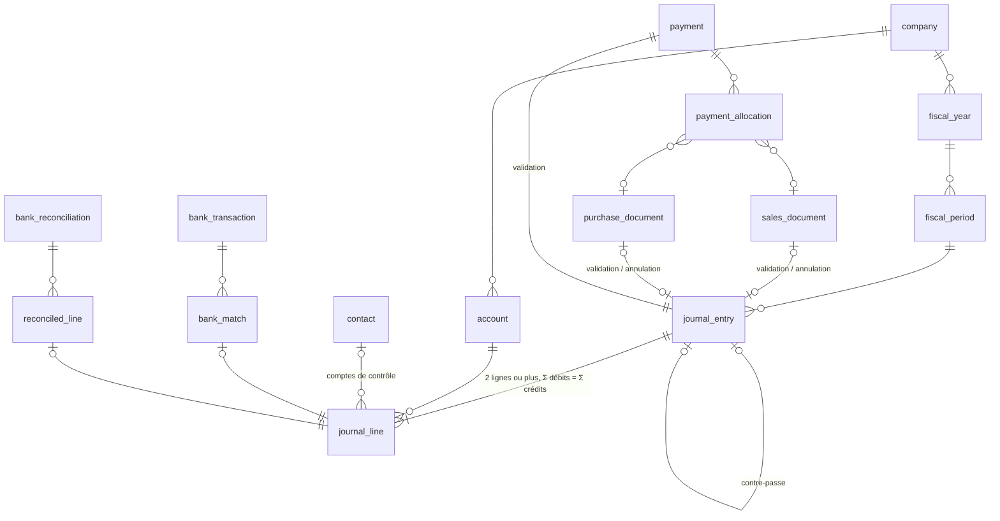

# Schéma de données

> Conception de la phase 1. En phase 2, ce schéma devient `prisma/schema.prisma`, et le SQL complémentaire est ajouté à la fin de la migration initiale (`prisma migrate dev --create-only`, puis édition). Toute modification ultérieure passe par une migration **et** par cette page, dans le même commit.

Voir aussi [[Architecture]], [[Regles-comptables]], [[Plan-de-tests]].

## Conventions
- Tables et colonnes en `snake_case` (`@@map`/`@map`), modèles Prisma en `PascalCase`.
- Clés primaires `uuid` v7 générées par Prisma (`@default(uuid(7))`). Exceptions : `session` (SHA-256 du jeton), `number_sequence` (clé composée), `audit_log` (`bigint` séquentiel).
- Argent en `BIGINT` (cents, colonnes `*_cents`). Quantités `NUMERIC(19,4)`, prix unitaires `NUMERIC(19,6)`, taux `NUMERIC(9,6)`.
- Dates comptables en `DATE`; horodatages en `timestamptz`.
- Toute table de données d'entreprise porte `company_id`, avec RLS `ENABLE` + `FORCE`.
- Les références entre tables d'une entreprise sont des **clés étrangères composites** `(company_id, x_id) → (company_id, id)`.
- Les colonnes d'auteur (`created_by_id`, `posted_by_id`…) n'ont pas de clé étrangère, sauf sur `journal_entry` et `audit_log` : un utilisateur n'est jamais supprimé, et la piste d'audit fait foi.

## Vue d'ensemble
39 tables : 5 globales (sans RLS) et 34 par entreprise (RLS).

| Domaine | Tables |
|---|---|
| Instance et identité (globales) | `instance`, `app_user`, `user_recovery_code`, `session`, `rate_limit` |
| Entreprise | `company`, `membership`, `invitation`, `number_sequence` |
| Exercices | `fiscal_year`, `fiscal_period` |
| Grand livre | `account`, `journal_entry`, `journal_line` |
| Contacts | `contact`, `item` |
| Taxes | `tax`, `tax_rate`, `tax_code`, `tax_code_component` |
| Ventes | `sales_document`, `sales_document_line`, `sales_document_tax`, `sales_credit_application` |
| Achats | `purchase_document`, `purchase_document_line`, `purchase_document_tax`, `purchase_credit_application` |
| Paiements | `payment`, `payment_allocation` |
| Banque | `bank_account_profile`, `bank_import`, `bank_transaction`, `bank_match`, `bank_reconciliation`, `reconciled_line` |
| Pièces jointes | `attachment`, `attachment_link` |
| Audit | `audit_log` |



## Partie double et immuabilité
| Garantie | Mécanisme en base |
|---|---|
| Une ligne a un seul côté non nul, positif | `CHECK journal_line_one_side` |
| Une écriture a au moins 2 lignes et Σ débits = Σ crédits | Triggers de contrainte **différés** (`journal_line_balanced`, `journal_entry_complete`), évalués au `COMMIT` |
| Écriture datée dans une période **ouverte** de son entreprise | Trigger `journal_entry_20_validate` (période verrouillée en `FOR SHARE` : une fermeture concurrente attend le `COMMIT`) |
| Aucune modification ni suppression, même par le propriétaire | Triggers `*_append_only`, `*_no_truncate`, et aucun privilège `UPDATE`/`DELETE` pour `allumi_app` |
| Pas de ligne ajoutée à une écriture existante | Registre `allumi.open_entries` local à la transaction (compatible avec les savepoints) vérifié par `journal_line_validate` |
| Contre-passation : miroir exact, une seule par écriture, jamais d'une contre-passation | Vérification différée (`EXCEPT ALL`), contrainte unique `(company_id, reverses_entry_id)` |
| L'écriture d'un document ou d'un paiement ne se contre-passe qu'en l'annulant | Vérification différée : la contre-passation doit être le `void_entry_id` du document |
| Comptes clients/fournisseurs : seulement documents, paiements, contre-passations, toujours avec contact | Trigger `journal_line_validate` |
| Compte inactif refusé (sauf contre-passation); type d'un compte utilisé figé | Triggers `journal_line_validate`, `account_guard` (avec verrou `FOR SHARE` sur le compte) |

## Documents, paiements, banque
- **Documents** (`sales_document`, `purchase_document`) : créés en `DRAFT`, librement modifiables. Le passage à `POSTED` exige une écriture dont la source est ce document, à la même date, et des totaux égaux à la somme des lignes et des taxes. Un document `POSTED` est figé : seuls les champs d'annulation changent, vers `VOID`, avec la contre-passation de son écriture. Seuls les brouillons se suppriment.
- **Montant de ligne** = `round(quantité × prix × 100)`, vérifié par `CHECK` (demi s'éloignant de zéro).
- **Paiements** : créés validés, avec leur écriture. Jamais supprimés; annulés par contre-passation après retrait des affectations.
- **Affectations et avoirs** : sens cohérent (encaissement → facture, remboursement → avoir, etc.), même contact, documents validés, Σ affectations ≤ paiement, solde ouvert ≥ 0. Vérification différée, avec verrous de ligne pris dès l'insertion (aucune course entre deux transactions).
- **Banque** : `amount_cents` exprime l'effet sur le compte du grand livre (+ débit, − crédit). Une transaction `MATCHED` est égale à la somme des lignes appariées, toutes sur son compte. Un rapprochement complété est figé; son solde pointé doit égaler le solde du relevé. Seul le dernier rapprochement peut être rouvert.

## Isolation par entreprise
- Fonctions de contexte : `app_current_company_id()` et `app_current_user_id()` lisent `app.company_id` et `app.user_id`, posés par l'app avec `set_config(…, true)` au début de chaque transaction.
- Politique `tenant_isolation` sur chaque table avec `company_id` : `USING` et `WITH CHECK (company_id = app_current_company_id())`. Sans contexte, rien n'est visible ni modifiable.
- `company` : entreprise courante (lecture et écriture) + entreprises dont l'utilisateur est membre (lecture). `membership` : entreprise courante + ses propres adhésions (lecture). `audit_log` : entreprise courante + ses propres événements globaux.
- Les fonctions de validation sont `SECURITY DEFINER` avec `search_path` figé : elles lisent malgré RLS, mais ne renvoient aucune donnée.
- Rôle `allumi_app` : NOSUPERUSER, NOBYPASSRLS, pas propriétaire. Il est créé `NOLOGIN` par la migration; l'étape `migrate` lui donne `LOGIN` et `APP_DB_PASSWORD`.

## Codes d'erreur
| SQLSTATE | Sens | Exemple de message affiché (fr-CA) |
|---|---|---|
| `AL001` | Écriture déséquilibrée | « Les débits et les crédits ne sont pas égaux. » |
| `AL002` | Écriture incomplète | « Une écriture doit compter au moins deux lignes. » |
| `AL003` | Période ou exercice fermé | « Cette période est verrouillée. » |
| `AL004` | Donnée en ajout seulement | « Une écriture validée ne se modifie pas : contre-passe-la. » |
| `AL005` | Règle de compte ou de ligne | « Ce compte n'accepte que les écritures de factures et de paiements. » |
| `AL006` | Document figé ou transition invalide | « Ce document est validé : émets un avoir ou annule-le. » |
| `AL007` | Affectation invalide | « Le montant dépasse le solde de la facture. » |
| `AL008` | Contre-passation invalide | « Pour corriger une facture, annule-la. » |
| `AL009` | Dernier propriétaire | « L'entreprise doit garder au moins un propriétaire. » |
| `AL010` | Règle bancaire | « Le solde pointé ne correspond pas au relevé. » |

## Validation faite en phase 1
- `prisma validate` et `prisma format` (Prisma 7.10) : schéma valide.
- SQL généré + SQL complémentaire appliqués sur PostgreSQL 16 sans erreur.
- `prisma migrate diff` (base → schéma) : **vide**. Prisma ne tente pas de supprimer les `CHECK`, `EXCLUDE`, triggers ni politiques.
- Catalogue : 34 tables sous RLS forcée, aucune table avec `company_id` sans RLS.
- 46 cas SQL exécutés avec le rôle `allumi_app`, tous réussis (liste dans [[Plan-de-tests]]).
- Concurrence vérifiée avec deux connexions : verrouillage d'une période pendant une écriture, deux affectations simultanées sur une même facture, deux rétrogradations simultanées de propriétaires.
- Savepoints : une écriture créée dans un savepoint relâché accepte ses lignes; un savepoint annulé retire l'écriture du registre.


## Schéma Prisma
```prisma
// Allumi — schéma de données (conception, phase 1).
// Les objets que Prisma ne modélise pas (CHECK, EXCLUDE, triggers, RLS, GRANT)
// sont dans le SQL complémentaire de la migration initiale.

generator client {
  provider        = "prisma-client"
  output          = "../src/generated/prisma"
  previewFeatures = ["partialIndexes", "postgresqlExtensions"]
}

datasource db {
  provider   = "postgresql"
  extensions = [btree_gist]
}

// ─────────────────────────────── Enums ───────────────────────────────

enum AppLocale {
  fr_CA @map("fr-CA")
  en

  @@map("app_locale")
}

enum Province {
  AB
  BC
  MB
  NB
  NL
  NS
  NT
  NU
  ON
  PE
  QC
  SK
  YT

  @@map("province")
}

enum MemberRole {
  OWNER
  ACCOUNTANT
  READ_ONLY

  @@map("member_role")
}

enum TaxRounding {
  PER_LINE
  PER_DOCUMENT

  @@map("tax_rounding")
}

enum FilingFrequency {
  MONTHLY
  QUARTERLY
  ANNUAL

  @@map("filing_frequency")
}

enum FiscalYearStatus {
  OPEN
  CLOSED

  @@map("fiscal_year_status")
}

enum PeriodStatus {
  OPEN
  LOCKED

  @@map("period_status")
}

enum AccountType {
  ASSET
  LIABILITY
  EQUITY
  REVENUE
  EXPENSE

  @@map("account_type")
}

enum AccountSubtype {
  CASH
  BANK
  ACCOUNTS_RECEIVABLE
  CURRENT_ASSET
  FIXED_ASSET
  OTHER_ASSET
  CREDIT_CARD
  ACCOUNTS_PAYABLE
  SALES_TAX
  CURRENT_LIABILITY
  LONG_TERM_LIABILITY
  EQUITY
  RETAINED_EARNINGS
  OPERATING_REVENUE
  OTHER_REVENUE
  COST_OF_SALES
  OPERATING_EXPENSE
  OTHER_EXPENSE

  @@map("account_subtype")
}

enum SystemAccount {
  ACCOUNTS_RECEIVABLE
  ACCOUNTS_PAYABLE
  UNDEPOSITED_FUNDS
  RETAINED_EARNINGS
  OPENING_BALANCE_EQUITY

  @@map("system_account")
}

enum SequenceKey {
  JOURNAL_ENTRY
  INVOICE
  CREDIT_NOTE
  PURCHASE_DOCUMENT
  PAYMENT_RECEIVED
  PAYMENT_SENT

  @@map("sequence_key")
}

enum JournalSource {
  MANUAL
  OPENING_BALANCE
  SALES_DOCUMENT
  PURCHASE_DOCUMENT
  PAYMENT
  BANK
  REVERSAL

  @@map("journal_source")
}

enum TaxTreatment {
  STANDARD
  ZERO_RATED
  EXEMPT
  OUT_OF_SCOPE

  @@map("tax_treatment")
}

enum SalesDocumentKind {
  INVOICE
  CREDIT_NOTE

  @@map("sales_document_kind")
}

enum PurchaseDocumentKind {
  BILL
  SUPPLIER_CREDIT
  EXPENSE

  @@map("purchase_document_kind")
}

enum DocumentStatus {
  DRAFT
  POSTED
  VOID

  @@map("document_status")
}

enum PaymentDirection {
  RECEIVED
  SENT

  @@map("payment_direction")
}

enum PaymentMethod {
  CASH
  CHEQUE
  EFT
  INTERAC
  CREDIT_CARD
  DEBIT_CARD
  OTHER

  @@map("payment_method")
}

enum PaymentStatus {
  POSTED
  VOID

  @@map("payment_status")
}

enum BankImportFormat {
  CSV
  OFX

  @@map("bank_import_format")
}

enum BankTransactionStatus {
  UNMATCHED
  MATCHED
  EXCLUDED

  @@map("bank_transaction_status")
}

enum ReconciliationStatus {
  IN_PROGRESS
  COMPLETED

  @@map("reconciliation_status")
}

enum ActorKind {
  USER
  SYSTEM

  @@map("actor_kind")
}

// ─────────────────────── Instance et identité (global, sans RLS) ───────────────────────

/// Ligne unique (id = 1). setup_completed_at non nul => /setup désactivée.
model Instance {
  id               Int       @id @default(1)
  setupCompletedAt DateTime? @map("setup_completed_at") @db.Timestamptz(6)

  @@map("instance")
}

model User {
  id               String    @id @default(uuid(7)) @db.Uuid
  /// Normalisé en minuscules (CHECK).
  email            String    @unique
  passwordHash     String    @map("password_hash")
  displayName      String    @map("display_name")
  locale           AppLocale @default(fr_CA)
  /// Secret TOTP chiffré AES-256-GCM (ENCRYPTION_KEY). Exclu de l'audit.
  totpSecretEnc    Bytes?    @map("totp_secret_enc")
  totpEnabledAt    DateTime? @map("totp_enabled_at") @db.Timestamptz(6)
  failedLoginCount Int       @default(0) @map("failed_login_count")
  lockedUntil      DateTime? @map("locked_until") @db.Timestamptz(6)
  lastLoginAt      DateTime? @map("last_login_at") @db.Timestamptz(6)
  /// Un utilisateur n'est jamais supprimé : il est désactivé.
  disabledAt       DateTime? @map("disabled_at") @db.Timestamptz(6)
  createdAt        DateTime  @default(now()) @map("created_at") @db.Timestamptz(6)
  updatedAt        DateTime  @updatedAt @map("updated_at") @db.Timestamptz(6)

  memberships    Membership[]
  sessions       Session[]
  recoveryCodes  UserRecoveryCode[]
  journalEntries JournalEntry[]
  auditEvents    AuditLog[]

  @@map("app_user")
}

model UserRecoveryCode {
  id        String    @id @default(uuid(7)) @db.Uuid
  userId    String    @map("user_id") @db.Uuid
  codeHash  String    @map("code_hash")
  usedAt    DateTime? @map("used_at") @db.Timestamptz(6)
  createdAt DateTime  @default(now()) @map("created_at") @db.Timestamptz(6)

  user User @relation(fields: [userId], references: [id], onDelete: Cascade)

  @@index([userId])
  @@map("user_recovery_code")
}

/// id = SHA-256 (hex) du jeton de session; le jeton lui-même n'est jamais stocké.
model Session {
  id            String    @id @db.Char(64)
  userId        String    @map("user_id") @db.Uuid
  mfaVerifiedAt DateTime? @map("mfa_verified_at") @db.Timestamptz(6)
  createdAt     DateTime  @default(now()) @map("created_at") @db.Timestamptz(6)
  lastSeenAt    DateTime  @default(now()) @map("last_seen_at") @db.Timestamptz(6)
  expiresAt     DateTime  @map("expires_at") @db.Timestamptz(6)
  /// Tronqué à 256 caractères.
  userAgent     String?   @map("user_agent")

  user User @relation(fields: [userId], references: [id], onDelete: Cascade)

  @@index([userId])
  @@index([expiresAt])
  @@map("session")
}

/// Fenêtre fixe par clé (ex. « login:ip:<hash> », « login:email:<hash> »).
model RateLimit {
  key         String   @id
  windowStart DateTime @map("window_start") @db.Timestamptz(6)
  count       Int

  @@index([windowStart])
  @@map("rate_limit")
}

// ─────────────────────── Entreprise, membres (RLS) ───────────────────────

model Company {
  id                   String          @id @default(uuid(7)) @db.Uuid
  name                 String
  legalName            String?         @map("legal_name")
  /// Numéro d'entreprise du Québec (10 chiffres).
  neq                  String?
  /// Numéro d'entreprise fédéral (9 chiffres).
  businessNumber       String?         @map("business_number")
  /// TPS/TVH : 9 chiffres + RT + 4 chiffres.
  gstNumber            String?         @map("gst_number")
  /// TVQ : 10 chiffres + TQ + 4 chiffres.
  qstNumber            String?         @map("qst_number")
  addressLine1         String?         @map("address_line1")
  addressLine2         String?         @map("address_line2")
  city                 String?
  province             Province        @default(QC)
  postalCode           String?         @map("postal_code")
  email                String?
  phone                String?
  /// MVP : CAD seulement (CHECK). Colonne réservée pour la multidevise.
  currency             String          @default("CAD") @db.Char(3)
  defaultLocale        AppLocale       @default(fr_CA) @map("default_locale")
  fiscalYearStartMonth Int             @default(1) @map("fiscal_year_start_month")
  taxRounding          TaxRounding     @default(PER_LINE) @map("tax_rounding")
  taxFilingFrequency   FilingFrequency @default(QUARTERLY) @map("tax_filing_frequency")
  createdAt            DateTime        @default(now()) @map("created_at") @db.Timestamptz(6)
  updatedAt            DateTime        @updatedAt @map("updated_at") @db.Timestamptz(6)

  memberships       Membership[]
  invitations       Invitation[]
  numberSequences   NumberSequence[]
  fiscalYears       FiscalYear[]
  accounts          Account[]
  journalEntries    JournalEntry[]
  contacts          Contact[]
  items             Item[]
  taxes             Tax[]
  taxCodes          TaxCode[]
  salesDocuments    SalesDocument[]
  purchaseDocuments PurchaseDocument[]
  payments          Payment[]
  attachments       Attachment[]
  auditLogs         AuditLog[]

  @@map("company")
}

model Membership {
  id        String     @id @default(uuid(7)) @db.Uuid
  companyId String     @map("company_id") @db.Uuid
  userId    String     @map("user_id") @db.Uuid
  role      MemberRole
  createdAt DateTime   @default(now()) @map("created_at") @db.Timestamptz(6)
  updatedAt DateTime   @updatedAt @map("updated_at") @db.Timestamptz(6)

  company Company @relation(fields: [companyId], references: [id], onDelete: Restrict)
  user    User    @relation(fields: [userId], references: [id], onDelete: Restrict)

  @@unique([companyId, userId])
  @@index([userId])
  @@map("membership")
}

model Invitation {
  id          String     @id @default(uuid(7)) @db.Uuid
  companyId   String     @map("company_id") @db.Uuid
  email       String
  role        MemberRole
  /// SHA-256 (hex) du jeton envoyé par courriel.
  tokenHash   String     @unique @map("token_hash") @db.Char(64)
  expiresAt   DateTime   @map("expires_at") @db.Timestamptz(6)
  acceptedAt  DateTime?  @map("accepted_at") @db.Timestamptz(6)
  revokedAt   DateTime?  @map("revoked_at") @db.Timestamptz(6)
  createdById String     @map("created_by_id") @db.Uuid
  createdAt   DateTime   @default(now()) @map("created_at") @db.Timestamptz(6)

  company Company @relation(fields: [companyId], references: [id], onDelete: Restrict)

  @@index([companyId])
  @@map("invitation")
}

/// Numérotation sans trou : UPDATE ... SET next_value = next_value + 1 RETURNING (verrou de ligne).
model NumberSequence {
  companyId String      @map("company_id") @db.Uuid
  key       SequenceKey
  prefix    String      @default("")
  nextValue BigInt      @default(1) @map("next_value")
  padding   Int         @default(0)

  company Company @relation(fields: [companyId], references: [id], onDelete: Restrict)

  @@id([companyId, key])
  @@map("number_sequence")
}

// ─────────────────────── Exercices et périodes ───────────────────────

model FiscalYear {
  id         String           @id @default(uuid(7)) @db.Uuid
  companyId  String           @map("company_id") @db.Uuid
  startDate  DateTime         @map("start_date") @db.Date
  endDate    DateTime         @map("end_date") @db.Date
  status     FiscalYearStatus @default(OPEN)
  closedAt   DateTime?        @map("closed_at") @db.Timestamptz(6)
  closedById String?          @map("closed_by_id") @db.Uuid
  createdAt  DateTime         @default(now()) @map("created_at") @db.Timestamptz(6)

  company Company        @relation(fields: [companyId], references: [id], onDelete: Restrict)
  periods FiscalPeriod[]

  @@unique([companyId, id])
  @@unique([companyId, startDate])
  @@map("fiscal_year")
}

model FiscalPeriod {
  id           String       @id @default(uuid(7)) @db.Uuid
  companyId    String       @map("company_id") @db.Uuid
  fiscalYearId String       @map("fiscal_year_id") @db.Uuid
  periodNumber Int          @map("period_number")
  startDate    DateTime     @map("start_date") @db.Date
  endDate      DateTime     @map("end_date") @db.Date
  status       PeriodStatus @default(OPEN)
  lockedAt     DateTime?    @map("locked_at") @db.Timestamptz(6)
  lockedById   String?      @map("locked_by_id") @db.Uuid

  fiscalYear     FiscalYear     @relation(fields: [companyId, fiscalYearId], references: [companyId, id], onDelete: Restrict)
  journalEntries JournalEntry[]

  @@unique([companyId, id])
  @@unique([fiscalYearId, periodNumber])
  @@index([companyId, startDate])
  @@map("fiscal_period")
}

// ─────────────────────── Plan comptable et journal ───────────────────────

model Account {
  id          String         @id @default(uuid(7)) @db.Uuid
  companyId   String         @map("company_id") @db.Uuid
  code        String
  nameFr      String         @map("name_fr")
  nameEn      String         @map("name_en")
  type        AccountType
  subtype     AccountSubtype
  parentId    String?        @map("parent_id") @db.Uuid
  /// Code de l'Index général des renseignements financiers (IGRF, norme publique de l'ARC).
  gifiCode    String?        @map("gifi_code")
  /// Compte de contrôle ou système, unique par entreprise.
  systemKey   SystemAccount? @map("system_key")
  isActive    Boolean        @default(true) @map("is_active")
  description String?
  createdAt   DateTime       @default(now()) @map("created_at") @db.Timestamptz(6)
  updatedAt   DateTime       @updatedAt @map("updated_at") @db.Timestamptz(6)

  company  Company   @relation(fields: [companyId], references: [id], onDelete: Restrict)
  parent   Account?  @relation("AccountHierarchy", fields: [companyId, parentId], references: [companyId, id], onDelete: Restrict)
  children Account[] @relation("AccountHierarchy")

  journalLines          JournalLine[]
  itemsIncome           Item[]                 @relation("ItemIncomeAccount")
  itemsExpense          Item[]                 @relation("ItemExpenseAccount")
  taxesPayable          Tax[]                  @relation("TaxPayableAccount")
  taxesRecoverable      Tax[]                  @relation("TaxRecoverableAccount")
  salesLines            SalesDocumentLine[]
  purchaseLines         PurchaseDocumentLine[]
  purchaseDocumentsPaid PurchaseDocument[]     @relation("PurchasePaymentAccount")
  payments              Payment[]
  bankProfile           BankAccountProfile?
  bankImports           BankImport[]
  bankTransactions      BankTransaction[]
  reconciliations       BankReconciliation[]

  @@unique([companyId, id])
  @@unique([companyId, code])
  @@unique([companyId, systemKey])
  @@index([companyId, type])
  @@map("account")
}

/// Écriture validée dès son insertion. Ajout seulement (triggers + GRANT).
model JournalEntry {
  id              String        @id @default(uuid(7)) @db.Uuid
  companyId       String        @map("company_id") @db.Uuid
  entryNumber     BigInt        @map("entry_number")
  entryDate       DateTime      @map("entry_date") @db.Date
  fiscalPeriodId  String        @map("fiscal_period_id") @db.Uuid
  sourceType      JournalSource @map("source_type")
  /// Document, paiement ou transaction bancaire d'origine (selon source_type).
  sourceId        String?       @map("source_id") @db.Uuid
  memo            String?
  reversesEntryId String?       @map("reverses_entry_id") @db.Uuid
  createdById     String        @map("created_by_id") @db.Uuid
  createdAt       DateTime      @default(now()) @map("created_at") @db.Timestamptz(6)

  company      Company       @relation(fields: [companyId], references: [id], onDelete: Restrict)
  fiscalPeriod FiscalPeriod  @relation(fields: [companyId, fiscalPeriodId], references: [companyId, id], onDelete: Restrict)
  createdBy    User          @relation(fields: [createdById], references: [id], onDelete: Restrict)
  reverses     JournalEntry? @relation("Reversal", fields: [companyId, reversesEntryId], references: [companyId, id], onDelete: Restrict)
  reversedBy   JournalEntry? @relation("Reversal")
  lines        JournalLine[]

  salesDocumentPosted    SalesDocument?    @relation("SalesDocumentPosting")
  salesDocumentVoided    SalesDocument?    @relation("SalesDocumentVoid")
  purchaseDocumentPosted PurchaseDocument? @relation("PurchaseDocumentPosting")
  purchaseDocumentVoided PurchaseDocument? @relation("PurchaseDocumentVoid")
  paymentPosted          Payment?          @relation("PaymentPosting")
  paymentVoided          Payment?          @relation("PaymentVoid")
  attachmentLinks        AttachmentLink[]

  @@unique([companyId, id])
  @@unique([companyId, entryNumber])
  @@unique([companyId, reversesEntryId])
  @@index([companyId, entryDate])
  @@index([companyId, sourceType, sourceId])
  @@map("journal_entry")
}

/// Exactement un de debit_cents / credit_cents est non nul (CHECK).
model JournalLine {
  id          String   @id @default(uuid(7)) @db.Uuid
  companyId   String   @map("company_id") @db.Uuid
  entryId     String   @map("entry_id") @db.Uuid
  lineNo      Int      @map("line_no") @db.SmallInt
  accountId   String   @map("account_id") @db.Uuid
  debitCents  BigInt   @default(0) @map("debit_cents")
  creditCents BigInt   @default(0) @map("credit_cents")
  description String?
  /// Obligatoire sur les comptes clients/fournisseurs (trigger).
  contactId   String?  @map("contact_id") @db.Uuid
  /// Copie de journal_entry.entry_date (vérifiée par trigger) pour les rapports par plage de dates.
  entryDate   DateTime @map("entry_date") @db.Date

  entry          JournalEntry    @relation(fields: [companyId, entryId], references: [companyId, id], onDelete: Restrict)
  account        Account         @relation(fields: [companyId, accountId], references: [companyId, id], onDelete: Restrict)
  contact        Contact?        @relation(fields: [companyId, contactId], references: [companyId, id], onDelete: Restrict)
  bankMatch      BankMatch?
  reconciledLine ReconciledLine?

  @@unique([companyId, id])
  @@unique([entryId, lineNo])
  @@index([companyId, accountId, entryDate])
  @@index([companyId, contactId, entryDate])
  @@map("journal_line")
}

// ─────────────────────── Contacts et articles ───────────────────────

model Contact {
  id                 String    @id @default(uuid(7)) @db.Uuid
  companyId          String    @map("company_id") @db.Uuid
  isCustomer         Boolean   @default(false) @map("is_customer")
  isSupplier         Boolean   @default(false) @map("is_supplier")
  displayName        String    @map("display_name")
  legalName          String?   @map("legal_name")
  email              String?
  phone              String?
  addressLine1       String?   @map("address_line1")
  addressLine2       String?   @map("address_line2")
  city               String?
  province           Province?
  postalCode         String?   @map("postal_code")
  country            String    @default("CA") @db.Char(2)
  locale             AppLocale @default(fr_CA)
  defaultTaxCodeId   String?   @map("default_tax_code_id") @db.Uuid
  paymentTermsDays   Int       @default(30) @map("payment_terms_days")
  taxExemptionNumber String?   @map("tax_exemption_number")
  notes              String?
  isActive           Boolean   @default(true) @map("is_active")
  /// Loi 25 : anonymisation plutôt que suppression (pièces comptables à conserver).
  anonymizedAt       DateTime? @map("anonymized_at") @db.Timestamptz(6)
  createdAt          DateTime  @default(now()) @map("created_at") @db.Timestamptz(6)
  updatedAt          DateTime  @updatedAt @map("updated_at") @db.Timestamptz(6)

  company        Company  @relation(fields: [companyId], references: [id], onDelete: Restrict)
  defaultTaxCode TaxCode? @relation("ContactDefaultTaxCode", fields: [companyId, defaultTaxCodeId], references: [companyId, id], onDelete: Restrict)

  journalLines      JournalLine[]
  salesDocuments    SalesDocument[]
  purchaseDocuments PurchaseDocument[]
  payments          Payment[]
  attachmentLinks   AttachmentLink[]

  @@unique([companyId, id])
  @@index([companyId, displayName])
  @@map("contact")
}

model Item {
  id               String   @id @default(uuid(7)) @db.Uuid
  companyId        String   @map("company_id") @db.Uuid
  code             String?
  name             String
  description      String?
  unitPrice        Decimal? @map("unit_price") @db.Decimal(19, 6)
  incomeAccountId  String?  @map("income_account_id") @db.Uuid
  expenseAccountId String?  @map("expense_account_id") @db.Uuid
  defaultTaxCodeId String?  @map("default_tax_code_id") @db.Uuid
  isActive         Boolean  @default(true) @map("is_active")
  createdAt        DateTime @default(now()) @map("created_at") @db.Timestamptz(6)
  updatedAt        DateTime @updatedAt @map("updated_at") @db.Timestamptz(6)

  company        Company  @relation(fields: [companyId], references: [id], onDelete: Restrict)
  incomeAccount  Account? @relation("ItemIncomeAccount", fields: [companyId, incomeAccountId], references: [companyId, id], onDelete: Restrict)
  expenseAccount Account? @relation("ItemExpenseAccount", fields: [companyId, expenseAccountId], references: [companyId, id], onDelete: Restrict)
  defaultTaxCode TaxCode? @relation("ItemDefaultTaxCode", fields: [companyId, defaultTaxCodeId], references: [companyId, id], onDelete: Restrict)

  salesLines    SalesDocumentLine[]
  purchaseLines PurchaseDocumentLine[]

  @@unique([companyId, id])
  @@unique([companyId, code])
  @@map("item")
}

// ─────────────────────── Taxes ───────────────────────

/// Une taxe (TPS, TVQ, TVH...). Les montants vont au compte à payer; la portion récupérable (CTI/RTI) au compte récupérable.
model Tax {
  id                   String   @id @default(uuid(7)) @db.Uuid
  companyId            String   @map("company_id") @db.Uuid
  code                 String
  nameFr               String   @map("name_fr")
  nameEn               String   @map("name_en")
  registrationNumber   String?  @map("registration_number")
  payableAccountId     String   @map("payable_account_id") @db.Uuid
  recoverableAccountId String?  @map("recoverable_account_id") @db.Uuid
  isActive             Boolean  @default(true) @map("is_active")
  createdAt            DateTime @default(now()) @map("created_at") @db.Timestamptz(6)

  company            Company  @relation(fields: [companyId], references: [id], onDelete: Restrict)
  payableAccount     Account  @relation("TaxPayableAccount", fields: [companyId, payableAccountId], references: [companyId, id], onDelete: Restrict)
  recoverableAccount Account? @relation("TaxRecoverableAccount", fields: [companyId, recoverableAccountId], references: [companyId, id], onDelete: Restrict)

  rates                 TaxRate[]
  components            TaxCodeComponent[]
  salesDocumentTaxes    SalesDocumentTax[]
  purchaseDocumentTaxes PurchaseDocumentTax[]

  @@unique([companyId, id])
  @@unique([companyId, code])
  @@map("tax")
}

/// Taux par date d'effet; les plages d'une même taxe ne se chevauchent pas (EXCLUDE). effective_to inclusif.
model TaxRate {
  id            String    @id @default(uuid(7)) @db.Uuid
  companyId     String    @map("company_id") @db.Uuid
  taxId         String    @map("tax_id") @db.Uuid
  rate          Decimal   @db.Decimal(9, 6)
  effectiveFrom DateTime  @map("effective_from") @db.Date
  effectiveTo   DateTime? @map("effective_to") @db.Date

  tax Tax @relation(fields: [companyId, taxId], references: [companyId, id], onDelete: Restrict)

  @@unique([taxId, effectiveFrom])
  @@map("tax_rate")
}

/// Code appliqué sur une ligne (ex. « TPS+TVQ », « TVH ON », « Détaxé », « Exonéré »).
model TaxCode {
  id        String       @id @default(uuid(7)) @db.Uuid
  companyId String       @map("company_id") @db.Uuid
  code      String
  nameFr    String       @map("name_fr")
  nameEn    String       @map("name_en")
  treatment TaxTreatment
  isActive  Boolean      @default(true) @map("is_active")
  createdAt DateTime     @default(now()) @map("created_at") @db.Timestamptz(6)

  company    Company            @relation(fields: [companyId], references: [id], onDelete: Restrict)
  components TaxCodeComponent[]

  contacts      Contact[]              @relation("ContactDefaultTaxCode")
  items         Item[]                 @relation("ItemDefaultTaxCode")
  salesLines    SalesDocumentLine[]
  purchaseLines PurchaseDocumentLine[]

  @@unique([companyId, id])
  @@unique([companyId, code])
  @@map("tax_code")
}

model TaxCodeComponent {
  id         String  @id @default(uuid(7)) @db.Uuid
  companyId  String  @map("company_id") @db.Uuid
  taxCodeId  String  @map("tax_code_id") @db.Uuid
  taxId      String  @map("tax_id") @db.Uuid
  position   Int     @db.SmallInt
  /// Taxe calculée sur (base + taxes précédentes). Faux pour TPS/TVQ depuis 2013.
  isCompound Boolean @default(false) @map("is_compound")

  taxCode TaxCode @relation(fields: [companyId, taxCodeId], references: [companyId, id], onDelete: Cascade)
  tax     Tax     @relation(fields: [companyId, taxId], references: [companyId, id], onDelete: Restrict)

  @@unique([taxCodeId, taxId])
  @@unique([taxCodeId, position])
  @@map("tax_code_component")
}

// ─────────────────────── Ventes : factures et avoirs ───────────────────────

model SalesDocument {
  id              String            @id @default(uuid(7)) @db.Uuid
  companyId       String            @map("company_id") @db.Uuid
  kind            SalesDocumentKind
  status          DocumentStatus    @default(DRAFT)
  /// Attribué à la validation (séquence INVOICE ou CREDIT_NOTE).
  number          String?
  contactId       String            @map("contact_id") @db.Uuid
  issueDate       DateTime          @map("issue_date") @db.Date
  dueDate         DateTime?         @map("due_date") @db.Date
  currency        String            @default("CAD") @db.Char(3)
  locale          AppLocale         @default(fr_CA)
  reference       String?
  memo            String?
  terms           String?
  taxRounding     TaxRounding       @map("tax_rounding")
  /// Nom, adresse et numéros du client figés à la validation.
  billingSnapshot Json?             @map("billing_snapshot")
  subtotalCents   BigInt            @default(0) @map("subtotal_cents")
  taxTotalCents   BigInt            @default(0) @map("tax_total_cents")
  totalCents      BigInt            @default(0) @map("total_cents")
  journalEntryId  String?           @map("journal_entry_id") @db.Uuid
  voidEntryId     String?           @map("void_entry_id") @db.Uuid
  postedAt        DateTime?         @map("posted_at") @db.Timestamptz(6)
  postedById      String?           @map("posted_by_id") @db.Uuid
  voidedAt        DateTime?         @map("voided_at") @db.Timestamptz(6)
  voidedById      String?           @map("voided_by_id") @db.Uuid
  voidReason      String?           @map("void_reason")
  createdById     String            @map("created_by_id") @db.Uuid
  createdAt       DateTime          @default(now()) @map("created_at") @db.Timestamptz(6)
  updatedAt       DateTime          @updatedAt @map("updated_at") @db.Timestamptz(6)

  company      Company       @relation(fields: [companyId], references: [id], onDelete: Restrict)
  contact      Contact       @relation(fields: [companyId, contactId], references: [companyId, id], onDelete: Restrict)
  journalEntry JournalEntry? @relation("SalesDocumentPosting", fields: [companyId, journalEntryId], references: [companyId, id], onDelete: Restrict)
  voidEntry    JournalEntry? @relation("SalesDocumentVoid", fields: [companyId, voidEntryId], references: [companyId, id], onDelete: Restrict)

  lines           SalesDocumentLine[]
  taxes           SalesDocumentTax[]
  allocations     PaymentAllocation[]
  creditsApplied  SalesCreditApplication[] @relation("CreditNoteApplied")
  creditsReceived SalesCreditApplication[] @relation("InvoiceCredited")
  attachmentLinks AttachmentLink[]

  @@unique([companyId, id])
  @@unique([companyId, kind, number])
  @@unique([companyId, journalEntryId])
  @@unique([companyId, voidEntryId])
  @@index([companyId, contactId])
  @@index([companyId, status, issueDate])
  @@map("sales_document")
}

model SalesDocumentLine {
  id          String  @id @default(uuid(7)) @db.Uuid
  companyId   String  @map("company_id") @db.Uuid
  documentId  String  @map("document_id") @db.Uuid
  position    Int     @db.SmallInt
  itemId      String? @map("item_id") @db.Uuid
  description String
  quantity    Decimal @default(1) @db.Decimal(19, 4)
  unitPrice   Decimal @map("unit_price") @db.Decimal(19, 6)
  /// round(quantity × unit_price) au cent, par la fonction d'arrondi centrale.
  amountCents BigInt  @map("amount_cents")
  accountId   String  @map("account_id") @db.Uuid
  taxCodeId   String? @map("tax_code_id") @db.Uuid

  document SalesDocument @relation(fields: [companyId, documentId], references: [companyId, id], onDelete: Cascade)
  item     Item?         @relation(fields: [companyId, itemId], references: [companyId, id], onDelete: Restrict)
  account  Account       @relation(fields: [companyId, accountId], references: [companyId, id], onDelete: Restrict)
  taxCode  TaxCode?      @relation(fields: [companyId, taxCodeId], references: [companyId, id], onDelete: Restrict)

  @@unique([documentId, position])
  @@map("sales_document_line")
}

/// Totaux de taxe du document, avec le taux appliqué figé.
model SalesDocumentTax {
  id          String  @id @default(uuid(7)) @db.Uuid
  companyId   String  @map("company_id") @db.Uuid
  documentId  String  @map("document_id") @db.Uuid
  taxId       String  @map("tax_id") @db.Uuid
  rate        Decimal @db.Decimal(9, 6)
  baseCents   BigInt  @map("base_cents")
  amountCents BigInt  @map("amount_cents")

  document SalesDocument @relation(fields: [companyId, documentId], references: [companyId, id], onDelete: Cascade)
  tax      Tax           @relation(fields: [companyId, taxId], references: [companyId, id], onDelete: Restrict)

  @@unique([documentId, taxId])
  @@map("sales_document_tax")
}

// ─────────────────────── Achats : factures fournisseurs, crédits, dépenses ───────────────────────

model PurchaseDocument {
  id                String               @id @default(uuid(7)) @db.Uuid
  companyId         String               @map("company_id") @db.Uuid
  kind              PurchaseDocumentKind
  status            DocumentStatus       @default(DRAFT)
  /// Numéro interne attribué à la validation (séquence PURCHASE_DOCUMENT).
  number            String?
  /// Obligatoire pour BILL et SUPPLIER_CREDIT (CHECK); facultatif pour EXPENSE.
  contactId         String?              @map("contact_id") @db.Uuid
  payeeName         String?              @map("payee_name")
  /// Numéro de la facture du fournisseur; unique par fournisseur.
  supplierReference String?              @map("supplier_reference")
  documentDate      DateTime             @map("document_date") @db.Date
  dueDate           DateTime?            @map("due_date") @db.Date
  currency          String               @default("CAD") @db.Char(3)
  memo              String?
  taxRounding       TaxRounding          @map("tax_rounding")
  /// EXPENSE seulement : compte de banque, d'encaisse ou de carte de crédit débité.
  paymentAccountId  String?              @map("payment_account_id") @db.Uuid
  paymentMethod     PaymentMethod?       @map("payment_method")
  subtotalCents     BigInt               @default(0) @map("subtotal_cents")
  taxTotalCents     BigInt               @default(0) @map("tax_total_cents")
  totalCents        BigInt               @default(0) @map("total_cents")
  journalEntryId    String?              @map("journal_entry_id") @db.Uuid
  voidEntryId       String?              @map("void_entry_id") @db.Uuid
  postedAt          DateTime?            @map("posted_at") @db.Timestamptz(6)
  postedById        String?              @map("posted_by_id") @db.Uuid
  voidedAt          DateTime?            @map("voided_at") @db.Timestamptz(6)
  voidedById        String?              @map("voided_by_id") @db.Uuid
  voidReason        String?              @map("void_reason")
  createdById       String               @map("created_by_id") @db.Uuid
  createdAt         DateTime             @default(now()) @map("created_at") @db.Timestamptz(6)
  updatedAt         DateTime             @updatedAt @map("updated_at") @db.Timestamptz(6)

  company        Company       @relation(fields: [companyId], references: [id], onDelete: Restrict)
  contact        Contact?      @relation(fields: [companyId, contactId], references: [companyId, id], onDelete: Restrict)
  paymentAccount Account?      @relation("PurchasePaymentAccount", fields: [companyId, paymentAccountId], references: [companyId, id], onDelete: Restrict)
  journalEntry   JournalEntry? @relation("PurchaseDocumentPosting", fields: [companyId, journalEntryId], references: [companyId, id], onDelete: Restrict)
  voidEntry      JournalEntry? @relation("PurchaseDocumentVoid", fields: [companyId, voidEntryId], references: [companyId, id], onDelete: Restrict)

  lines           PurchaseDocumentLine[]
  taxes           PurchaseDocumentTax[]
  allocations     PaymentAllocation[]
  creditsApplied  PurchaseCreditApplication[] @relation("SupplierCreditApplied")
  creditsReceived PurchaseCreditApplication[] @relation("BillCredited")
  attachmentLinks AttachmentLink[]

  @@unique([companyId, id])
  @@unique([companyId, number])
  @@unique([companyId, contactId, kind, supplierReference])
  @@unique([companyId, journalEntryId])
  @@unique([companyId, voidEntryId])
  @@index([companyId, status, documentDate])
  @@map("purchase_document")
}

model PurchaseDocumentLine {
  id          String  @id @default(uuid(7)) @db.Uuid
  companyId   String  @map("company_id") @db.Uuid
  documentId  String  @map("document_id") @db.Uuid
  position    Int     @db.SmallInt
  itemId      String? @map("item_id") @db.Uuid
  description String
  quantity    Decimal @default(1) @db.Decimal(19, 4)
  unitPrice   Decimal @map("unit_price") @db.Decimal(19, 6)
  amountCents BigInt  @map("amount_cents")
  accountId   String  @map("account_id") @db.Uuid
  taxCodeId   String? @map("tax_code_id") @db.Uuid

  document PurchaseDocument @relation(fields: [companyId, documentId], references: [companyId, id], onDelete: Cascade)
  item     Item?            @relation(fields: [companyId, itemId], references: [companyId, id], onDelete: Restrict)
  account  Account          @relation(fields: [companyId, accountId], references: [companyId, id], onDelete: Restrict)
  taxCode  TaxCode?         @relation(fields: [companyId, taxCodeId], references: [companyId, id], onDelete: Restrict)

  @@unique([documentId, position])
  @@map("purchase_document_line")
}

/// recoverable_cents va au compte récupérable de la taxe (CTI/RTI); le reste est passé en charge avec les lignes.
model PurchaseDocumentTax {
  id               String  @id @default(uuid(7)) @db.Uuid
  companyId        String  @map("company_id") @db.Uuid
  documentId       String  @map("document_id") @db.Uuid
  taxId            String  @map("tax_id") @db.Uuid
  rate             Decimal @db.Decimal(9, 6)
  baseCents        BigInt  @map("base_cents")
  amountCents      BigInt  @map("amount_cents")
  recoverableCents BigInt  @map("recoverable_cents")

  document PurchaseDocument @relation(fields: [companyId, documentId], references: [companyId, id], onDelete: Cascade)
  tax      Tax              @relation(fields: [companyId, taxId], references: [companyId, id], onDelete: Restrict)

  @@unique([documentId, taxId])
  @@map("purchase_document_tax")
}

// ─────────────────────── Paiements et affectations ───────────────────────

/// Validé à la création (pas de brouillon). Annulation = contre-passation + status VOID.
model Payment {
  id             String           @id @default(uuid(7)) @db.Uuid
  companyId      String           @map("company_id") @db.Uuid
  direction      PaymentDirection
  number         String?
  contactId      String           @map("contact_id") @db.Uuid
  paymentDate    DateTime         @map("payment_date") @db.Date
  amountCents    BigInt           @map("amount_cents")
  /// Compte de banque, d'encaisse ou « fonds non déposés ».
  accountId      String           @map("account_id") @db.Uuid
  method         PaymentMethod
  reference      String?
  memo           String?
  status         PaymentStatus    @default(POSTED)
  journalEntryId String           @map("journal_entry_id") @db.Uuid
  voidEntryId    String?          @map("void_entry_id") @db.Uuid
  voidedAt       DateTime?        @map("voided_at") @db.Timestamptz(6)
  voidedById     String?          @map("voided_by_id") @db.Uuid
  voidReason     String?          @map("void_reason")
  createdById    String           @map("created_by_id") @db.Uuid
  createdAt      DateTime         @default(now()) @map("created_at") @db.Timestamptz(6)
  updatedAt      DateTime         @updatedAt @map("updated_at") @db.Timestamptz(6)

  company      Company       @relation(fields: [companyId], references: [id], onDelete: Restrict)
  contact      Contact       @relation(fields: [companyId, contactId], references: [companyId, id], onDelete: Restrict)
  account      Account       @relation(fields: [companyId, accountId], references: [companyId, id], onDelete: Restrict)
  journalEntry JournalEntry  @relation("PaymentPosting", fields: [companyId, journalEntryId], references: [companyId, id], onDelete: Restrict)
  voidEntry    JournalEntry? @relation("PaymentVoid", fields: [companyId, voidEntryId], references: [companyId, id], onDelete: Restrict)

  allocations     PaymentAllocation[]
  attachmentLinks AttachmentLink[]

  @@unique([companyId, id])
  @@unique([companyId, direction, number])
  @@unique([companyId, journalEntryId])
  @@unique([companyId, voidEntryId])
  @@index([companyId, contactId])
  @@index([companyId, paymentDate])
  @@map("payment")
}

/// Affecte un paiement à exactement un document (CHECK num_nonnulls = 1).
model PaymentAllocation {
  id                 String   @id @default(uuid(7)) @db.Uuid
  companyId          String   @map("company_id") @db.Uuid
  paymentId          String   @map("payment_id") @db.Uuid
  salesDocumentId    String?  @map("sales_document_id") @db.Uuid
  purchaseDocumentId String?  @map("purchase_document_id") @db.Uuid
  amountCents        BigInt   @map("amount_cents")
  createdAt          DateTime @default(now()) @map("created_at") @db.Timestamptz(6)

  payment          Payment           @relation(fields: [companyId, paymentId], references: [companyId, id], onDelete: Restrict)
  salesDocument    SalesDocument?    @relation(fields: [companyId, salesDocumentId], references: [companyId, id], onDelete: Restrict)
  purchaseDocument PurchaseDocument? @relation(fields: [companyId, purchaseDocumentId], references: [companyId, id], onDelete: Restrict)

  @@unique([paymentId, salesDocumentId])
  @@unique([paymentId, purchaseDocumentId])
  @@index([companyId, salesDocumentId])
  @@index([companyId, purchaseDocumentId])
  @@map("payment_allocation")
}

/// Application d'un avoir client à une facture (sans effet sur le grand livre : les deux sont au compte clients).
model SalesCreditApplication {
  id           String   @id @default(uuid(7)) @db.Uuid
  companyId    String   @map("company_id") @db.Uuid
  creditNoteId String   @map("credit_note_id") @db.Uuid
  invoiceId    String   @map("invoice_id") @db.Uuid
  amountCents  BigInt   @map("amount_cents")
  appliedDate  DateTime @map("applied_date") @db.Date
  createdById  String   @map("created_by_id") @db.Uuid
  createdAt    DateTime @default(now()) @map("created_at") @db.Timestamptz(6)

  creditNote SalesDocument @relation("CreditNoteApplied", fields: [companyId, creditNoteId], references: [companyId, id], onDelete: Restrict)
  invoice    SalesDocument @relation("InvoiceCredited", fields: [companyId, invoiceId], references: [companyId, id], onDelete: Restrict)

  @@unique([creditNoteId, invoiceId])
  @@index([companyId, invoiceId])
  @@map("sales_credit_application")
}

model PurchaseCreditApplication {
  id               String   @id @default(uuid(7)) @db.Uuid
  companyId        String   @map("company_id") @db.Uuid
  supplierCreditId String   @map("supplier_credit_id") @db.Uuid
  billId           String   @map("bill_id") @db.Uuid
  amountCents      BigInt   @map("amount_cents")
  appliedDate      DateTime @map("applied_date") @db.Date
  createdById      String   @map("created_by_id") @db.Uuid
  createdAt        DateTime @default(now()) @map("created_at") @db.Timestamptz(6)

  supplierCredit PurchaseDocument @relation("SupplierCreditApplied", fields: [companyId, supplierCreditId], references: [companyId, id], onDelete: Restrict)
  bill           PurchaseDocument @relation("BillCredited", fields: [companyId, billId], references: [companyId, id], onDelete: Restrict)

  @@unique([supplierCreditId, billId])
  @@index([companyId, billId])
  @@map("purchase_credit_application")
}

// ─────────────────────── Banque et rapprochement ───────────────────────

model BankAccountProfile {
  id              String   @id @default(uuid(7)) @db.Uuid
  companyId       String   @map("company_id") @db.Uuid
  accountId       String   @map("account_id") @db.Uuid
  institutionName String?  @map("institution_name")
  /// 4 derniers chiffres seulement.
  accountMask     String?  @map("account_mask")
  /// Correspondance des colonnes CSV (date, montant, description...).
  csvMapping      Json?    @map("csv_mapping")
  createdAt       DateTime @default(now()) @map("created_at") @db.Timestamptz(6)
  updatedAt       DateTime @updatedAt @map("updated_at") @db.Timestamptz(6)

  account Account @relation(fields: [companyId, accountId], references: [companyId, id], onDelete: Restrict)

  @@unique([companyId, accountId])
  @@map("bank_account_profile")
}

model BankImport {
  id           String           @id @default(uuid(7)) @db.Uuid
  companyId    String           @map("company_id") @db.Uuid
  accountId    String           @map("account_id") @db.Uuid
  format       BankImportFormat
  fileName     String           @map("file_name")
  /// Empêche l'import du même fichier deux fois sur un compte.
  fileSha256   String           @map("file_sha256") @db.Char(64)
  rowCount     Int              @map("row_count")
  importedById String           @map("imported_by_id") @db.Uuid
  importedAt   DateTime         @default(now()) @map("imported_at") @db.Timestamptz(6)

  account         Account           @relation(fields: [companyId, accountId], references: [companyId, id], onDelete: Restrict)
  transactions    BankTransaction[]
  attachmentLinks AttachmentLink[]

  @@unique([companyId, id])
  @@unique([accountId, fileSha256])
  @@map("bank_import")
}

/// amount_cents signé du point de vue du relevé : + dépôt, − retrait.
model BankTransaction {
  id          String                @id @default(uuid(7)) @db.Uuid
  companyId   String                @map("company_id") @db.Uuid
  accountId   String                @map("account_id") @db.Uuid
  importId    String?               @map("import_id") @db.Uuid
  txnDate     DateTime              @map("txn_date") @db.Date
  amountCents BigInt                @map("amount_cents")
  description String
  payee       String?
  /// Identifiant OFX (FITID) lorsqu'il existe.
  externalId  String?               @map("external_id")
  /// Empreinte (date, montant, description normalisée, rang d'occurrence) pour les CSV.
  dedupeKey   String                @map("dedupe_key")
  status      BankTransactionStatus @default(UNMATCHED)
  createdAt   DateTime              @default(now()) @map("created_at") @db.Timestamptz(6)
  updatedAt   DateTime              @updatedAt @map("updated_at") @db.Timestamptz(6)

  account Account     @relation(fields: [companyId, accountId], references: [companyId, id], onDelete: Restrict)
  import  BankImport? @relation(fields: [companyId, importId], references: [companyId, id], onDelete: Restrict)
  matches BankMatch[]

  @@unique([companyId, id])
  @@unique([accountId, externalId])
  @@unique([accountId, dedupeKey])
  @@index([companyId, accountId, txnDate])
  @@index([companyId, status])
  @@map("bank_transaction")
}

/// Lie une transaction bancaire à une ou plusieurs lignes du grand livre sur le même compte.
model BankMatch {
  id                String   @id @default(uuid(7)) @db.Uuid
  companyId         String   @map("company_id") @db.Uuid
  bankTransactionId String   @map("bank_transaction_id") @db.Uuid
  journalLineId     String   @map("journal_line_id") @db.Uuid
  createdAt         DateTime @default(now()) @map("created_at") @db.Timestamptz(6)

  bankTransaction BankTransaction @relation(fields: [companyId, bankTransactionId], references: [companyId, id], onDelete: Restrict)
  journalLine     JournalLine     @relation(fields: [companyId, journalLineId], references: [companyId, id], onDelete: Restrict)

  @@unique([companyId, journalLineId])
  @@index([companyId, bankTransactionId])
  @@map("bank_match")
}

model BankReconciliation {
  id                    String               @id @default(uuid(7)) @db.Uuid
  companyId             String               @map("company_id") @db.Uuid
  accountId             String               @map("account_id") @db.Uuid
  statementDate         DateTime             @map("statement_date") @db.Date
  statementBalanceCents BigInt               @map("statement_balance_cents")
  status                ReconciliationStatus @default(IN_PROGRESS)
  completedAt           DateTime?            @map("completed_at") @db.Timestamptz(6)
  completedById         String?              @map("completed_by_id") @db.Uuid
  createdById           String               @map("created_by_id") @db.Uuid
  createdAt             DateTime             @default(now()) @map("created_at") @db.Timestamptz(6)

  account Account          @relation(fields: [companyId, accountId], references: [companyId, id], onDelete: Restrict)
  lines   ReconciledLine[]

  @@unique([companyId, id])
  @@unique([accountId, statementDate])
  /// Un seul rapprochement en cours par compte.
  @@unique([accountId], map: "bank_reconciliation_one_in_progress", where: raw("status = 'IN_PROGRESS'"))
  @@map("bank_reconciliation")
}

/// Ligne du grand livre pointée par un rapprochement (le journal reste immuable).
model ReconciledLine {
  id               String @id @default(uuid(7)) @db.Uuid
  companyId        String @map("company_id") @db.Uuid
  reconciliationId String @map("reconciliation_id") @db.Uuid
  journalLineId    String @map("journal_line_id") @db.Uuid

  reconciliation BankReconciliation @relation(fields: [companyId, reconciliationId], references: [companyId, id], onDelete: Restrict)
  journalLine    JournalLine        @relation(fields: [companyId, journalLineId], references: [companyId, id], onDelete: Restrict)

  @@unique([companyId, journalLineId])
  @@index([companyId, reconciliationId])
  @@map("reconciled_line")
}

// ─────────────────────── Pièces jointes ───────────────────────

/// Fichier dans /app/storage derrière une interface de stockage abstraite. storage_key = <company_id>/<aaaa>/<mm>/<uuid> (jamais le nom fourni).
model Attachment {
  id           String    @id @default(uuid(7)) @db.Uuid
  companyId    String    @map("company_id") @db.Uuid
  storageKey   String    @unique @map("storage_key")
  fileName     String    @map("file_name")
  mimeType     String    @map("mime_type")
  sizeBytes    Int       @map("size_bytes")
  sha256       String    @db.Char(64)
  uploadedById String    @map("uploaded_by_id") @db.Uuid
  createdAt    DateTime  @default(now()) @map("created_at") @db.Timestamptz(6)
  deletedAt    DateTime? @map("deleted_at") @db.Timestamptz(6)

  company Company          @relation(fields: [companyId], references: [id], onDelete: Restrict)
  links   AttachmentLink[]

  @@unique([companyId, id])
  @@index([companyId, sha256])
  @@map("attachment")
}

/// Rattache une pièce jointe à exactement une cible (CHECK num_nonnulls = 1).
model AttachmentLink {
  id                 String   @id @default(uuid(7)) @db.Uuid
  companyId          String   @map("company_id") @db.Uuid
  attachmentId       String   @map("attachment_id") @db.Uuid
  journalEntryId     String?  @map("journal_entry_id") @db.Uuid
  salesDocumentId    String?  @map("sales_document_id") @db.Uuid
  purchaseDocumentId String?  @map("purchase_document_id") @db.Uuid
  paymentId          String?  @map("payment_id") @db.Uuid
  contactId          String?  @map("contact_id") @db.Uuid
  bankImportId       String?  @map("bank_import_id") @db.Uuid
  createdAt          DateTime @default(now()) @map("created_at") @db.Timestamptz(6)

  attachment       Attachment        @relation(fields: [companyId, attachmentId], references: [companyId, id], onDelete: Restrict)
  journalEntry     JournalEntry?     @relation(fields: [companyId, journalEntryId], references: [companyId, id], onDelete: Restrict)
  salesDocument    SalesDocument?    @relation(fields: [companyId, salesDocumentId], references: [companyId, id], onDelete: Restrict)
  purchaseDocument PurchaseDocument? @relation(fields: [companyId, purchaseDocumentId], references: [companyId, id], onDelete: Restrict)
  payment          Payment?          @relation(fields: [companyId, paymentId], references: [companyId, id], onDelete: Restrict)
  contact          Contact?          @relation(fields: [companyId, contactId], references: [companyId, id], onDelete: Restrict)
  bankImport       BankImport?       @relation(fields: [companyId, bankImportId], references: [companyId, id], onDelete: Restrict)

  @@index([companyId, attachmentId])
  @@index([companyId, journalEntryId])
  @@index([companyId, salesDocumentId])
  @@index([companyId, purchaseDocumentId])
  @@index([companyId, paymentId])
  @@index([companyId, contactId])
  @@index([companyId, bankImportId])
  @@map("attachment_link")
}

// ─────────────────────── Piste d'audit (ajout seulement) ───────────────────────

/// Écrite par triggers (changements de lignes) et par l'application (connexion, export, fermeture...).
/// company_id nul = événement global (ex. connexion).
model AuditLog {
  id          BigInt    @id @default(autoincrement())
  companyId   String?   @map("company_id") @db.Uuid
  occurredAt  DateTime  @default(now()) @map("occurred_at") @db.Timestamptz(6)
  actorKind   ActorKind @map("actor_kind")
  actorUserId String?   @map("actor_user_id") @db.Uuid
  /// Ex. « row.insert », « row.update », « auth.login », « period.reopen ».
  action      String
  entityType  String    @map("entity_type")
  entityId    String?   @map("entity_id")
  /// INSERT/DELETE : ligne complète; UPDATE : colonnes modifiées seulement. Colonnes secrètes exclues.
  before      Json?
  after       Json?
  requestId   String?   @map("request_id")

  company   Company? @relation(fields: [companyId], references: [id], onDelete: Restrict)
  actorUser User?    @relation(fields: [actorUserId], references: [id], onDelete: Restrict)

  @@index([companyId, occurredAt])
  @@index([companyId, entityType, entityId])
  @@index([actorUserId, occurredAt])
  @@map("audit_log")
}
```

## SQL complémentaire de la migration initiale
```sql
-- =====================================================================
-- Allumi — SQL complémentaire de la migration initiale.
-- Ajouté à la suite du SQL généré par Prisma (prisma migrate dev --create-only).
-- Contient ce que Prisma ne modélise pas : CHECK, EXCLUDE, fonctions,
-- triggers, Row Level Security et privilèges du rôle applicatif.
--
-- Codes SQLSTATE propres à Allumi (traduits en messages i18n par l'app) :
--   AL001 écriture déséquilibrée          AL006 document figé / transition invalide
--   AL002 écriture incomplète (< 2 lignes) AL007 affectation invalide ou excédentaire
--   AL003 période ou exercice fermé        AL008 contre-passation invalide
--   AL004 donnée en ajout seulement        AL009 dernier propriétaire
--   AL005 règle de compte ou de ligne      AL010 règle bancaire ou de rapprochement
-- =====================================================================

-- ---------------------------------------------------------------------
-- 0. Rôle applicatif (fail-closed)
--    NOLOGIN ici; l'étape « migrate » lui donne LOGIN et le mot de passe
--    APP_DB_PASSWORD (jamais dans le dépôt).
-- ---------------------------------------------------------------------
DO $$
BEGIN
  IF NOT EXISTS (SELECT 1 FROM pg_roles WHERE rolname = 'allumi_app') THEN
    CREATE ROLE allumi_app NOLOGIN NOSUPERUSER NOCREATEDB NOCREATEROLE NOREPLICATION NOBYPASSRLS;
  END IF;
END $$;

-- ---------------------------------------------------------------------
-- 1. Contexte de requête (posé par l'app au début de chaque transaction :
--    SELECT set_config('app.company_id', $1, true), set_config('app.user_id', $2, true))
-- ---------------------------------------------------------------------
CREATE FUNCTION app_current_company_id() RETURNS uuid
LANGUAGE sql STABLE PARALLEL SAFE
AS $$ SELECT NULLIF(current_setting('app.company_id', true), '')::uuid $$;

CREATE FUNCTION app_current_user_id() RETURNS uuid
LANGUAGE sql STABLE PARALLEL SAFE
AS $$ SELECT NULLIF(current_setting('app.user_id', true), '')::uuid $$;

-- ---------------------------------------------------------------------
-- 2. Contraintes CHECK et EXCLUDE
-- ---------------------------------------------------------------------
ALTER TABLE instance
  ADD CONSTRAINT instance_singleton CHECK (id = 1);

ALTER TABLE app_user
  ADD CONSTRAINT app_user_email_normalized CHECK (email = lower(btrim(email)) AND email LIKE '_%@_%'),
  ADD CONSTRAINT app_user_failed_login_count CHECK (failed_login_count >= 0);

ALTER TABLE session
  ADD CONSTRAINT session_id_is_sha256 CHECK (id ~ '^[0-9a-f]{64}$'),
  ADD CONSTRAINT session_expiry CHECK (expires_at > created_at),
  ADD CONSTRAINT session_user_agent_length CHECK (user_agent IS NULL OR length(user_agent) <= 256);

ALTER TABLE rate_limit
  ADD CONSTRAINT rate_limit_count CHECK (count >= 0);

ALTER TABLE company
  ADD CONSTRAINT company_name CHECK (btrim(name) <> ''),
  ADD CONSTRAINT company_currency_mvp CHECK (currency = 'CAD'),
  ADD CONSTRAINT company_fiscal_year_start_month CHECK (fiscal_year_start_month BETWEEN 1 AND 12),
  ADD CONSTRAINT company_neq_format CHECK (neq IS NULL OR neq ~ '^[0-9]{10}$'),
  ADD CONSTRAINT company_business_number_format CHECK (business_number IS NULL OR business_number ~ '^[0-9]{9}$'),
  ADD CONSTRAINT company_gst_number_format CHECK (gst_number IS NULL OR gst_number ~ '^[0-9]{9}RT[0-9]{4}$'),
  ADD CONSTRAINT company_qst_number_format CHECK (qst_number IS NULL OR qst_number ~ '^[0-9]{10}TQ[0-9]{4}$');

ALTER TABLE invitation
  ADD CONSTRAINT invitation_email_normalized CHECK (email = lower(btrim(email)) AND email LIKE '_%@_%'),
  ADD CONSTRAINT invitation_token_is_sha256 CHECK (token_hash ~ '^[0-9a-f]{64}$'),
  ADD CONSTRAINT invitation_single_outcome CHECK (num_nonnulls(accepted_at, revoked_at) <= 1);

ALTER TABLE number_sequence
  ADD CONSTRAINT number_sequence_next_value CHECK (next_value >= 1),
  ADD CONSTRAINT number_sequence_padding CHECK (padding BETWEEN 0 AND 12);

-- Une année d'imposition ne dépasse pas 53 semaines (371 jours).
ALTER TABLE fiscal_year
  ADD CONSTRAINT fiscal_year_dates CHECK (end_date > start_date AND end_date - start_date < 371),
  ADD CONSTRAINT fiscal_year_closed_state CHECK ((status = 'CLOSED') = (closed_at IS NOT NULL)),
  ADD CONSTRAINT fiscal_year_no_overlap
    EXCLUDE USING gist (company_id WITH =, daterange(start_date, end_date, '[]') WITH &&);

ALTER TABLE fiscal_period
  ADD CONSTRAINT fiscal_period_dates CHECK (end_date >= start_date),
  ADD CONSTRAINT fiscal_period_number CHECK (period_number BETWEEN 1 AND 53),
  ADD CONSTRAINT fiscal_period_locked_state CHECK ((status = 'LOCKED') = (locked_at IS NOT NULL)),
  ADD CONSTRAINT fiscal_period_no_overlap
    EXCLUDE USING gist (company_id WITH =, daterange(start_date, end_date, '[]') WITH &&);

ALTER TABLE account
  ADD CONSTRAINT account_code_format CHECK (code ~ '^[0-9A-Za-z][0-9A-Za-z.-]{0,19}$'),
  ADD CONSTRAINT account_names CHECK (btrim(name_fr) <> '' AND btrim(name_en) <> ''),
  ADD CONSTRAINT account_gifi_format CHECK (gifi_code IS NULL OR gifi_code ~ '^[0-9]{4}$'),
  ADD CONSTRAINT account_not_own_parent CHECK (parent_id IS NULL OR parent_id <> id),
  ADD CONSTRAINT account_subtype_matches_type CHECK (
    CASE type
      WHEN 'ASSET'     THEN subtype IN ('CASH', 'BANK', 'ACCOUNTS_RECEIVABLE', 'CURRENT_ASSET', 'FIXED_ASSET', 'OTHER_ASSET', 'SALES_TAX')
      WHEN 'LIABILITY' THEN subtype IN ('CREDIT_CARD', 'ACCOUNTS_PAYABLE', 'SALES_TAX', 'CURRENT_LIABILITY', 'LONG_TERM_LIABILITY')
      WHEN 'EQUITY'    THEN subtype IN ('EQUITY', 'RETAINED_EARNINGS')
      WHEN 'REVENUE'   THEN subtype IN ('OPERATING_REVENUE', 'OTHER_REVENUE')
      WHEN 'EXPENSE'   THEN subtype IN ('COST_OF_SALES', 'OPERATING_EXPENSE', 'OTHER_EXPENSE')
    END),
  -- Un seul compte clients et un seul compte fournisseurs (comptes de contrôle) par entreprise.
  ADD CONSTRAINT account_control_accounts CHECK (
        (subtype = 'ACCOUNTS_RECEIVABLE') = (system_key IS NOT DISTINCT FROM 'ACCOUNTS_RECEIVABLE')
    AND (subtype = 'ACCOUNTS_PAYABLE')    = (system_key IS NOT DISTINCT FROM 'ACCOUNTS_PAYABLE')),
  ADD CONSTRAINT account_system_key_subtype CHECK (
    system_key IS NULL OR CASE system_key
      WHEN 'UNDEPOSITED_FUNDS'      THEN subtype IN ('CASH', 'CURRENT_ASSET')
      WHEN 'RETAINED_EARNINGS'      THEN subtype = 'RETAINED_EARNINGS'
      WHEN 'OPENING_BALANCE_EQUITY' THEN subtype = 'EQUITY'
      ELSE true
    END);

ALTER TABLE journal_entry
  ADD CONSTRAINT journal_entry_number CHECK (entry_number > 0),
  ADD CONSTRAINT journal_entry_reversal_link CHECK ((source_type = 'REVERSAL') = (reverses_entry_id IS NOT NULL)),
  ADD CONSTRAINT journal_entry_not_self_reversal CHECK (reverses_entry_id IS NULL OR reverses_entry_id <> id),
  ADD CONSTRAINT journal_entry_source_link CHECK (
    (source_type IN ('SALES_DOCUMENT', 'PURCHASE_DOCUMENT', 'PAYMENT', 'BANK')) = (source_id IS NOT NULL));

-- Exactement un côté non nul; plafond de 1 000 milliards $ par ligne.
ALTER TABLE journal_line
  ADD CONSTRAINT journal_line_number CHECK (line_no >= 1),
  ADD CONSTRAINT journal_line_one_side CHECK (
        debit_cents >= 0 AND credit_cents >= 0
    AND debit_cents <= 100000000000000 AND credit_cents <= 100000000000000
    AND (debit_cents = 0) <> (credit_cents = 0));

ALTER TABLE contact
  ADD CONSTRAINT contact_role CHECK (is_customer OR is_supplier),
  ADD CONSTRAINT contact_display_name CHECK (btrim(display_name) <> ''),
  ADD CONSTRAINT contact_payment_terms CHECK (payment_terms_days BETWEEN 0 AND 365),
  ADD CONSTRAINT contact_country CHECK (country ~ '^[A-Z]{2}$');

ALTER TABLE item
  ADD CONSTRAINT item_name CHECK (btrim(name) <> '');

ALTER TABLE tax
  ADD CONSTRAINT tax_code_format CHECK (code ~ '^[A-Z0-9][A-Z0-9-]{0,15}$');

ALTER TABLE tax_rate
  ADD CONSTRAINT tax_rate_range CHECK (rate >= 0 AND rate < 1),
  ADD CONSTRAINT tax_rate_dates CHECK (effective_to IS NULL OR effective_to >= effective_from),
  ADD CONSTRAINT tax_rate_no_overlap
    EXCLUDE USING gist (tax_id WITH =, daterange(effective_from, effective_to, '[]') WITH &&);

ALTER TABLE tax_code
  ADD CONSTRAINT tax_code_code_format CHECK (code ~ '^[A-Z0-9][A-Z0-9+-]{0,23}$');

ALTER TABLE tax_code_component
  ADD CONSTRAINT tax_code_component_position CHECK (position >= 1);

-- Montant de ligne = round(quantité × prix unitaire) au cent. round(numeric) de
-- PostgreSQL arrondit au demi s'éloignant de zéro : c'est la règle centrale d'Allumi.
ALTER TABLE sales_document
  ADD CONSTRAINT sales_document_currency_mvp CHECK (currency = 'CAD'),
  ADD CONSTRAINT sales_document_totals CHECK (total_cents = subtotal_cents + tax_total_cents),
  ADD CONSTRAINT sales_document_due_date CHECK (due_date IS NULL OR due_date >= issue_date),
  ADD CONSTRAINT sales_document_state CHECK (
        (status = 'DRAFT') = (journal_entry_id IS NULL)
    AND (status = 'VOID')  = (void_entry_id IS NOT NULL)
    AND (status = 'VOID')  = (voided_at IS NOT NULL)
    AND (status = 'DRAFT' OR (number IS NOT NULL AND billing_snapshot IS NOT NULL AND posted_at IS NOT NULL
                              AND subtotal_cents > 0 AND tax_total_cents >= 0)));

ALTER TABLE sales_document_line
  ADD CONSTRAINT sales_document_line_position CHECK (position >= 1),
  ADD CONSTRAINT sales_document_line_description CHECK (btrim(description) <> ''),
  ADD CONSTRAINT sales_document_line_amount CHECK (amount_cents = round(quantity * unit_price * 100));

ALTER TABLE sales_document_tax
  ADD CONSTRAINT sales_document_tax_rate CHECK (rate >= 0 AND rate < 1),
  ADD CONSTRAINT sales_document_tax_amount CHECK (amount_cents >= 0);

ALTER TABLE purchase_document
  ADD CONSTRAINT purchase_document_currency_mvp CHECK (currency = 'CAD'),
  ADD CONSTRAINT purchase_document_totals CHECK (total_cents = subtotal_cents + tax_total_cents),
  ADD CONSTRAINT purchase_document_due_date CHECK (due_date IS NULL OR due_date >= document_date),
  ADD CONSTRAINT purchase_document_payment_account CHECK (kind = 'EXPENSE' OR payment_account_id IS NULL),
  ADD CONSTRAINT purchase_document_state CHECK (
        (status = 'DRAFT') = (journal_entry_id IS NULL)
    AND (status = 'VOID')  = (void_entry_id IS NOT NULL)
    AND (status = 'VOID')  = (voided_at IS NOT NULL)
    AND (status = 'DRAFT' OR (number IS NOT NULL AND posted_at IS NOT NULL
                              AND subtotal_cents > 0 AND tax_total_cents >= 0
                              AND (kind = 'EXPENSE' OR contact_id IS NOT NULL)
                              AND (kind <> 'EXPENSE' OR payment_account_id IS NOT NULL))));

ALTER TABLE purchase_document_line
  ADD CONSTRAINT purchase_document_line_position CHECK (position >= 1),
  ADD CONSTRAINT purchase_document_line_description CHECK (btrim(description) <> ''),
  ADD CONSTRAINT purchase_document_line_amount CHECK (amount_cents = round(quantity * unit_price * 100));

ALTER TABLE purchase_document_tax
  ADD CONSTRAINT purchase_document_tax_rate CHECK (rate >= 0 AND rate < 1),
  ADD CONSTRAINT purchase_document_tax_amounts CHECK (amount_cents >= 0 AND recoverable_cents BETWEEN 0 AND amount_cents);

ALTER TABLE payment
  ADD CONSTRAINT payment_amount CHECK (amount_cents > 0 AND amount_cents <= 100000000000000),
  ADD CONSTRAINT payment_void_state CHECK (
        (status = 'VOID') = (void_entry_id IS NOT NULL)
    AND (status = 'VOID') = (voided_at IS NOT NULL));

ALTER TABLE payment_allocation
  ADD CONSTRAINT payment_allocation_one_target CHECK (num_nonnulls(sales_document_id, purchase_document_id) = 1),
  ADD CONSTRAINT payment_allocation_amount CHECK (amount_cents > 0);

ALTER TABLE sales_credit_application
  ADD CONSTRAINT sales_credit_application_amount CHECK (amount_cents > 0),
  ADD CONSTRAINT sales_credit_application_distinct CHECK (credit_note_id <> invoice_id);

ALTER TABLE purchase_credit_application
  ADD CONSTRAINT purchase_credit_application_amount CHECK (amount_cents > 0),
  ADD CONSTRAINT purchase_credit_application_distinct CHECK (supplier_credit_id <> bill_id);

ALTER TABLE bank_account_profile
  ADD CONSTRAINT bank_account_profile_mask CHECK (account_mask IS NULL OR account_mask ~ '^[0-9]{4}$');

ALTER TABLE bank_import
  ADD CONSTRAINT bank_import_sha256 CHECK (file_sha256 ~ '^[0-9a-f]{64}$'),
  ADD CONSTRAINT bank_import_row_count CHECK (row_count >= 0);

-- amount_cents : effet sur le compte du grand livre (+ = débit, − = crédit).
ALTER TABLE bank_transaction
  ADD CONSTRAINT bank_transaction_amount CHECK (amount_cents <> 0);

ALTER TABLE bank_reconciliation
  ADD CONSTRAINT bank_reconciliation_completed_state CHECK ((status = 'COMPLETED') = (completed_at IS NOT NULL));

ALTER TABLE attachment
  ADD CONSTRAINT attachment_size CHECK (size_bytes > 0 AND size_bytes <= 26214400),
  ADD CONSTRAINT attachment_sha256 CHECK (sha256 ~ '^[0-9a-f]{64}$'),
  ADD CONSTRAINT attachment_storage_key CHECK (
    storage_key ~ ('^' || company_id::text || '/[0-9]{4}/[0-9]{2}/[0-9a-f-]{36}$'));

ALTER TABLE attachment_link
  ADD CONSTRAINT attachment_link_one_target CHECK (
    num_nonnulls(journal_entry_id, sales_document_id, purchase_document_id, payment_id, contact_id, bank_import_id) = 1);

ALTER TABLE audit_log
  ADD CONSTRAINT audit_log_action_format CHECK (action ~ '^[a-z_]+\.[a-z_]+$'),
  ADD CONSTRAINT audit_log_actor CHECK ((actor_kind = 'USER') = (actor_user_id IS NOT NULL));

-- ---------------------------------------------------------------------
-- 3. Fonctions utilitaires
-- ---------------------------------------------------------------------

-- Refus générique : données en ajout seulement.
CREATE FUNCTION reject_change() RETURNS trigger
LANGUAGE plpgsql AS $$
BEGIN
  RAISE EXCEPTION '% is append-only: % refused', TG_TABLE_NAME, TG_OP USING ERRCODE = 'AL004';
END $$;

-- Solde ouvert d'un document de vente (facture : à encaisser; avoir : à utiliser).
CREATE FUNCTION sales_document_open_cents(p_company_id uuid, p_document_id uuid) RETURNS bigint
LANGUAGE sql STABLE AS $$
  SELECT d.total_cents
       - coalesce((SELECT sum(a.amount_cents) FROM payment_allocation a
                    WHERE a.company_id = d.company_id AND a.sales_document_id = d.id), 0)
       - coalesce((SELECT sum(c.amount_cents) FROM sales_credit_application c
                    WHERE c.company_id = d.company_id AND (c.invoice_id = d.id OR c.credit_note_id = d.id)), 0)
    FROM sales_document d
   WHERE d.company_id = p_company_id AND d.id = p_document_id
$$;

CREATE FUNCTION purchase_document_open_cents(p_company_id uuid, p_document_id uuid) RETURNS bigint
LANGUAGE sql STABLE AS $$
  SELECT d.total_cents
       - coalesce((SELECT sum(a.amount_cents) FROM payment_allocation a
                    WHERE a.company_id = d.company_id AND a.purchase_document_id = d.id), 0)
       - coalesce((SELECT sum(c.amount_cents) FROM purchase_credit_application c
                    WHERE c.company_id = d.company_id AND (c.bill_id = d.id OR c.supplier_credit_id = d.id)), 0)
    FROM purchase_document d
   WHERE d.company_id = p_company_id AND d.id = p_document_id
$$;

-- ---------------------------------------------------------------------
-- 4. Grand livre : partie double, périodes, immuabilité
--    Les fonctions de validation sont SECURITY DEFINER (search_path figé) :
--    elles lisent de façon fiable malgré RLS et ne renvoient aucune donnée.
-- ---------------------------------------------------------------------

-- 4.1 Registre des écritures créées par la transaction courante. Fonction
--     SECURITY INVOKER sans clause SET : une clause SET annulerait le
--     set_config local à la sortie de la fonction. Survit aux savepoints
--     (annulé avec eux), disparaît à la fin de la transaction.
CREATE FUNCTION journal_entry_register_open() RETURNS trigger
LANGUAGE plpgsql AS $$
BEGIN
  PERFORM set_config('allumi.open_entries',
                     coalesce(current_setting('allumi.open_entries', true), '') || NEW.id::text || ';',
                     true);
  RETURN NEW;
END $$;

CREATE FUNCTION journal_entry_before_insert() RETURNS trigger
LANGUAGE plpgsql SECURITY DEFINER SET search_path = public, pg_temp AS $$
DECLARE
  p fiscal_period%ROWTYPE;
BEGIN
  -- FOR SHARE : bloque une fermeture de période concurrente jusqu'au COMMIT.
  SELECT * INTO p FROM fiscal_period
   WHERE company_id = NEW.company_id AND id = NEW.fiscal_period_id
     FOR SHARE;
  IF NOT FOUND THEN
    RAISE EXCEPTION 'fiscal period % not found', NEW.fiscal_period_id USING ERRCODE = 'AL003';
  END IF;
  IF NEW.entry_date NOT BETWEEN p.start_date AND p.end_date THEN
    RAISE EXCEPTION 'entry date % is outside fiscal period % (% to %)',
      NEW.entry_date, p.period_number, p.start_date, p.end_date USING ERRCODE = 'AL003';
  END IF;
  IF p.status <> 'OPEN' THEN
    RAISE EXCEPTION 'fiscal period % (% to %) is locked', p.period_number, p.start_date, p.end_date
      USING ERRCODE = 'AL003';
  END IF;
  IF NEW.reverses_entry_id IS NOT NULL AND EXISTS (
       SELECT 1 FROM journal_entry o
        WHERE o.company_id = NEW.company_id AND o.id = NEW.reverses_entry_id AND o.source_type = 'REVERSAL') THEN
    RAISE EXCEPTION 'a reversal cannot itself be reversed' USING ERRCODE = 'AL008';
  END IF;
  NEW.created_at := now();
  RETURN NEW;
END $$;

CREATE FUNCTION journal_line_before_insert() RETURNS trigger
LANGUAGE plpgsql SECURITY DEFINER SET search_path = public, pg_temp AS $$
DECLARE
  e journal_entry%ROWTYPE;
  a account%ROWTYPE;
BEGIN
  IF position(NEW.entry_id::text || ';' IN coalesce(current_setting('allumi.open_entries', true), '')) = 0 THEN
    RAISE EXCEPTION 'lines can only be added in the transaction that created entry %', NEW.entry_id
      USING ERRCODE = 'AL004';
  END IF;
  SELECT * INTO e FROM journal_entry WHERE company_id = NEW.company_id AND id = NEW.entry_id;
  IF NOT FOUND THEN
    RAISE EXCEPTION 'journal entry % not found', NEW.entry_id USING ERRCODE = 'AL005';
  END IF;
  IF NEW.entry_date IS DISTINCT FROM e.entry_date THEN
    RAISE EXCEPTION 'line date % differs from entry date %', NEW.entry_date, e.entry_date USING ERRCODE = 'AL005';
  END IF;
  -- FOR SHARE : un changement de type ou une désactivation concurrente attend la fin de l'écriture.
  SELECT * INTO a FROM account WHERE company_id = NEW.company_id AND id = NEW.account_id FOR SHARE;
  IF NOT FOUND THEN
    RAISE EXCEPTION 'account % not found', NEW.account_id USING ERRCODE = 'AL005';
  END IF;
  IF NOT a.is_active AND e.source_type <> 'REVERSAL' THEN
    RAISE EXCEPTION 'account % is inactive', a.code USING ERRCODE = 'AL005';
  END IF;
  IF a.subtype IN ('ACCOUNTS_RECEIVABLE', 'ACCOUNTS_PAYABLE') THEN
    -- Le sous-grand livre (âge des comptes) doit concilier avec le compte de contrôle.
    IF e.source_type NOT IN ('SALES_DOCUMENT', 'PURCHASE_DOCUMENT', 'PAYMENT', 'REVERSAL') THEN
      RAISE EXCEPTION 'control account % only accepts postings from documents and payments', a.code
        USING ERRCODE = 'AL005';
    END IF;
    IF NEW.contact_id IS NULL THEN
      RAISE EXCEPTION 'a contact is required on control account %', a.code USING ERRCODE = 'AL005';
    END IF;
  END IF;
  RETURN NEW;
END $$;

-- 4.2 Vérification différée au COMMIT : partie double, nombre de lignes,
--     contre-passation miroir.
CREATE FUNCTION journal_entry_check_deferred() RETURNS trigger
LANGUAGE plpgsql SECURITY DEFINER SET search_path = public, pg_temp AS $$
DECLARE
  v_entry_id uuid;
  e journal_entry%ROWTYPE;
  v_lines int;
  v_debit numeric;
  v_credit numeric;
BEGIN
  IF TG_TABLE_NAME = 'journal_entry' THEN v_entry_id := NEW.id; ELSE v_entry_id := NEW.entry_id; END IF;
  SELECT * INTO e FROM journal_entry WHERE company_id = NEW.company_id AND id = v_entry_id;

  SELECT count(*), coalesce(sum(debit_cents), 0), coalesce(sum(credit_cents), 0)
    INTO v_lines, v_debit, v_credit
    FROM journal_line WHERE company_id = e.company_id AND entry_id = e.id;

  IF v_lines < 2 THEN
    RAISE EXCEPTION 'journal entry % has % line(s); at least 2 are required', e.entry_number, v_lines
      USING ERRCODE = 'AL002';
  END IF;
  IF v_debit <> v_credit THEN
    RAISE EXCEPTION 'journal entry % is unbalanced: debits % <> credits %', e.entry_number, v_debit, v_credit
      USING ERRCODE = 'AL001';
  END IF;

  IF e.source_type = 'REVERSAL' THEN
    IF EXISTS (
      (SELECT account_id, contact_id, credit_cents, debit_cents FROM journal_line
        WHERE company_id = e.company_id AND entry_id = e.reverses_entry_id
       EXCEPT ALL
       SELECT account_id, contact_id, debit_cents, credit_cents FROM journal_line
        WHERE company_id = e.company_id AND entry_id = e.id)
      UNION ALL
      (SELECT account_id, contact_id, debit_cents, credit_cents FROM journal_line
        WHERE company_id = e.company_id AND entry_id = e.id
       EXCEPT ALL
       SELECT account_id, contact_id, credit_cents, debit_cents FROM journal_line
        WHERE company_id = e.company_id AND entry_id = e.reverses_entry_id)) THEN
      RAISE EXCEPTION 'reversal % does not mirror the reversed entry', e.entry_number USING ERRCODE = 'AL008';
    END IF;
    -- L'écriture d'un document ou d'un paiement ne se contre-passe qu'en annulant ce document.
    IF EXISTS (SELECT 1 FROM journal_entry o
                WHERE o.company_id = e.company_id AND o.id = e.reverses_entry_id
                  AND o.source_type IN ('SALES_DOCUMENT', 'PURCHASE_DOCUMENT', 'PAYMENT'))
       AND NOT EXISTS (SELECT 1 FROM sales_document    WHERE company_id = e.company_id AND void_entry_id = e.id)
       AND NOT EXISTS (SELECT 1 FROM purchase_document WHERE company_id = e.company_id AND void_entry_id = e.id)
       AND NOT EXISTS (SELECT 1 FROM payment           WHERE company_id = e.company_id AND void_entry_id = e.id) THEN
      RAISE EXCEPTION 'entry of a document or payment can only be reversed by voiding it' USING ERRCODE = 'AL008';
    END IF;
  END IF;
  RETURN NULL;
END $$;

CREATE TRIGGER journal_entry_10_register_open
  BEFORE INSERT ON journal_entry FOR EACH ROW EXECUTE FUNCTION journal_entry_register_open();
CREATE TRIGGER journal_entry_20_validate
  BEFORE INSERT ON journal_entry FOR EACH ROW EXECUTE FUNCTION journal_entry_before_insert();
CREATE CONSTRAINT TRIGGER journal_entry_complete
  AFTER INSERT ON journal_entry DEFERRABLE INITIALLY DEFERRED
  FOR EACH ROW EXECUTE FUNCTION journal_entry_check_deferred();
CREATE TRIGGER journal_entry_append_only
  BEFORE UPDATE OR DELETE ON journal_entry FOR EACH ROW EXECUTE FUNCTION reject_change();
CREATE TRIGGER journal_entry_no_truncate
  BEFORE TRUNCATE ON journal_entry FOR EACH STATEMENT EXECUTE FUNCTION reject_change();

CREATE TRIGGER journal_line_validate
  BEFORE INSERT ON journal_line FOR EACH ROW EXECUTE FUNCTION journal_line_before_insert();
CREATE CONSTRAINT TRIGGER journal_line_balanced
  AFTER INSERT ON journal_line DEFERRABLE INITIALLY DEFERRED
  FOR EACH ROW EXECUTE FUNCTION journal_entry_check_deferred();
CREATE TRIGGER journal_line_append_only
  BEFORE UPDATE OR DELETE ON journal_line FOR EACH ROW EXECUTE FUNCTION reject_change();
CREATE TRIGGER journal_line_no_truncate
  BEFORE TRUNCATE ON journal_line FOR EACH STATEMENT EXECUTE FUNCTION reject_change();

-- ---------------------------------------------------------------------
-- 5. Exercices et périodes
-- ---------------------------------------------------------------------
CREATE FUNCTION fiscal_year_guard() RETURNS trigger
LANGUAGE plpgsql SECURITY DEFINER SET search_path = public, pg_temp AS $$
DECLARE
  v_open int;
  v_covered int;
BEGIN
  IF TG_OP = 'DELETE' THEN
    IF OLD.status <> 'OPEN' THEN
      RAISE EXCEPTION 'a closed fiscal year cannot be deleted' USING ERRCODE = 'AL003';
    END IF;
    RETURN OLD;
  END IF;
  IF (NEW.company_id, NEW.start_date, NEW.end_date) IS DISTINCT FROM (OLD.company_id, OLD.start_date, OLD.end_date) THEN
    RAISE EXCEPTION 'fiscal year dates cannot change' USING ERRCODE = 'AL003';
  END IF;
  IF OLD.status = 'OPEN' AND NEW.status = 'CLOSED' THEN
    SELECT count(*) FILTER (WHERE status = 'OPEN'), coalesce(sum(end_date - start_date + 1), 0)
      INTO v_open, v_covered
      FROM fiscal_period WHERE company_id = NEW.company_id AND fiscal_year_id = NEW.id;
    IF v_open > 0 THEN
      RAISE EXCEPTION 'lock every period before closing the fiscal year' USING ERRCODE = 'AL003';
    END IF;
    IF v_covered <> NEW.end_date - NEW.start_date + 1 THEN
      RAISE EXCEPTION 'periods do not cover the whole fiscal year' USING ERRCODE = 'AL003';
    END IF;
  END IF;
  RETURN NEW;
END $$;

CREATE TRIGGER fiscal_year_guard
  BEFORE UPDATE OR DELETE ON fiscal_year FOR EACH ROW EXECUTE FUNCTION fiscal_year_guard();

CREATE FUNCTION fiscal_period_guard() RETURNS trigger
LANGUAGE plpgsql SECURITY DEFINER SET search_path = public, pg_temp AS $$
DECLARE
  y fiscal_year%ROWTYPE;
  v_mutable text[] := ARRAY['status', 'locked_at', 'locked_by_id'];
BEGIN
  IF TG_OP = 'DELETE' THEN
    SELECT * INTO y FROM fiscal_year WHERE company_id = OLD.company_id AND id = OLD.fiscal_year_id;
    IF y.status <> 'OPEN' THEN
      RAISE EXCEPTION 'periods of a closed fiscal year cannot be deleted' USING ERRCODE = 'AL003';
    END IF;
    RETURN OLD;
  END IF;
  -- FOR SHARE : sérialise avec la fermeture de l'exercice (UPDATE de fiscal_year).
  SELECT * INTO y FROM fiscal_year WHERE company_id = NEW.company_id AND id = NEW.fiscal_year_id FOR SHARE;
  IF TG_OP = 'INSERT' THEN
    IF NEW.start_date < y.start_date OR NEW.end_date > y.end_date THEN
      RAISE EXCEPTION 'period % is outside its fiscal year', NEW.period_number USING ERRCODE = 'AL003';
    END IF;
    IF y.status <> 'OPEN' THEN
      RAISE EXCEPTION 'fiscal year is closed' USING ERRCODE = 'AL003';
    END IF;
    RETURN NEW;
  END IF;
  IF (to_jsonb(NEW) - v_mutable) IS DISTINCT FROM (to_jsonb(OLD) - v_mutable) THEN
    RAISE EXCEPTION 'only the status of a fiscal period can change' USING ERRCODE = 'AL003';
  END IF;
  IF y.status <> 'OPEN' AND NEW.status IS DISTINCT FROM OLD.status THEN
    RAISE EXCEPTION 'reopen the fiscal year before changing its periods' USING ERRCODE = 'AL003';
  END IF;
  RETURN NEW;
END $$;

CREATE TRIGGER fiscal_period_guard
  BEFORE INSERT OR UPDATE OR DELETE ON fiscal_period FOR EACH ROW EXECUTE FUNCTION fiscal_period_guard();

-- ---------------------------------------------------------------------
-- 6. Plan comptable
-- ---------------------------------------------------------------------
CREATE FUNCTION account_guard() RETURNS trigger
LANGUAGE plpgsql SECURITY DEFINER SET search_path = public, pg_temp AS $$
DECLARE
  v_parent_type account_type;
BEGIN
  IF TG_OP = 'DELETE' THEN
    IF OLD.system_key IS NOT NULL THEN
      RAISE EXCEPTION 'system account % cannot be deleted', OLD.code USING ERRCODE = 'AL005';
    END IF;
    RETURN OLD; -- un compte utilisé est protégé par les FK (RESTRICT)
  END IF;
  IF TG_OP = 'UPDATE' THEN
    IF NEW.company_id <> OLD.company_id THEN
      RAISE EXCEPTION 'company_id cannot change' USING ERRCODE = 'AL005';
    END IF;
    IF (NEW.type, NEW.subtype, NEW.system_key) IS DISTINCT FROM (OLD.type, OLD.subtype, OLD.system_key)
       AND EXISTS (SELECT 1 FROM journal_line WHERE company_id = OLD.company_id AND account_id = OLD.id) THEN
      RAISE EXCEPTION 'type of account % cannot change once it has postings', OLD.code USING ERRCODE = 'AL005';
    END IF;
  END IF;
  IF NEW.system_key IS NOT NULL AND NOT NEW.is_active THEN
    RAISE EXCEPTION 'system account % cannot be deactivated', NEW.code USING ERRCODE = 'AL005';
  END IF;
  IF NEW.parent_id IS NOT NULL THEN
    SELECT type INTO v_parent_type FROM account WHERE company_id = NEW.company_id AND id = NEW.parent_id;
    IF v_parent_type IS DISTINCT FROM NEW.type THEN
      RAISE EXCEPTION 'parent account must have the same type' USING ERRCODE = 'AL005';
    END IF;
    IF TG_OP = 'UPDATE' AND EXISTS (
      WITH RECURSIVE ancestors(id) AS (
        SELECT NEW.parent_id
        UNION
        SELECT a.parent_id FROM account a JOIN ancestors s ON a.id = s.id
         WHERE a.company_id = NEW.company_id AND a.parent_id IS NOT NULL)
      SELECT 1 FROM ancestors WHERE id = NEW.id) THEN
      RAISE EXCEPTION 'account hierarchy cannot contain a cycle' USING ERRCODE = 'AL005';
    END IF;
  END IF;
  RETURN NEW;
END $$;

CREATE TRIGGER account_guard
  BEFORE INSERT OR UPDATE OR DELETE ON account FOR EACH ROW EXECUTE FUNCTION account_guard();

-- ---------------------------------------------------------------------
-- 7. Documents : brouillon modifiable, document validé figé
-- ---------------------------------------------------------------------
CREATE FUNCTION document_guard() RETURNS trigger
LANGUAGE plpgsql SECURITY DEFINER SET search_path = public, pg_temp AS $$
DECLARE
  v_mutable text[] := ARRAY['status', 'void_entry_id', 'voided_at', 'voided_by_id', 'void_reason', 'updated_at'];
  v_source journal_source;
  v_date date;
  v_sum_lines bigint;
  v_sum_taxes bigint;
  v_bad_taxes int;
  v_linked int;
  je journal_entry%ROWTYPE;
BEGIN
  IF TG_TABLE_NAME = 'sales_document' THEN
    v_source := 'SALES_DOCUMENT';
  ELSE
    v_source := 'PURCHASE_DOCUMENT';
  END IF;

  IF TG_OP = 'DELETE' THEN
    IF OLD.status <> 'DRAFT' THEN
      RAISE EXCEPTION '% % is % and cannot be deleted', TG_TABLE_NAME, OLD.number, OLD.status USING ERRCODE = 'AL006';
    END IF;
    RETURN OLD;
  END IF;

  IF TG_OP = 'INSERT' THEN
    IF NEW.status <> 'DRAFT' THEN
      RAISE EXCEPTION 'documents are created as drafts' USING ERRCODE = 'AL006';
    END IF;
    RETURN NEW;
  END IF;

  IF NEW.company_id <> OLD.company_id OR NEW.kind <> OLD.kind THEN
    RAISE EXCEPTION 'company and kind of a document cannot change' USING ERRCODE = 'AL006';
  END IF;

  IF OLD.status = 'DRAFT' AND NEW.status = 'DRAFT' THEN
    RETURN NEW;
  END IF;

  IF OLD.status = 'DRAFT' AND NEW.status = 'POSTED' THEN
    v_date := (to_jsonb(NEW) ->> CASE TG_TABLE_NAME WHEN 'sales_document' THEN 'issue_date' ELSE 'document_date' END)::date;
    SELECT * INTO je FROM journal_entry WHERE company_id = NEW.company_id AND id = NEW.journal_entry_id;
    IF NOT FOUND OR je.source_type <> v_source OR je.source_id IS DISTINCT FROM NEW.id OR je.entry_date <> v_date THEN
      RAISE EXCEPTION 'posting entry must come from this document and share its date' USING ERRCODE = 'AL006';
    END IF;
    EXECUTE format('SELECT coalesce(sum(amount_cents), 0) FROM %I WHERE company_id = $1 AND document_id = $2',
                   TG_TABLE_NAME || '_line') INTO v_sum_lines USING NEW.company_id, NEW.id;
    EXECUTE format('SELECT coalesce(sum(amount_cents), 0) FROM %I WHERE company_id = $1 AND document_id = $2',
                   TG_TABLE_NAME || '_tax') INTO v_sum_taxes USING NEW.company_id, NEW.id;
    IF v_sum_lines <> NEW.subtotal_cents OR v_sum_taxes <> NEW.tax_total_cents THEN
      RAISE EXCEPTION 'document totals do not match its lines and taxes' USING ERRCODE = 'AL006';
    END IF;
    RETURN NEW;
  END IF;

  IF OLD.status = 'POSTED' AND NEW.status IN ('POSTED', 'VOID') THEN
    IF (to_jsonb(NEW) - v_mutable) IS DISTINCT FROM (to_jsonb(OLD) - v_mutable) THEN
      RAISE EXCEPTION 'posted % % is frozen; issue a credit or void it', TG_TABLE_NAME, OLD.number USING ERRCODE = 'AL006';
    END IF;
    IF NEW.status = 'VOID' THEN
      SELECT * INTO je FROM journal_entry WHERE company_id = NEW.company_id AND id = NEW.void_entry_id;
      IF NOT FOUND OR je.reverses_entry_id IS DISTINCT FROM NEW.journal_entry_id THEN
        RAISE EXCEPTION 'void entry must reverse the posting entry' USING ERRCODE = 'AL006';
      END IF;
      IF TG_TABLE_NAME = 'sales_document' THEN
        SELECT (SELECT count(*) FROM payment_allocation WHERE company_id = NEW.company_id AND sales_document_id = NEW.id)
             + (SELECT count(*) FROM sales_credit_application
                 WHERE company_id = NEW.company_id AND (invoice_id = NEW.id OR credit_note_id = NEW.id))
          INTO v_linked;
      ELSE
        SELECT (SELECT count(*) FROM payment_allocation WHERE company_id = NEW.company_id AND purchase_document_id = NEW.id)
             + (SELECT count(*) FROM purchase_credit_application
                 WHERE company_id = NEW.company_id AND (bill_id = NEW.id OR supplier_credit_id = NEW.id))
          INTO v_linked;
      END IF;
      IF v_linked > 0 THEN
        RAISE EXCEPTION 'remove payments and credits applied to the document before voiding it' USING ERRCODE = 'AL006';
      END IF;
    END IF;
    RETURN NEW;
  END IF;

  RAISE EXCEPTION 'invalid status transition % -> % for % %', OLD.status, NEW.status, TG_TABLE_NAME, OLD.id
    USING ERRCODE = 'AL006';
END $$;

CREATE TRIGGER sales_document_guard
  BEFORE INSERT OR UPDATE OR DELETE ON sales_document FOR EACH ROW EXECUTE FUNCTION document_guard();
CREATE TRIGGER purchase_document_guard
  BEFORE INSERT OR UPDATE OR DELETE ON purchase_document FOR EACH ROW EXECUTE FUNCTION document_guard();

-- Lignes et taxes : modifiables seulement tant que le document est un brouillon.
CREATE FUNCTION document_child_guard() RETURNS trigger
LANGUAGE plpgsql SECURITY DEFINER SET search_path = public, pg_temp AS $$
DECLARE
  v_parent text := CASE WHEN TG_TABLE_NAME LIKE 'sales_%' THEN 'sales_document' ELSE 'purchase_document' END;
  v_company uuid;
  v_document uuid;
  v_status document_status;
BEGIN
  IF TG_OP = 'DELETE' THEN
    v_company := OLD.company_id; v_document := OLD.document_id;
  ELSE
    v_company := NEW.company_id; v_document := NEW.document_id;
  END IF;
  IF TG_OP = 'UPDATE' AND (NEW.company_id, NEW.document_id) IS DISTINCT FROM (OLD.company_id, OLD.document_id) THEN
    RAISE EXCEPTION 'a line cannot move to another document' USING ERRCODE = 'AL006';
  END IF;
  EXECUTE format('SELECT status FROM %I WHERE company_id = $1 AND id = $2', v_parent)
     INTO v_status USING v_company, v_document;
  -- Parent introuvable : suppression en cascade d'un brouillon (seuls les brouillons se suppriment),
  -- ou insertion qui sera refusée par la FK.
  IF v_status IS NOT NULL AND v_status <> 'DRAFT' THEN
    RAISE EXCEPTION 'lines and taxes of a % document cannot change', v_status USING ERRCODE = 'AL006';
  END IF;
  IF TG_OP = 'DELETE' THEN RETURN OLD; END IF;
  RETURN NEW;
END $$;

CREATE TRIGGER sales_document_line_guard
  BEFORE INSERT OR UPDATE OR DELETE ON sales_document_line FOR EACH ROW EXECUTE FUNCTION document_child_guard();
CREATE TRIGGER sales_document_tax_guard
  BEFORE INSERT OR UPDATE OR DELETE ON sales_document_tax FOR EACH ROW EXECUTE FUNCTION document_child_guard();
CREATE TRIGGER purchase_document_line_guard
  BEFORE INSERT OR UPDATE OR DELETE ON purchase_document_line FOR EACH ROW EXECUTE FUNCTION document_child_guard();
CREATE TRIGGER purchase_document_tax_guard
  BEFORE INSERT OR UPDATE OR DELETE ON purchase_document_tax FOR EACH ROW EXECUTE FUNCTION document_child_guard();

-- ---------------------------------------------------------------------
-- 8. Paiements et affectations
-- ---------------------------------------------------------------------
CREATE FUNCTION payment_guard() RETURNS trigger
LANGUAGE plpgsql SECURITY DEFINER SET search_path = public, pg_temp AS $$
DECLARE
  v_mutable text[] := ARRAY['status', 'void_entry_id', 'voided_at', 'voided_by_id', 'void_reason', 'updated_at'];
  je journal_entry%ROWTYPE;
BEGIN
  IF TG_OP = 'DELETE' THEN
    RAISE EXCEPTION 'payments cannot be deleted; void them' USING ERRCODE = 'AL006';
  END IF;
  IF TG_OP = 'INSERT' THEN
    SELECT * INTO je FROM journal_entry WHERE company_id = NEW.company_id AND id = NEW.journal_entry_id;
    IF NOT FOUND OR je.source_type <> 'PAYMENT' OR je.source_id IS DISTINCT FROM NEW.id OR je.entry_date <> NEW.payment_date THEN
      RAISE EXCEPTION 'posting entry must come from this payment and share its date' USING ERRCODE = 'AL006';
    END IF;
    IF NEW.status <> 'POSTED' THEN
      RAISE EXCEPTION 'payments are created posted' USING ERRCODE = 'AL006';
    END IF;
    RETURN NEW;
  END IF;
  IF OLD.status <> 'POSTED' OR (to_jsonb(NEW) - v_mutable) IS DISTINCT FROM (to_jsonb(OLD) - v_mutable) THEN
    RAISE EXCEPTION 'payment % is frozen; void it', OLD.id USING ERRCODE = 'AL006';
  END IF;
  IF NEW.status = 'VOID' THEN
    SELECT * INTO je FROM journal_entry WHERE company_id = NEW.company_id AND id = NEW.void_entry_id;
    IF NOT FOUND OR je.reverses_entry_id IS DISTINCT FROM NEW.journal_entry_id THEN
      RAISE EXCEPTION 'void entry must reverse the payment entry' USING ERRCODE = 'AL006';
    END IF;
    IF EXISTS (SELECT 1 FROM payment_allocation WHERE company_id = NEW.company_id AND payment_id = NEW.id) THEN
      RAISE EXCEPTION 'remove the allocations of a payment before voiding it' USING ERRCODE = 'AL006';
    END IF;
  END IF;
  RETURN NEW;
END $$;

CREATE TRIGGER payment_guard
  BEFORE INSERT OR UPDATE OR DELETE ON payment FOR EACH ROW EXECUTE FUNCTION payment_guard();

-- Vérification différée : sens, statuts, contact, plafonds.
CREATE FUNCTION payment_allocation_check() RETURNS trigger
LANGUAGE plpgsql SECURITY DEFINER SET search_path = public, pg_temp AS $$
DECLARE
  p payment%ROWTYPE;
  v_kind text;
  v_status document_status;
  v_contact uuid;
  v_open bigint;
  v_allocated bigint;
BEGIN
  SELECT * INTO p FROM payment WHERE company_id = NEW.company_id AND id = NEW.payment_id;
  IF p.status <> 'POSTED' THEN
    RAISE EXCEPTION 'cannot allocate a void payment' USING ERRCODE = 'AL007';
  END IF;
  SELECT coalesce(sum(amount_cents), 0) INTO v_allocated
    FROM payment_allocation WHERE company_id = p.company_id AND payment_id = p.id;
  IF v_allocated > p.amount_cents THEN
    RAISE EXCEPTION 'allocations (%) exceed the payment amount (%)', v_allocated, p.amount_cents USING ERRCODE = 'AL007';
  END IF;
  IF NEW.sales_document_id IS NOT NULL THEN
    SELECT kind::text, status, contact_id INTO v_kind, v_status, v_contact
      FROM sales_document WHERE company_id = NEW.company_id AND id = NEW.sales_document_id;
    IF NOT ((p.direction = 'RECEIVED' AND v_kind = 'INVOICE') OR (p.direction = 'SENT' AND v_kind = 'CREDIT_NOTE')) THEN
      RAISE EXCEPTION 'a % payment cannot be allocated to a %', p.direction, v_kind USING ERRCODE = 'AL007';
    END IF;
    v_open := sales_document_open_cents(NEW.company_id, NEW.sales_document_id);
  ELSE
    SELECT kind::text, status, contact_id INTO v_kind, v_status, v_contact
      FROM purchase_document WHERE company_id = NEW.company_id AND id = NEW.purchase_document_id;
    IF NOT ((p.direction = 'SENT' AND v_kind = 'BILL') OR (p.direction = 'RECEIVED' AND v_kind = 'SUPPLIER_CREDIT')) THEN
      RAISE EXCEPTION 'a % payment cannot be allocated to a %', p.direction, v_kind USING ERRCODE = 'AL007';
    END IF;
    v_open := purchase_document_open_cents(NEW.company_id, NEW.purchase_document_id);
  END IF;
  IF v_status <> 'POSTED' THEN
    RAISE EXCEPTION 'payments can only be allocated to posted documents' USING ERRCODE = 'AL007';
  END IF;
  IF v_contact IS DISTINCT FROM p.contact_id THEN
    RAISE EXCEPTION 'payment and document must have the same contact' USING ERRCODE = 'AL007';
  END IF;
  IF v_open < 0 THEN
    RAISE EXCEPTION 'allocation exceeds the open balance of the document' USING ERRCODE = 'AL007';
  END IF;
  RETURN NULL;
END $$;

CREATE CONSTRAINT TRIGGER payment_allocation_check
  AFTER INSERT OR UPDATE ON payment_allocation DEFERRABLE INITIALLY DEFERRED
  FOR EACH ROW EXECUTE FUNCTION payment_allocation_check();

-- Verrous de ligne pris dès l'insertion, toujours dans le même ordre (paiement, puis document) :
-- deux transactions qui affectent le même paiement ou le même document sont sérialisées,
-- et la vérification différée de la seconde voit l'affectation de la première.
CREATE FUNCTION payment_allocation_lock() RETURNS trigger
LANGUAGE plpgsql SECURITY DEFINER SET search_path = public, pg_temp AS $$
BEGIN
  PERFORM 1 FROM payment WHERE company_id = NEW.company_id AND id = NEW.payment_id FOR UPDATE;
  PERFORM 1 FROM sales_document WHERE company_id = NEW.company_id AND id = NEW.sales_document_id FOR UPDATE;
  PERFORM 1 FROM purchase_document WHERE company_id = NEW.company_id AND id = NEW.purchase_document_id FOR UPDATE;
  RETURN NEW;
END $$;

CREATE TRIGGER payment_allocation_lock
  BEFORE INSERT OR UPDATE ON payment_allocation FOR EACH ROW EXECUTE FUNCTION payment_allocation_lock();

CREATE FUNCTION credit_application_check() RETURNS trigger
LANGUAGE plpgsql SECURITY DEFINER SET search_path = public, pg_temp AS $$
DECLARE
  v_credit record;
  v_target record;
BEGIN
  IF TG_TABLE_NAME = 'sales_credit_application' THEN
    SELECT kind::text AS kind, status, contact_id, sales_document_open_cents(company_id, id) AS open INTO v_credit
      FROM sales_document WHERE company_id = NEW.company_id AND id = NEW.credit_note_id;
    SELECT kind::text AS kind, status, contact_id, sales_document_open_cents(company_id, id) AS open INTO v_target
      FROM sales_document WHERE company_id = NEW.company_id AND id = NEW.invoice_id;
    IF v_credit.kind <> 'CREDIT_NOTE' OR v_target.kind <> 'INVOICE' THEN
      RAISE EXCEPTION 'a credit note must be applied to an invoice' USING ERRCODE = 'AL007';
    END IF;
  ELSE
    SELECT kind::text AS kind, status, contact_id, purchase_document_open_cents(company_id, id) AS open INTO v_credit
      FROM purchase_document WHERE company_id = NEW.company_id AND id = NEW.supplier_credit_id;
    SELECT kind::text AS kind, status, contact_id, purchase_document_open_cents(company_id, id) AS open INTO v_target
      FROM purchase_document WHERE company_id = NEW.company_id AND id = NEW.bill_id;
    IF v_credit.kind <> 'SUPPLIER_CREDIT' OR v_target.kind <> 'BILL' THEN
      RAISE EXCEPTION 'a supplier credit must be applied to a bill' USING ERRCODE = 'AL007';
    END IF;
  END IF;
  IF v_credit.status <> 'POSTED' OR v_target.status <> 'POSTED' THEN
    RAISE EXCEPTION 'credits can only be applied between posted documents' USING ERRCODE = 'AL007';
  END IF;
  IF v_credit.contact_id IS DISTINCT FROM v_target.contact_id THEN
    RAISE EXCEPTION 'credit and document must have the same contact' USING ERRCODE = 'AL007';
  END IF;
  IF v_credit.open < 0 OR v_target.open < 0 THEN
    RAISE EXCEPTION 'credit application exceeds an open balance' USING ERRCODE = 'AL007';
  END IF;
  RETURN NULL;
END $$;

CREATE CONSTRAINT TRIGGER sales_credit_application_check
  AFTER INSERT OR UPDATE ON sales_credit_application DEFERRABLE INITIALLY DEFERRED
  FOR EACH ROW EXECUTE FUNCTION credit_application_check();
CREATE CONSTRAINT TRIGGER purchase_credit_application_check
  AFTER INSERT OR UPDATE ON purchase_credit_application DEFERRABLE INITIALLY DEFERRED
  FOR EACH ROW EXECUTE FUNCTION credit_application_check();

-- Verrouille les deux documents dans l'ordre de leur id (pas d'interblocage).
CREATE FUNCTION credit_application_lock() RETURNS trigger
LANGUAGE plpgsql SECURITY DEFINER SET search_path = public, pg_temp AS $$
BEGIN
  IF TG_TABLE_NAME = 'sales_credit_application' THEN
    PERFORM 1 FROM sales_document
     WHERE company_id = NEW.company_id AND id IN (NEW.credit_note_id, NEW.invoice_id)
     ORDER BY id FOR UPDATE;
  ELSE
    PERFORM 1 FROM purchase_document
     WHERE company_id = NEW.company_id AND id IN (NEW.supplier_credit_id, NEW.bill_id)
     ORDER BY id FOR UPDATE;
  END IF;
  RETURN NEW;
END $$;

CREATE TRIGGER sales_credit_application_lock
  BEFORE INSERT OR UPDATE ON sales_credit_application FOR EACH ROW EXECUTE FUNCTION credit_application_lock();
CREATE TRIGGER purchase_credit_application_lock
  BEFORE INSERT OR UPDATE ON purchase_credit_application FOR EACH ROW EXECUTE FUNCTION credit_application_lock();

-- ---------------------------------------------------------------------
-- 9. Membres : il reste toujours au moins un propriétaire
-- ---------------------------------------------------------------------
CREATE FUNCTION membership_owner_check() RETURNS trigger
LANGUAGE plpgsql SECURITY DEFINER SET search_path = public, pg_temp AS $$
BEGIN
  IF TG_OP = 'UPDATE' AND (NEW.company_id, NEW.user_id) IS DISTINCT FROM (OLD.company_id, OLD.user_id) THEN
    RAISE EXCEPTION 'a membership cannot move to another company or user' USING ERRCODE = 'AL009';
  END IF;
  IF NOT EXISTS (SELECT 1 FROM membership WHERE company_id = OLD.company_id AND role = 'OWNER') THEN
    RAISE EXCEPTION 'a company must keep at least one owner' USING ERRCODE = 'AL009';
  END IF;
  RETURN NULL;
END $$;

CREATE CONSTRAINT TRIGGER membership_keeps_owner
  AFTER UPDATE OR DELETE ON membership DEFERRABLE INITIALLY DEFERRED
  FOR EACH ROW EXECUTE FUNCTION membership_owner_check();

-- Sérialise les changements de membres d'une même entreprise (deux rétrogradations simultanées
-- ne peuvent pas retirer chacune « l'autre » dernier propriétaire).
CREATE FUNCTION membership_lock_company() RETURNS trigger
LANGUAGE plpgsql SECURITY DEFINER SET search_path = public, pg_temp AS $$
BEGIN
  PERFORM 1 FROM company WHERE id = OLD.company_id FOR UPDATE;
  IF TG_OP = 'DELETE' THEN RETURN OLD; END IF;
  RETURN NEW;
END $$;

CREATE TRIGGER membership_lock_company
  BEFORE UPDATE OR DELETE ON membership FOR EACH ROW EXECUTE FUNCTION membership_lock_company();

-- ---------------------------------------------------------------------
-- 10. Banque et rapprochement
-- ---------------------------------------------------------------------
CREATE FUNCTION bank_transaction_match_check() RETURNS trigger
LANGUAGE plpgsql SECURITY DEFINER SET search_path = public, pg_temp AS $$
DECLARE
  t bank_transaction%ROWTYPE;
  v_sum numeric;
  v_count int;
  v_foreign int;
BEGIN
  IF TG_TABLE_NAME = 'bank_match' THEN
    IF TG_OP = 'DELETE' THEN
      SELECT * INTO t FROM bank_transaction WHERE company_id = OLD.company_id AND id = OLD.bank_transaction_id;
    ELSE
      SELECT * INTO t FROM bank_transaction WHERE company_id = NEW.company_id AND id = NEW.bank_transaction_id;
    END IF;
  ELSE
    t := NEW;
  END IF;
  SELECT coalesce(sum(l.debit_cents - l.credit_cents), 0), count(*), count(*) FILTER (WHERE l.account_id <> t.account_id)
    INTO v_sum, v_count, v_foreign
    FROM bank_match m
    JOIN journal_line l ON l.company_id = m.company_id AND l.id = m.journal_line_id
   WHERE m.company_id = t.company_id AND m.bank_transaction_id = t.id;
  IF v_foreign > 0 THEN
    RAISE EXCEPTION 'matched lines must be on the bank account of the transaction' USING ERRCODE = 'AL010';
  END IF;
  IF t.status = 'MATCHED' AND v_sum <> t.amount_cents THEN
    RAISE EXCEPTION 'matched lines total % but the transaction is %', v_sum, t.amount_cents USING ERRCODE = 'AL010';
  END IF;
  IF t.status <> 'MATCHED' AND v_count > 0 THEN
    RAISE EXCEPTION 'only a matched transaction can have matches' USING ERRCODE = 'AL010';
  END IF;
  RETURN NULL;
END $$;

CREATE CONSTRAINT TRIGGER bank_match_check
  AFTER INSERT OR UPDATE OR DELETE ON bank_match DEFERRABLE INITIALLY DEFERRED
  FOR EACH ROW EXECUTE FUNCTION bank_transaction_match_check();
CREATE CONSTRAINT TRIGGER bank_transaction_match_check
  AFTER INSERT OR UPDATE ON bank_transaction DEFERRABLE INITIALLY DEFERRED
  FOR EACH ROW EXECUTE FUNCTION bank_transaction_match_check();

CREATE FUNCTION bank_transaction_guard() RETURNS trigger
LANGUAGE plpgsql SECURITY DEFINER SET search_path = public, pg_temp AS $$
BEGIN
  IF TG_OP = 'DELETE' THEN
    RAISE EXCEPTION 'bank transactions cannot be deleted; exclude them' USING ERRCODE = 'AL010';
  END IF;
  IF (to_jsonb(NEW) - ARRAY['status', 'updated_at']) IS DISTINCT FROM (to_jsonb(OLD) - ARRAY['status', 'updated_at']) THEN
    RAISE EXCEPTION 'only the status of a bank transaction can change' USING ERRCODE = 'AL010';
  END IF;
  RETURN NEW;
END $$;

CREATE TRIGGER bank_transaction_guard
  BEFORE UPDATE OR DELETE ON bank_transaction FOR EACH ROW EXECUTE FUNCTION bank_transaction_guard();
CREATE TRIGGER bank_import_append_only
  BEFORE UPDATE OR DELETE ON bank_import FOR EACH ROW EXECUTE FUNCTION reject_change();

CREATE FUNCTION reconciled_line_guard() RETURNS trigger
LANGUAGE plpgsql SECURITY DEFINER SET search_path = public, pg_temp AS $$
DECLARE
  r bank_reconciliation%ROWTYPE;
  l journal_line%ROWTYPE;
BEGIN
  IF TG_OP = 'UPDATE' THEN
    RAISE EXCEPTION 'reconciled lines cannot be updated' USING ERRCODE = 'AL010';
  END IF;
  IF TG_OP = 'DELETE' THEN
    SELECT * INTO r FROM bank_reconciliation WHERE company_id = OLD.company_id AND id = OLD.reconciliation_id;
  ELSE
    SELECT * INTO r FROM bank_reconciliation WHERE company_id = NEW.company_id AND id = NEW.reconciliation_id;
  END IF;
  IF r.status <> 'IN_PROGRESS' THEN
    RAISE EXCEPTION 'reconciliation of % is completed', r.statement_date USING ERRCODE = 'AL010';
  END IF;
  IF TG_OP = 'DELETE' THEN RETURN OLD; END IF;
  SELECT * INTO l FROM journal_line WHERE company_id = NEW.company_id AND id = NEW.journal_line_id;
  IF l.account_id <> r.account_id OR l.entry_date > r.statement_date THEN
    RAISE EXCEPTION 'line must be on the reconciled account and dated on or before the statement' USING ERRCODE = 'AL010';
  END IF;
  RETURN NEW;
END $$;

CREATE TRIGGER reconciled_line_guard
  BEFORE INSERT OR UPDATE OR DELETE ON reconciled_line FOR EACH ROW EXECUTE FUNCTION reconciled_line_guard();

CREATE FUNCTION bank_reconciliation_guard() RETURNS trigger
LANGUAGE plpgsql SECURITY DEFINER SET search_path = public, pg_temp AS $$
DECLARE
  v_cleared numeric;
  v_mutable text[] := ARRAY['status', 'completed_at', 'completed_by_id'];
BEGIN
  IF TG_OP = 'INSERT' THEN
    IF NEW.status <> 'IN_PROGRESS' THEN
      RAISE EXCEPTION 'reconciliations start in progress' USING ERRCODE = 'AL010';
    END IF;
    IF EXISTS (SELECT 1 FROM bank_reconciliation
                WHERE company_id = NEW.company_id AND account_id = NEW.account_id
                  AND status = 'COMPLETED' AND statement_date >= NEW.statement_date) THEN
      RAISE EXCEPTION 'statement date must follow the last completed reconciliation' USING ERRCODE = 'AL010';
    END IF;
    RETURN NEW;
  END IF;
  IF TG_OP = 'DELETE' THEN
    IF OLD.status <> 'IN_PROGRESS' THEN
      RAISE EXCEPTION 'a completed reconciliation cannot be deleted' USING ERRCODE = 'AL010';
    END IF;
    RETURN OLD;
  END IF;
  IF OLD.status = 'COMPLETED' AND (to_jsonb(NEW) - v_mutable) IS DISTINCT FROM (to_jsonb(OLD) - v_mutable) THEN
    RAISE EXCEPTION 'a completed reconciliation is frozen' USING ERRCODE = 'AL010';
  END IF;
  IF OLD.status = 'IN_PROGRESS' AND NEW.status = 'COMPLETED' THEN
    SELECT coalesce(sum(l.debit_cents - l.credit_cents), 0) INTO v_cleared
      FROM reconciled_line rl
      JOIN bank_reconciliation r ON r.company_id = rl.company_id AND r.id = rl.reconciliation_id
      JOIN journal_line l ON l.company_id = rl.company_id AND l.id = rl.journal_line_id
     WHERE r.company_id = NEW.company_id AND r.account_id = NEW.account_id
       AND (r.status = 'COMPLETED' OR r.id = NEW.id);
    IF v_cleared <> NEW.statement_balance_cents THEN
      RAISE EXCEPTION 'cleared balance % differs from statement balance %', v_cleared, NEW.statement_balance_cents
        USING ERRCODE = 'AL010';
    END IF;
  END IF;
  IF OLD.status = 'COMPLETED' AND NEW.status = 'IN_PROGRESS' AND EXISTS (
       SELECT 1 FROM bank_reconciliation
        WHERE company_id = NEW.company_id AND account_id = NEW.account_id
          AND status = 'COMPLETED' AND statement_date > NEW.statement_date) THEN
    RAISE EXCEPTION 'only the latest reconciliation can be reopened' USING ERRCODE = 'AL010';
  END IF;
  RETURN NEW;
END $$;

CREATE TRIGGER bank_reconciliation_guard
  BEFORE INSERT OR UPDATE OR DELETE ON bank_reconciliation FOR EACH ROW EXECUTE FUNCTION bank_reconciliation_guard();

-- ---------------------------------------------------------------------
-- 11. Piste d'audit générique (ajout seulement)
--     TG_ARGV : colonnes à exclure (secrets).
-- ---------------------------------------------------------------------
CREATE FUNCTION audit_row_change() RETURNS trigger
LANGUAGE plpgsql SECURITY DEFINER SET search_path = public, pg_temp AS $$
DECLARE
  v_old jsonb;
  v_new jsonb;
  v_before jsonb;
  v_after jsonb;
  v_row jsonb;
  v_company uuid;
  v_actor uuid := app_current_user_id();
  -- Sans argument, TG_ARGV est NULL et « jsonb - NULL » donnerait NULL.
  v_excluded text[] := coalesce(TG_ARGV, ARRAY[]::text[]);
BEGIN
  IF TG_OP IN ('UPDATE', 'DELETE') THEN v_old := to_jsonb(OLD) - v_excluded; END IF;
  IF TG_OP IN ('INSERT', 'UPDATE') THEN v_new := to_jsonb(NEW) - v_excluded; END IF;

  IF TG_OP = 'UPDATE' THEN
    SELECT jsonb_object_agg(o.key, o.value) INTO v_before
      FROM jsonb_each(v_old) o WHERE v_new -> o.key IS DISTINCT FROM o.value;
    SELECT jsonb_object_agg(n.key, n.value) INTO v_after
      FROM jsonb_each(v_new) n WHERE v_old -> n.key IS DISTINCT FROM n.value;
    IF v_after IS NULL OR v_after = '{}'::jsonb OR (v_after - 'updated_at') = '{}'::jsonb THEN
      RETURN NULL;
    END IF;
  ELSE
    v_before := v_old;
    v_after := v_new;
  END IF;

  v_row := coalesce(v_new, v_old);
  v_company := CASE WHEN TG_TABLE_NAME = 'company' THEN (v_row ->> 'id')::uuid
                    ELSE (v_row ->> 'company_id')::uuid END;

  INSERT INTO audit_log (company_id, actor_kind, actor_user_id, action, entity_type, entity_id, before, after, request_id)
  VALUES (v_company,
          CASE WHEN v_actor IS NULL THEN 'SYSTEM'::actor_kind ELSE 'USER'::actor_kind END,
          v_actor,
          'row.' || lower(TG_OP),
          TG_TABLE_NAME,
          v_row ->> 'id',
          v_before,
          v_after,
          NULLIF(current_setting('app.request_id', true), ''));
  RETURN NULL;
END $$;

DO $$
DECLARE
  t text;
BEGIN
  FOREACH t IN ARRAY ARRAY[
    'company', 'membership', 'invitation', 'fiscal_year', 'fiscal_period', 'account',
    'journal_entry', 'journal_line', 'contact', 'item', 'tax', 'tax_rate', 'tax_code', 'tax_code_component',
    'sales_document', 'sales_document_line', 'sales_document_tax',
    'purchase_document', 'purchase_document_line', 'purchase_document_tax',
    'payment', 'payment_allocation', 'sales_credit_application', 'purchase_credit_application',
    'bank_account_profile', 'bank_import', 'bank_transaction', 'bank_match', 'bank_reconciliation', 'reconciled_line',
    'attachment', 'attachment_link']
  LOOP
    EXECUTE format('CREATE TRIGGER %I AFTER INSERT OR UPDATE OR DELETE ON %I FOR EACH ROW EXECUTE FUNCTION audit_row_change()',
                   t || '_audit', t);
  END LOOP;
END $$;

-- Utilisateurs : on journalise sans les secrets.
CREATE TRIGGER app_user_audit
  AFTER INSERT OR UPDATE OR DELETE ON app_user FOR EACH ROW
  EXECUTE FUNCTION audit_row_change('password_hash', 'totp_secret_enc', 'failed_login_count', 'locked_until', 'last_login_at');

CREATE TRIGGER audit_log_append_only
  BEFORE UPDATE OR DELETE ON audit_log FOR EACH ROW EXECUTE FUNCTION reject_change();
CREATE TRIGGER audit_log_no_truncate
  BEFORE TRUNCATE ON audit_log FOR EACH STATEMENT EXECUTE FUNCTION reject_change();
CREATE TRIGGER company_no_truncate
  BEFORE TRUNCATE ON company FOR EACH STATEMENT EXECUTE FUNCTION reject_change();

-- ---------------------------------------------------------------------
-- 12. Row Level Security (ENABLE + FORCE) sur toute table portant company_id
-- ---------------------------------------------------------------------
DO $$
DECLARE
  t text;
BEGIN
  FOR t IN
    SELECT c.relname
      FROM pg_class c
      JOIN pg_namespace n ON n.oid = c.relnamespace
      JOIN pg_attribute a ON a.attrelid = c.oid AND a.attname = 'company_id' AND NOT a.attisdropped
     WHERE n.nspname = 'public' AND c.relkind = 'r' AND c.relname NOT IN ('membership', 'audit_log')
  LOOP
    EXECUTE format('ALTER TABLE %I ENABLE ROW LEVEL SECURITY', t);
    EXECUTE format('ALTER TABLE %I FORCE ROW LEVEL SECURITY', t);
    EXECUTE format('CREATE POLICY tenant_isolation ON %I
                      USING (company_id = app_current_company_id())
                      WITH CHECK (company_id = app_current_company_id())', t);
  END LOOP;
END $$;

-- company : l'entreprise courante, plus celles dont l'utilisateur est membre (sélecteur d'entreprise).
ALTER TABLE company ENABLE ROW LEVEL SECURITY;
ALTER TABLE company FORCE ROW LEVEL SECURITY;
CREATE POLICY company_current ON company
  USING (id = app_current_company_id())
  WITH CHECK (id = app_current_company_id());
CREATE POLICY company_member_read ON company FOR SELECT
  USING (EXISTS (SELECT 1 FROM membership m WHERE m.company_id = company.id AND m.user_id = app_current_user_id()));

-- membership : celles de l'entreprise courante, plus les siennes (lecture).
ALTER TABLE membership ENABLE ROW LEVEL SECURITY;
ALTER TABLE membership FORCE ROW LEVEL SECURITY;
CREATE POLICY tenant_isolation ON membership
  USING (company_id = app_current_company_id())
  WITH CHECK (company_id = app_current_company_id());
CREATE POLICY membership_self_read ON membership FOR SELECT
  USING (user_id = app_current_user_id());

-- audit_log : entreprise courante; événements globaux (company_id nul) de l'utilisateur courant.
ALTER TABLE audit_log ENABLE ROW LEVEL SECURITY;
ALTER TABLE audit_log FORCE ROW LEVEL SECURITY;
CREATE POLICY tenant_isolation ON audit_log
  USING (company_id = app_current_company_id()
         OR (company_id IS NULL AND actor_user_id = app_current_user_id()))
  WITH CHECK (company_id = app_current_company_id()
              OR (company_id IS NULL AND actor_user_id IS NOT DISTINCT FROM app_current_user_id()));

-- ---------------------------------------------------------------------
-- 13. Privilèges du rôle applicatif (3e couche d'immuabilité)
--     Aucun TRUNCATE; aucun UPDATE/DELETE sur journal_entry, journal_line, audit_log.
-- ---------------------------------------------------------------------
GRANT USAGE ON SCHEMA public TO allumi_app;
GRANT SELECT, INSERT ON ALL TABLES IN SCHEMA public TO allumi_app;
DO $$
BEGIN
  IF to_regclass('public._prisma_migrations') IS NOT NULL THEN
    REVOKE ALL ON TABLE _prisma_migrations FROM allumi_app;
  END IF;
END $$;
GRANT USAGE, SELECT ON ALL SEQUENCES IN SCHEMA public TO allumi_app;
-- Tables des migrations futures : lecture et insertion par défaut; UPDATE/DELETE au cas par cas.
ALTER DEFAULT PRIVILEGES IN SCHEMA public GRANT SELECT, INSERT ON TABLES TO allumi_app;
ALTER DEFAULT PRIVILEGES IN SCHEMA public GRANT USAGE, SELECT ON SEQUENCES TO allumi_app;

GRANT UPDATE ON
  instance, app_user, user_recovery_code, session, rate_limit,
  company, membership, invitation, number_sequence, fiscal_year, fiscal_period,
  account, contact, item, tax, tax_rate, tax_code, tax_code_component,
  sales_document, sales_document_line, sales_document_tax,
  purchase_document, purchase_document_line, purchase_document_tax,
  payment, bank_account_profile, bank_transaction, bank_reconciliation, attachment
TO allumi_app;

GRANT DELETE ON
  user_recovery_code, session, rate_limit, invitation, membership,
  account, item, tax_rate, tax_code, tax_code_component,
  sales_document, sales_document_line, sales_document_tax,
  purchase_document, purchase_document_line, purchase_document_tax,
  payment_allocation, sales_credit_application, purchase_credit_application,
  bank_match, bank_reconciliation, reconciled_line, attachment_link
TO allumi_app;
```
