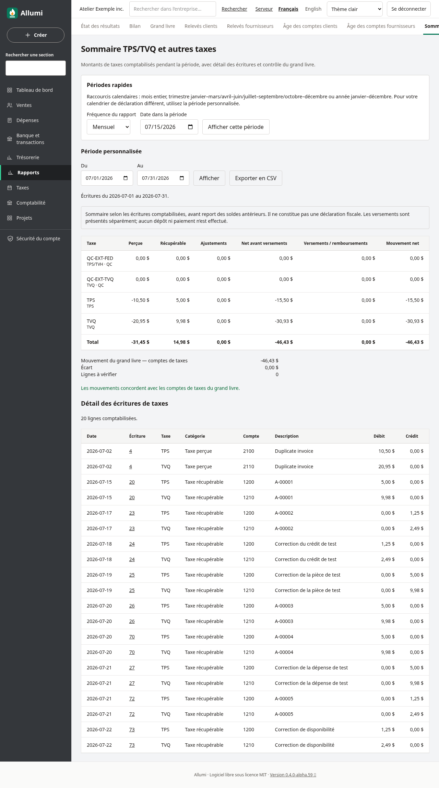
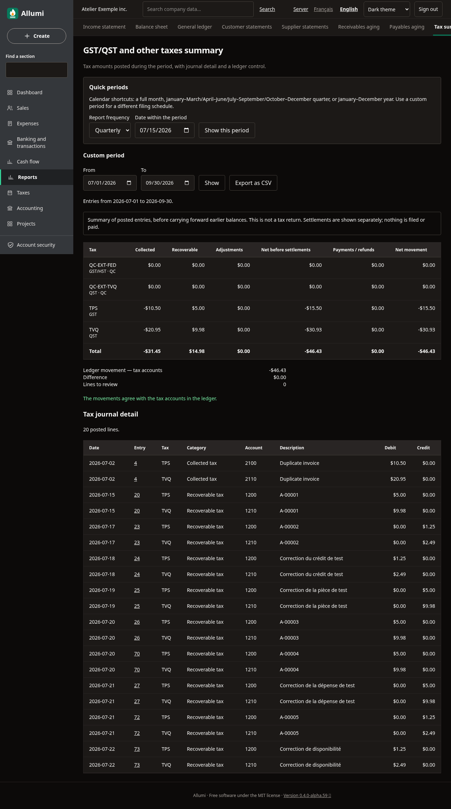
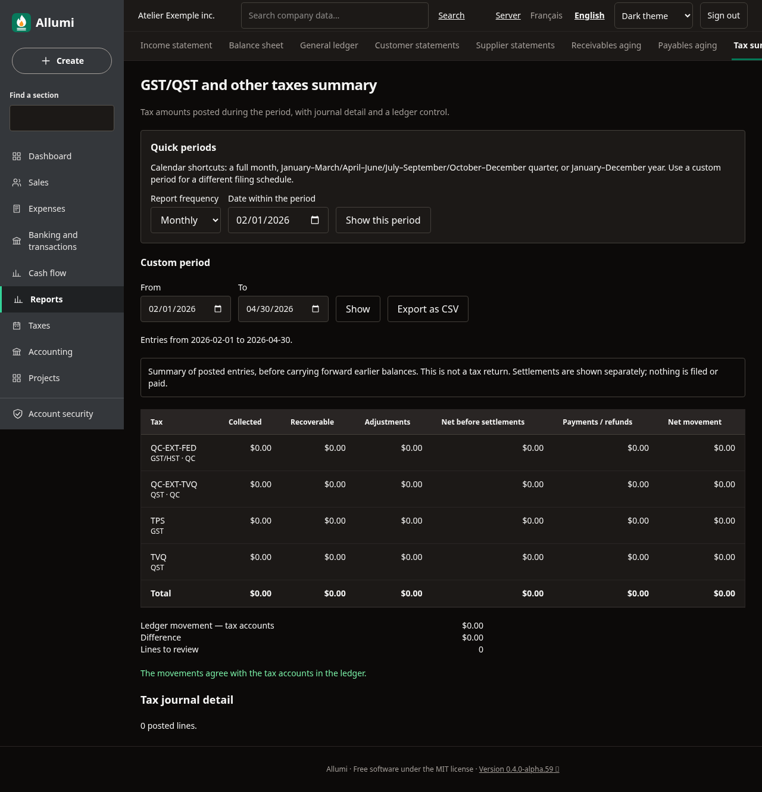
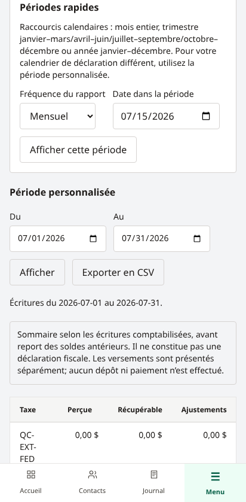
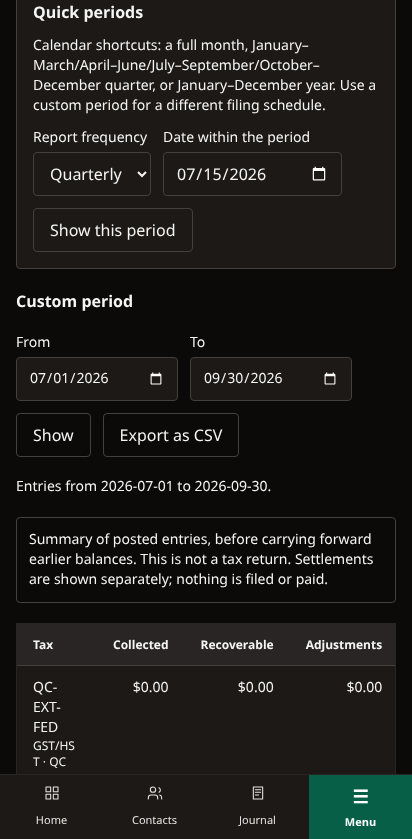
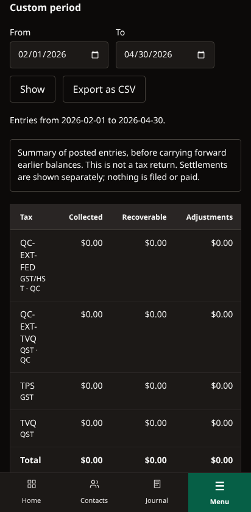

# Sommaire TPS/TVQ et autres taxes

Dans **Rapports → Sommaire TPS/TVQ**, choisis les dates **Du** et **Au**, puis **Afficher**. La consultation et le CSV exigent les permissions **Comptabilité en lecture** et **Taxes en lecture**. Les accès Ventes et Contacts ne sont pas nécessaires.

## Rapports mensuels, trimestriels et annuels

Dans **Périodes rapides**, sélectionner la **Fréquence du rapport**, une **Date dans la période**, puis **Afficher cette période**. Les bornes exactes sont affichées dans **Du / Au** :

| Fréquence | Exemple de date choisie | Période incluse |
|---|---|---|
| Mensuel | 15 juillet 2026 | 1er au 31 juillet 2026 |
| Trimestriel | 15 juillet 2026 | 1er juillet au 30 septembre 2026 |
| Annuel | 15 juillet 2026 | 1er janvier au 31 décembre 2026 |

Les mois de février tiennent compte des années bissextiles. Les trimestres rapides sont calendaires : janvier–mars, avril–juin, juillet–septembre et octobre–décembre. Ces choix ne configurent pas la fréquence de déclaration attribuée par l’ARC ou Revenu Québec.

Pour un exercice décalé, un trimestre de déclaration différent, un semestre ou toute autre plage, saisir les bornes dans **Période personnalisée**, puis **Afficher**. Par exemple, du 1er mai au 31 juillet ou du 1er avril au 31 mars suivant. Sans sélection dans l’adresse, le rapport conserve le défaut existant : exercice courant jusqu’à aujourd’hui, ou dernier exercice disponible.

Une période pas encore terminée est signalée : les écritures déjà comptabilisées ne constituent pas un rapport final de toute la période. La pagination et le CSV conservent la période choisie. Modifier un champ puis appliquer le formulaire avant d’exporter.

Les dates impossibles, plages inversées, champs de période répétés et mélanges contradictoires de raccourci et de dates personnalisées sont refusés, à l’écran comme à l’export. Le rapport ne revient pas silencieusement à une autre période.

## Comparer deux périodes

**Comparer les périodes de taxes** ouvre les montants de deux plages côte à côte, avec variations et contrôles séparés, export CSV privé et impression/PDF navigateur. La référence proposée suit le mois, trimestre ou année précédent pour un raccourci calendaire; les quatre dates restent modifiables. Voir [[Comparaison-des-taxes]].

## Ce que le sommaire calcule

Il reprend les lignes du grand livre datées de la période, pour chaque taxe configurée, y compris une taxe inactive ayant des mouvements. Il ne recalcule pas les montants avec les taux actuels et ne dépend pas du statut actuel des factures. Les dates sont inclusives.

| Colonne | Calcul à partir des écritures |
|---|---|
| Perçue | Crédits moins débits, catégorie COLLECTED |
| Récupérable | Débits moins crédits, catégorie RECOVERABLE |
| Ajustements | Crédits moins débits, catégorie ADJUSTMENT |
| Net avant versements | Perçue − récupérable + ajustements |
| Versements / remboursements | Crédits moins débits, catégorie SETTLEMENT |
| Mouvement net | Net avant versements + versements / remboursements |

Un versement comptabilisé au débit du compte de taxes apparaît donc négatif; un remboursement reçu peut apparaître positif. Le signe des ajustements reflète leur effet au grand livre. Le crédit de taxe récupérable est uniquement le montant réellement porté dans RECOVERABLE; une portion non récupérable enregistrée en charges n’est pas ajoutée.

Les avoirs et contre-passations sont pris à leur date comptable. Une facture validée en juin puis annulée en juillet reste incluse dans juin; sa contre-passation apparaît en juillet et les deux s’annulent sur une période qui les couvre. Un encaissement ou décaissement ordinaire sans ligne de taxe ne modifie pas ce sommaire.

## Portée

Le rapport est un sommaire des écritures comptabilisées, et non une déclaration officielle ou un montant final à verser. Il ne reporte pas les soldes des périodes antérieures et ne remplit pas les cases d’un formulaire fiscal. Les méthodes de calcul ou ajustements réglementaires absents des écritures ne sont pas calculés automatiquement. Aucune déclaration, date de clôture ni écriture de versement n’est créée par cette page.

Les libellés et codes des taxes sont ceux de leur configuration actuelle. Les montants proviennent des écritures immuables. Vérifie les paramètres et les écritures nécessaires à ta méthode de déclaration avant utilisation.

## Contrôle et détail

Le contrôle compare le **mouvement net** aux crédits moins débits de tous les comptes de sous-type **Taxes de vente** sur la même période. Résumé, détail et contrôle sont lus dans un seul instantané de la base.

Une ligne non classée ou portée sur un compte incohérent est signalée dans **Lignes à vérifier**, même si plusieurs anomalies s’annulent et produisent un écart nul. Une ligne sans taxe/catégorie ne peut pas être affectée à une taxe du tableau; son mouvement reste dans le contrôle. Le lien **Vérifier le grand livre** aide à l’examiner. Le rapport ne corrige aucune écriture automatiquement.

Le détail montre les lignes de taxes classées, avec date, numéro interne d’écriture, taxe, catégorie, compte, description, débit et crédit. Le numéro ouvre l’écriture. Il est paginé par 100 lignes; les totaux portent toujours sur la période entière.

## Export CSV

L’export contient le sommaire, les totaux, le contrôle, l’écart et le nombre de lignes à vérifier, puis **tout** le détail classé. Il utilise UTF-8 avec BOM, les points-virgules et virgules décimales en français, ou les virgules et points décimaux en anglais. Les textes susceptibles d’être interprétés comme des formules sont neutralisés; les montants restent exacts et numériques.

Au-delà de 200 000 lignes, le téléchargement est refusé : réduis la période. Aucun fichier partiel n’est produit. L’export n’est pas mis en cache et suit les mêmes droits que la page.

Voir [[Taxes-et-catalogue]], [[Grand-livre]], [[Regles-comptables]] et [[Utilisateurs-et-permissions]].

## Captures

## Périodes sur téléphone

